# Walkthrough Challenge 2 - Upgrading one Java app and one .NET app

[Previous Challenge Solution](../challenge-01/solution-01.md) - **[Home](../../Readme.md)** - [Next Challenge Solution](../challenge-03/solution-03.md)

## 2.1. Verify the sample repositories

Complete the [environment setup guide](../../docs/environment-setup.md) before continuing. It explains how to start the recommended GHCP App Modernization Codespace, authenticate GitHub CLI for GitHub Copilot, authenticate Azure CLI, verify the required tools, and clone the two sample applications directly from `Azure-Samples` — no forking needed; your work stays on a local `modernize` branch.

## 2.2. Set up your working directory

The recommended Codespace opens in the GHCP App Modernization hack directory, and the environment setup cloned both samples into `repos/`. From the hack directory, confirm they are present and on the `modernize` branch:

```bash
git -C repos/PhotoAlbum-Java status
git -C repos/PhotoAlbum status
```

If a repository is missing, clone it and create the working branch:

```bash
git clone https://github.com/Azure-Samples/PhotoAlbum-Java.git repos/PhotoAlbum-Java
git clone https://github.com/Azure-Samples/PhotoAlbum.git repos/PhotoAlbum
git -C repos/PhotoAlbum-Java checkout -b modernize
git -C repos/PhotoAlbum checkout -b modernize
```

The modernization CLI is already installed in the recommended Codespace. Confirm the installation and GitHub authentication:

```bash
modernize --version
gh auth status
```

For a local workstation, follow the installation instructions in the [environment setup guide](../../docs/environment-setup.md#option-b-local-workstation). We will use the modernization CLI end-to-end for upgrade, assessment, planning, and execution.

For batch operations across multiple repositories, create a JSON config file that lists them. Create it at `.github/modernize/repos.json` in the hack directory (the folder you launch `modernize` from), using local `path` entries so the CLI operates on your clones in `repos/`. Paths must be absolute — print them with:

```bash
echo "$(pwd)/repos/PhotoAlbum-Java"
echo "$(pwd)/repos/PhotoAlbum"
```

```json
{
  "repos": [
    { "name": "PhotoAlbum-Java", "path": "<absolute path to repos/PhotoAlbum-Java>" },
    { "name": "PhotoAlbum", "path": "<absolute path to repos/PhotoAlbum>" }
  ]
}
```

Reference: <https://learn.microsoft.com/azure/developer/github-copilot-app-modernization/modernization-agent/batch-assess#configure-repositories>

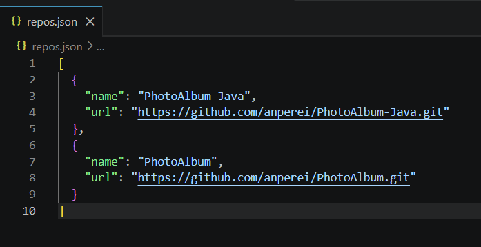

> [!NOTE]
> The screenshot shows a config that lists repository URLs. In this MicroHack you use local `path` entries instead, so the assessment and upgrades run directly on your working copies — nothing is re-cloned.

## 2.3. Run the batch assessment

From the hack directory, run the modernize CLI by typing `modernize` (verify the installation and see the available commands with `modernize --help`) and accept execution in the working directory when prompted.

Run "Assess" to analyze the code of the 2 apps and generate a report.

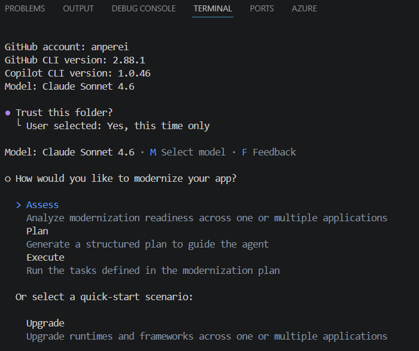

Select "From a config file".

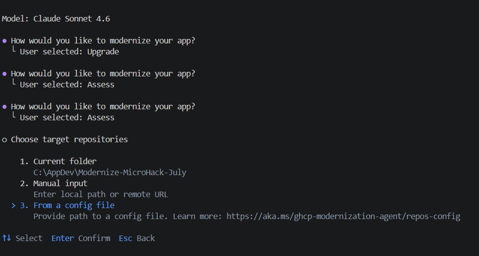

Select both apps.

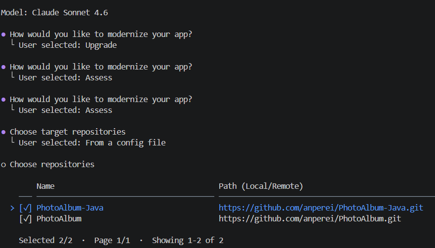

Check both "Upgrade" and "Cloud readiness". Leave "Security" unchecked.

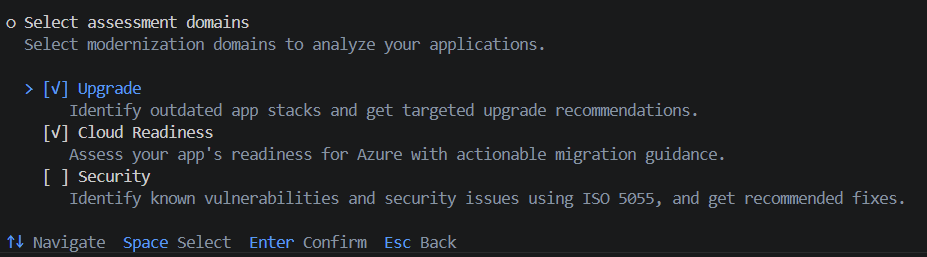

Change the Analysis coverage to "Full analysis". On the same configuration page, verify the upgrade targets before continuing: **.NET / Target Framework = .NET 10** and **Java / Target Runtime = OpenJDK 25** — the report's upgrade recommendations are driven by these values. Then press enter to continue.

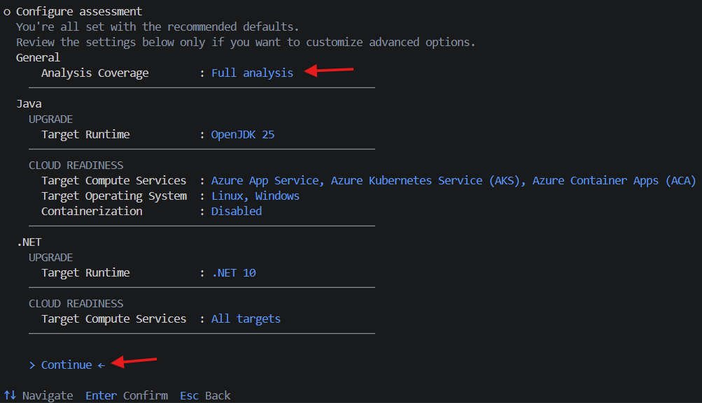

Choose to assess locally. (Cloud-agent delegation is not available in this setup — it requires github.com repository URLs, and this hack uses local `path` entries.)

> [!NOTE]
> An `assessment-config.yaml` file is generated automatically and the assessment starts on your local working copies. With Full analysis it takes roughly 10-20 minutes for the two repositories, so it's a good time to take a coffee break.

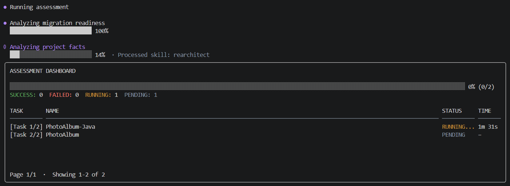


Congratulations 🎉 you have just finished the batch assessment phase. Take some time to explore the outcome results.

## 2.4. Explore the assessment results

Batch assessment is especially valuable for migration planning because it enables you to efficiently assess the readiness and requirements of various applications at once. By using batch assessment, you can evaluate different repositories at the same time and obtain detailed assessment reports for each application. It produces two kinds of reports to support your migration planning:

**Aggregated report:** Presents an overall perspective of all assessed applications, offering summary insights, recommendations on Azure services, target platforms, upgrade paths, migration strategies, and migration waves. Additionally, the aggregated report includes shortcuts for easy access to each per repository report.

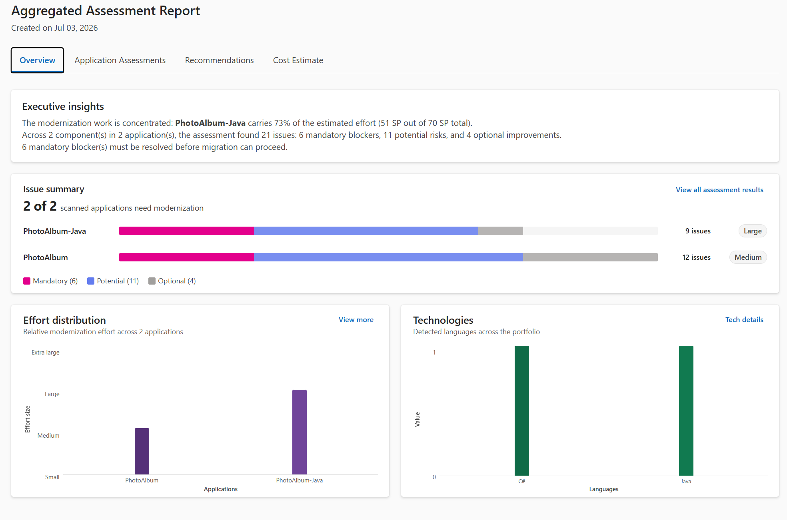

**Per repository report:** Provides detailed insights on the two aspects identified at the individual repository level.

All reports are written to **`.github/modernize/assessment/`** in the hack directory (the folder you launched `modernize` from), inside a timestamped `reports-*` subfolder: an aggregated report (`index.md`) plus one report per repository. The CLI opens the aggregated report automatically when the assessment finishes; use this path to get back to the reports later.

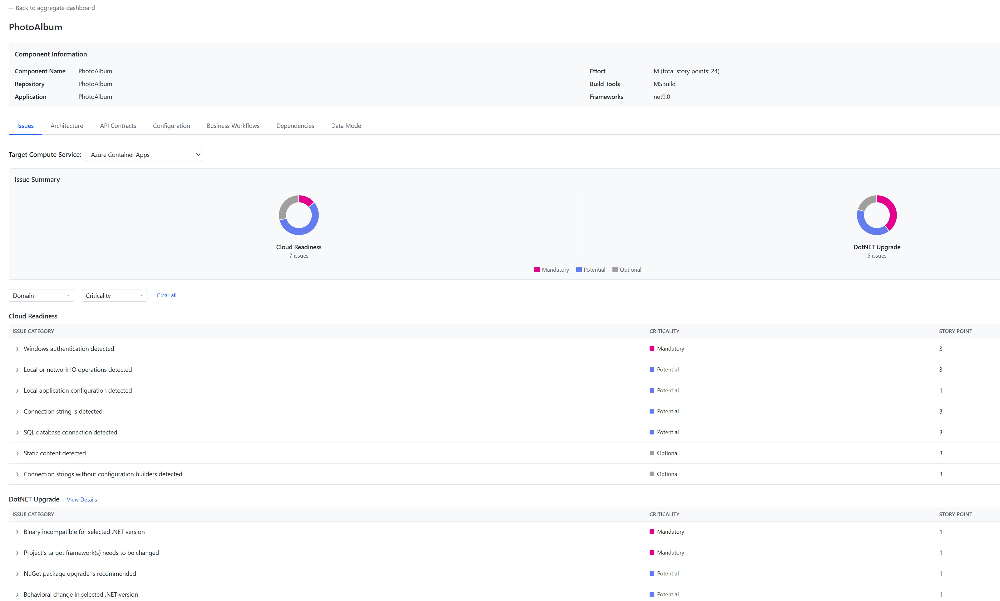

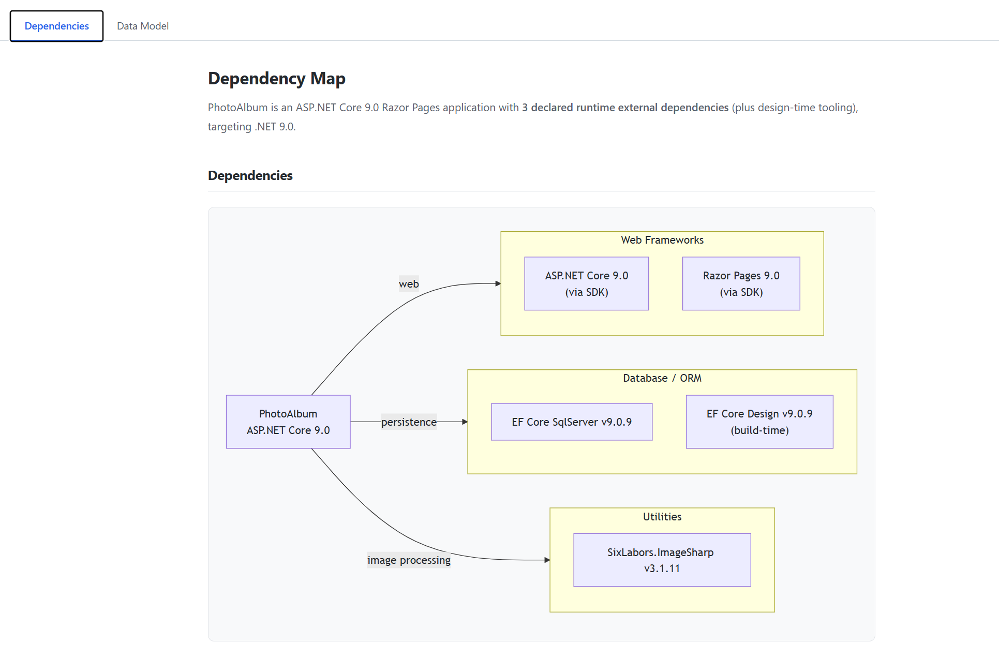

## 2.5. Upgrade each app individually

Now that we have an assessment report, we could jump straight to a modernization plan, but we want to start with an upgrade of the .NET and Java versions first.

For a batch upgrade, both repositories would need to use the same programming language, which is not the case here, so let's upgrade both apps individually.

When the assessment finishes, the CLI asks how to continue — select **Return to main menu** (creating a modernization plan is the subject of Challenge 3). Exit the modernize CLI, navigate to the folder of the PhotoAlbum (.NET) and relaunch the modernize CLI.

Select the Upgrade option, current folder, and upgrade locally.

In the prompt box, submit the following prompt: "Upgrade to .NET 10", as recommended previously in our assessment report.

The modernize CLI immediately starts creating an upgrade plan, followed by execution of the necessary code changes.

Check the resulting Plan Execution Summary for each app. Upgrade should show "Success".

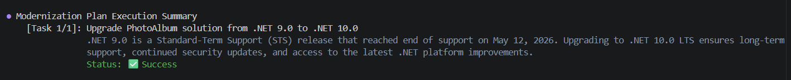

Navigate to the PhotoAlbum-Java directory and repeat the same process for the Java version of the app. Use the following prompt: "Upgrade to Java 25 and upgrade to Spring Boot 4.0", as recommended previously in our assessment report.

Exit the modernize CLI, navigate to each app folder, and commit your changes on the `modernize` branch (the upgrade may already have created commits — check with `git log`). The upstream `Azure-Samples` repositories are read-only for you, so there is nothing to push; if you want a remote copy, publish a repository to your own account with `gh repo create <name> --source=. --private --push`.

> [!WARNING]
> The sample repositories ship with pre-existing example content under `.github/` (agents, prompts, and several GitHub Actions workflows). If you publish a copy to your own account, delete `.github/workflows/` first — otherwise those workflows start running on your account, and pushing workflow files requires the `workflow` scope on your GitHub CLI credential.

Congratulations 🎉 your apps are now upgraded and you have completed challenge 2.

You are now ready to initiate challenge 3 - modernize your upgraded apps and deploy them in Azure.
