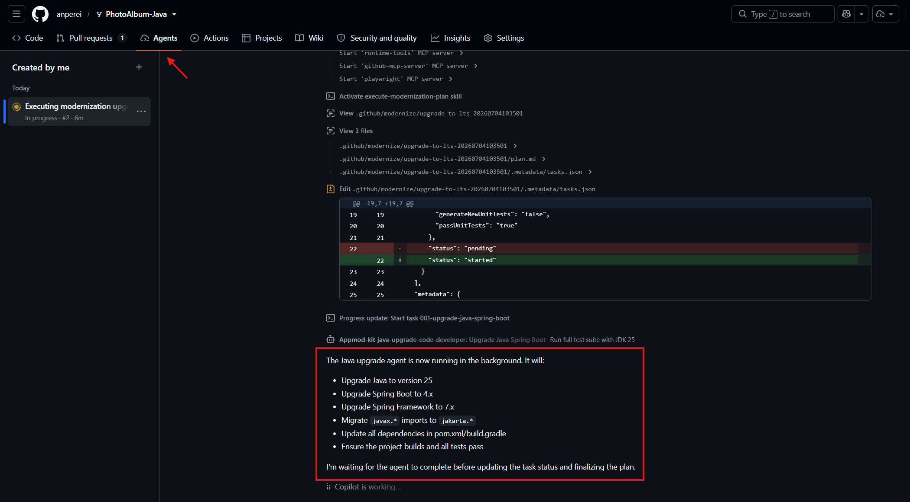
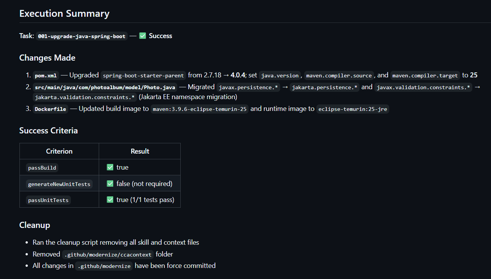
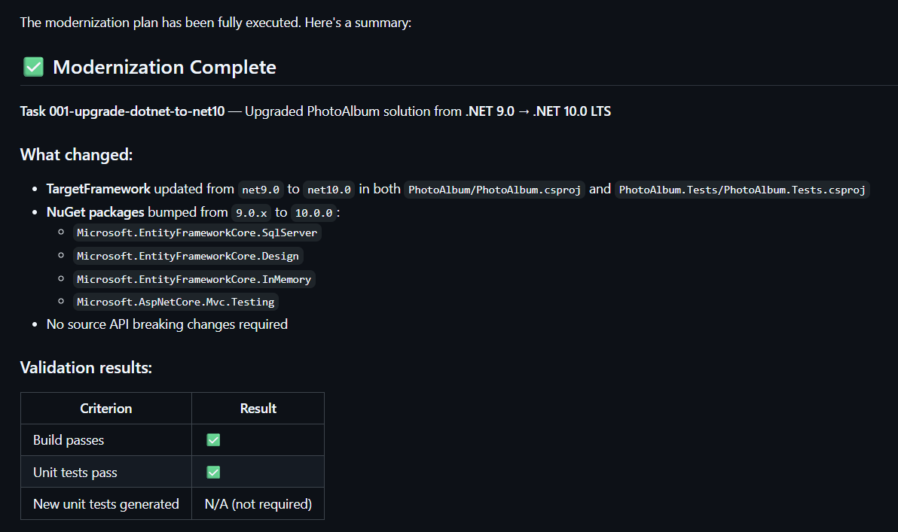
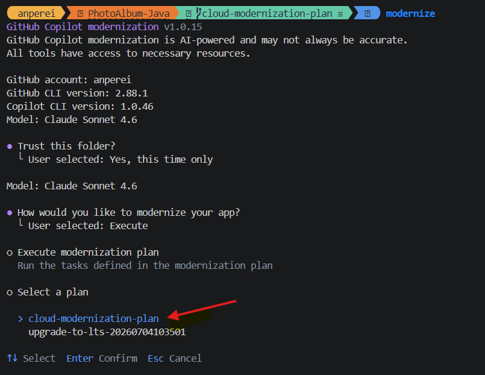
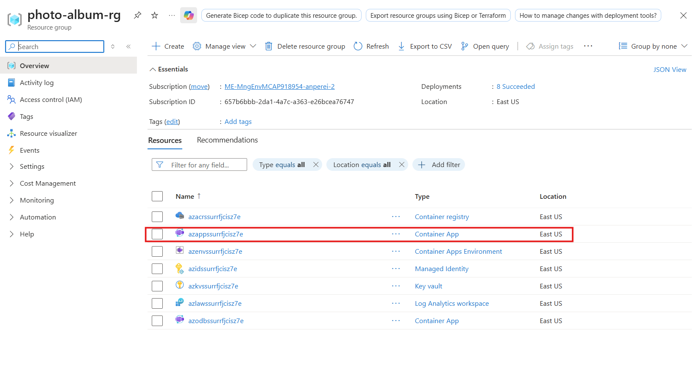
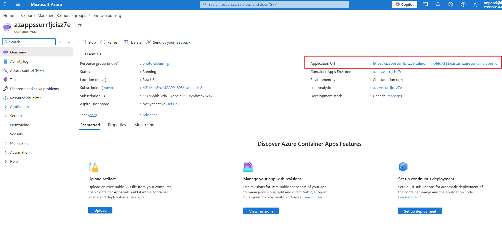
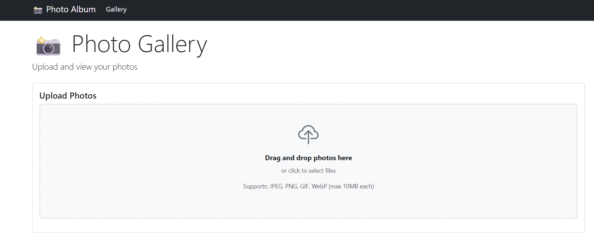
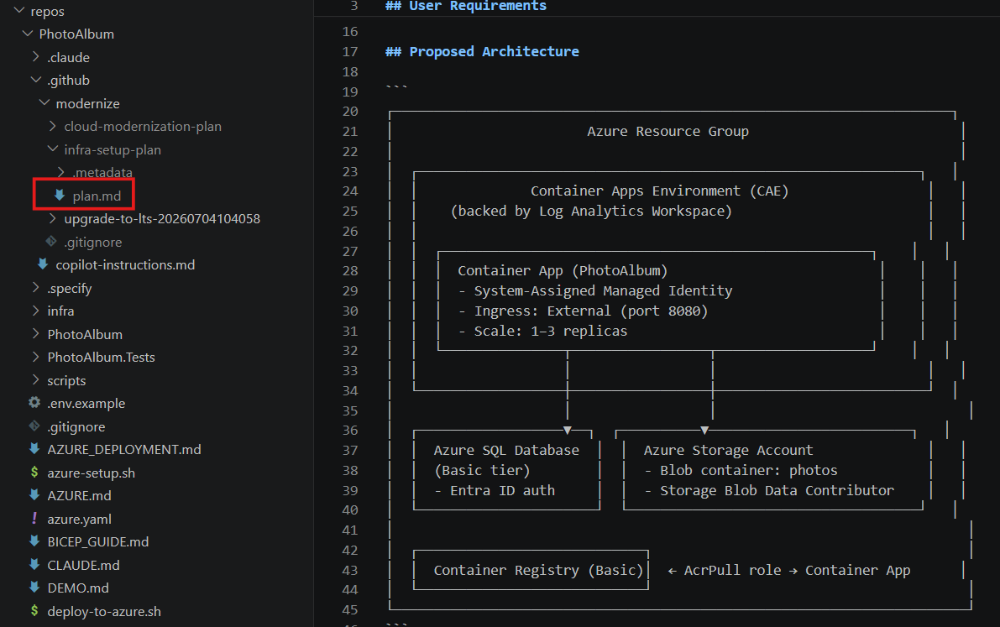

# Walkthrough Challenge 3 - Modernize your upgraded apps and deploy them in Azure

[Previous Challenge Solution](../challenge-02/solution-02.md) - **[Home](../../Readme.md)**

## 3.1. Create the cloud modernization plan

From the hack directory, launch the modernize CLI and select the **Plan** option. Choose **From a config file** — the CLI auto-detects the `.github/modernize/repos.json` you created in Challenge 2 — and select both apps. Choose **Keep the plan local** and name the plan `cloud-modernization-plan`.

Type the following instruction in the prompt: "An assessment has been previously completed for both apps, but after that both apps have been upgraded to their latest respective framework versions. In this plan, you should ignore any upgrade recommendations in the existing assessment report. You should focus on resolving the cloud readiness issues, set up Azure infrastructure for each app, and deploy the App on Azure. If OracleDB exists, migrate to PostgreSQL."

Answer the clarifying questions the agent asks about your goals, then let it generate the plans.

> [!NOTE]
> Generating the plans should take about 15-20 min. Once finished, you should see a series of tasks to be executed.

## 3.2 Review the generated plans

A plan is generated locally inside each repository: open `repos/<app>/.github/modernize/cloud-modernization-plan/plan.md` (the task list sits next to it in `.metadata/tasks.json`). Review the strategy and tasks for each app, and edit the files if you want to adjust the approach before execution — the plans are plain local files in each repository's working tree (the CLI git-ignores them); nothing is committed or pushed anywhere.

## 3.3 Deploy the PhotoAlbum-Java app

Navigate to `repos/PhotoAlbum-Java`, launch the modernize CLI, select **Execute**, and pick the `cloud-modernization-plan`.

Plan execution will start. Wait for all tasks to complete. It may take a while. Maybe a good time to stretch your legs.

> [!NOTE]
> You have Owner rights on the lab subscription, so the agent can provision into a resource group it creates (as shown below). If you prefer to deploy into your pre-created lab resource group instead, add `resource group: <your-resource-group>` to the plan prompt in step 3.1.

Once finished, check the resource group on Azure with the deployed resources. Next, open the Frontend Container app URL.

Congratulations! 🎉 You managed to migrate and deploy in Azure the upgraded PhotoAlbum-Java app.

## 3.4 Deploy the PhotoAlbum (.NET) app

Now, let's migrate and deploy in Azure the .NET version of the app. Navigate to `repos/PhotoAlbum`, launch the modernize CLI, select **Execute**, and pick the `cloud-modernization-plan`.

Plan execution will start. Wait for all tasks to complete. It may take a while.

Notice this plan didn't create the infrastructure code nor deployed any resource in Azure. Let's create another plan and be explicit in our prompt.

Create a new plan, locally this time, name it `infra-setup-plan`, and use the following prompt: "Provision Azure resources and deploy the app."

Wait for the plan to be generated. Once finished, you can check the plan at `.github/modernize/infra-setup-plan`.

Finally, execute the plan. Plan execution will start. Wait for all tasks to complete.

> [!WARNING]
> The .NET app's Release container build can fail with a **Six Labors (ImageSharp) license** error — ImageSharp 3.2+ (pulled in by the Challenge 2 security fixes) enforces license checks in Release builds. Get a free community key from <https://licensing.sixlabors.com/> and set the `SixLaborsLicenseKey` build property, or instruct the agent to publish a Debug build for this lab.

Once finished, check the resource group on Azure with the deployed resources. Next, open the Frontend Container app link.

> [!TIP]
> If you get any deployment error, use GitHub Copilot CLI to diagnose and help you fix it — the Azure MCP server you configured in Challenge 1 (`.github/mcp.json`) lets it query your Azure resources directly.

Congratulations! 🎉 You managed to migrate and deploy in Azure the upgraded PhotoAlbum (.NET) app, and finish the challenge 3 successfully!
