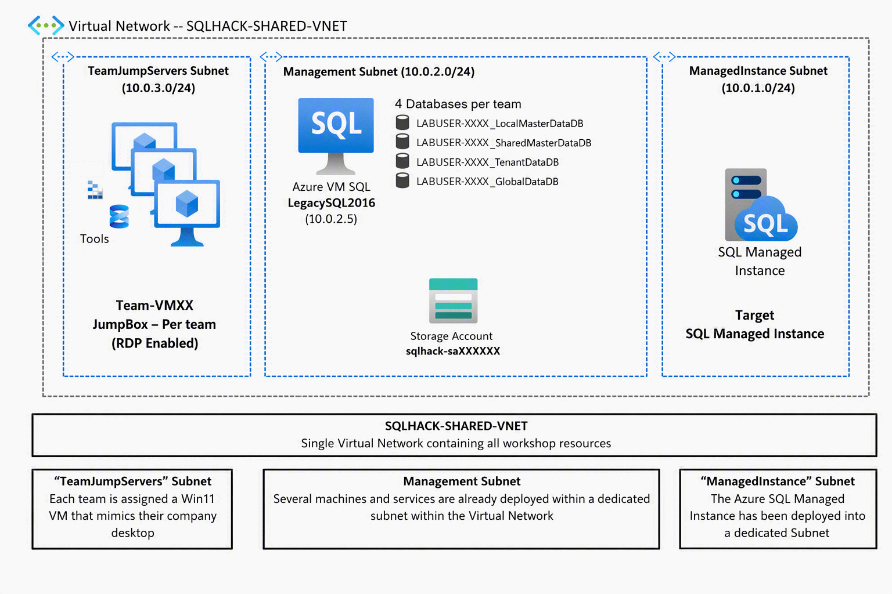

# Challenge 2 - Monitoring and Performance on Azure SQL Managed Instance

[Previous Challenge Solution](challenge-01.md) - **[Home](../Readme.md)** - [Next Challenge Solution](challenge-03.md)

## Lab environment

All workshop resources are deployed into one Virtual Network (**SQLHACK-SHARED-VNET**) with three subnets:

* **TeamJumpServers subnet**: Every team has its own Windows 11 VM (**Team-VMXX**, accessible via Azure Bastion/RDP). It mimics your company desktop and has SQL Server Management Studio (SSMS) installed. You do all your work from this VM.
* **Management subnet**: The **LegacySQL2016** Azure VM mimics your on-premises SQL Server 2016. It hosts **4 databases per team** (*LABUSER-XXXX_LocalMasterDataDB*, *LABUSER-XXXX_SharedMasterDataDB*, *LABUSER-XXXX_TenantDataDB* and *LABUSER-XXXX_GlobalDataDB*). A storage account is only used during the deployment of the lab.
* **ManagedInstance subnet**: The **Azure SQL Managed Instance** is the migration target. It is shared by all teams.

> ## ⚠️ WARNING - Only work with the databases of YOUR team!
>
> The Azure SQL Managed Instance is **shared with the other teams**.
>
> * 🚫 **Do NOT change, migrate, link, fail over, delete or otherwise touch databases of other teams.**
> * 🆔 **Know your team name!** It starts with **LABUSER-XXXX** and is the prefix of your database names. Always check it before you select or change a database.

## Goal 

The goal of this exercise is to understand monitoring and perfomance optimzation on an Azure SQL Managed Instance. 

## Actions

* Identifying performance issues, their root causes and fixing the problem
* Use the Azure Portal to identify performance bottlenecks
* Using Log Analytics with KQL to visualize Azure SQL MI and database stats
* Use Github Copilot to identify and mitigate performance issues on your Azure SQL MI

## Success criteria

* You have identifed the most consuming stored procedure based on the total_worker_time (CPU)
* You successfully reviewed the performance graph showing CPU utilization in the Azure Portal
* You have successfully queried the AzureDiagnostics using KQL to receive the different diagnostics
* You have successfully leveraged Github Copilot to identify and mitigate the most important performance issues on your Azure SQL MI

## Learning resources
* [Monitor Azure SQL Managed Instance - Azure SQL Managed Instance](https://learn.microsoft.com/en-us/azure/azure-sql/managed-instance/monitoring-sql-managed-instance-azure-monitor?view=azuresql)

