# Walkthrough Challenge 2 - Monitoring and Performance on Azure SQL Managed Instance with GitHub Copilot

[Previous Challenge Solution](../challenge-01/solution-01.md) - **[Home](../../Readme.md)** - [Next Challenge Solution](../challenge-03/solution-03.md)

## Monitoring and Performance on Azure SQL Managed Instance with GitHub Copilot

In this challenge **GitHub Copilot is your main tool for finding and fixing performance problems**. You will start with a few prompting basics, then use Copilot to find the bottleneck, understand the root cause, write KQL queries, and fix the problem. The classic tools (DMVs, Query Store, Azure Portal, Log Analytics) are still part of the walkthrough, and you use them to **verify what Copilot tells you**.

### Contents

[Migration architecture and Azure components](#migration-architecture-and-azure-components)

[Lab Overview & Background](#lab-overview--background)

[1. Preparation](#1-preparation)
* [1.1 Connect to the Managed Instance and open the TenantCRM database](#11-connect-to-the-managed-instance-and-open-the-tenantcrm-database)
* [1.2 Open the GitHub Copilot chat](#12-open-the-github-copilot-chat)

[2. Prompting basics: how to talk to GitHub Copilot](#2-prompting-basics-how-to-talk-to-github-copilot)

[3. Find the performance bottleneck with GitHub Copilot](#3-find-the-performance-bottleneck-with-github-copilot)

[4. Verify with DMVs and the Query Store](#4-verify-with-dmvs-and-the-query-store)

[5. Analyze the performance in the Azure Portal](#5-analyze-the-performance-in-the-azure-portal)

[6. Visualize SQL MI and database stats with Log Analytics and KQL](#6-visualize-sql-mi-and-database-stats-with-log-analytics-and-kql)

[7. Fix the performance issue with GitHub Copilot](#7-fix-the-performance-issue-with-github-copilot)

[8. Deepen your understanding with GitHub Copilot](#8-deepen-your-understanding-with-github-copilot)
* [8.1 Which monitoring options exist?](#81-which-monitoring-options-exist)
* [8.2 Query Store, plans and regressions](#82-query-store-plans-and-regressions)
* [8.3 Waits and resource limits](#83-waits-and-resource-limits)
* [8.4 Indexes and statistics](#84-indexes-and-statistics)
* [8.5 Blocking, deadlocks and Extended Events](#85-blocking-deadlocks-and-extended-events)
* [8.6 Alerts, baselines and dashboards](#86-alerts-baselines-and-dashboards)
* [8.7 Scaling and cost](#87-scaling-and-cost)
* [8.8 Using Copilot responsibly](#88-using-copilot-responsibly)

[Prompt cheat sheet](#prompt-cheat-sheet)

# Migration architecture and Azure components

# Lab Overview & Background

In this exercise you will explore how you can monitor and diagnose performance issues with Azure SQL Managed Instance using GitHub Copilot, SQL Server Management Studio, DMVs (Dynamic Management Views) and Azure Portal tools.

## Background

We have seen that the legacy application is a multi-tenant system with a collection of 4 databases supporting the transactional workload for each customer – these are the 4 databases we have modernised by migrating to the shared Azure SQL Managed Instance.

Apart from the tenant centric transactional databases there are 2 shared databases:

* **SharedMasterDataDB**: A centralised Data Warehouse database that combines data from the various tenant transactional databases and is used for aggregated reporting and analytics.
* **TenantCRM**: A centralised database that is used to manage all customer relationships and order processing.

Recently you have heard complaints from users that the TenantCRM system is running slowly. Recently changes were made to some of the stored procedures in the TenantCRM database and the App dev team believe these are the source of the problem. They’ve asked for your help to track down the performance issues and its root cause.

> **Note:** The exercises in this lab are conducted against the shared **TenantCRM** database.

Performance issues in SQL Server can be grouped into 1 of 2 high-level categories: *Running* or *Waiting*.

*Running* means a query has been allocated CPU resource and is actively processing but is taking a long time to complete. *Waiting* means a query is not actively being processed by the CPU but is waiting on another resource (such as memory, disk, network, etc) to pass data in so processing can continue.

Finding the bottleneck will help us determine what category issue we have so we can progress to identifying the root cause.

# 1. Preparation

## 1.1 Connect to the Managed Instance and open the TenantCRM database

|**Narrative/Instructions**| **Screenshot**| **Notes**|
|:------------|:--------------|:---------|
|On your Team Win11 VM open **SQL Server Management Studio (SSMS)** and connect to the Azure SQL Managed Instance XXXXXX. **Authentication: Microsoft Entra MFA** **Login:** **<secret group="Azure" name="Entra ID Username" show="true"></secret>** **TAP:**  **<secret group="Azure" name="Entra ID TAP"></secret>**| ****|If SSMS is not connected to your Azure and GitHub accounts anymore, repeat the account steps from [Challenge 1](../challenge-01/solution-01.md#12-connect-ssms-with-your-azure-and-github-copilot-accounts).|
|In Object Explorer expand **Databases**, right-click **TenantCRM** and select **New Query**. Make sure the query window is connected to the **TenantCRM** database.||Copilot uses the connection of the active query window as context.|

## 1.2 Open the GitHub Copilot chat

|**Narrative/Instructions**| **Screenshot**| **Notes**|
|:------------|:--------------|:---------|
|Open the GitHub Copilot chat window in SSMS and verify that you are signed in.|||
|Verify that Copilot sees your database context by asking a first question.|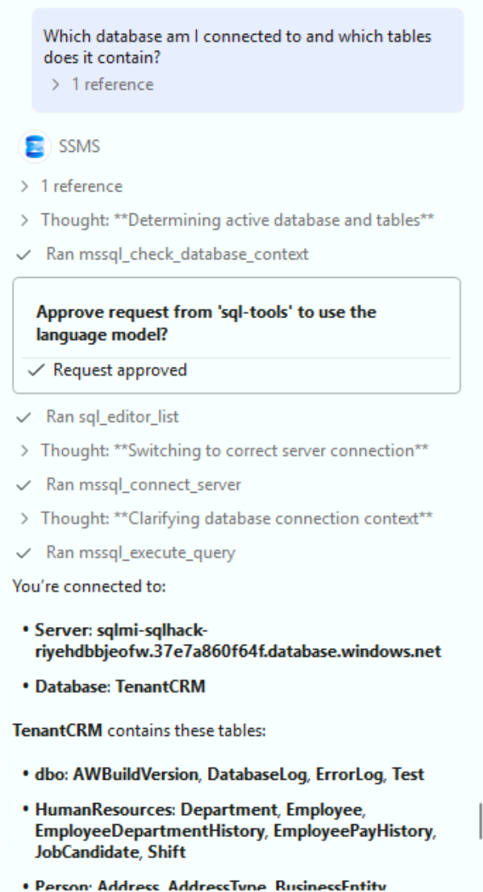|**Prompt**: *"Which database am I connected to and which tables does it contain?"*|

# 2. Prompting basics: how to talk to GitHub Copilot

The quality of the answer depends on the quality of your question. Before you start, try the same task with a weak and with a strong prompt and compare the results.

| Principle | Weak prompt | Better prompt |
|:----------|:------------|:--------------|
| **Be specific about the target** | *"Why is it slow?"* | *"Why is the TenantCRM database on my Managed Instance slow?"* |
| **Describe the symptom** | *"Check performance."* | *"Users report that TenantCRM is slow since the last stored procedure changes. Check the CPU usage and find the cause."* |
| **Ask for evidence** | *"Fix my query."* | *"Show me the query or DMV you used to find this and explain what the numbers mean."* |
| **Ask for an explanation** | *"Create an index."* | *"Explain why this index helps and what the trade-offs are before you create it."* |
| **Iterate with follow-ups** | *(one single prompt)* | *"Now show me the second most expensive procedure."* |
| **Review before you run** | *(execute everything)* | *"Show me the script first. Do not change anything yet."* |

|**Narrative/Instructions**| **Screenshot**| **Notes**|
|:------------|:--------------|:---------|
|Send a **vague** prompt to Copilot and look at the answer.|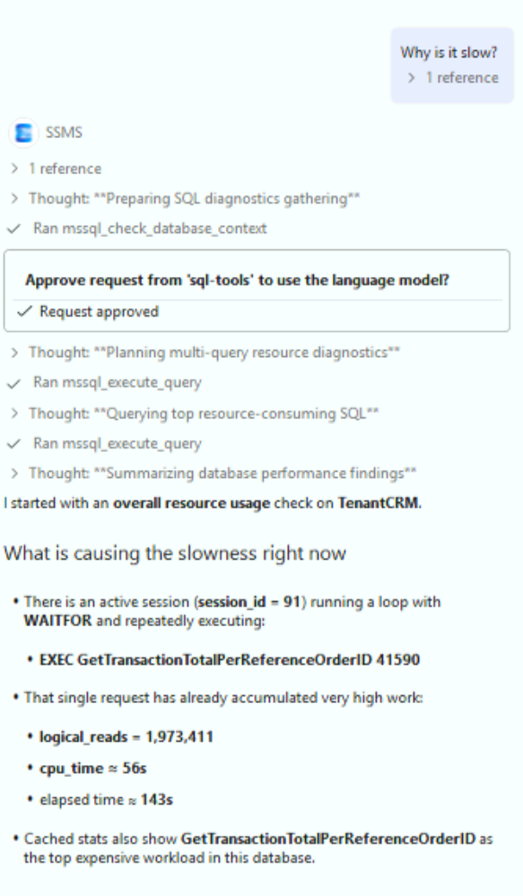|**Prompt**: *"Why is it slow?"*|
|Now send a **specific** prompt that contains the database, the symptom and the expected result. Compare the two answers.|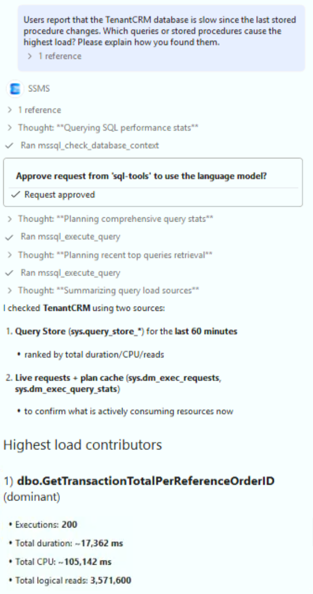|**Prompt**: *"Users report that the TenantCRM database is slow since the last stored procedure changes. Which queries or stored procedures cause the highest load? Please explain how you found them."*|

> **Tip:** Copilot may ask for approval before it runs queries against your database. Please read what is executed and approve the requests. Copilot should only read data and metadata in this challenge unless you tell it to change something.

# 3. Find the performance bottleneck with GitHub Copilot

|**Narrative/Instructions**| **Screenshot**| **Notes**|
|:------------|:--------------|:---------|
|Ask Copilot to analyze the load of the database. Enter a prompt similar to the following into the GitHub Copilot chat window.|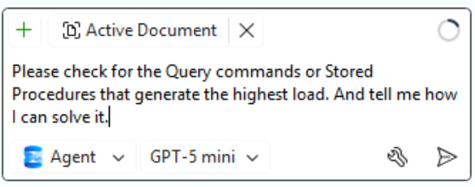|**Prompt**: *"Please check for queries or stored procedures with the highest load in the TenantCRM database and suggest solutions for possible performance issues."*|
|GitHub Copilot may request approval several times to execute queries to analyze the problem. Please approve the requests.||**Note**: Look at the queries Copilot executes. You will recognize DMVs such as `sys.dm_exec_query_stats` and the Query Store views.|
|Ask Copilot to explain the category of the problem.|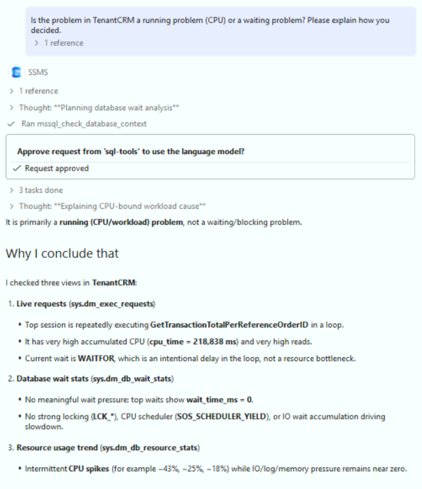|**Prompt**: *"Is the problem in TenantCRM a running problem (CPU) or a waiting problem? Please explain how you decided."*|
|Ask Copilot to rank the most expensive stored procedures.|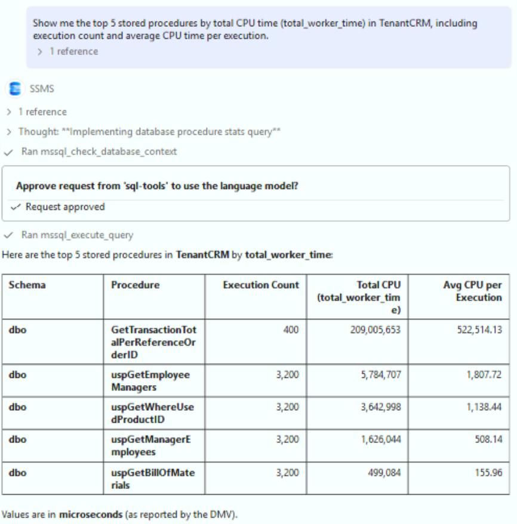|**Prompt**: *"Show me the top 5 stored procedures by total CPU time (total_worker_time) in TenantCRM, including execution count and average CPU time per execution."*|
|Note the name of the most CPU consuming stored procedure. You will need it in the next steps.|||

# 4. Verify with DMVs and the Query Store

GitHub Copilot is a great assistant, but you should **always verify** its findings. In this section you reproduce the result with the lab scripts and the built-in Query Store reports. Use Copilot to explain what you see.

|**Narrative/Instructions**| **Screenshot**| **Notes**|
|:------------|:--------------|:---------|
|**Open** the SQL script:  C:\\MicroHack\\LABS\\02-Administering_Monitoring\\Part_01_Monitoring_Lab_1.sql          **Note:** Make sure you connect with the **TenantCRM** database.          Run the **PART 1** QUERY 1.  Look at the results and note the [avg_cpu_percent] value is spiking many times indicating that this database is consuming a lot of the hosts CPU resources|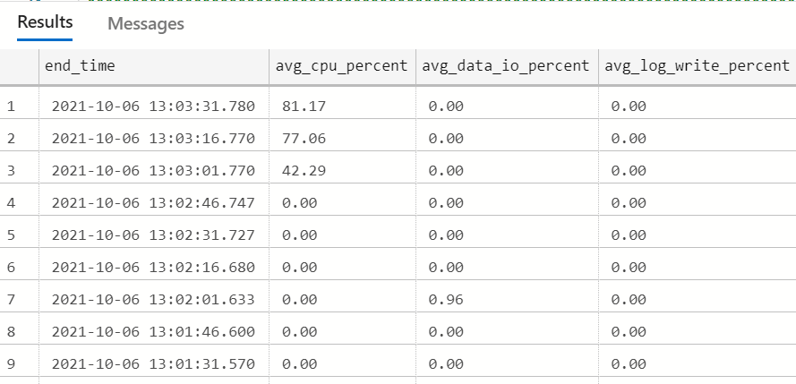| [[sys].[dm_db_resource_stats]](https://docs.microsoft.com/en-us/sql/relational-databases/system-dynamic-management-views/sys-dm-db-resource-stats-azure-sql-database?view=azuresqldb-current) exposes a number of key database performance metrics.  One metric every 15 seconds over the last hour. **Prompt**: *"Explain the result of this query and what the avg_cpu_percent column tells me."* (select the query in the editor first)|
|Now let’s try the second query to analyze the resource consumption.     **Execute** QUERY 2 and analyze the values during the last minutes. You will see spikes in CPU consumption.|| If more than 1 hour of statistics is needed, use the DMV [[sys].[server_resource_stats]](https://docs.microsoft.com/en-us/sql/relational-databases/system-catalog-views/sys-server-resource-stats-azure-sql-database?view=azuresqldb-current) up to 14 days. **Prompt**: *"How can I look at more than one hour of CPU history on a Managed Instance?"*|
|**Open** the SQL script:  C:\\MicroHack\\LABS\\02-Administering_Monitoring\\Part_02_Monitoring_Lab_1.sql          **Note:** Make sure you connect with the **TenantCRM** database.          **Run** the **PART 2** QUERY 1.  Identify the most consuming stored procedure based on the total_worker_time (CPU). Compare the result with the answer from Copilot.|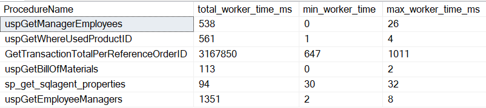|**Prompt**: *"Does this result match your analysis? If not, explain the difference."*|
|Then to have further details on the most consuming stored procedure **Run** the **PART 2** QUERY 2, replace the filter clause with the stored procedure name. What is the issue? How to optimise?  **Tip:** Have a look to the execution plan| **CROSS APPLY and Table-valued Functions**  The PART 2 query joins the [sys].[dm_exec_requests] and [sys].[dm_exec_sql_text] DMVs to obtain long running batches and critically their offending SQL.  Note that [dm_exec_sql_text] is actually a table-valued function (TVF) hence the use of the CROSS APPLY as TVFs can't be used in a normal join operation. The CROSS APPLY therefore produces the required inner-join between [dm_exec_requests] and [dm_exec_sql_text].  See APPLY documentation here: [Using APPLY \| Microsoft Docs](https://docs.microsoft.com/en-us/previous-versions/sql/sql-server-2008-r2/ms175156(v=sql.105)?redirectedfrom=MSDN) and this excellent explanation on MSSQLTips: [SQL Server CROSS APPLY and OUTER APPLY (mssqltips.com)](https://www.mssqltips.com/sqlservertip/1958/sql-server-cross-apply-and-outer-apply/#:~:text=The%20CROSS%20APPLY%20operator%20returns%20only%20those%20rows,rows%20for%20the%20left%20table%20expression%20match%20only.) **Prompt**: *"Why is this stored procedure so expensive? Please look at its code and its execution plan."*||
| In SSMS expand the [TenantCRM] database then expand Query Store.Remember that the Query Store collects telemetry data every 15 seconds and persists it for about 1hr.  Double click on **Overall Resource Consumption** report to open it.| 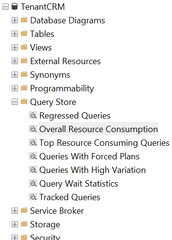||
| For further details CPU Time, double click on the current day bar| 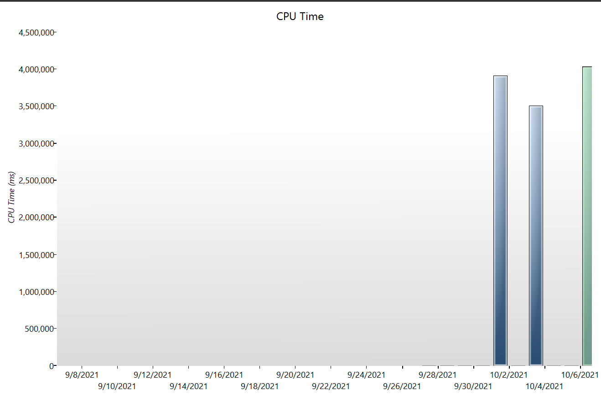||
| You can identify the top CPU consuming queries.  Click on bars for more details| 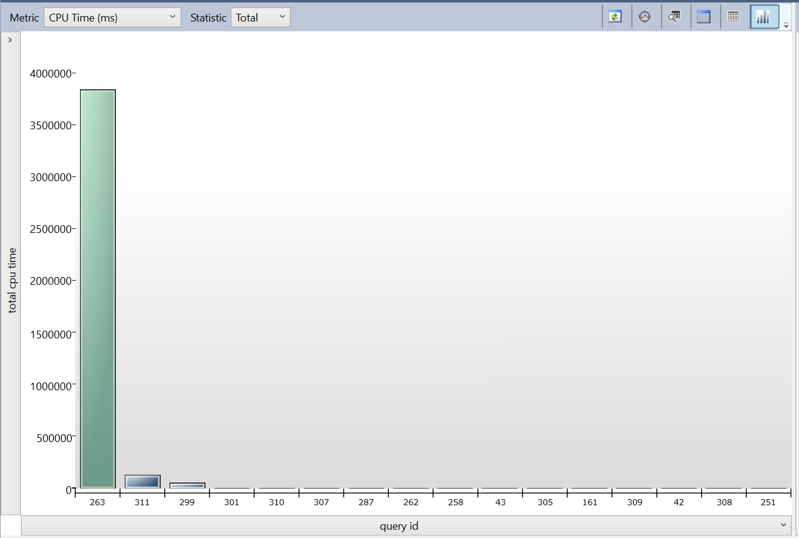 |**Prompt**: *"What is the Query Store and how does it help me to find regressed queries?"*|

# 5. Analyze the performance in the Azure Portal

As we are using Azure SQL Managed Instance we can also use the richness of the Azure Portal to help us to troubleshoot performance issues. GitHub Copilot in SSMS cannot see the Azure Portal, so use it here as a **guide that explains the metrics** while you look at the portal.

|**Narrative/Instructions**| **Screenshot**| **Notes**|
|:------------|:--------------|:---------|
| Open the Azure Portal (portal.azure.com) and open the shared SQL Managed Instance.  Scroll down the **Overview** screen until you see the performance graph showing CPU utilization.  Toggle the switches next to view CPU consumption over 1 hour, 24 hours and 7 days.   Has the CPU usage pattern changed over time?     | 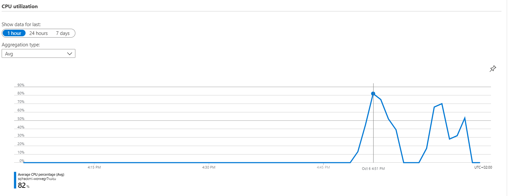 |**Prompt**: *"Which metrics of an Azure SQL Managed Instance should I check first when users report a slow database, and what do they tell me?"*|
| Click into the graph to go into Metrics chart screen. Here you have more flexibility over the data being reported and the format of the chart. Let’s add Storage Space Used the chart.   Click **Add Metric**   In the Metric drop down select **Storage Space Used**.  .  | 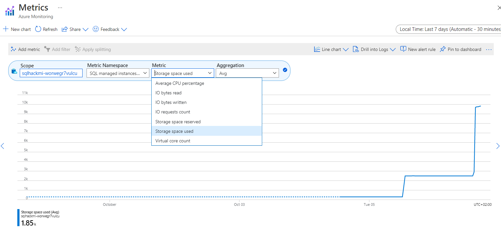 | Notice that from the chart screen you can alter the type of chart (Line, Area, Bar, Scatter to data Grid), set up alerts, and pin the chart to your Azure Portal dashboard. |
| Click **Local Time** on the top right of the chart to view the data for various time intervals.|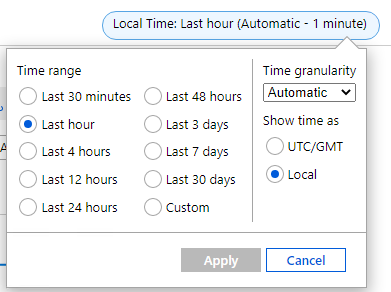||
|Describe what you see in the chart to Copilot and ask for an interpretation.|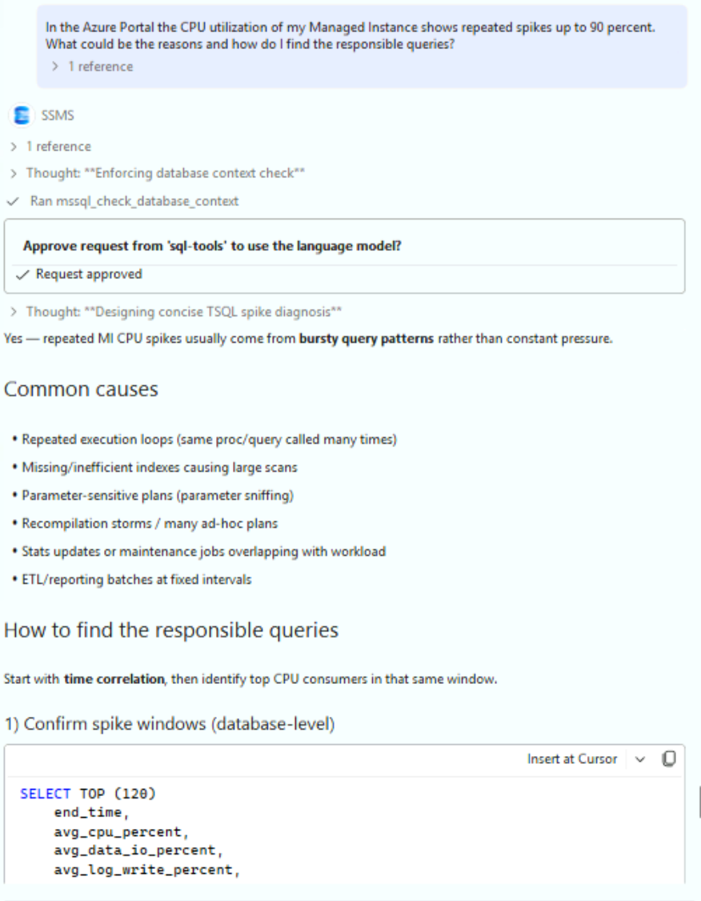|**Prompt**: *"In the Azure Portal the CPU utilization of my Managed Instance shows repeated spikes up to 90 percent. What could be the reasons and how do I find the responsible queries?"*|

# 6. Visualize SQL MI and database stats with Log Analytics and KQL

Now that we can use the global monitoring tool Log Analytics to identify which SQL Managed Instance consumes the resources, let Copilot help you with the Kusto Query Language (KQL).

|**Narrative/Instructions**| **Screenshot**| **Notes**|
|:------------|:--------------|:---------|
|This time we will be using Copilot from Azure Portal.|||
|Ask Copilot to generate a KQL query for you.|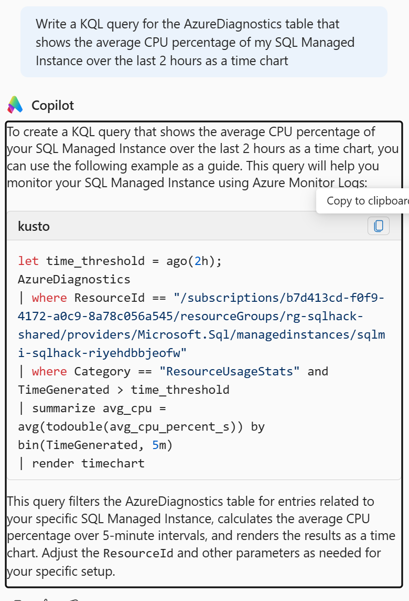|**Prompt**: *"Write a KQL query for the AzureDiagnostics table that shows the average CPU percentage of my SQL Managed Instance over the last 2 hours as a time chart."*|
|On the Azure Portal, on the SQL Managed Instance Resource, **click on Logs** on the left Menu. You will find several query templates You can test the **CPU utilization threshold template** And modify the parameters if needed.|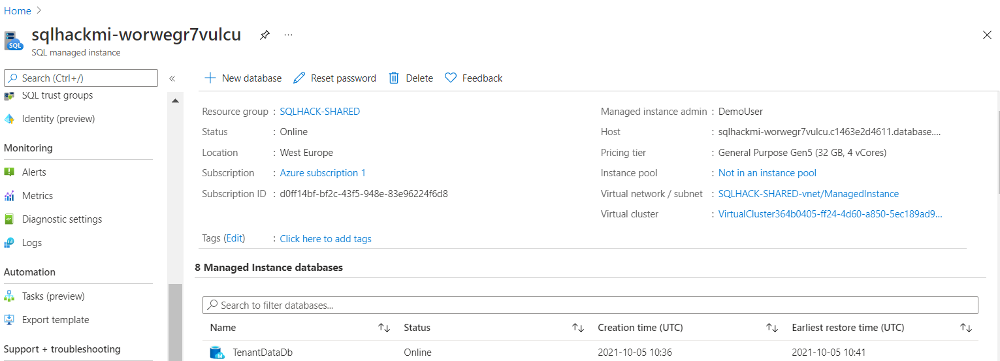||
||**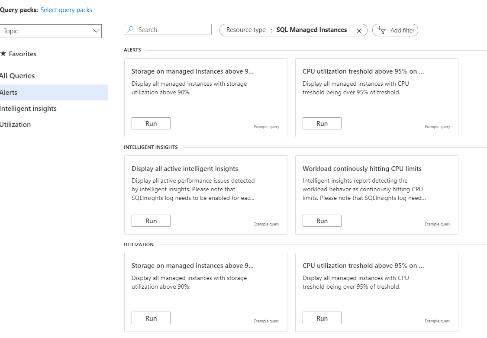**||
|Create a new Query| 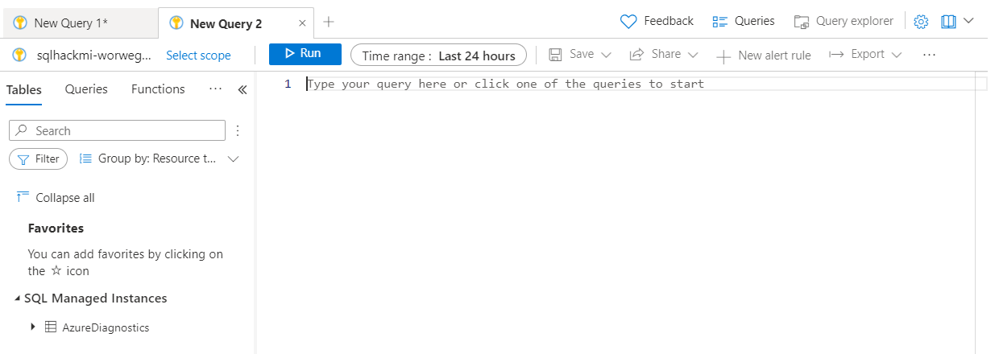||
|Paste the query from Copilot and run it|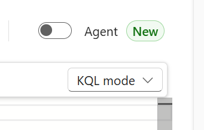 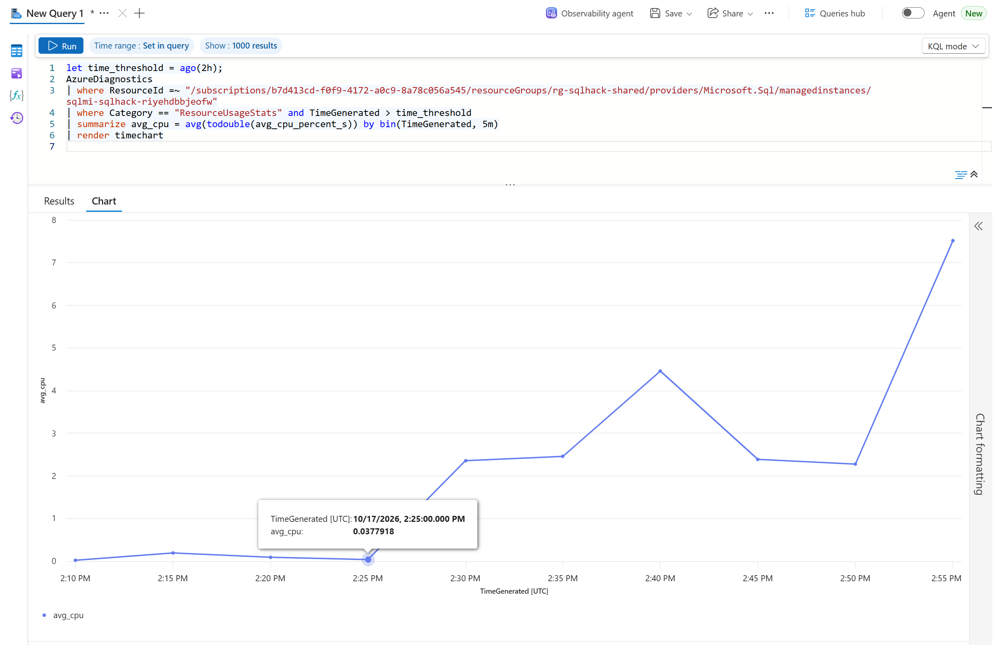||
|Try the following queries (replace the SQLMI name). AzureDiagnostics is the table receiving the different diagnostics. Modify the Time Range, By default 24hours     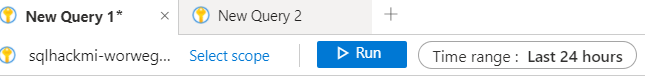|//general queries   // query 1 without filter  AzureDiagnostics    // query 2 SQL MI Resource usage   AzureDiagnostics  \| where Resource =~ "SQLHACKMI-WORWEGR7VULCU" //replace with your SQL MI Instance Name  \| where Category == "ResourceUsageStats"    // query 3 on database: waits Stats   AzureDiagnostics  \| where Resource =~ "TENANTCRM"  \| where Category == "QueryStoreWaitStatistics"    // query 4 on database: errors  AzureDiagnostics  \| where Resource =~ "TENANTCRM"  \| where Category == "Errors"|  Language Reference  [SQL to Kusto query translation](https://docs.microsoft.com/en-us/azure/data-explorer/kusto/query/sqlcheatsheet) |
|On the results for each of the queries, change the to **Chart**  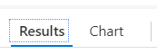  The chart Formatting is on the right.| // more specific queries   //Query get CPU usage   AzureDiagnostics  \| where Resource =~ "SQLHACKMI-WORWEGR7VULCU" and TimeGenerated \> ago(2h) //replace with your SQL MI Instance Name  \| where Category == "ResourceUsageStats"  \| project TimeGenerated, todecimal(avg_cpu_percent_s)  // visualize the resulset as a chart  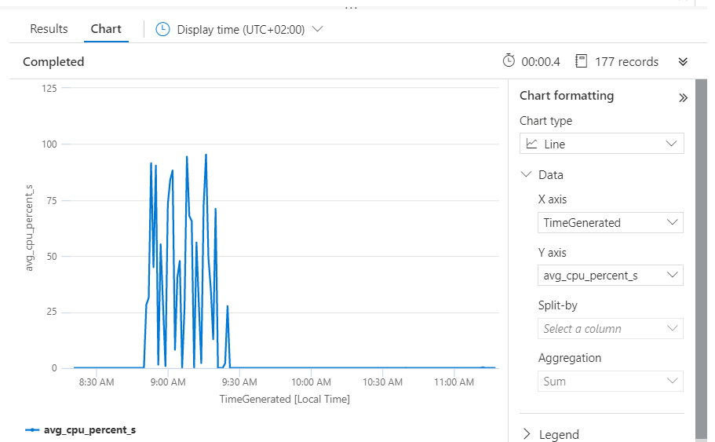  // Query get database Waits Stats  AzureDiagnostics  \| where Category == "QueryStoreWaitStatistics"  \| summarize Total_Wait_Ms = max(todouble(total_query_wait_time_ms_d)) by wait_category_s, DatabaseName_s  \| order by Total_Wait_Ms desc     // visualize the resulset as a chart  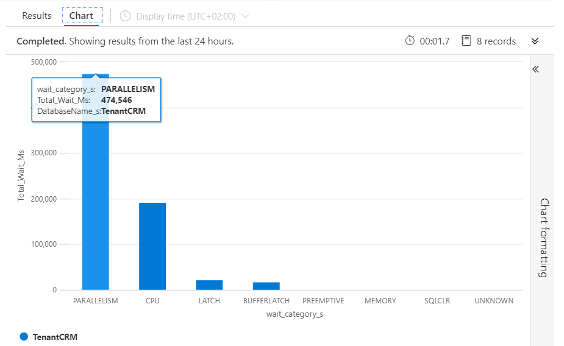||
|Ask Copilot to explain a KQL query line by line. This is a good way to learn KQL.|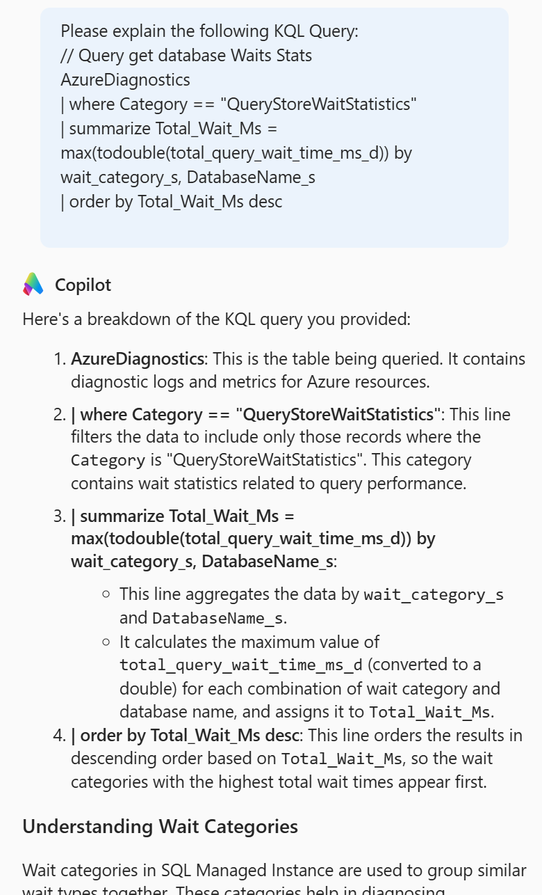|**Prompt**: *"Explain this KQL query line by line and tell me what the wait categories mean."* (paste the wait statistics query)|

We’ve now seen how the various performance monitoring and diagnosis tools – GitHub Copilot, the Azure Portal, DMVs and the Query Store reports all revealed that the CPU was under pressure. The DMVs and Query Store reports also allowed us to drill-down to root cause and identify the worst offending query. Now we progress to tune the offending query to reduce the overall load on the Managed Instance CPUs and thereby improve the database and environment performance.

# 7. Fix the performance issue with GitHub Copilot

In this exercise you will leverage GitHub Copilot to mitigate the performance issue.

> **Important: Once you have found the solution, consult the trainers first. Do not make any changes to the database until you have discussed the solution with them.**

|**Narrative/Instructions**| **Screenshot**| **Notes**|
|:------------|:--------------|:---------|
|Ask Copilot for a recommendation to fix the most expensive stored procedure. Ask for an explanation **and** for the script, but tell Copilot not to execute it.|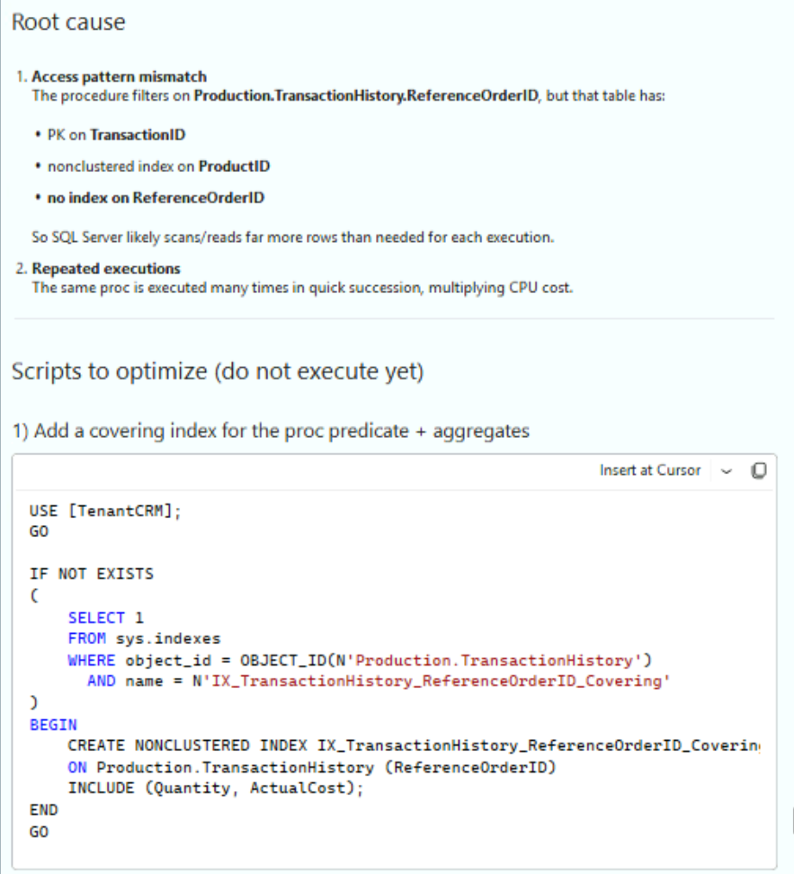|**Prompt**: *"Please suggest how to optimize the most CPU consuming stored procedure in TenantCRM. Explain the root cause and show me the scripts, but do not execute anything."*|
|GitHub Copilot identified the missing index and suggests to create the index. Review the explanation and the **CREATE INDEX** script.|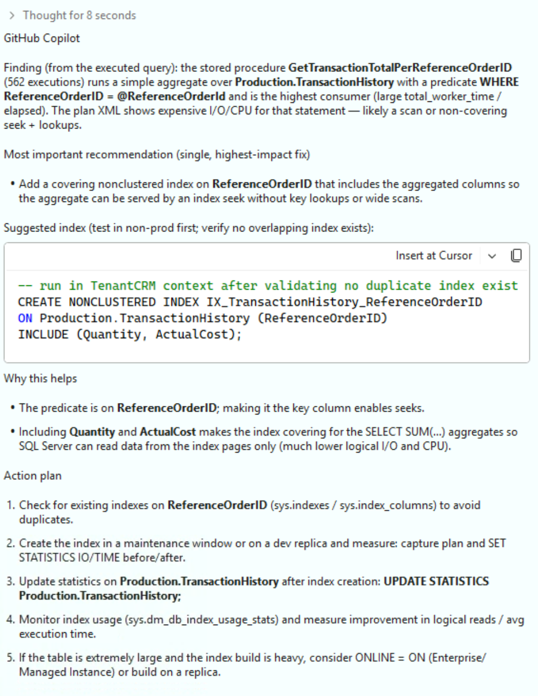|**Prompt**: *"What are the downsides of this index, for example for write performance and storage?"*|
|Insert the **CREATE INDEX** script into the query window and execute it.|||
|Check whether the problem is solved. Run the stored procedure again, or wait a few minutes and ask Copilot to compare the load before and after the change.|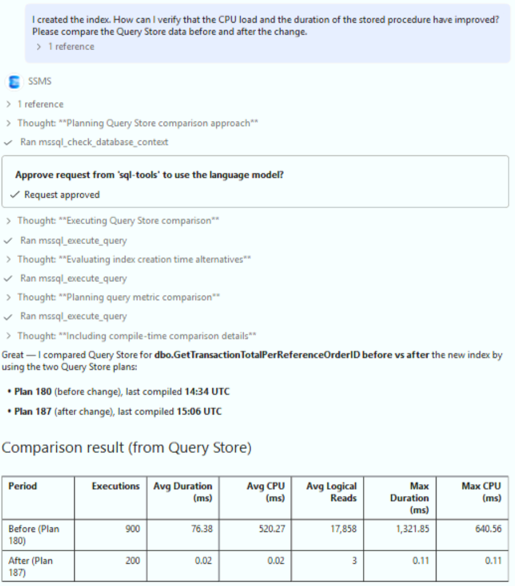|**Prompt**: *"I created the index. How can I verify that the CPU load and the duration of the stored procedure have improved? Please compare the Query Store data before and after the change."*|
|Optional: Ask Copilot to look for further issues in the database.|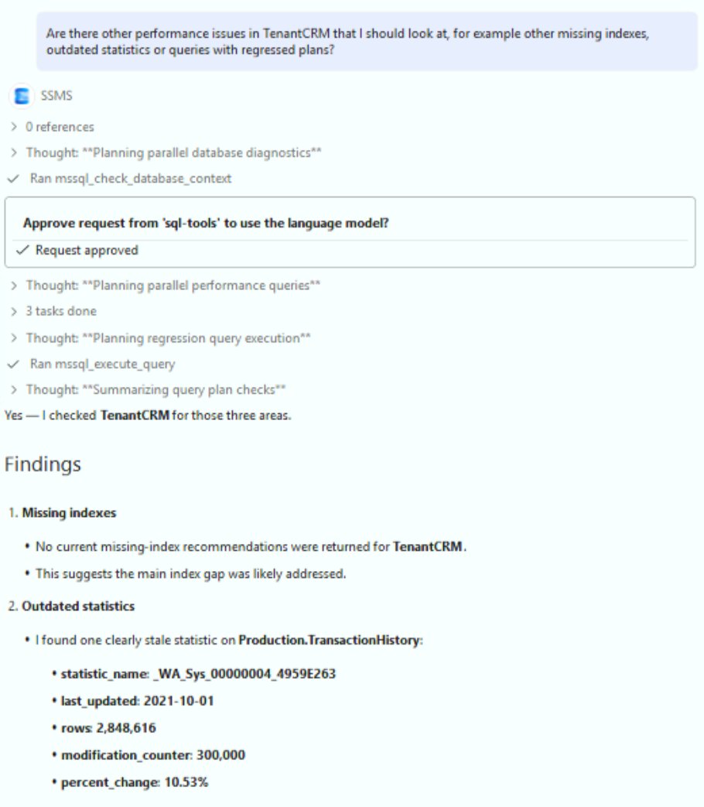|**Prompt**: *"Are there other performance issues in TenantCRM that I should look at, for example other missing indexes, outdated statistics or queries with regressed plans?"*|

We have seen how GitHub Copilot can help us analyze and mitigate performance issues, and how the classic tools help us to verify the results.

# 8. Deepen your understanding with GitHub Copilot

This optional section contains additional prompts that help you to understand the bigger picture of monitoring and performance tuning on Azure SQL Managed Instance. No screenshots are needed. Run the prompts in the Copilot chat of SSMS (connected to **TenantCRM**) or in Copilot in the Azure Portal where noted, and ask follow-up questions.

> **Tips**
>
> * Ask for **evidence**: *"Show me the DMV or query you used."*
> * Ask for **tables** when you compare options.
> * Features and tiers change. Ask Copilot to point to the **official documentation** and verify limits and availability there.
> * In this section Copilot should only **read**. Add *"do not execute anything"* to every prompt that could change the database.

## 8.1 Which monitoring options exist?

|**Narrative**| **Prompt and what you should learn**|
|:------------|:------------------------------------|
|Get the big picture.|**Prompt**: *"Which options do I have to monitor Azure SQL Managed Instance? Compare DMVs, Query Store, Azure Monitor metrics, diagnostic settings with Log Analytics, Extended Events and Database Watcher in a table by data source, retention, granularity and typical use case."* **Learn**: Which tool answers which question, and where the data is stored.|
|Understand real-time versus historical analysis.|**Prompt**: *"Which tools help me with a problem that is happening right now and which help me with a problem that happened last week?"* **Learn**: DMVs show the current state, Query Store and Log Analytics keep history.|
|Understand retention.|**Prompt**: *"How long is the data kept in sys.dm_db_resource_stats, sys.server_resource_stats, Query Store, Azure Monitor metrics and Log Analytics? How can I keep it longer?"*|
|Understand the cost of monitoring.|**Prompt**: *"What does monitoring cost me in Azure, for example Log Analytics ingestion and retention? How can I reduce the cost without losing important information?"*|
|Find out what is monitored by default.|**Prompt**: *"What is collected for my Managed Instance without any configuration, and what do I have to enable myself, for example diagnostic settings?"*|
|Compare the tools with the lab.|**Prompt**: *"In this lab we used DMVs, Query Store, the Azure Portal and KQL. Which question did each tool answer best, and what would I miss if I only used one of them?"*|

## 8.2 Query Store, plans and regressions

|**Narrative**| **Prompt and what you should learn**|
|:------------|:------------------------------------|
|Understand the Query Store.|**Prompt**: *"Explain how the Query Store captures queries, plans and runtime statistics, and how it differs from the plan cache and dm_exec_query_stats."*|
|Find regressions.|**Prompt**: *"Show me a query that finds queries in TenantCRM whose average duration got worse in the last 24 hours compared with the previous 7 days. Use the Query Store views and do not change anything."*|
|Understand plan regressions.|**Prompt**: *"What is a plan regression and why can the same stored procedure be fast for one parameter value and slow for another? Explain parameter sniffing with an example."*|
|Understand plan forcing.|**Prompt**: *"When should I force a plan in the Query Store, and what are the risks? What happens if the forced plan becomes invalid?"*|
|Learn the alternatives.|**Prompt**: *"Which options do I have to fix a parameter sniffing problem, for example OPTION (RECOMPILE), OPTIMIZE FOR, Query Store hints and parameter sensitive plan optimization? Compare them by effort and risk."*|
|Understand automatic tuning.|**Prompt**: *"What is automatic tuning in Azure SQL and which parts of it are available on Managed Instance? Should I enable it for TenantCRM?"*|
|Understand compatibility levels.|**Prompt**: *"How does the database compatibility level influence query performance and the optimizer? What should I check before I raise it for TenantCRM?"*|

## 8.3 Waits and resource limits

|**Narrative**| **Prompt and what you should learn**|
|:------------|:------------------------------------|
|Understand wait statistics.|**Prompt**: *"Explain wait statistics and the most common wait types such as PAGEIOLATCH, LCK_M, CXPACKET, SOS_SCHEDULER_YIELD and WRITELOG. What does each one tell me?"*|
|Read the wait statistics of the instance.|**Prompt**: *"Give me a query that shows the top wait types of the connected Managed Instance and filter out the harmless background waits. Explain the result."*|
|Understand the resource limits.|**Prompt**: *"Which resource limits apply to Azure SQL Managed Instance, for example vCores, memory, storage, IOPS, log rate and tempdb? Where do I see that I hit one of them?"*|
|Understand storage performance.|**Prompt**: *"How does the storage performance (IOPS and throughput) of the General Purpose tier depend on the file size? What does this mean for my databases?"* **Learn**: Why file layout and size can matter for I/O on this tier.|
|Compare the tiers.|**Prompt**: *"What are the performance differences between General Purpose and Business Critical for a workload with many small transactions and a lot of reads?"*|
|Understand CPU pressure.|**Prompt**: *"How do I distinguish between a CPU problem caused by one expensive query and a CPU problem caused by many small queries or too few vCores?"*|

## 8.4 Indexes and statistics

|**Narrative**| **Prompt and what you should learn**|
|:------------|:------------------------------------|
|Understand missing index suggestions.|**Prompt**: *"How reliable are the missing index recommendations of SQL Server? Why should I not create all of them?"*|
|Find unused indexes.|**Prompt**: *"Show me indexes in TenantCRM that are not used for reads but cost write performance. Explain the limits of this analysis, for example after a restart."*|
|Find duplicate indexes.|**Prompt**: *"Find duplicate or overlapping indexes in TenantCRM and tell me which ones I could consolidate. Do not execute anything."*|
|Understand statistics.|**Prompt**: *"What are statistics, how are they updated on Managed Instance, and how can outdated statistics lead to bad execution plans?"*|
|Understand fragmentation.|**Prompt**: *"Is index fragmentation still a relevant problem on modern storage? When should I rebuild or reorganize an index and when not?"*|
|Think about maintenance.|**Prompt**: *"Which regular maintenance tasks do I have to implement on Managed Instance myself and which does the platform do for me?"*|

## 8.5 Blocking, deadlocks and Extended Events

|**Narrative**| **Prompt and what you should learn**|
|:------------|:------------------------------------|
|Find blocking sessions.|**Prompt**: *"Give me a query that shows the current blocking chains in TenantCRM, including the head blocker and its SQL text."*|
|Understand blocking versus deadlocks.|**Prompt**: *"Explain the difference between blocking and a deadlock with an example. How does SQL Server resolve each?"*|
|Reduce blocking.|**Prompt**: *"Which options do I have to reduce blocking, for example read committed snapshot isolation, shorter transactions and better indexes? What are the trade-offs?"*|
|Capture deadlocks.|**Prompt**: *"How do I find past deadlocks on Managed Instance? Show me how to read the deadlock graph from the system_health Extended Events session."*|
|Learn Extended Events.|**Prompt**: *"Explain Extended Events and show me an example session for long-running queries that has a small performance impact. Do not execute anything."*|

## 8.6 Alerts, baselines and dashboards

|**Narrative**| **Prompt and what you should learn**|
|:------------|:------------------------------------|
|Plan alerts.|**Prompt**: *"Which alerts should I configure for a Managed Instance, for example CPU, storage, log rate and failed connections? Suggest thresholds and explain them."* **Tip**: Run this prompt in Copilot in the Azure Portal as well and compare.|
|Understand baselines.|**Prompt**: *"What is a performance baseline and which metrics should I record regularly to recognize a regression early?"*|
|Write more KQL.|**Prompt**: *"Write a KQL query that shows the five most frequent wait types of my Managed Instance over the last 24 hours as a bar chart."* **Note**: Which tables exist depends on the diagnostic settings you configured.|
|Build a dashboard.|**Prompt**: *"Which tiles belong on an Azure dashboard or workbook that gives the operations team a quick health overview of the Managed Instance?"*|
|Route the alerts.|**Prompt**: *"Explain action groups in Azure Monitor and how I can notify a team by email or Teams when the CPU alert fires."*|
|Create a runbook.|**Prompt**: *"Create a first-response checklist for the alert 'CPU above 90 percent for 15 minutes' on a Managed Instance with the steps, the queries to run and the escalation criteria."*|

## 8.7 Scaling and cost

|**Narrative**| **Prompt and what you should learn**|
|:------------|:------------------------------------|
|Decide between tuning and scaling.|**Prompt**: *"When should I fix the query and when should I add vCores to the Managed Instance? Please give me a decision guide."*|
|Understand how scaling works.|**Prompt**: *"How does scaling a Managed Instance up or down work, how long does it take, and is there downtime or a failover?"*|
|Use read scale-out.|**Prompt**: *"Can I offload reporting queries from the primary Managed Instance? Explain the read scale-out and its limits."*|
|Understand the cost of performance.|**Prompt**: *"Which cost levers do I have for a Managed Instance with spiky CPU usage, for example vCores, service tier, instance pools and reservations?"*|
|Find workload isolation options.|**Prompt**: *"We have OLTP and reporting workloads on the same instance. Which options do I have to prevent the reports from slowing down the transactions?"*|

## 8.8 Using Copilot responsibly

|**Narrative**| **Prompt and what you should learn**|
|:------------|:------------------------------------|
|Know the limits of the answer.|**Prompt**: *"What are you not able to see or verify in my environment? Which conclusions of your last answer need to be confirmed with the Query Store or the Azure Portal?"*|
|Test before production.|**Prompt**: *"How should I test the index change that you suggested before I apply it in production? Include the rollback script."*|
|Document the analysis.|**Prompt**: *"Summarize our analysis as an incident report: symptom, impact, root cause, fix, verification and preventive actions."*|
|Teach the next colleague.|**Prompt**: *"Create a short troubleshooting guide with the steps we used today so that a colleague can repeat the analysis with the DMVs and the Query Store."*|

# Prompt cheat sheet

| Goal | Example prompt |
|:-----|:---------------|
| Understand the context | *"Which database am I connected to and which tables does it contain?"* |
| Find the bottleneck | *"Please check for queries or stored procedures with the highest load in the TenantCRM database and suggest solutions for possible performance issues."* |
| Classify the problem | *"Is the problem a running problem (CPU) or a waiting problem? Please explain how you decided."* |
| Rank the offenders | *"Show me the top 5 stored procedures by total CPU time in TenantCRM."* |
| Explain a result | *"Explain the result of this query and what the avg_cpu_percent column tells me."* |
| Find the root cause | *"Why is this stored procedure so expensive? Please look at its code and its execution plan."* |
| Write KQL | *"Write a KQL query for the AzureDiagnostics table that shows the average CPU percentage of my SQL Managed Instance over the last 2 hours."* |
| Fix safely | *"Suggest how to optimize this stored procedure. Explain the root cause and show me the scripts, but do not execute anything."* |
| Verify the fix | *"How can I verify that the CPU load has improved after creating the index?"* |
| Compare monitoring tools | *"Compare DMVs, Query Store, Azure Monitor metrics, Log Analytics and Extended Events by data source, retention and typical use case."* |
| Find regressions | *"Show me queries in TenantCRM whose average duration got worse in the last 24 hours compared with the previous 7 days. Do not change anything."* |
| Understand parameter sniffing | *"Why can the same stored procedure be fast for one parameter value and slow for another? Compare the options to fix it by effort and risk."* |
| Read wait statistics | *"Give me a query that shows the top wait types of the connected instance without the harmless background waits and explain the result."* |
| Check resource limits | *"Which resource limits apply to my Managed Instance and where do I see that I hit one of them?"* |
| Judge index suggestions | *"Why should I not create all missing indexes? Show me unused and duplicate indexes in TenantCRM. Do not execute anything."* |
| Find blocking | *"Show me the current blocking chains in TenantCRM including the head blocker and its SQL text."* |
| Plan alerts | *"Which alerts should I configure for a Managed Instance? Suggest thresholds and explain them."* |
| Tune or scale | *"When should I fix the query and when should I add vCores? Please give me a decision guide."* |
| Document the analysis | *"Summarize our analysis as an incident report: symptom, impact, root cause, fix, verification and preventive actions."* |
