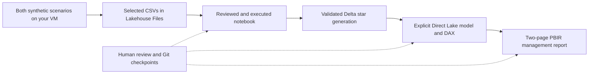

# Agentic Power BI Report Development

**Testing - source-authoring preview, not event-ready.** Build a management report
with GitHub Copilot, then prove its numbers. Choose a wholly synthetic bank or
insurer and complete the same journey: local CSVs, Lakehouse Files, typed Delta
tables, an explicit semantic model, and a populated PBIR report in Microsoft Fabric.
This is GitHub Copilot accessing Fabric, not the built-in Fabric Copilot experience.

## Objectives

Learn to give an agent bounded tasks, approve its plan, review source/diffs, and
challenge its results. Explain fact grains, stock versus flow, filter scope, DAX
reconciliation, report design, and the difference between creating an item and
proving that it works. Manual portal experimentation is welcome.

## General prerequisites

Organizer: complete [provisioning and release gates](labautomation/README.md)
before admitting participants. Each participant needs a separate Windows VM,
identity, resource group and workspace, valid Power BI authoring entitlement, a
GitHub Copilot seat and an approved available model. Shared F16 compute does not
provide an author license or isolate workspaces. Do not grant capacity admin to
participants. Workspace creation/assignment permissions must be preflighted.
VMs are private, reached through shared Azure Bastion; deployment hooks use
platform inputs and checked-in nonsecret settings, not a private config mount.

Participant: know basic tables, relationships and aggregations. Start with
[host readiness](resources/host-readiness.md), inspect the local
[datasets and dictionary](datasets/README.md), and choose the
[banking](resources/banking-business-brief.md) or
[insurance](resources/insurance-business-brief.md) brief. Both datasets must already
be checksum-valid on the VM. Never upload real customer or participant information.

English text and a one-day format (approximately 5.5 hours including readiness and
finish) are **delivery proposals**, not approved duration/language/cohort promises.
The reporting currency is CHF. Counts and KPI definitions are versioned
implementation proposals pending business review.
No regulatory, actuarial or accounting-policy compliance is claimed.

## Challenges

The [participant home](challenges/README.md) is the published learner entry point.

1. [From CSV to a trusted Lakehouse](challenges/challenge-01.md)
2. [Engineer the business model](challenges/challenge-02.md)
3. [Brief the management team](challenges/challenge-03.md)

[Finish and cleanup](challenges/finish.md).

## Coach solutions - spoilers

The separate [coach home](walkthrough/README.md) introduces these references.

1. [Lakehouse walkthrough](walkthrough/challenge-01/solution-01.md)
2. [Semantic-model walkthrough](walkthrough/challenge-02/solution-02.md)
3. [Report walkthrough](walkthrough/challenge-03/solution-03.md)

Solutions contain source-generating aids, not screenshots or evidence of a tested
tenant journey. Keep walkthrough content out of participant starter packages.
This repository overview, contributor guide, tests and deployment automation are
not audience downloads. Published student and coach pages have separate navigation;
download ZIPs carry supporting assets, not the lesson/walkthrough Markdown pages.

## Source and release status

Run the credential-free [local checks](tests/README.md). Live deployment, execution,
DAX reconciliation, rendering, entitlement, isolation and policy tests remain
**NOT VALIDATED**. [Release evidence](resources/release-gates.md) separates local
checks from the independently witnessed event pilot. Direct Lake on OneLake is the
intended teaching path; unavailable APIs/tooling or invalid binding block that path.
Do not silently replace it with Import or declare an empty report complete.

See the [contributor learning guide](CONTRIBUTING.md). The requested legacy-style
folder is retained deliberately; upstream recommends lowercase names with hyphens.
Confirm that exception with maintainers before publication. Source template and
the preceding Talk to your data MicroHack are unchanged.

## Learning resources

- [Microsoft Fabric documentation](https://learn.microsoft.com/en-us/fabric/)
- [Direct Lake overview](https://learn.microsoft.com/en-us/fabric/fundamentals/direct-lake-overview)
- [Power BI projects](https://learn.microsoft.com/en-us/power-bi/developer/projects/projects-overview)
- [Fabric skills and authoring tools](https://github.com/microsoft/skills-for-fabric)
- [GitHub Copilot CLI](https://docs.github.com/en/copilot/concepts/agents/about-copilot-cli)
