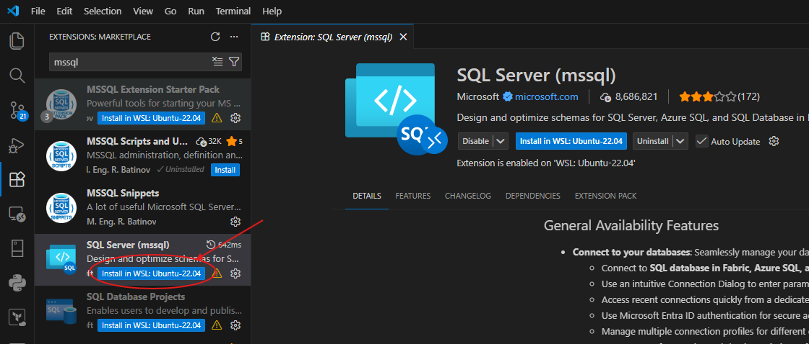
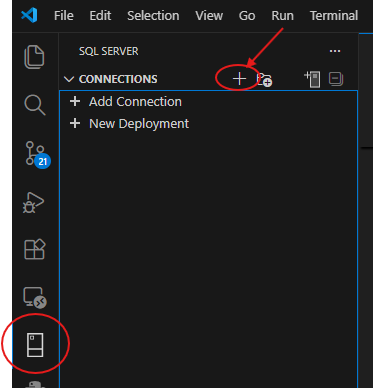
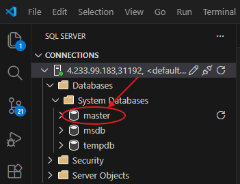
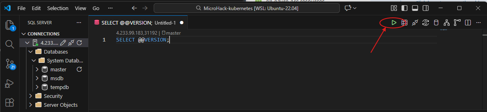

# Walkthrough Challenge 4 - Deploy SQL Managed Instance to your cluster

[Back to challenge](../../challenges/challenge-04.md) - [Next Challenge's Solution](../challenge-05/solution-05.md)

## prerequisites
- [client tools](https://learn.microsoft.com/en-us/azure/azure-arc/data/install-client-tools)
- Provider reqistration
```shell
az provider register --namespace Microsoft.AzureArcData
```

## Read about the prerequisites and concepts
1. Create Azure Arc [data services cluster extension](https://learn.microsoft.com/en-us/azure/azure-arc/kubernetes/conceptual-extensions)
2. Create a [custom location] on your arc-enabled k8s(https://learn.microsoft.com/en-us/azure/azure-arc/kubernetes/custom-locations#create-custom-location)
3. create the Arc data controller

## Task 1 - Create arc data services controller

The deployment uses ARM templates as this is the most robust way for deployment at the time of writing this microhack. Before deploying, you need to prepare the parameter file with your specific values.

### Step 1: Gather required values

```bash
# Get current user's number (e.g., LabUser-37@... or hackuser-067@... -> 37 or 67)
export azure_user=$(az account show --query user.name --output tsv)
export user_number=$(echo "$azure_user" | cut -d'@' -f1 | sed -E -n 's/.*[^0-9]([0-9]+)$/\1/p' | sed 's/^0*//')
export resource_group="$user_number-k8s-arc"
export connected_cluster_name="$user_number-k8s-arc-enabled"
export extension_name="$user_number-arc-data-controller-ext"
export namespace="$user_number-arc-data-controller"
export custom_location_name="$user_number-arc-data-controller"
export data_controller_name="$user_number-dc"

# Get Log Analytics workspace details
export log_analytics_workspace_id=$(az monitor log-analytics workspace show -g $resource_group -n "$user_number-law" --query customerId -o tsv)
export log_analytics_primary_key=$(az monitor log-analytics workspace get-shared-keys -g $resource_group -n "$user_number-law" --query primarySharedKey -o tsv)

echo "Your values:"
echo "RESOURCE_GROUP: $resource_group"
echo "CONNECTED_CLUSTER_NAME: $connected_cluster_name"
echo "EXTENSION_NAME: $extension_name"
echo "NAMESPACE: $namespace"
echo "CUSTOM_LOCATION_NAME: $custom_location_name"
echo "DATA_CONTROLLER_NAME: $data_controller_name"
echo "LOG_ANALYTICS_WORKSPACE_ID: $log_analytics_workspace_id"
```

### Step 2: Update parameters.json

Copy the template file and replace placeholders:

```bash
cd walkthrough/challenge-04/templates

# Remove the old one and start fresh
rm parameters-my.json
# Create a working copy
cp parameters.json parameters-my.json

# Replace placeholders (Linux/WSL)
# Note: Escape special sed characters in the primary key to handle any potential delimiters
escaped_key=$(printf '%s\n' "$log_analytics_primary_key" | sed 's/[\/&]/\\&/g')

sed -i "s/<CONNECTED_CLUSTER_NAME>/$connected_cluster_name/g" parameters-my.json
sed -i "s/<EXTENSION_NAME>/$extension_name/g" parameters-my.json
sed -i "s/<NAMESPACE>/$namespace/g" parameters-my.json
sed -i "s/<CUSTOM_LOCATION_NAME>/$custom_location_name/g" parameters-my.json
sed -i "s/<DATA_CONTROLLER_NAME>/$data_controller_name/g" parameters-my.json
sed -i "s/<LOG_ANALYTICS_WORKSPACE_ID>/$log_analytics_workspace_id/g" parameters-my.json
sed -i "s/<LOG_ANALYTICS_PRIMARY_KEY>/$escaped_key/g" parameters-my.json
sed -i "s/<DC_DASHBOARD_USERNAME>/mhadmin/g" parameters-my.json

# Alternative: manual replacement
# Edit parameters-my.json and replace:
#   <CONNECTED_CLUSTER_NAME> with the name of your arc-enabled connected cluster
#   <EXTENSION_NAME> with the desired extension name
#   <NAMESPACE> with the Kubernetes namespace for arc data services
#   <CUSTOM_LOCATION_NAME> with the custom location name
#   <DATA_CONTROLLER_NAME> with the desired data controller name
#   <LOG_ANALYTICS_WORKSPACE_ID> with workspace ID
#   <LOG_ANALYTICS_PRIMARY_KEY> with workspace key
#   <DC_DASHBOARD_USERNAME> with the desired dashboard username (e.g., mhadmin)
```

### Step 3: Deploy the Arc Data Controller

```bash
read -s -p "Enter password for metrics/logs dashboard: " DC_PASSWORD && echo

# Validate the deployment first
az deployment group validate \
  --resource-group $resource_group \
  --template-file template.json \
  --parameters parameters-my.json \
  --parameters dataController_metricsAndLogsDashboardPassword="$DC_PASSWORD"

# Deploy (you'll be prompted for the dashboard password)
az deployment group create \
  --resource-group $resource_group \
  --template-file template.json \
  --parameters parameters-my.json \
  --parameters dataController_metricsAndLogsDashboardPassword="$DC_PASSWORD" \
  --verbose
```
*NOTE*: At the time of writing there is a bug in the az cli command to create the arc data controller. This is why we are using a workaround based on an ARM template deployment.

The deployment takes 10-15 minutes. You can monitor progress with:

```bash
# Watch deployment status
az deployment group show \
  --resource-group $resource_group \
  --name template \
  --query properties.provisioningState

# Monitor operations
az deployment operation group list \
  --resource-group $resource_group \
  --name template \
  --query "[].{Resource:properties.targetResource.resourceName, State:properties.provisioningState}" -o table
```

## Task 2 - Create SQL Managed Instance in connected cluster

**IMPORTANT: 'sa' is not allowed as sql admin at managed instance level!**

```bash
# Set SQL MI name (must start with a letter for Kubernetes naming rules)
export sqlmi_name="sqlmi-${user_number}-1"

# Create SQL MI (you'll be prompted for sql admin user and password)
az sql mi-arc create \
  --name $sqlmi_name \
  --resource-group $resource_group \
  --custom-location $custom_location_name \
  --cores-request 1 \
  --memory-request 3Gi
```

The creation takes 5-10 minutes. Monitor progress:

```bash
# Check deployment status
az sql mi-arc show --name $sqlmi_name --resource-group $resource_group --query "properties.k8sRaw.status.state" -o tsv

# Check pods in the namespace
kubectl get pods -n $namespace -l app.kubernetes.io/name=$sqlmi_name
```

## Task 3 - Connect to your SQL Managed Instance

### Prerequisites
* In this microhack the K3s cluster is configured to expose services on the private IP address of the master node per default. So you should use the Windows workstation in your lab environment to connect to the SQL MI.
* **Network Security Group (NSG)**: The Terraform deployment has already configured the NSG to allow external access to the NodePort range (30000-32767) required for SQL MI connectivity. No additional NSG configuration is needed.

### Get connection details

```bash
# Get public ip of master node via Azure cli according to user-number
master_ip=$(az vm list-ip-addresses --resource-group "${user_number}-k8s-onprem" --name "${user_number}-k8s-master" --query "[0].virtualMachine.network.privateIpAddresses[0]" --output tsv)

# Get the NodePort assigned to SQL MI
node_port=$(kubectl get svc ${sqlmi_name}-external-svc -n $namespace -o jsonpath='{.spec.ports[0].nodePort}')

echo "Connection details:"
echo "Server: $master_ip,$node_port"
echo "Username: <your-user-name>"
echo "Password: <your-sql-password>"
echo ""
echo "Connection string:"
echo "Server=$master_ip,$node_port;Database=master;User Id=sa;Password=<your-password>;TrustServerCertificate=true;"
```

### Connect using VS Code SQL Server extension

#### 1. Install the **SQL Server (mssql)** extension in VS Code:



#### 2. After installation completed, in the SQL PlugIn click **Add Connection**:



#### 3. Enter connection details:
**💡Note: In this lab we are using the public ip to connect to the service.**
   - **Input type**: Parameters
   - **Server:** `<Public-IP-Master-Node>,<NODE_PORT>` (e.g., `20.123.45.67,31433`, optionally, use the following command: ```echo "$master_ip,$(kubectl get svc ${sqlmi_name}-external-svc -n $namespace -o jsonpath='{.spec.ports[0].nodePort}')"```
   - **Trust Server Certificate:** Yes
   - **Authentication Type:** SQL Login
   - **User name:** (the admin account you entered during SQL MI creation)
   - **Password:** (the password you entered during SQL MI creation)
   - **Database:** `master` (or leave empty)

#### 4. Click **Connect**
#### 5. Expand Databases, then expand System Databases and right click on **master**. In the context menu select **New Query**.


#### 6. Query database version using ```SELECT @@VERSION;```:


You successfully completed challenge 4! 🚀🚀🚀

[Next challenge](../../challenges/challenge-05.md) - [Next Challenge's Solution](../challenge-05/solution-05.md)

---

## Appendix - Known differences in SQL Managed Instance compared to SQL Server

SQL Managed Instance enabled by Azure Arc is the SQL Server engine, but it is **not** a plain standalone SQL Server. It is deployed and operated by the Arc Data Controller on Kubernetes and, regardless of service tier, every instance is hosted inside a **Contained Availability Group (contained AG)**. This changes how you interact with the instance compared to an on-premises SQL Server.

### Why server-level `sp_configure` commands cannot be run against `master` directly

When you connect to the SQL MI through its external endpoint (the connection you used in Task 3), you are **not** connected to the SQL Server *instance*. You are connected into the context of the **contained availability group**.

A contained AG has its own contained system databases. When you connect through the endpoint/listener, the `master` you see is actually the *contained* `master` of the availability group (at instance level it is named `<containedAG>_master`). Because of that, the engine deliberately blocks any change to **server-scoped** configuration from this connection.

If you try to run, for example:

```sql
EXEC sys.sp_configure N'show advanced options', N'1';
RECONFIGURE WITH OVERRIDE;
```

you get:

```
Msg 5874, Level 16, State 1, Procedure sys.sp_configure
Changes to server configuration options are not permitted in the connection to Contained Availability Group.
Change connection to SQL Server instance level and retry the operation.
```

This is by design. Per the [contained availability groups documentation](https://learn.microsoft.com/sql/database-engine/availability-groups/windows/contained-availability-groups-overview#differences):

> *Server configuration through `sp_configure` can be **read** from the contained AG connection but can only be **written** from instance level.*

So the problem is **not** permissions on `master` and **not** your admin login. Reads (e.g. `SELECT * FROM sys.configurations`) work fine from the endpoint; only **writes** to server-scoped settings are rejected, because they must be applied on the underlying SQL Server *instance*, not inside the contained AG.

> **Note:** The same principle explains why you cannot manage the physical files of the system databases (`ALTER DATABASE [master] MODIFY FILE ...`), restore system databases, or perform most instance-, endpoint- or AG-level operations from the endpoint connection. These are managed by the Arc Data Controller / platform.

### Which settings are affected

Typical on-premises hardening/tuning you would normally apply via `sp_configure` — for example:

* `max degree of parallelism` (MAXDOP)
* `cost threshold for parallelism`
* `fill factor (%)`

are all **server-scoped** and therefore hit `Msg 5874` when set from the endpoint connection.

> **Tip:** `max degree of parallelism` also has a database-scoped equivalent that you *can* set from the normal endpoint connection, per user database:
> ```sql
> ALTER DATABASE SCOPED CONFIGURATION SET MAXDOP = 2;
> ```
> There is **no** database-scoped equivalent for `cost threshold for parallelism` or `fill factor (%)`, so those still require the instance-level connection described below.

### Workaround - Set server-level properties via port forwarding to the instance endpoint

To change server-scoped settings you must connect to the **SQL Server instance**, which listens on a **separate internal port inside the pod** (typically `1533`; the external/listener port `1433` is the contained AG). This port is not exposed outside the cluster, so you tunnel to it with `kubectl port-forward` and then connect a client to the local end of the tunnel.

You can confirm the instance port from the SQL error log inside the pod:

```bash
kubectl exec -n $namespace ${sqlmi_name}-0 -c arc-sqlmi -- \
  bash -c "grep -i 'listening on' /var/opt/mssql/log/errorlog | tail -n 20"
```

Example output (the port that is **not** 1433 is the instance level):

```
Server is listening on [ 'any' <ipv4> 1533 ].   <- SQL Server instance   (sp_configure writes allowed)
Server is listening on [ 'any' <ipv4> 1433 ].   <- Contained AG listener  (Msg 5874 on writes)
```

**Step 1 - Open a port-forward tunnel to the instance endpoint (leave this running):**

```bash
# maps local port 15330 -> pod port 1533 (the SQL Server instance)
kubectl port-forward -n $namespace pod/${sqlmi_name}-0 15330:1533
```

Wait until it prints `Forwarding from 127.0.0.1:15330 -> 1533`.

**Step 2 - In a second terminal, connect to the instance and apply the settings.**

Create a file `config.sql`:

```sql
EXEC sys.sp_configure N'show advanced options', N'1';
RECONFIGURE WITH OVERRIDE;
GO
EXEC sys.sp_configure N'cost threshold for parallelism', N'50';
GO
EXEC sys.sp_configure N'max degree of parallelism', N'2';
GO
EXEC sys.sp_configure N'fill factor (%)', N'80';
GO
RECONFIGURE WITH OVERRIDE;
GO
EXEC sys.sp_configure N'show advanced options', N'0';
RECONFIGURE WITH OVERRIDE;
GO
-- Verify
SELECT name, value, value_in_use
FROM sys.configurations
WHERE name IN ('cost threshold for parallelism','max degree of parallelism','fill factor (%)');
GO
```

Run it against the tunnel (note the connection now targets `127.0.0.1,15330`, i.e. the instance):

```bash
sqlcmd -S tcp:127.0.0.1,15330 -U <admin-user> -P '<your-sql-password>' -C -i config.sql
```

Because you are now connected to the SQL Server **instance** (port `1533`) and no longer to the contained AG (port `1433`), `sp_configure` / `RECONFIGURE` succeed without `Msg 5874`.

> **Windows / PowerShell jump box notes**
> * If `sqlcmd` is missing, install go-sqlcmd with `winget install sqlcmd` and open a **new** shell so the updated `PATH` is picked up (or call it via its full path, e.g. `& "C:\Program Files\sqlcmd\sqlcmd.exe" ...`).
> * The legacy .NET Framework `System.Data.SqlClient` may fail the TLS pre-login handshake against SQL Server on Linux. Use **go-sqlcmd** (`-C` to trust the self-signed certificate) or the **VS Code mssql extension** (ODBC Driver 18) with **Trust Server Certificate = Yes** — connect it to `127.0.0.1,15330` through the same tunnel.
> * When creating `config.sql` from PowerShell, use a **double-quoted here-string** (`@" ... "@ | Set-Content -Encoding ascii`) so the single quotes in `N'...'` stay intact. A single-quoted here-string requires doubling every SQL quote (`''`) and, if written to the file un-collapsed, produces `Msg 102 Incorrect syntax near 'show'`.

### Important behavior notes

* **`max degree of parallelism`** and **`cost threshold for parallelism`** take effect immediately (`value_in_use` updates right away).
* **`fill factor (%)`** requires an engine restart before `value_in_use` reflects the new value. On Arc this means restarting the SQL MI pod:
  ```bash
  kubectl delete pod ${sqlmi_name}-0 -n $namespace   # the operator recreates it automatically
  ```
* These settings are stored in the instance and persist across pod restarts/failover, but **not** across deleting and re-creating the SQL MI. For reproducible environments, keep `config.sql` as a post-deployment step.

### System database files cannot be modified (`ALTER DATABASE [master] MODIFY FILE`)

On a standalone SQL Server it is common to pre-size the system database files, e.g.:

```sql
USE [master];
ALTER DATABASE [master] MODIFY FILE ( NAME = N'master',  MAXSIZE = 10240000KB );
ALTER DATABASE [master] MODIFY FILE ( NAME = N'mastlog', MAXSIZE = 10240000KB );
```

On Arc-enabled SQL MI this **fails**, even though a `SELECT` against `master` works and shows the files:

```
Msg 5041, Level 16, State 1
MODIFY FILE failed. File 'master' does not exist.
```

Key points:

* The `NAME` argument expects the **logical** file name (e.g. `master` / `mastlog`), **not** the physical path (`/var/opt/mssql/data/...`). Passing the path produces the same `Msg 5041`.
* But even with the correct logical name the statement fails: **the system databases (`master`, `model`, `msdb`) are managed by the Arc Data Controller / platform** and their files can't be altered by the user. The exact same statement against a **user database works without issues** — that is the quick way to prove the restriction is specific to system databases, not to your login.
* `MAXSIZE` is only a logical ceiling anyway. The real capacity comes from the instance's persistent volumes (see next section), so setting it on `master` would have no practical effect.
* This is consistent with Azure SQL Managed Instance, where the [T-SQL `ALTER DATABASE` differences](https://learn.microsoft.com/azure/azure-sql/managed-instance/transact-sql-tsql-differences-sql-server?view=azuresql#alter-database-statement) state that *file names/paths can't be changed* and the [master database](https://learn.microsoft.com/sql/relational-databases/databases/master-database#physical-properties-of-master) physical properties are platform-controlled.

> **Takeaway:** Apply your usual `MAXSIZE` / `FILEGROWTH` settings on **user databases**. Control instance capacity through the storage volumes, not through `master`.

### Storage layout: `master` and user databases share the same PVCs

There are **no dedicated PVCs per database**. Storage is separated **by file type**, not by database — all databases of an instance (`master`, `model`, `msdb`, `tempdb` **and** your user DBs) live on the same volumes.

Per-instance PVCs (General Purpose = single pod):

| PVC (pattern) | Set via | Contains |
| --- | --- | --- |
| `<namespace>/data-<instance>-0` | `--volume-size-data` / `--storage-class-data` | all `.mdf`/`.ndf` (from `master` to user DBs) |
| `<namespace>/datalogs-<instance>-0` | `--volume-size-datalogs` | the transaction logs (`.ldf`) of all DBs |
| `<namespace>/logs-<instance>-0` | `--volume-size-logs` / `--storage-class-logs` | container/process logs (`/var/log`) |
| `<namespace>/backups-<instance>-0` | `--volume-size-backups` | backup files (RWX storage class recommended) |

> Naming pitfall: `--storage-class-logs` (`/var/log`) means the **container** logs, while the SQL **transaction logs** (`.ldf`) live on the `datalogs` volume.

Consequences:

* Because all databases share the `data` / `datalogs` volume, a full volume affects **all** databases at once — the sizing knob is the **volume size** (`--volume-size-*`), not `MAXSIZE`.
* Real isolation is achieved by deploying a **separate SQL MI instance**, not by per-DB PVCs.
* Growing a full volume: the MI is a `StatefulSet`, so resize in three steps — **scale the StatefulSet to 0 → patch the PVC → scale back up** (requires a storage class with `AllowVolumeExpansion=true`).
* Inspect the PVCs with `kubectl get pvc -n $namespace`.

See [Storage configuration](https://learn.microsoft.com/azure/azure-arc/data/storage-configuration) and [Resize persistent volume](https://learn.microsoft.com/azure/azure-arc/data/resize-persistent-volume-claim).

### System databases cannot be backed up or restored — recovery model

Because the system databases are platform-managed, you **cannot back up or restore `master` / `model` / `msdb`** yourself (no on-prem style `RESTORE DATABASE master`). Two failure scenarios matter:

1. **Pod / node failure (most common) → automatic recovery, no action.** Kubernetes starts a new pod that **re-attaches to the same persistent volumes**, including `master.mdf`. System DBs, logins and instance config survive. (*"a new SQL Managed Instance will start up and re-attach to the persistent volume containing your data"* — see [features](https://learn.microsoft.com/azure/azure-arc/data/managed-instance-features).)
2. **Full loss of the PV/instance → create a new SQL MI and restore user databases.** Instance-level objects (logins, SQL Agent jobs, server roles) lived in `master`/`msdb` and do **not** carry over — recreate them from scripts.

Important restore caveat for scenario 2:

* Point-in-time restore (PITR) **only restores to the same Arc-enabled SQL MI** where the backups were taken — it can't restore to a *new* instance (see [limitations](https://learn.microsoft.com/azure/azure-arc/data/limitations-managed-instance)).
* To move user DBs to a new instance, keep your **own native backups** (`BACKUP ... TO URL` to Azure Blob, `COPY_ONLY`) or BACPACs, and `RESTORE FROM URL` there.

> **DR practice:** back up user DBs to Blob yourself; keep logins/jobs/config as code (IaC/`.sql`); keep the instance reproducible via `az sql mi-arc create`; use the **Business Critical** tier (Always On AG) for higher availability.

### Transparent Data Encryption (TDE) is supported

TDE works on Arc-enabled SQL MI and is a good example of platform-managed system-database handling: enabling it makes the **platform** automatically create the database master key and certificate **inside `master`** — you don't do it manually as on-prem.

Rahmenbedingungen:

* TDE is **instance-wide**: all existing and future databases get encrypted.
* Only the **General Purpose** tier is supported; **failover groups** are not supported; feature is **preview**.
* Two modes: **Service-managed** (platform creates key + certificate) or **Customer-managed** (you supply the certificate).

Enable service-managed TDE on an existing instance:

```bash
az sql mi-arc update --name $sqlmi_name --k8s-namespace $namespace --use-k8s --tde-mode ServiceManaged
```

Verify:

```sql
SELECT db.name, db.is_encrypted, dm.encryption_state_desc
FROM sys.databases db
LEFT JOIN sys.dm_database_encryption_keys dm ON db.database_id = dm.database_id;
```

Backup/restore caveats:

* **Back up the TDE certificate** (`BACKUP CERTIFICATE ... TO FILE` in `master`, then `kubectl cp` it out of the pod) — otherwise encrypted backups can't be restored elsewhere.
* Service-managed TDE uses a non-exportable internal key, so those `COPY_ONLY` backups **can't** be restored to another instance — use **Customer-managed** TDE for portable backups.
* To restore a backup taken **before** TDE, temporarily disable TDE, restore, then re-enable.

See [Enable TDE on SQL Managed Instance enabled by Azure Arc](https://learn.microsoft.com/azure/azure-arc/data/configure-transparent-data-encryption-sql-managed-instance).

### Reference

* [What is a contained availability group?](https://learn.microsoft.com/sql/database-engine/availability-groups/windows/contained-availability-groups-overview)
* [High availability with SQL Managed Instance enabled by Azure Arc](https://learn.microsoft.com/azure/azure-arc/data/managed-instance-high-availability)
* [Connect to SQL Managed Instance enabled by Azure Arc](https://learn.microsoft.com/azure/azure-arc/data/connect-managed-instance)
* [Storage configuration (Azure Arc data services)](https://learn.microsoft.com/azure/azure-arc/data/storage-configuration)
* [Resize persistent volume to increase size](https://learn.microsoft.com/azure/azure-arc/data/resize-persistent-volume-claim)
* [Limitations of SQL Managed Instance enabled by Azure Arc](https://learn.microsoft.com/azure/azure-arc/data/limitations-managed-instance)
* [Enable transparent data encryption on SQL Managed Instance enabled by Azure Arc](https://learn.microsoft.com/azure/azure-arc/data/configure-transparent-data-encryption-sql-managed-instance)
* [T-SQL differences: ALTER DATABASE (Azure SQL Managed Instance)](https://learn.microsoft.com/azure/azure-sql/managed-instance/transact-sql-tsql-differences-sql-server?view=azuresql#alter-database-statement)
