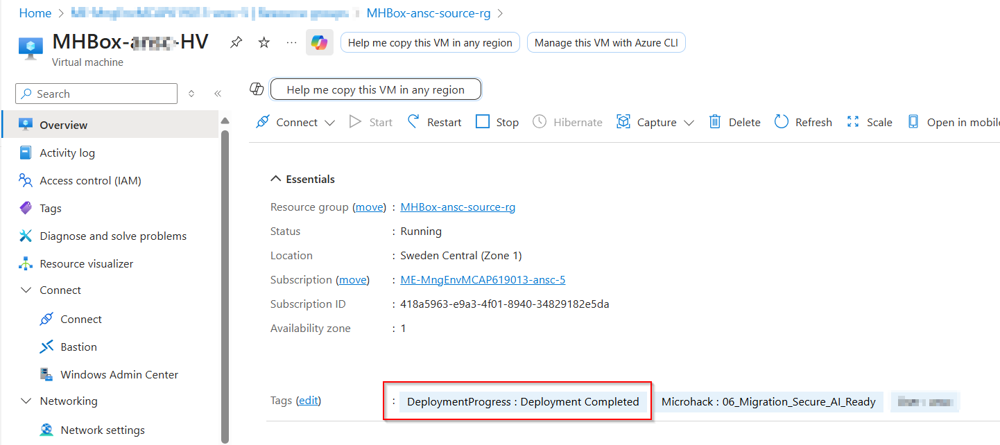
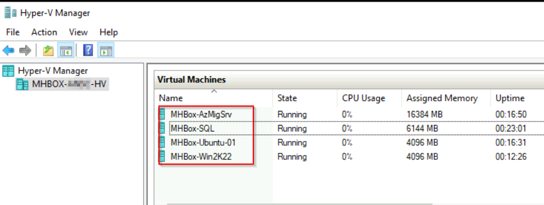
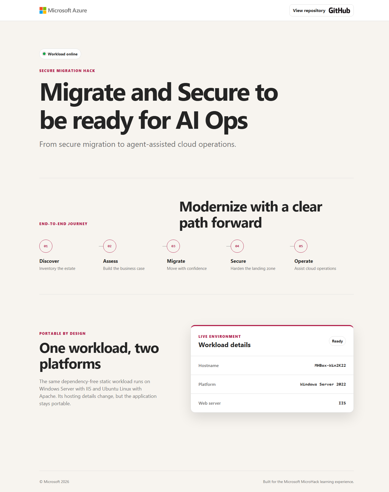

# Walkthrough Challenge 1 - Prerequisites and landing zone preparation

**[Home](../../Readme.md)** - [Next Challenge Solution](../challenge-02/solution-02.md)

Duration: 15 minutes (verification of an already-provisioned lab)

## Prerequisites

- Please ensure that you successfully verified the [General prerequisites](../../Readme.md#general-prerequisites) before continuing with this challenge.
- Your instructor has completed [predeployment](../../resources/README.md) through Hackbox Console or manually. Obtain the subscription, lab resource group, connection details, and login instructions from the Console dashboard or your instructor.
- Your learner account has **Owner on the Hack subscription**, including access to the assigned resource group and permission to register additional providers. On shared subscriptions, this also grants access to other learners' labs; work only in your assigned RG.

> [!IMPORTANT]
> **Many of the resource deployments in this Hack are adapted from the [Jumpstart ArcBox for IT Pros](https://jumpstart.azure.com/azure_jumpstart_arcbox/ITPro). Special thanks to the [Jumpstart Team](https://aka.ms/arcjumpstart) for their excellent work.**

### **Task 1: Receive the lab and verify host readiness**

1. Record the assigned subscription, `<YOUR-LAB-RESOURCE-GROUP>`, region, Hyper-V host name, and login instructions from your Console dashboard or instructor. Do not copy passwords into shared notes.
2. Sign in to the [Azure Portal](https://portal.azure.com) with your assigned learner account. Open that existing resource group; do not create a source or destination resource group.
3. Locate the supplied Hyper-V host. A fresh Console lab in `rg-labuser-0013` uses `mh-0013-hv`, preserving the learner number's leading zeros. Existing Console labs and nonstandard RG names retain hash-based names; manual deployments use the instructor's chosen suffix. Do not rename a working host.
4. On the host VM, check that **DeploymentProgress** is **Deployment Completed** and **LabReady** is **single-rg-v1**. Console deployments also require RG tag **LabVerified=single-rg-v1**; for manual deployment the instructor performs the initial-handoff checks directly, without this Console tag. Bootstrap publishes `C:\MHBox\lab-ready.json` (schema version 1). Confirm it names the actual host and four expected guests and records HTTP 200 for both workloads. You can inspect ARM deployment status under the lab resource group's **Deployments**, but ARM success alone is not the readiness gate.
5. Connect to the host using **Connect** > **Bastion** and the supplied host login credentials. You can also select **Password from Azure Key Vault** and use the login secrets stored in the lab Key Vault.

> [!NOTE]
> Screenshots are illustrative and can show older names. Your dashboard's resource group, host name, and credentials are authoritative.



> [!IMPORTANT]
> Fresh predeployment can take **35–90+ minutes**, including nested-VM downloads and configuration. Console automation polls ARM for up to **180 minutes per invocation**, then waits up to **120 minutes** for guest readiness and independently checks the baseline. Its **LabRegion** tag records the selected resource region, which can differ from the RG's metadata location. Manual instructors check readiness themselves. If your lab is not ready, contact the instructor with its status; do not delete the resource group or redeploy into a different region.

These are **initial-handoff** checks. If you revisit this walkthrough after migration, source guests may correctly be stopped. Completed Console deployment reruns preserve that state instead of restarting guests or requiring all four to be running; do not reset learner progress just to repeat Challenge 1.

### **Task 2: Verify the deployed VM resources**
Open *Hyper-V Manager* on the supplied host and ensure that four VMs are running.
+ MHBox-AzMigSrv
    + This system will be used later to deploy the Azure Migrate appliance, which is required for the discovery process.
+ MHBox-SQL
    + This system hosts a Microsoft SQL Server installation to demonstrate the SQL assessment capabilities.
+ MHBox-Ubuntu-01
    + This system hosts an Ubuntu server with an installed Apache web server.
+ MHBox-Win2K22
    + This system hosts Windows Server 2022 with an installed IIS web server.

The Console dashboard lists **Migration Windows Guest** username and initial-password fields for the three Windows VMs, and **Migration Ubuntu Guest** fields for the Ubuntu VM. These are separate from the host login credentials provided by the Console or instructor and stored in Key Vault. The following lab-only image defaults also apply to manual deployments; if you change a guest password, use your updated password rather than the dashboard's initial value.

**Windows virtual machine credentials:**

```text
Username: Administrator
Password: JS123!!
```

**Ubuntu virtual machine credentials:**

```text
Username: jumpstart
Password: JS123!!
```



Open Microsoft Edge and navigate to the IP address of each web VM. Confirm that the migration journey dashboard returns HTTP success and shows the correct details:

| VM | Platform | Web server |
| --- | --- | --- |
| *MHBox-Win2K22* | `Windows Server 2022` | `IIS` |
| *MHBox-Ubuntu-01* | `Ubuntu Linux` | `Apache` |

The **Hostname** value must match the VM you opened.




### **Task 3: Verify the deployed Azure resources**

Within **the same** `<YOUR-LAB-RESOURCE-GROUP>`, verify the following. `<suffix>` is the learner number (for example, `0013`) for fresh Console labs, the existing hash suffix for older Console labs and nonstandard RG names, or the instructor's chosen suffix for manual labs:

| Component | Purpose |
| --- | --- |
| Source VNet, `mh-<suffix>-Source-VNet`, `10.1.0.0/16` | Hosts the Azure Hyper-V VM `mh-<suffix>-hv`, with the four nested guests above |
| Destination VNet, `mh-<suffix>-destination-VNet`, `10.2.0.0/16` | Target network for the migrated Azure VMs in Challenge 5 |
| Bastion access and NAT Gateways | Private administration and outbound connectivity for the respective networks |
| Azure Key Vault, `mhkv` plus the unique suffix derived from the RG ID | Stores the host login username and generated password |

**Textual architecture:** one learner resource group contains two networks. The source network contains the Hyper-V host and its nested appliance, SQL, Windows/IIS, and Ubuntu/Apache guests. Azure Migrate will later discover the guests and migrate the two web workloads into the destination network **without changing resource group**. Monitoring and App Service resources will also be created in this lab group during their exercises.

Do not install the Azure Migrate appliance or configure replication, monitoring, or App Service yet. Keep the whole resource group through Challenges 2–8; deleting it would remove both the simulated source and the migrated environment.

You successfully completed Challenge 1! 🚀🚀🚀
