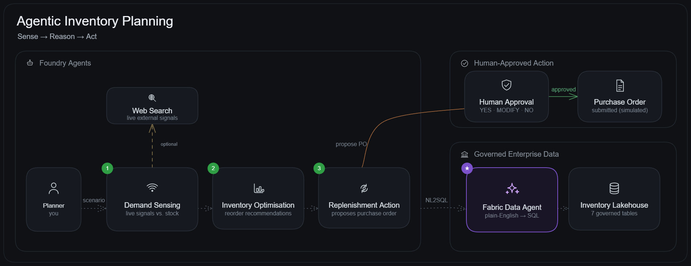

# Agentic Inventory Planning — Sense, Reason, Act

- [**MicroHack introduction**](#microhack-introduction)
- [**What you'll build**](#what-youll-build)
- [**MicroHack context**](#microhack-context)
- [**Objectives**](#objectives)
- [**MicroHack challenges**](#microhack-challenges)
- [**Contributors**](#contributors)

## MicroHack introduction

This MicroHack teaches you to build **AI agents that reason over governed enterprise data and take human-approved actions**. You will use **Microsoft Foundry Agent Service** to create three agents that form a closed planning loop for inventory management: sensing real-world demand signals, optimising stock positions, and submitting replenishment orders with a human-in-the-loop approval gate.

No coding background in AI is required. The three core agents are built as **prompt agents** directly in the Foundry portal. In the optional final challenge, participants deploy the supplied **hosted assistant from GitHub through browser-based Azure Cloud Shell**; they do not write application code or install Python/azd on their computer. You will spend your time on the *reasoning* layer, not the infrastructure layer.

The star of the hack is the **Fabric Data Agent**: a published Microsoft Fabric agent that turns plain-English questions into governed queries (NL2SQL) over an inventory Lakehouse. Every Foundry agent you build calls it as a tool — so you get trustworthy, governed answers without writing a line of SQL.

> [!TIP]
> **The pattern you take home works for any industry.** Agents that combine governed internal data with live external signals to drive human-approved actions apply equally to manufacturing, finance, healthcare, and retail.

## What you'll build

Your own **Fabric Data Agent** (built in **Challenge 1**) plus three Foundry prompt agents that form one closed planning loop — every one of them calling **your** **Fabric Data Agent** for governed answers:

| Challenge | Agent | Tools it uses | What it produces |
|-----------|-------|---------------|------------------|
| 1 | **Fabric Data Agent** (the governed data layer) | Inventory Lakehouse, published Data Agent | Plain-English answers over your own data — the foundation for everything else |
| 2 | **Demand Sensing** | Fabric Data Agent *(+ optional Web Search)* | A demand-exposure assessment (adequate / at risk / critically exposed) |
| 3 | **Inventory Optimisation** | Fabric Data Agent | A reorder recommendation table with CRITICAL items flagged |
| 4 | **Replenishment Action** | Fabric Data Agent + human approval gate | A **human-approved** purchase order (simulated submit) |
| 5 ⭐ *(stretch)* | **Hosted Inventory Planning Assistant** | Agent Framework chains the three specialists; application-controlled approval | The whole loop from one prompt, publishable to Teams/M365 |



> [!NOTE]
> You build **your own** Fabric Data Agent on **your own** Inventory Lakehouse in **Challenge 1** (one notebook, Run All) — there is no shared backend. You then build the three Foundry agents on top of it; **Challenge 5** wraps them under a single orchestrator.

## MicroHack context

Enterprise planning cycles have a fundamental problem: decisions are made on historical data, but the world changes in real time. A sporting event is announced, a supplier delays, a competitor launches — and the plan is already wrong.

This MicroHack demonstrates how AI agents close that gap:

1. A **Demand Sensing Agent** monitors real-world signals (via Web Search) and reconciles them against the governed inventory position (via the Fabric Data Agent) to produce an adjusted demand forecast.
2. An **Inventory Optimisation Agent** reasons over the adjusted forecast and current stock levels to recommend the right reorder quantities and locations.
3. A **Replenishment Action Agent** closes the loop by proposing a purchase order, waiting for human approval, and recording the outcome — completing the sense → plan → act cycle.

The architecture uses two key Foundry tools:

| Tool | What it does in this hack |
|------|--------------------------|
| **Fabric Data Agent** ⭐ | Queries the governed inventory **Lakehouse** in plain English (NL2SQL) — no SQL or Fabric knowledge needed. This is the centrepiece of the hack. |
| **Web Search** *(optional)* | Grounds the demand signal in live external information (news, market trends, competitor activity) |

> [!NOTE]
> You connect your published Fabric Data Agent to your agents through **Fabric IQ (OneLake Catalog)**.
> The Foundry visual workflow designer retires on **1 December 2026**, so Challenge 5
> uses a small [hosted assistant](orchestrator/README.md) instead. The earlier
> visual-workflow exercise is kept for reference in the repository:
> [archived workflow exercise](archive/visual-workflow-exercise.md).

## Objectives

After completing this MicroHack you will be able to:

- Create and configure **Foundry prompt agents** in the portal with specific tools and instructions.
- Ground an agent's reasoning in **live web signals** using the Web Search tool.
- Connect a Foundry agent to a **governed Fabric Data Agent** via Fabric IQ, without writing SQL or understanding Fabric internals.
- Implement a **human-in-the-loop** approval pattern inside an agent conversation.
- Use **agent tracing** in Foundry to inspect every model call and tool invocation — understanding *why* the agent made a decision.
- Articulate the **sense → plan → approve → act** agentic pattern and identify where it applies in your own organisation.

## MicroHack challenges

### Prerequisites

Complete the following before the hack session:

- A modern browser (Chrome, Edge, or Firefox).
- Access to the **Microsoft Foundry portal** at [ai.azure.com](https://ai.azure.com) — your facilitator will share credentials on the day.
- No local software installation required — all participant work is browser-based.
- For the optional Challenge 5: a private browser window (Edge InPrivate or Chrome Incognito)
  and the lab account you were given. Everything runs in your browser — Azure Cloud Shell,
  Teams for the web and Microsoft 365 Copilot for the web.

> [!TIP]
> **Portal language:** the steps and screenshots use English. Before starting, set
> the Fabric portal display language to **English** under **Settings → General →
> Language**, then refresh (labels can vary by portal version). Do the same in
> Foundry if needed. Translated item names can be surprising: a *Lakehouse* is a
> Fabric data item, not a different service. Keep resource names such as
> `InventoryLakehouse` unchanged. You can restore your preferred language afterward.

> [!NOTE]
> Your Foundry project, gpt-5.4-mini model deployment, and your **own Fabric capacity** are provisioned for you by the lab automation. In **Challenge 1** you stand up your own Fabric workspace and publish your **Fabric Data Agent** by running one notebook (Run All). You'll be handed a project endpoint and your capacity name at the start of the hack. Web Search is optional and may need project-level enablement.

> [!TIP]
> **You're ready to start when**, in Foundry, you can: (1) see the dashboard model deployment with status *Succeeded*, and (2) use **Fabric IQ (OneLake Catalog)** to connect your published `inventory-hack-agent` (Challenge 2). Confirm OAuth consent and permissions as the participant, not just the facilitator.

> [!IMPORTANT]
> **Facilitators:** there is **no shared Fabric backend** — [`labautomation/deploy-lab.ps1`](labautomation/deploy-lab.ps1) provisions each attendee's Foundry project, model, and their **own Fabric capacity**, and each attendee builds their workspace + Data Agent in Challenge 1. Ensure: the platform service principal has **Owner** on the attendee resource groups; [`lab-defaults.json`](labautomation/lab-defaults.json) sets **`groups: ["M365-E5-Users"]`** so attendees get a Power BI Pro license for the Fabric portal; the **lab tenant has Fabric enabled** (tenant-admin setting *“Users can create Fabric items / workspaces”* — **not** settable via `lab-defaults.json`); and the subscription has **Fabric F-SKU quota** (F4 = 4 CU; ~128 attendees per 512-CU subscription). See [`labautomation/README.md`](labautomation/README.md).

> [!NOTE]
> **Facilitator guidance (from run feedback):**
> - **Audience & expectations:** pitch this at a **no-code / low-code** audience (e.g. technical decision-makers, level 150–200) and set that expectation in the invite — it is *not* a hardcore-developer hack.
> - **Token throughput:** the default model deployment requests capacity **200** and the platform packs **5 attendees per subscription**. These are starting values, not a throughput guarantee. Diagnose TPM/RPM and service-capacity throttling separately; adding subscriptions does not increase an unchanged deployment's limit. See the [quota and rehearsal runbook](labautomation/README.md#workshop-readiness-and-rehearsal).
> - **Fabric capacity:** **F4 remains the default**, but must be rehearsed. An event reported stalled table loads on F4, and we reproduced it on a fresh F4: the fourth file hung and cancelling the job fixed it. The reported cause was the concurrent Spark core limit, not CU consumption (loading used about 1% of an F4): finished **TableLoad** jobs kept showing **In progress** and held cores. Cancelling them in the Monitor hub freed the cores, so try that before resizing to **F8**. Treat F8 as a validation candidate, not a universal requirement. F2 is a lower-cost experiment only after measurement. If changing the default, update daily costs and subscription capacity calculations together.
> - **Optional previews:** schema-object descriptions require the preview runtime; ontology also depends on tenant enablement and current capacity requirements. Neither is necessary for the core lab. See the optional ideas in [Challenge 5](challenges/challenge-05.md).
> - **Fabric IQ and Challenge 5:** Fabric IQ is in preview, so rehearse the exact versions and tenant before every event. The earlier Foundry Fabric Data Agent connector retires on **6 November 2026**. Challenge 5 needs a short preflight (publishing, licenses, private-browser sign-in): see [Challenge 5 preflight](labautomation/README.md#challenge-5-preflight).

### Challenge overview

| Challenge | Title | Duration | Key learning |
|-----------|-------|----------|--------------|
| [Challenge 1](challenges/challenge-01.md) | Get Grounded | 45 min | Understand the inventory scenario and the Foundry + Fabric architecture |
| [Challenge 2](challenges/challenge-02.md) | Demand Sensing Agent | 60 min | Build an agent that combines web signals with governed data |
| [Challenge 3](challenges/challenge-03.md) | Inventory Optimisation Agent | 60 min | Reasoning over stock positions + reading agent traces |
| [Challenge 4](challenges/challenge-04.md) | Replenishment + Human-in-the-Loop | 75 min | Close the loop with an approval gate and end-to-end trace |
| [Challenge 5](challenges/challenge-05.md) *(stretch)* | Run and Publish the Hosted Assistant | 45–60 min | Agent Framework orchestration, explicit approval, Teams/M365 personal publishing; facilitator setup required |

### Agenda

```
09:00 – 10:00   Tech Talk: the agentic dev model, the three agents, the tools (60 min)
10:00 – 11:45   Challenges 1 and 2 (with a short break)
11:45 – 12:45   Lunch
12:45 – 15:00   Challenges 3 and 4 (fast finishers: Challenge 5 stretch)
15:00 – 15:30   Wrap-up and discussion
```

## Contributors

| Name | Organization | Role |
|------|--------------|------|
| Digvijay Chauhan | Microsoft | Author & maintainer |
| Sorin Peste | Microsoft | **Contributor** — manual Lakehouse and Data Agent option; **Reviewer** |
| Martin Kruse | PRODYNA | **Contributor** — setup script update (MCP 2.x) and model image fix; **Reviewer** |
| Peter Williams | Microsoft | **Reviewer** |
| Erik Andersson | Microsoft | **Reviewer** |
| Katarina Svedman | Microsoft | **Reviewer** |
| Imran Diva | Microsoft | **Reviewer** |
| Lotta Åhag | Microsoft | **Reviewer** |
| Asif Mithawala | Microsoft | **Reviewer** |
| Jan Kruse | Microsoft | **Reviewer** |
| Christian Galla | PRODYNA | **Reviewer** |
| Nico Möller | Microsoft | **Reviewer** |
| John Håkansson | Microsoft | **Reviewer** |
| Marco Weber | Microsoft | **Reviewer** |
| Diana Dreher | Microsoft | **Reviewer** |

<!-- Add your name here when you contribute -->

## Contributing

This project welcomes contributions and suggestions. Most contributions require you to agree to a
Contributor License Agreement (CLA) declaring that you have the right to, and actually do, grant us
the rights to use your contribution. For details, visit [https://cla.opensource.microsoft.com](https://cla.opensource.microsoft.com).

When you submit a pull request, a CLA bot will automatically determine whether you need to provide a
CLA and decorate the PR appropriately (e.g., status check, comment). Simply follow the instructions
provided by the bot. You will only need to do this once across all repos using our CLA.

This project has adopted the [Microsoft Open Source Code of Conduct](https://opensource.microsoft.com/codeofconduct/).
For more information see the [Code of Conduct FAQ](https://opensource.microsoft.com/codeofconduct/faq/) or
contact [opencode@microsoft.com](mailto:opencode@microsoft.com) with any additional questions or comments.

## Trademarks

This project may contain trademarks or logos for projects, products, or services. Authorized use of Microsoft
trademarks or logos is subject to and must follow
[Microsoft's Trademark & Brand Guidelines](https://www.microsoft.com/en-us/legal/intellectualproperty/trademarks/usage/general).
Use of Microsoft trademarks or logos in modified versions of this project must not cause confusion or imply
Microsoft sponsorship. Any use of third-party trademarks or logos is subject to those third-party's policies.
