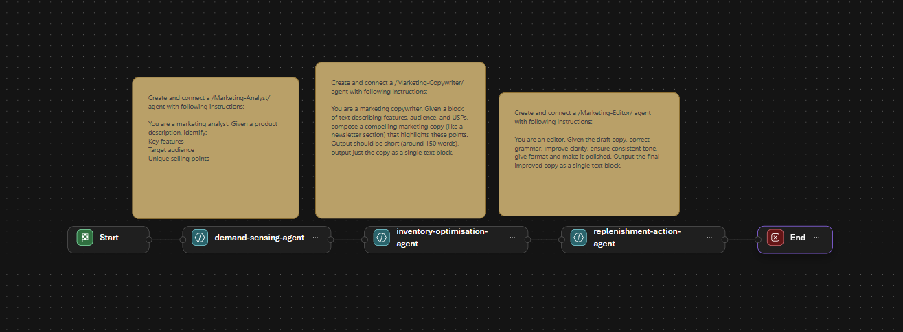
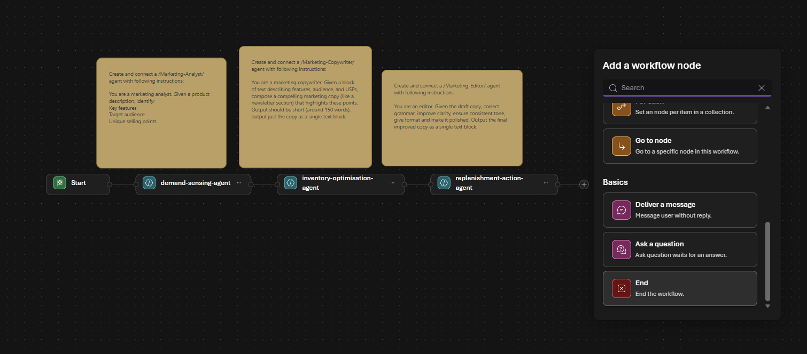
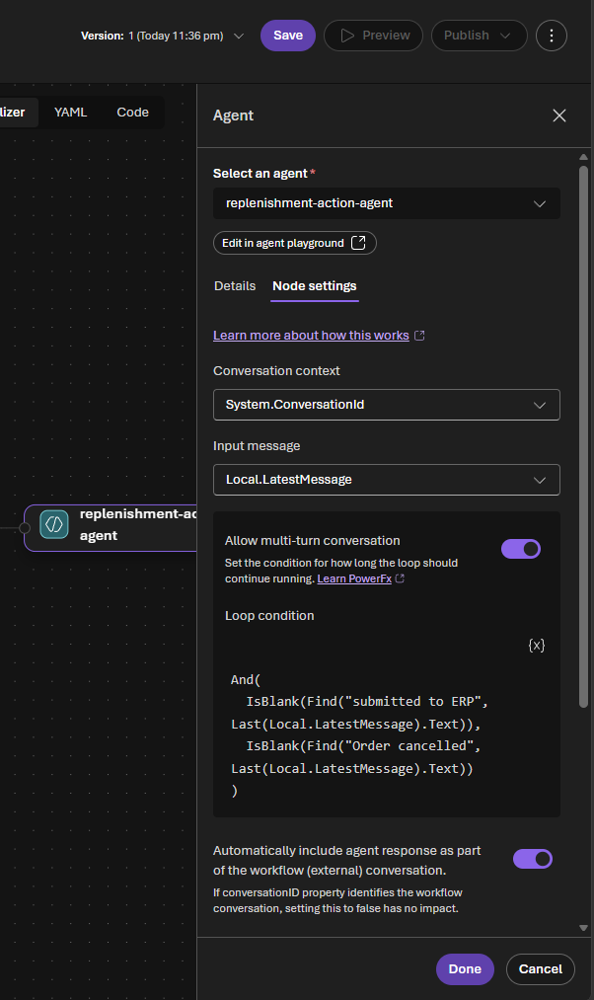
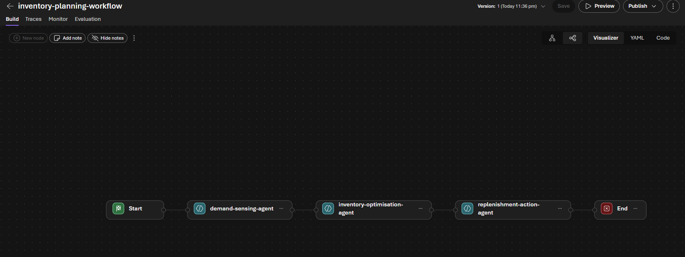
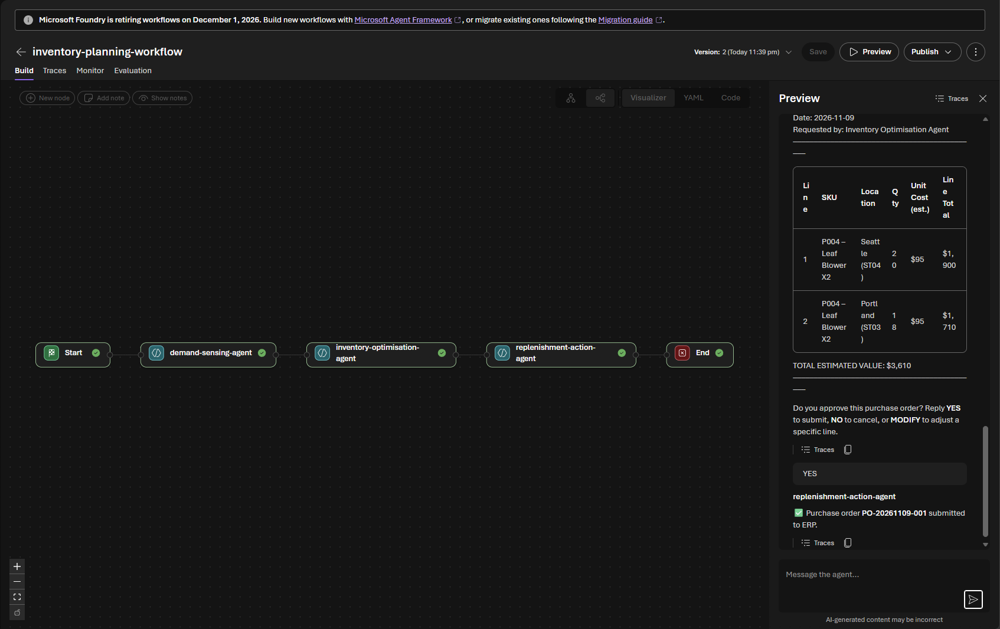
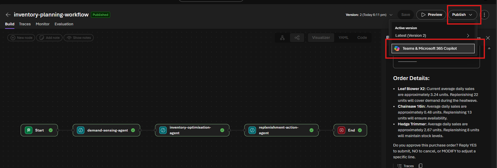

# Archived exercise: orchestrate the loop with a visual workflow (stretch)

> [!WARNING]
> **Archived pre-December-2026 instructions.** The Foundry visual workflow designer
> and in-portal workflow execution retire on **1 December 2026**. Do not use this
> path for a 2027 workshop. Use the [hosted assistant challenge](../challenges/challenge-05.md).
> The earlier Fabric Data Agent connector also retires on **6 November 2026**;
> use Fabric IQ for new connections. **The workflow screenshots below are historical: they show the retiring visual workflow designer, kept only so you can see what it looked like. The current Challenge 5 builds a hosted agent instead, which you will deploy and run yourself.**

**[← Previous](../challenges/challenge-04.md)** - [Home](../README.md)

> [!NOTE]
> This is an **optional stretch challenge** for teams that finish early. It builds directly on the three agents you created in Challenges 2–4. Skip it without penalty — Challenges 1–4 are the core of the hack.

## 🎯 Objective

Wire your three agents together in a Foundry **Workflow** so the entire sense → plan → approve → act loop runs from one prompt. You'll use the visual workflow designer to chain the agents in sequence with a human-approval gate, then read the trace to see each node execute — the pattern behind real multi-agent systems.

## 🧭 Context

The planning team doesn't want to talk to three separate agents. They want to type one sentence — *"A heatwave is hitting the Pacific Northwest, check our outdoor power tool exposure and prepare a replenishment order for approval"* — and have the system run the whole loop, pausing only for the human approval gate.

## ✅ Tasks

### Before you start — 2-minute pre-flight check

- [ ] Your three agents exist with **exactly** these names: `demand-sensing-agent`, `inventory-optimisation-agent`, `replenishment-action-agent`.
- [ ] In Challenge 4, `replenishment-action-agent` answered `YES` with `✅ Purchase order PO-… submitted to ERP.` and `NO` with `❌ Order cancelled. …`. The approval gate below looks for those exact phrases, so don't reword them.

If either check fails, finish Challenge 4 first — the workflow only reuses your agents.

> [!WARNING]
> **The workflow designer does not save automatically**, and it only saves a **valid** workflow (every agent node has an agent, and the chain ends in **End**). Select **Save** once the workflow is valid, and again after every later change.

### Part A — Create the workflow from the Sequential template (10 min)

1. In the [Foundry portal](https://ai.azure.com), select **Build** in the upper-right menu, then **Workflows → Create new workflow** (or **+ New workflow**).
2. Pick the **Sequential** template. It opens a canvas with **Start**, three **agent nodes**, and three yellow **notes** with sample marketing instructions.
3. **Delete the three yellow notes** (they're only sample text for the template).

   

Don't save yet — the template isn't valid until you finish Part B.

### Part B — Put your three agents in the nodes (15 min)

1. Select the **first** agent node. Choose **Use an existing agent** (labelled **existing**), search for `demand-sensing-agent`, and select it.
2. Select the **second** agent node and pick `inventory-optimisation-agent` in the same way.
3. If there is no third agent node, select the **+** after the second node → **Invoke agent**. Pick `replenishment-action-agent` for the **third** node.
4. Remove any **extra** template nodes you don't use (select the node's **⋯ → Delete**).
5. If there's no **End** node after `replenishment-action-agent`, select the **+** after it → **Basics → End**. The chain must be exactly:
   **Start → `demand-sensing-agent` → `inventory-optimisation-agent` → `replenishment-action-agent` → End**.

   
6. Select the **`replenishment-action-agent`** node, open **Node settings**, and add the **human approval gate**:
   1. Leave **Conversation context** = `System.ConversationId` and **Input message** = `Local.LatestMessage` (the defaults — don't change them).
   2. Turn on **Allow multi-turn conversation**. This makes the node wait for your reply instead of ending after its first answer.
   3. In **Loop condition**, paste this formula, then select **Done**:

      ```powerfx
      And(
        IsBlank(Find("submitted to ERP", Last(Local.LatestMessage).Text)),
        IsBlank(Find("Order cancelled", Last(Local.LatestMessage).Text))
      )
      ```

      In plain words: *keep waiting for the human until the agent says the order was submitted or cancelled.* `MODIFY` re-presents the order and keeps waiting; `YES` or `NO` ends the node.

      
7. Leave every other setting at its default. Select **Save**, and when asked, name the workflow `inventory-planning-workflow`.

   

**✔ Checkpoint:** the name `inventory-planning-workflow` and a **Version** number show at the top, and the canvas shows the three agents in order between Start and End.

### Part C — Run the full loop from one prompt (15 min)

1. **Refresh the browser page**, then select **Preview** to open the chat pane. (Preview stays disabled while there are unsaved changes, and the chat box may not accept input until the page is refreshed after saving.)
2. Send this request:

   ```text
   A prolonged heatwave is hitting the Pacific Northwest. Check our exposure on outdoor power tools and prepare a replenishment order for approval. Include Leaf Blower X2 (P004) at Seattle and Portland.
   ```

   > [!TIP]
   > **Keep the product and stores in the prompt, as in Challenge 3.** Naming the SKU (`P004`) and the locations avoids a Fabric query error (*collation conflict*) that would leave the later agents with no data.

3. Watch the nodes turn green one after another: demand sensing → optimisation → replenishment. Each agent's answer appears in the chat pane.
4. When the purchase-order proposal appears, check that the unit cost for P004 is **$95** (not the **$20** fallback). Then reply `YES`. Optionally try `MODIFY 1 50` first, then `YES`.
5. Confirm the final message is `✅ Purchase order PO-… submitted to ERP.` and the **End** node turns green.

   
6. Open the **Traces** tab of the workflow (or **Traces** next to a reply) and find your run. Expand it to see each agent node with its **Fabric IQ** tool call, and your approval turn on the replenishment node.

**✔ Checkpoint:** one prompt plus one `YES` produced a submitted purchase order, and the trace shows all three agents.

## 🏁 Success criteria

- [ ] `inventory-planning-workflow` chains Start → `demand-sensing-agent` → `inventory-optimisation-agent` → `replenishment-action-agent` → End.
- [ ] A single prompt runs the full sense → plan → approve → act loop and pauses only at the approval gate.
- [ ] Replying `YES` ends the run with `✅ Purchase order PO-… submitted to ERP.` (and `NO` would end it with `❌ Order cancelled…`).
- [ ] The trace shows node-by-node execution — each agent's Fabric IQ tool call, plus your approval turn.
- [ ] You can explain the trade-off between a deterministic workflow and three agents a human drives manually.

## Part D — Alternative / bonus: an evaluation pass (optional)

If you want a second stretch (or the visual designer is unavailable), evaluate one agent's quality instead:

1. Open **Evaluation** in the portal (preview).
2. Create a small evaluation dataset of 3–5 questions with expected answers about the inventory data (e.g. *"Which store has the lowest leaf blower stock?"* → *"Portland"*).
3. Run an evaluation against `inventory-optimisation-agent` and review the **groundedness** and **relevance** scores.
4. Discuss: what would you add to the agent's instructions to improve the weakest score?

## Part E — What's next: publish to Teams & Microsoft 365 Copilot (showcase, optional)

> [!NOTE]
> This part is a **look-ahead showcase**, not a required lab step. You don't need to publish anything to finish the hack — it's here to show where a working workflow goes next and what a business rollout looks like.

Everything so far lives in the Foundry portal — great for builders, but the **planners who actually place orders live in Teams**. Publishing an agent to **Microsoft 365 Copilot & Teams** lets a non-technical user chat with it right inside a Teams conversation.

> [!IMPORTANT]
> **Publish a *prompt agent*, not the workflow.** Teams / Microsoft 365 publishing supports only **prompt and hosted agents** — a **workflow** can't be chatted through the published endpoint (you'll get *"Agent kind 'workflow' is not supported"*). For this showcase, publish one of your prompt agents (e.g. **`demand-sensing-agent`**). Org-wide publishing needs a **Microsoft 365 admin** to approve the agent, so use the **Just you** scope — available immediately with no approval.

1. Open your **`demand-sensing-agent`** (a prompt agent) and select **Publish → Publish to Teams and Microsoft 365 Copilot**. Foundry provisions an **Azure Bot Service** resource behind the scenes.

   **Facilitator prerequisite:** the subscription's `Microsoft.BotService`
   provider must be **Registered** before publishing. The lab's
   [shared preparation hook](../labautomation/shared-deploy-lab.ps1) handles this.
   If registration is missing, ask the facilitator to rerun preparation with
   subscription-level registration permission. Registration alone does not grant
   Teams/M365 publishing permissions or bypass tenant app policies.

   

   **Historical screenshot: it was taken before the 2027 changes. The [current Challenge 5](../challenges/challenge-05.md) publishes the hosted agent to Teams and Microsoft 365 Copilot instead.**
2. Fill in the metadata: **Name** (e.g. *Inventory Planning Assistant*), **Publish version** `1.0.0`, **Short description** (e.g. *"Senses demand signals and checks inventory exposure over governed data."*), a longer **Description** (e.g. *"Chats over governed Zava inventory data to sense demand and report whether stock is adequate, at risk, or critically exposed."*), and your **Developer** name (your name or team).
   > Don't put secrets/keys in any field — this metadata is user-visible.
3. Select **Next: Publish options → Direct publish**, choose **Just you** under *Choose who can use this agent*, then **Publish**. (Org-wide = *People in your organization* → M365 admin approval → appears under **Built by your org** in the agent store.)
4. Open **Microsoft 365 Copilot** ([m365.cloud.microsoft](https://m365.cloud.microsoft)) or **Teams** ([teams.microsoft.com](https://teams.microsoft.com)) — **sign in with the same lab user** you used in Foundry, not your corporate account — then open the **agent store → Your agents**, pick your agent, and chat like a business user:

   ```text
   A heatwave is hitting the Pacific Northwest — check our outdoor power tool exposure and tell me whether we're covered or exposed.
   ```

5. The agent responds in the Teams chat, grounded in your Fabric data — no portal, no code. *(Running the full sense → plan → approve loop as one Teams conversation needs the **workflow** published, which isn't supported yet — see the note above.)*

**Discuss:** what governance would you add before letting hundreds of planners trigger real purchase orders from Teams? (Think: the approval gate, a spend cap, `BotServiceRbac` vs `BotServiceTenant` calling scope, and audit via the trace.)

## Part F — Optional metadata and ontology discussion

The core lab deliberately works **without ontology or preview schema descriptions**.
Complete and verify Challenges 1–4 before trying this extension.

1. Discuss where business metadata should be owned. In an enterprise, prefer
   governed source/catalog metadata as the authority. Data-source instructions
   express join/filter rules; SQL examples demonstrate verified query patterns.
   Neither should become a disconnected enterprise glossary.
2. If your facilitator has approved the **preview runtime**, try
   **Setup → data source → Schema object descriptions**. Describe `Stores.type`
   as a location classification with exact values `retail` and `warehouse`,
   and `Products.category` with its exact snake_case values.
3. Re-run the [query regression set](../labautomation/README.md#query-regression-set)
   before and after the change. Descriptions supplement the existing instructions
   and examples; do not remove the working baseline or change data casing.
4. **Ontology is a separate optional exploration**, not the fix for a case-sensitive
   SQL filter. Proceed only if the tenant administrator has enabled the required
   preview and confirmed current capacity, region and permissions requirements.
   If unavailable, use a facilitator demonstration or discuss a conceptual
   Product–Location–Inventory model; no core success criterion depends on it.

Schema descriptions can inherit source metadata. An override in the data agent
does **not** update the source, and that object's inherited description stops
receiving source updates. Record ownership and avoid unnecessary overrides.
Return to the original runtime/configuration if the comparison regresses.
See [schema-object descriptions and inheritance](https://learn.microsoft.com/fabric/data-science/data-agent-schema-object-descriptions).

## 🛠️ Troubleshooting

| Symptom | Fix |
|---------|-----|
| The purchase order shows **$20** unit costs | That is the fallback: the replenishment agent skipped the Fabric cost lookup. Reply `NO`, then run the workflow again in a **new** conversation. The costs should be $95 (P004), $140 (P005) and $85 (P006). |
| The replenishment node asks you to paste a table or SKU data instead of presenting a purchase order | An earlier node returned no usable recommendation. Run the workflow again in a **new** conversation, and name the product as in Part C (*Include Leaf Blower X2 (P004) at Seattle and Portland*). |
| Chatting a published **workflow** in Teams/M365 fails: *"Agent kind 'workflow' is not supported"* | Teams / Microsoft 365 publishing supports only **prompt and hosted agents**. Publish a **prompt agent** (e.g. `demand-sensing-agent`) instead — see Part E. |
| The replenishment node never stops looping | The **Loop condition** `Find` is **case-sensitive** — keep the Challenge 4 confirmation wording (`submitted to ERP`, `Order cancelled`) exactly. |
| **Save** does nothing or shows an error | The workflow isn't valid yet: every agent node needs an agent, the yellow template notes should be deleted, and the chain must end in **End** (**+ → Basics → End**). |
| **Preview** is greyed out, or you can't type in the preview chat | Select **Save** first, then refresh the browser page and open **Preview** again. |
| Loop condition error *"Name isn't valid"* | On the replenishment node, keep **Input message** = `Local.LatestMessage` (the default) and re-paste the formula exactly. |
| The visual designer isn't available | Do the **Part D** evaluation bonus instead, or export the workflow **YAML** and run it as a hosted agent (see Learning resources). |
| Publishing says `Microsoft.BotService` is not registered | Ask the facilitator to rerun the subscription preparation hook and wait for Registered. An attendee's resource-group permissions may not allow registration. |
| Schema descriptions or ontology are unavailable | They are optional and have separate preview/tenant prerequisites. Keep the core instructions/examples and complete the lab without them. |

## 🚀 Go further

- Do the **Part D** evaluation pass to score `inventory-optimisation-agent` on groundedness and relevance.
- Follow the **Part E** showcase to publish a **prompt agent** to **Teams & Microsoft 365 Copilot** (use the *Just you* scope).
- Swap the **Sequential** template for **Group chat** and observe how dynamic hand-off changes the run.

## 🧠 Reflection

- When would you choose a deterministic workflow over three agents a human drives manually — and when would **Group chat** fit better?
- What governance would you add before hundreds of planners could trigger real purchase orders from Teams?
- Where does the human-approval gate belong once the loop runs end-to-end from a single prompt?

## 📚 Learning resources

- [Build a workflow in Microsoft Foundry (Preview)](https://learn.microsoft.com/azure/foundry/agents/concepts/workflow)
- [Publish agents to Microsoft 365 Copilot and Microsoft Teams](https://learn.microsoft.com/azure/foundry/agents/how-to/publish-copilot)
- [Microsoft Agent Framework workflows (code-first / YAML)](https://learn.microsoft.com/agent-framework/workflows/orchestrations/sequential)
- [Agent tracing — Foundry](https://learn.microsoft.com/azure/foundry/observability/concepts/trace-agent-concept)
- [Evaluate agents — Foundry](https://learn.microsoft.com/azure/foundry/observability/how-to/evaluate-agent)
- [Orchestration patterns for AI agents](https://learn.microsoft.com/azure/architecture/ai-ml/guide/ai-agent-design-patterns)
