# Challenge 1 — Get Grounded

**[Home](../README.md)** - [Next Challenge →](challenge-02.md)

## 🎯 Objective

Understand the inventory scenario, provision your own Fabric workspace + Data Agent, and learn the pattern you will build across the next three challenges. No Foundry agent-building yet — just reading, exploring, standing up your data backend, and forming a clear mental model.

## 🧭 Context

You are a developer at a retail company. The planning team complains that their inventory decisions are always based on last month's data. By the time a demand spike or supplier disruption becomes visible in the ERP, it is too late. Your job is to build three agents that close this gap:

1. **Demand Sensing** — react to real-world changes before they hit the system
2. **Inventory Optimisation** — decide the right stock level given the updated demand picture
3. **Replenishment Action** — submit the order with a human review step

The data lives in **Microsoft Fabric** (a governed Lakehouse with inventory, demand, product, and market-signal data). In this challenge you'll stand up **your own** Fabric workspace and publish a **Fabric Data Agent** on top of it (one notebook, Run All) — then connect your Foundry agents to it in the next challenges.

> [!IMPORTANT]
> Understanding the architecture saves you time in the next challenges. Spend the full 45 minutes here; do not rush ahead.

## ✅ Tasks

1. **Read the Zava data model.**
   The Fabric **Lakehouse** you'll create in Task 3 has the following tables. You do not need to know SQL or Fabric to use them — the agents query in plain English.

   | Table | What it contains | Used by |
   |-------|-----------------|------|
   | `Inventory` | Current stock (`onHand`), `reorderPoint`, and `safetyStock` per product per store/warehouse | Challenges 2, 3 |
   | `DemandHistory` | Weekly sales units per product per location | Challenge 2 |
   | `ExternalSignals` | Pre-loaded market signals: competitor pricing, search trends, weather, news (sourced from Web IQ) | Challenge 2 |
   | `Products` | Product catalogue: `name`, `category`, `unitCost`, `leadTimeDays`, `supplierId` | Challenges 3, 4 |
   | `Stores` | Store and warehouse locations with region and type | Challenges 2, 3 |
   | `ReplenishmentOrders` | Purchase orders and transfers — status, approver, items JSON | Challenge 4 |
   | `Suppliers` | Supplier details | Challenge 4 |

   **Real product categories:** `garden_and_lawn`, `outdoor_power_tools`, `paint_and_supplies`, `smart_home`
   **Real locations:** 4 retail stores (Boston, Brooklyn, Portland, Seattle) + 2 distribution warehouses (Chicago, Dallas)

2. **Explore the Foundry portal.**
   Navigate to [ai.azure.com](https://ai.azure.com) and open **your** Foundry project — its `FoundryProjectEndpoint` is on your lab dashboard.

   > [!IMPORTANT]
   > **Shared tenant — make sure you open *your* project.** Every attendee's projects are listed together at [ai.azure.com](https://ai.azure.com) and the names look alike. To find yours, match the **`FoundryProjectEndpoint`** on your lab dashboard (the **Credentials** tab of the MicroHack portal) to the project's **Parent resource** shown in Foundry. Work only in that project.

   - Locate your **model deployments**: select **Models** in the left menu, then the **Deployments** tab. Confirm `gpt-5.4-mini` is listed with status **Succeeded**.
   - Open a **deployed model → Playground** and send this test message (in the current Foundry portal you open the Playground from a model or an agent — there is no top-level *Agents → Playground* menu):

     ```text
     What can you do?
     ```
   - You will inspect agent decisions in Challenges 3 and 4 in the agent's **Traces** tab (not a top-level *Tracing* menu).

   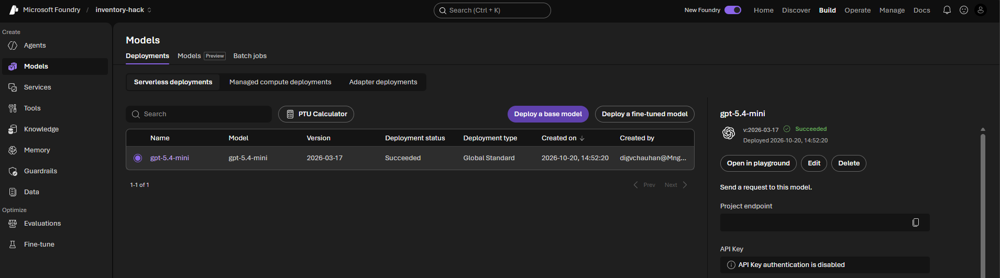

   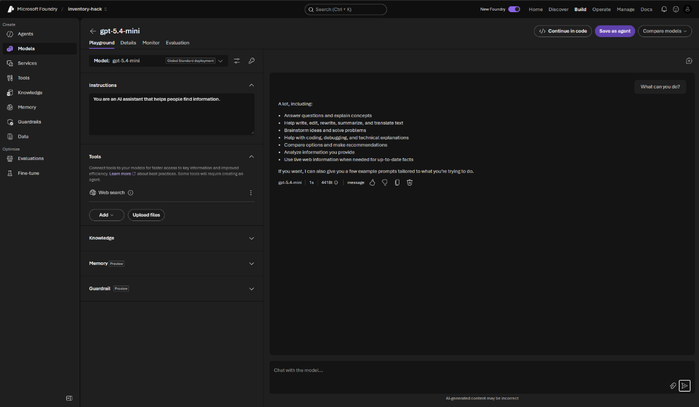

   > [!NOTE]
   > **The model name in the screenshots is only for illustration.** Some captures may show `gpt-4o-mini` (or another model) selected — that's just what was deployed when the screenshot was taken. Use **whatever model is deployed in your project** (check your **model deployments** list, e.g. `gpt-5.4-mini`). The model is swappable; every step in this hack works the same regardless of which chat model is deployed.

3. **Provision your own Fabric workspace and lakehouse.** *(~5 min)*

   Your lab dashboard gives you a **`FabricCapacityName`** — your own Fabric **capacity**. You'll stand up a workspace on it and publish your own Data Agent by running one notebook. Follow each step carefully — this is the data backend every later challenge depends on.

   **a. Create your workspace on your Fabric capacity.**
   Go to [app.fabric.microsoft.com](https://app.fabric.microsoft.com) → **Workspaces** (left rail) → **+ New workspace**.

   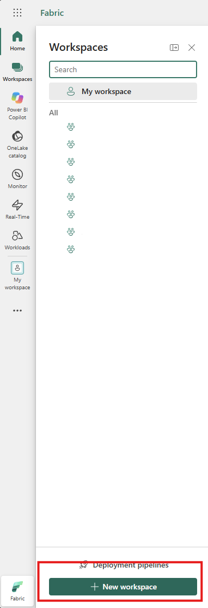

   Name it **`inventory-hack-<your-lab-user>`** (e.g. `inventory-hack-labuser-0001`) — Fabric workspace names must be **unique across the whole tenant**, so a plain `inventory-hack` is rejected once another attendee has taken it. Expand **Advanced**, and under **Workspace type** select **Fabric**. A **Details** dropdown appears — select your **`FabricCapacityName`** (the `invcap…` value from your dashboard). Leave the other settings, such as **Contact list** and **Semantic model storage format**, at their defaults. Click **Apply**.

   > [!NOTE]
   > Wherever the rest of this hack refers to the **`inventory-hack`** workspace, it means **your** uniquely-named workspace. The Lakehouse (`InventoryLakehouse`) and Data Agent (`inventory-hack-agent`) names live *inside* your workspace, so keep those exactly as written.

   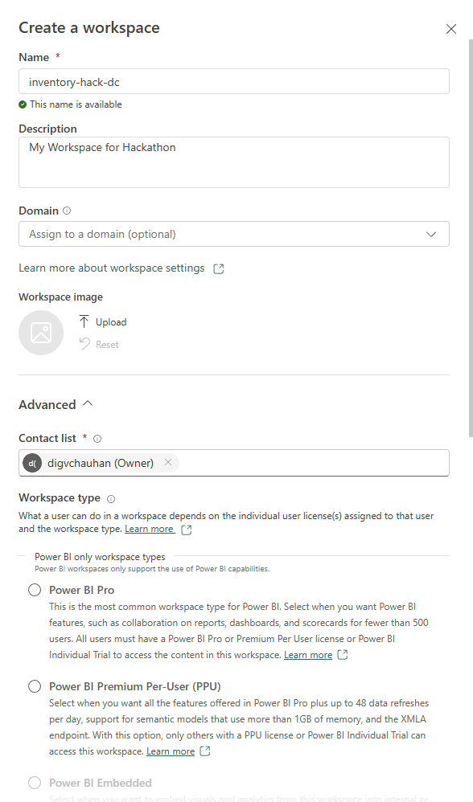

   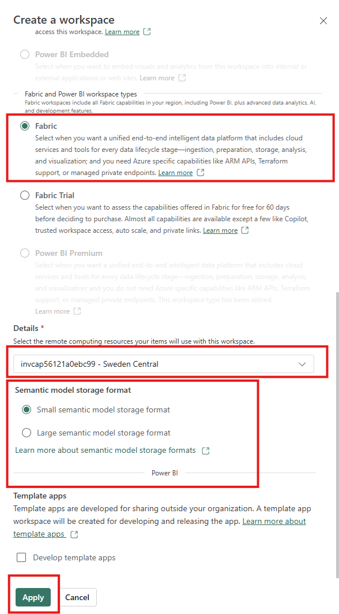

   > If your capacity isn't in the dropdown: it must be **running** (Azure portal → your Fabric capacity → **Resume**), and you must be signed in as the lab user it was assigned to. Ask your facilitator if it still doesn't appear.

   **b. Create the Lakehouse.**
   Inside the workspace, click **+ New item**, choose **Lakehouse** (type `lake` in the search box to find it fast), and name it exactly **`InventoryLakehouse`** — the notebook writes its tables here. Leave **Lakehouse schemas** ticked (the default); the tables are created under the `dbo` schema.

   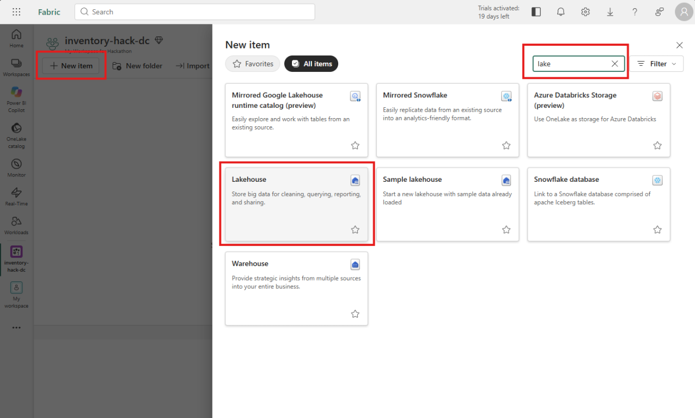

   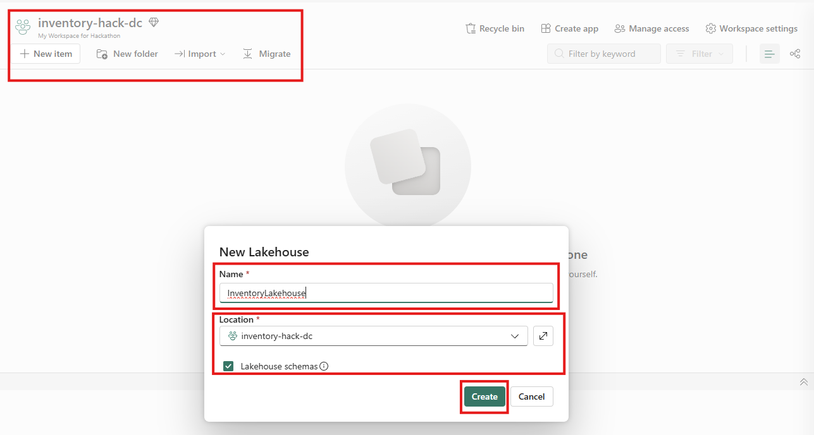

4(a). **Load the data and create a Data Agent (manually).** *(~20 min)*

   > [!NOTE]
   > Follow either this section or section 4(b) if you'd like to load the data and create the data agent using code.

   **a. Upload the seed data.**
   The seven `.parquet` files are in the hack repo's [`data/`](../data/) folder. Open **`InventoryLakehouse`**. In the **Explorer**, select the **...** next to **Files**, then **Upload → Upload files** (the **Upload files** tile on the home page also works). Use the folder button to select all seven files, click **Upload**, and wait until every file shows a green completion check.

   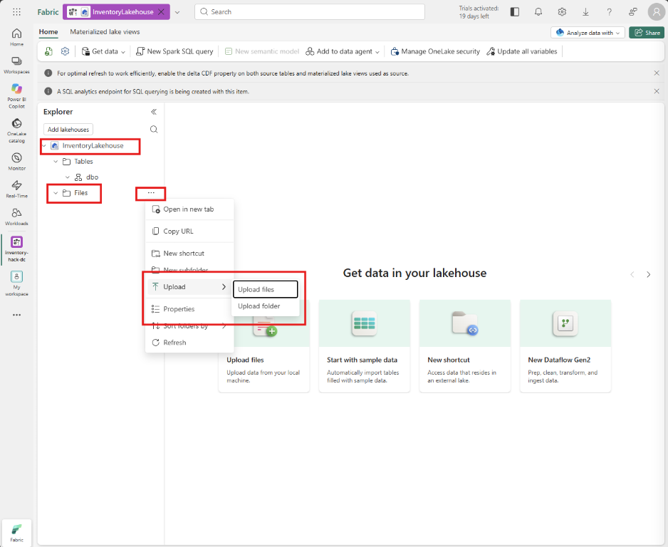

   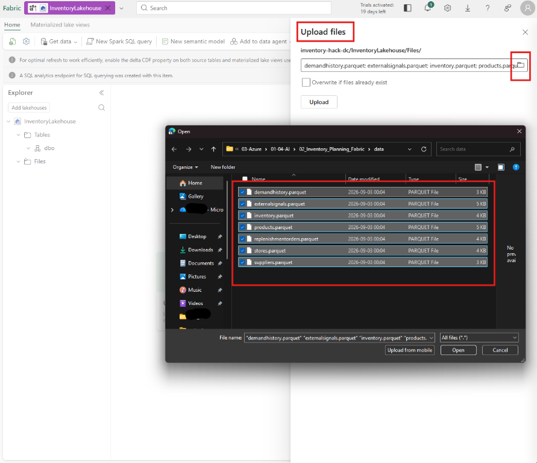

   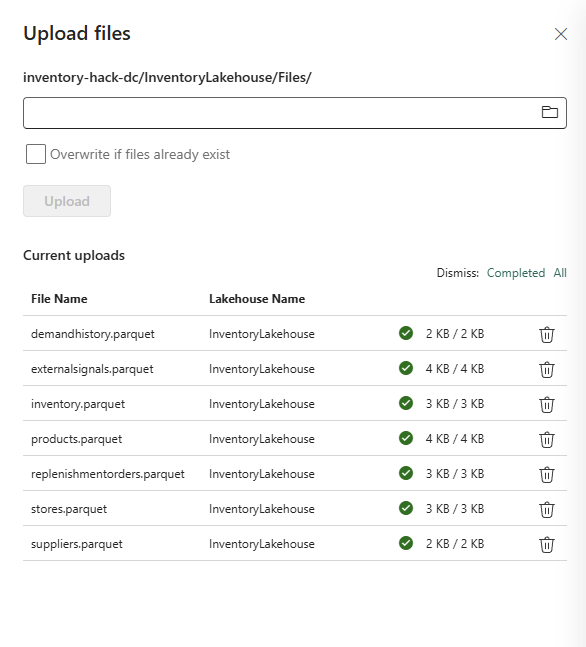

   **b. Load each file into a new table.**
   In the Lakehouse **Explorer**, expand **Files**. For each `.parquet` file, select its **...** menu, then **Load to Tables → New table**.

   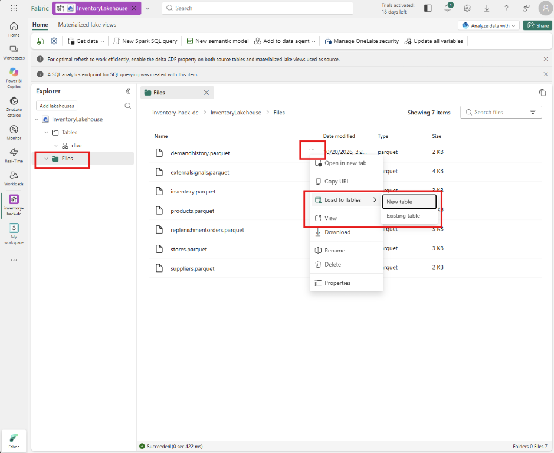

   Keep the schema as **`dbo`**, set the table name to the file name without the `.parquet` extension, and click **Load**. For example, load `demandhistory.parquet` into a table named `demandhistory`. Repeat this for all seven files.

   > [!NOTE]
   > **Load the files one at a time.** *Load to Tables* runs as a background Spark job. After a few loads (it can be around the fourth file), a finished job may keep showing **In progress** and hold on to Spark cores, so the next load fails or hangs. This is not a capacity problem, so you don't need a larger capacity. If Fabric suggests the legacy Monitor hub, use the new **Monitoring** view instead. Cancel the stuck job:
   > 1. Open the **Monitor** hub from the left navigation rail, then select **Job runs** (the new **Monitoring** view).
   > 2. Select **`InventoryLakehouse`** in the list. On **Last run details**, find the **TableLoad** job with Status **In progress**.
   > 3. Select **Cancel** and confirm.
   > 4. Wait until the status shows **Cancelled**, then retry that file into a new table.
   >
   > 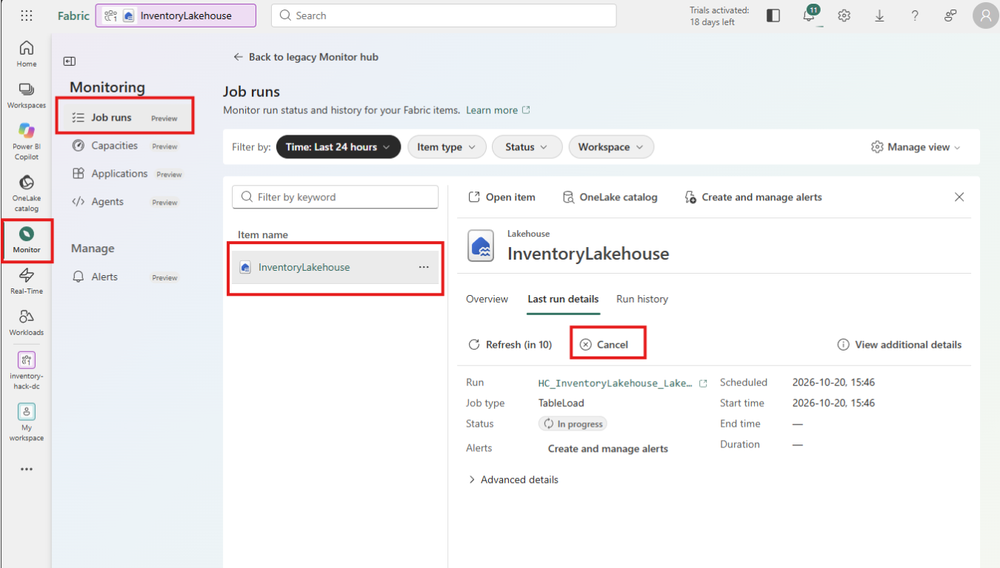

   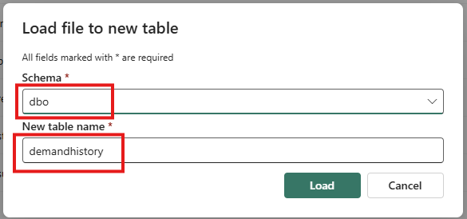

   **c. Verify the tables.**
   Expand **Tables -> dbo** and confirm that these seven tables appear: `demandhistory`, `externalsignals`, `inventory`, `products`, `replenishmentorders`, `stores`, and `suppliers`.

   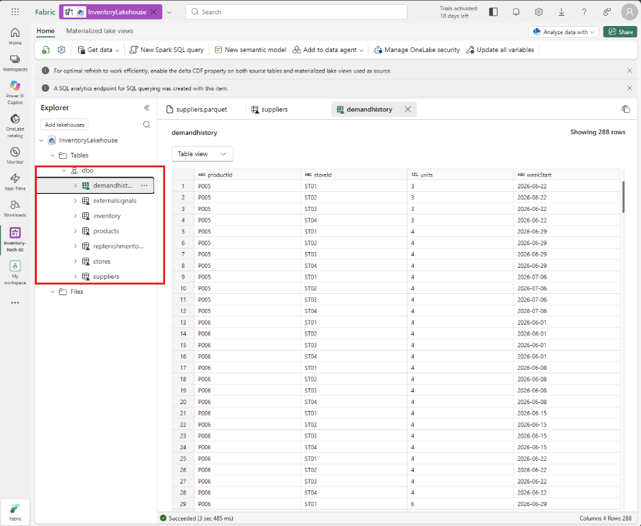

   **d. Create the Data Agent.**
   Return to **your** `inventory-hack-…` workspace, select **+ New item**, search for `agent`, and choose **Data agent**.    Name it  **`inventory-hack-agent`** and select **Create**.

      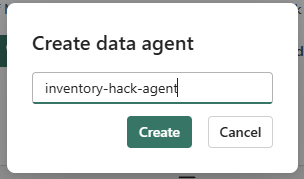

      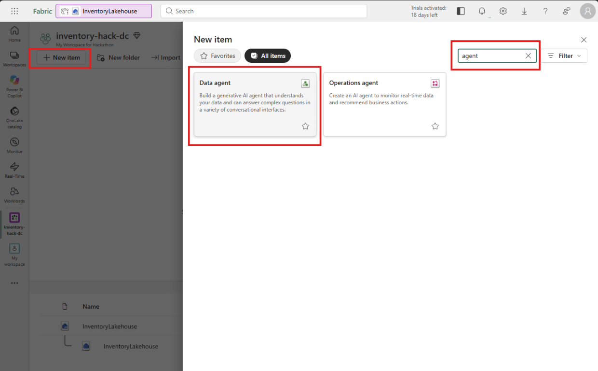

   **e. Add the Lakehouse data source.**
   On the agent's **Sources** tab (in the left **Explorer**), select **Add sources -> Data source**.

   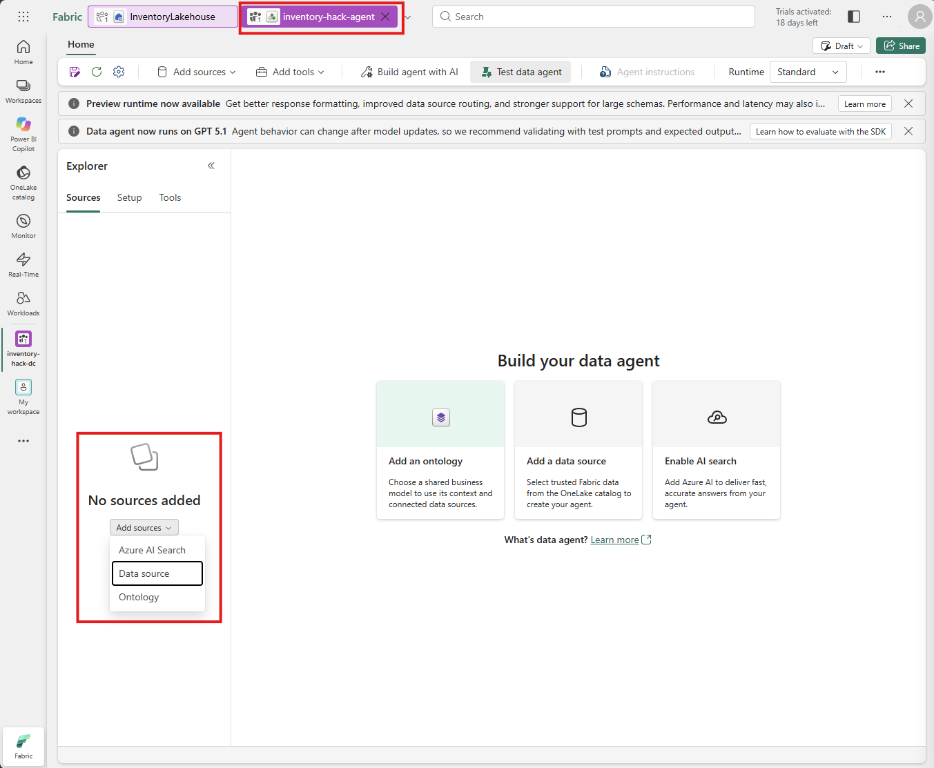

   The **OneLake catalog** opens. It can list several lakehouses called `InventoryLakehouse` from other attendees, so use the **Filter** to show only **Lakehouse**, and hover over the entries or open the **Explorer** pane on the left of the catalog to pick the one in **your** `inventory-hack-…` workspace. Select it, then **Add**. When the agent opens, tick all seven tables under **Schemas -> dbo -> Tables**.

   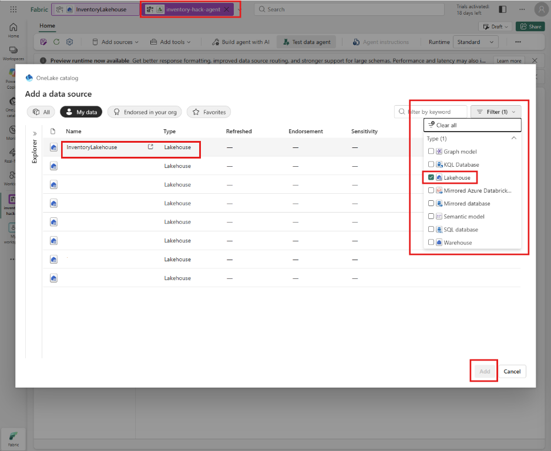

   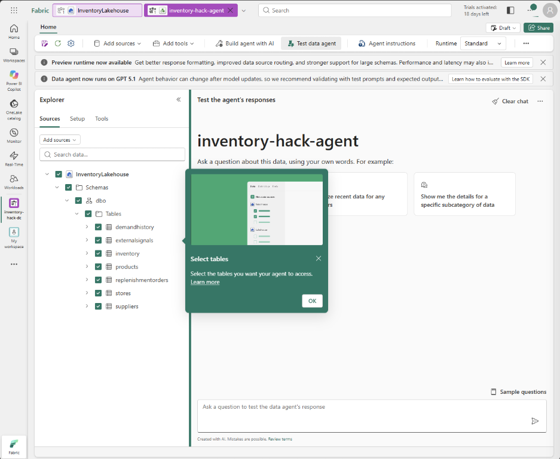

   **f. Add the agent instructions.**
   Open **Setup -> Agent instructions** and enter the following instructions:

   ```text
   You answer questions about Zava retail inventory. Use these tables: Inventory (onHand, reorderPoint, safetyStock per product per location), Products (name, category, unitCost, leadTimeDays, supplierId), Stores (retail stores and warehouses with region/city/state), DemandHistory (weekly units sold per product per store), ExternalSignals (market signals with affectedCategories), Suppliers, and ReplenishmentOrders (past purchase/transfer orders). Category values are stored as lowercase snake_case: garden_and_lawn, outdoor_power_tools, paint_and_supplies, smart_home. When a question names a category in plain English (e.g. "Outdoor Power Tools"), map it to the exact snake_case value before filtering; the same applies to affectedCategories in ExternalSignals. Prefer filtering by productId/SKU (e.g. P004) when the question names specific products. Always return exact numbers. Flag a product as CRITICAL when onHand is below safetyStock.
   ```

   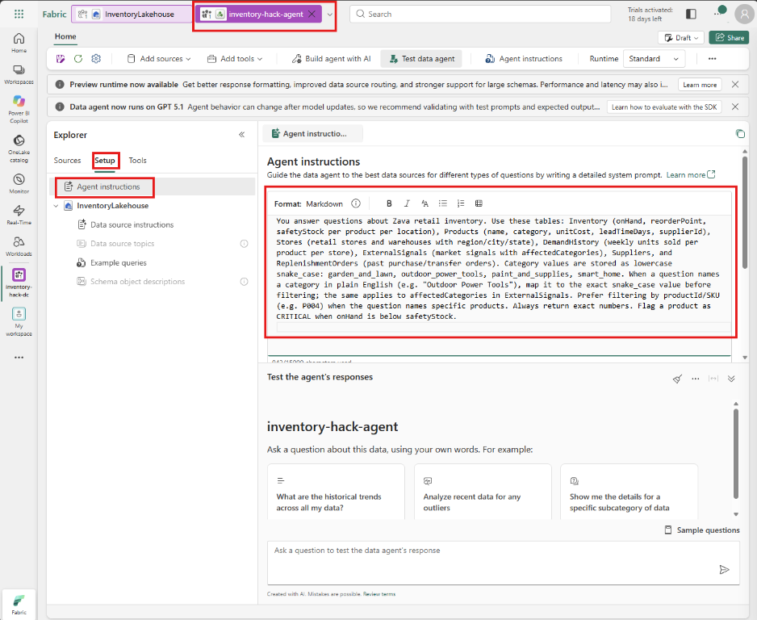

   **f2. Configure query generation at the data source.**

   Agent instructions guide the overall response; **data-source instructions**
   guide SQL generation. In **Setup**, select `InventoryLakehouse` and open its
   **Data source instructions**. Add the following (the notebook applies this
   automatically):

   ```text
   Use exact stored values in case-sensitive filters. Stores.type is 'retail' or 'warehouse'; map Retail/retail stores to 'retail' and warehouses/distribution centres to 'warehouse'.
   Products.category values are garden_and_lawn, outdoor_power_tools, paint_and_supplies, smart_home. Map plain-English category names to these exact values.
   ExternalSignals.affectedCategories is a comma-separated list: match a whole category token, not equality against the entire list.
   Stores.region uses exact values including 'Pacific Northwest', 'Northeast', 'Midwest', 'South'.
   Inventory has one row per productId/storeId; join Products on productId and Stores on storeId.
   DemandHistory has one row per productId/storeId/weekStart and its sales column is units, not unitsSold. Aggregate demand before joining to Inventory to avoid multiplying stock by the number of weeks.
   Use the latest available weekStart as the reference for recent sales; the seed is historical, not live.
   Suppliers joins Products on supplierId. ReplenishmentOrders has one row per orderId and itemsJson holds line items.
   CRITICAL means onHand < safetyStock, not <=. Return productId, storeId and exact stock numbers when relevant.
   For specific products prefer productId (e.g. P004). A valid empty result means no matching rows: never remove requested filters or invent inventory. Inspect the generated query and exact values before retrying.
   ```

   Under the same data source, add these **example question / SQL query** pairs.
   They teach exact filters without changing the source data's casing or collation.

   **How many retail stores do we have?**
   ```sql
   SELECT COUNT(*) AS retailStoreCount FROM dbo.Stores WHERE [type] = 'retail'
   ```

   **Show Leaf Blower X2 stock and safety stock at retail stores in the Pacific Northwest.**
   ```sql
   SELECT i.productId, s.storeId, s.city, i.onHand, i.safetyStock,
          CASE WHEN i.onHand < i.safetyStock THEN 'CRITICAL' ELSE 'adequate' END AS stockStatus
   FROM dbo.Inventory i JOIN dbo.Stores s ON i.storeId = s.storeId
   WHERE i.productId = 'P004' AND s.[type] = 'retail' AND s.region = 'Pacific Northwest'
   ORDER BY s.storeId
   ```

   **What is the total outdoor power tools stock at retail stores?**
   ```sql
   SELECT SUM(i.onHand) AS totalOnHand FROM dbo.Inventory i
   JOIN dbo.Products p ON i.productId = p.productId
   JOIN dbo.Stores s ON i.storeId = s.storeId
   WHERE p.category = 'outdoor_power_tools' AND s.[type] = 'retail'
   ```

   **Show inventory for product P999.**
   ```sql
   SELECT productId, storeId, onHand FROM dbo.Inventory WHERE productId = 'P999'
   ```

   **g. Test the Data Agent (before publishing).**
   Open the **Test data agent** pane and ask:

   ```text
   How many Leaf Blower X2 units are on hand at the Portland and Seattle stores, and are they below safety stock?
   ```

   You should get exact numbers with **CRITICAL** flags — proof your tables are selected and the agent reasons correctly. Testing the draft here confirms it works *before* you publish.

   Also ask **"How many Retail locations do we have?"** (expected: **4**) and
   **"Show inventory for product P999."** (expected: **no matching rows**).
   A grammatically convincing response is not proof: check the numbers and filters.

   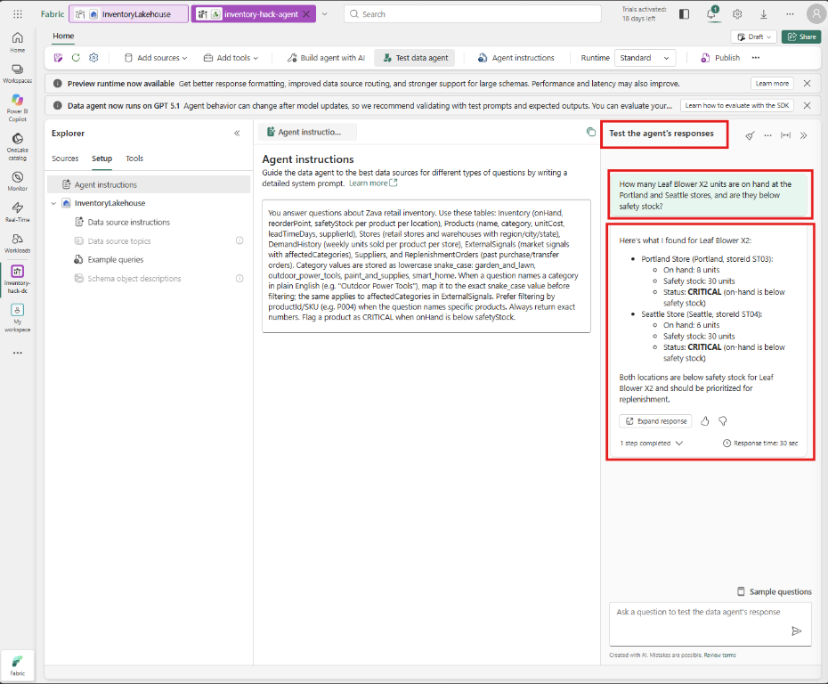

   **h. Publish the Data Agent.**

   Click **Publish** in the top toolbar. In the **Publish data agent** dialog, enter a short description of the agent's purpose and capabilities, for example: `Zava inventory data agent for the Agentic Inventory Planning MicroHack.` Leave **Also publish to Microsoft Copilot** turned off, then click **Publish**.

   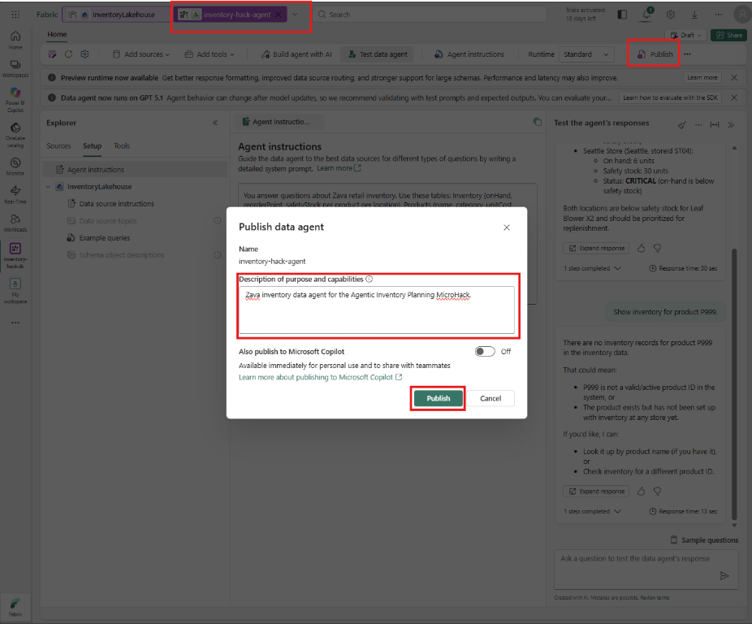

   **i. Get your two IDs.**

   After publishing, click the **Settings** gear in the data agent toolbar. Select **Model Context Protocol (MCP)**, then copy the **MCP server URL** using the copy icon.

   > [!NOTE]
   > Earlier builds of Fabric exposed a **Publishing → Published URL** here. That field has been replaced by the **Model Context Protocol** page — use the **MCP server URL** instead; it carries the same two IDs.

   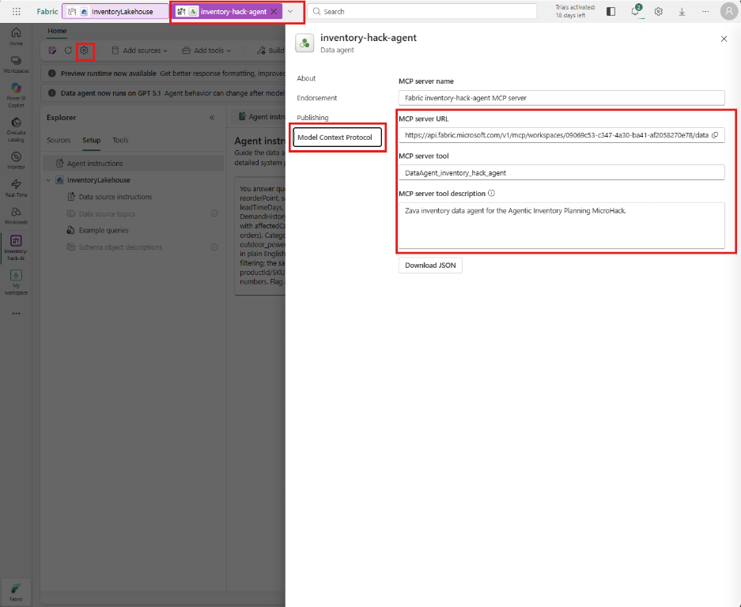

   Paste the URL into a text editor. It has this format:

   ```text
   https://api.fabric.microsoft.com/v1/mcp/workspaces/<workspace-id>/dataagents/<agent-id>/agent
   ```

   Copy and note these two values:
   - **Workspace ID** — the value between `/workspaces/` and `/dataagents/`
   - **Agent ID** — the value between `/dataagents/` and `/agent`

   Keep both IDs for diagnostics/SDKs. In Challenge 2, select the published
   `inventory-hack-agent` through **Fabric IQ (OneLake Catalog)** instead of the
   earlier ID-entry connector.

   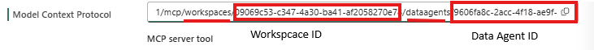

4(b). **Load the data and create a Data Agent (with code).** *(~20 min)*

   > [!NOTE]
   > Follow either this section or section 4(a) if you'd like to load the data and create the data agent manually.

   **a. Import the setup notebook.**
   Download **`Setup-InventoryDataAgent.ipynb`** from the hack repo's **`setup/`** folder (or the link your facilitator shares). In the workspace toolbar, click **Import → Notebook → From this computer**, then **Upload** and choose the file. You'll see an **Imported successfully** confirmation — open the notebook.

   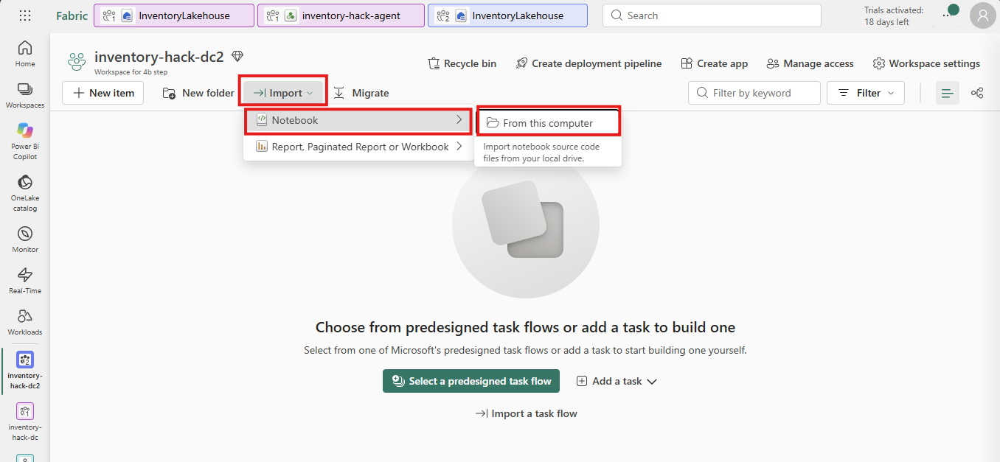

   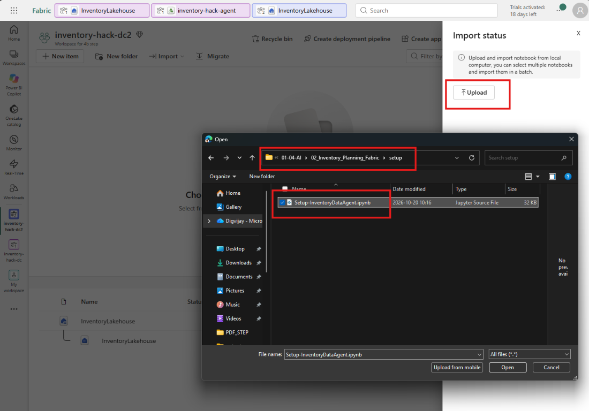

   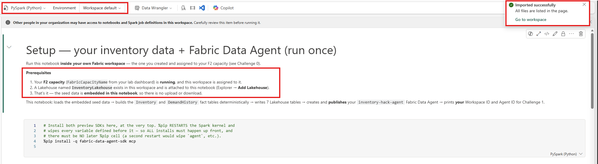

   **b. Attach your Lakehouse to the notebook.**
   Open the imported notebook. In the left **Explorer** pane click **Add data items → From OneLake catalog**. In the dialog, tick **`InventoryLakehouse`** and click **Add** — if more than one appears, pick the row whose **Location** is **your `inventory-hack-…` workspace**. It becomes the notebook's **default** Lakehouse. **Without this, the table-write cells fail.**

   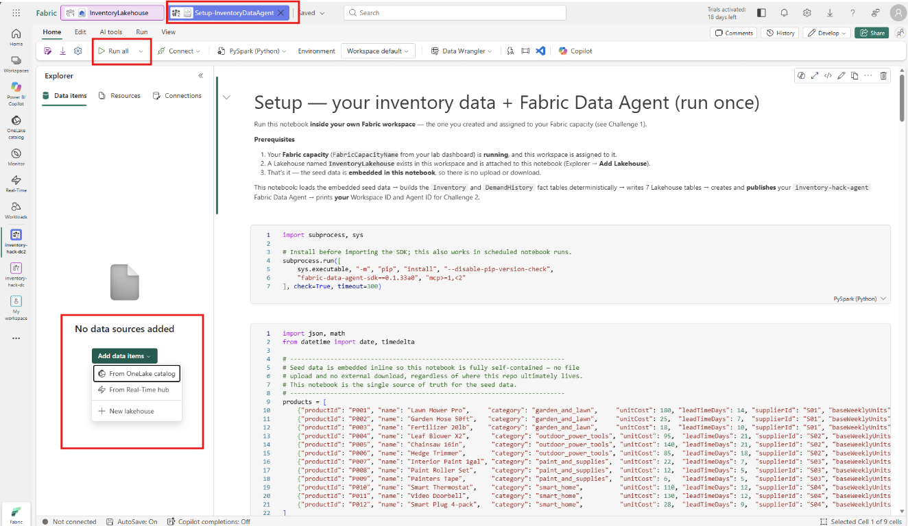

   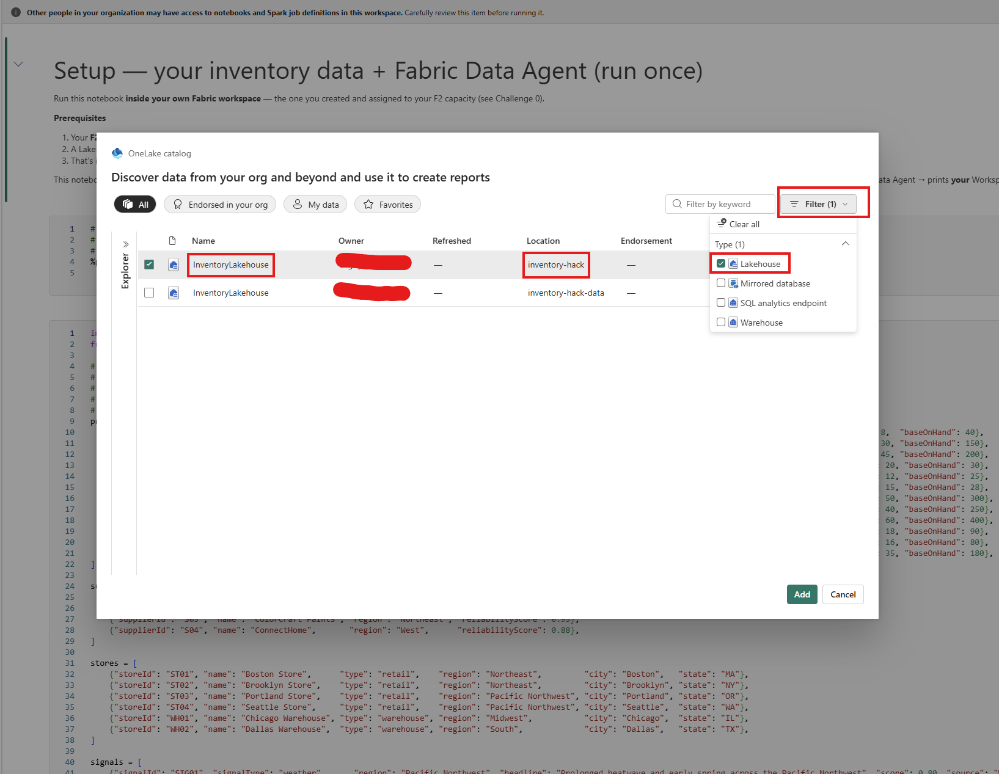

   **c. Run all.**
   Click **Run all**. The notebook installs its tested preview SDK version using the notebook's Python interpreter, loads its embedded seed data, writes **7 tables**, refreshes the SQL analytics endpoint metadata, and **publishes** your `inventory-hack-agent` Data Agent (~5–10 min). No kernel restart is required.

   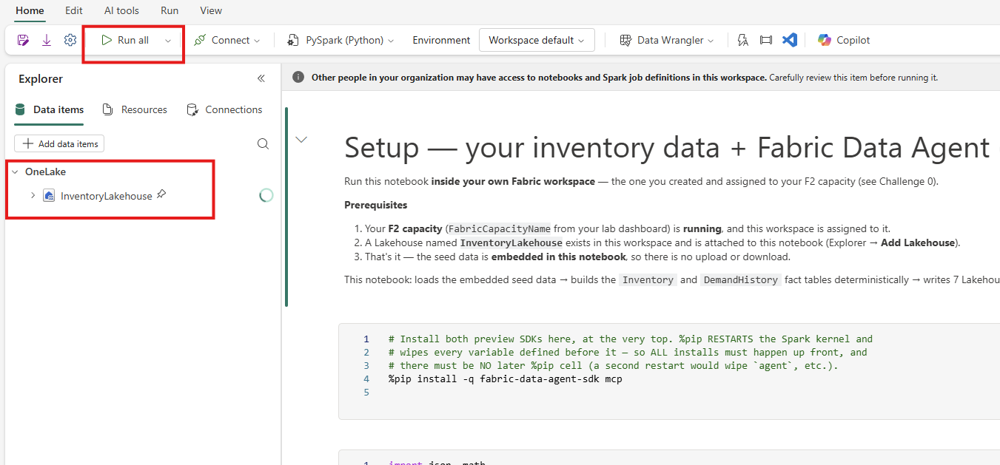

   > [!IMPORTANT]
   > **First run on a fresh capacity — the table-selection step may need a moment (or a manual tick).** The publish cell selects your 7 tables automatically, but on a **cold capacity** the Lakehouse's **SQL analytics endpoint** can take a couple of minutes to expose the newly-written tables. Until that schema sync finishes you may see **either**:
   > - the notebook raise **`No tables were selected (schema may still be syncing)`**, or
   > - an **`Error updating data agent data source selection(s)`** toast if you tick tables in the portal too early.
   >
   > If the table-write cells succeeded, this can be first-run schema-sync timing.
   > The notebook waits up to approximately five minutes and refuses to publish
   > unless **all seven named tables** are selected. Check the missing-table list
   > rather than assuming the load succeeded. To finish it:
   > 1. Open **`InventoryLakehouse`** → switch the view (top-right) from **Lakehouse** to **SQL analytics endpoint** → expand **`dbo → Tables`** and confirm all **7 tables** are listed. If they aren't yet, wait ~1–2 min and **Refresh** (opening the endpoint also nudges the sync).
   > 2. Then **either** re-run the notebook's publish cell (it's idempotent), **or** open the **`inventory-hack-agent`** data agent → tick **all 7 tables** in the **Explorer** (left pane) → **Publish**.

   **d. Copy your two IDs.**
   When it finishes, the **last cell prints your IDs** as `fabricWorkspaceId`, `fabricAgentId` and `lakehouseId`. Note the workspace and agent IDs for diagnostics/SDKs. Challenge 2 now selects the published item through **Fabric IQ (OneLake Catalog)**.

   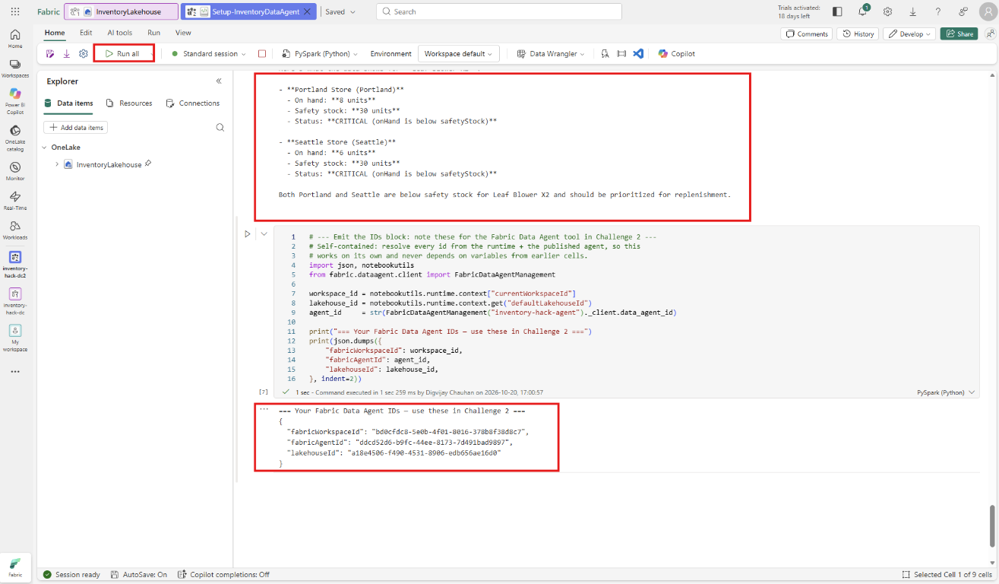

   **e. Verify your agent answers.** *(1 min)*
   Open the data agent's **Test data agent** pane and ask:

   ```text
   How many Leaf Blower X2 units are on hand at the Portland and Seattle stores, and are they below safety stock?
   ```

   You should get exact numbers with **CRITICAL** flags — proof that your tables are selected and the agent is published.

   Expected values: **Portland/ST03 = 8**, **Seattle/ST04 = 6**, safety stock
   **30 at each store**. Both are CRITICAL. Also ask "How many Retail locations do
   we have?" (4) and "Show inventory for product P999." (no matching rows).

   

   | Value | Where it comes from |
   |-------|---------------------|
   | Workspace ID | printed by the notebook's last cell (also in the workspace URL) |
   | Artifact / Data Agent ID | printed by the notebook's last cell |
   | Data Agent name | `inventory-hack-agent` — the name you select in Challenge 2 |

   > [!NOTE]
   > In Challenge 2, attach **Fabric IQ (OneLake Catalog)** to each Foundry agent
   > and select your published **`inventory-hack-agent`**. It points those
   > specialists at the Data Agent on **your** Lakehouse. The earlier Foundry
   > Fabric Data Agent connector retires on **6 November 2026**.

   > The connection is created the first time you add it in Challenge 2; later
   > agents reuse it. Select the Data Agent by name, not by entering its IDs.

5. **Understand the three-agent pattern.**
   Draw (on paper or a whiteboard) the flow:
   ```
   Real-world event
        ↓
   [Demand Sensing Agent] — Web Search + Fabric Data Agent
        ↓  adjusted demand signal
   [Inventory Optimisation Agent] — Fabric Data Agent
        ↓  reorder recommendation
   [Replenishment Action Agent] — Fabric Data Agent + human approval
        ↓  submitted purchase order
   ```
   Be able to answer: *What tool does each agent use and why?*

6. **Answer the grounding questions** (discuss with your team):
   - What would go wrong if the Demand Sensing Agent only looked at web signals and ignored the governed inventory data?
   - Why does the Replenishment Action Agent need a human approval step?
   - What data does the Fabric Data Agent abstract away for you?

## 🏁 Success criteria

- [ ] You can name the key inventory tables and explain what each one is used for.
- [ ] You have confirmed the `gpt-5.4-mini` model is deployed in your Foundry project.
- [ ] You have created your own Fabric workspace on your Fabric capacity, run the setup notebook, and published your `inventory-hack-agent` Data Agent — and kept its **Workspace ID** and **Agent ID** for diagnostics (Challenge 2 selects the agent by name in the Fabric IQ catalog, so you won't type them).
- [ ] You can describe, in one sentence each, what each of the three agents does.
- [ ] You can explain why combining web signals with governed data produces better decisions than either source alone.

## 🛠️ Troubleshooting

| Symptom | Fix |
|---------|-----|
| `gpt-5.4-mini` is missing from your **model deployments** | Flag your facilitator before starting — the model deployment is part of your provisioned lab. |
| Your **`FabricCapacityName`** isn't selectable when creating the workspace | The capacity must be **running** — resume it (Azure portal → your Fabric capacity → **Resume**). |
| The setup notebook errors on package installation or the publish cell | Read the installation/API error before retrying; the notebook pins its tested Data Agent SDK version and stops if installation fails. Make sure your Fabric capacity is **running**. If SQL metadata refresh fails, open the Lakehouse SQL analytics endpoint, refresh its schema, and confirm all seven tables appear before rerunning setup. |
| The agent replies *"I'm unable to access the data source"* (or *"No tables selected yet"*) | Its tables aren't selected. The setup notebook selects all seven automatically, but if it didn't: open the data agent → **Data** tab → tick **all** tables under `InventoryLakehouse → dbo` → **Publish**, then re-test. |
| A load hangs, fails with a *load already in progress* error, or shows `TooManyRequestsForCapacity` (HTTP 430) | Load the files **one at a time**. Open **Monitor** (left rail), **cancel** the **TableLoad** job that still shows **In progress**, then retry that file into a new table. You don't need a bigger capacity. |
| The agent returns nothing when you name a category (e.g. *"Outdoor Power Tools"*) | Category values are lowercase snake_case (`outdoor_power_tools`). Ask by the exact value or by **SKU/productId** (e.g. `P004`), and confirm the agent instructions include the category-mapping line from step 4(a)f / the setup notebook. |
| The generated query uses `Stores.type = 'Retail'` and returns zero rows | Stored values are lowercase `retail` / `warehouse`. Apply the **data-source instructions and example queries** in step f2, publish again, and re-test. Do not change the seed data or remove requested filters. |
| Portal labels do not match the English screenshots | Switch the portal display language to English in Settings and refresh. Resource names remain exactly as written; restore your preferred language afterward. |
| The publish cell raises **`No tables were selected (schema may still be syncing)`** | Expected on a **cold capacity** — the 7 tables wrote fine, but the Lakehouse **SQL analytics endpoint** hasn't exposed them yet. Open `InventoryLakehouse` → **SQL analytics endpoint** → confirm all 7 tables under `dbo`, then **re-run the publish cell** (idempotent) or tick the tables in the data agent's **Explorer** and **Publish**. |
| Ticking tables in the data agent shows **`Error updating data agent data source selection(s)`** | Same root cause — the SQL endpoint schema isn't fully synced. Wait until all 7 tables show under the Lakehouse's **SQL analytics endpoint**, **refresh** the data agent page (F5), then re-tick and **Publish**. If it persists, remove and re-add the `InventoryLakehouse` data source (**Add sources → Data source**), tick the 7 tables, and **Publish**. |
| The agent answers in the **Test data agent** pane but a Foundry agent later errors **`Stage configuration not found`** | The test pane runs the **draft/Preview** runtime; Foundry consumes the **published** version. On a cold capacity the notebook's publish can leave the agent in draft. Open `inventory-hack-agent` → confirm all 7 tables → click **Publish**, then retry. |

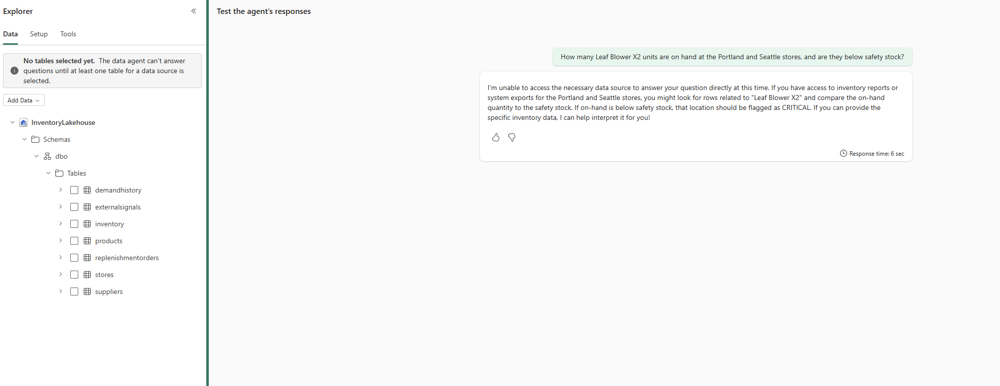

## 🚀 Go further

- Sketch the three-agent flow from memory and label which tool each agent uses and why.
- In the playground, ask the agent this and compare its answer to the table list above:

  ```text
  What data can you see?
  ```
- Predict which tables Challenge 3 and Challenge 4 will lean on before you get there.

## 🧠 Reflection

- What would go wrong if the Demand Sensing Agent only looked at web signals and ignored the governed inventory data?
- Why does the Replenishment Action Agent need a human approval step?
- What does the Fabric Data Agent abstract away for you, and why does that matter for a non-SQL audience?

## 📚 Learning resources

- [What is Microsoft Foundry Agent Service?](https://learn.microsoft.com/azure/foundry/agents/overview)
- [Fabric Data Agent with Foundry agents](https://learn.microsoft.com/fabric/data-science/data-agent-foundry)
- [Foundry agents playground](https://learn.microsoft.com/azure/foundry/concepts/concept-playgrounds)
- [Web Search tool in Foundry](https://learn.microsoft.com/azure/foundry/agents/how-to/tools/web-search)
