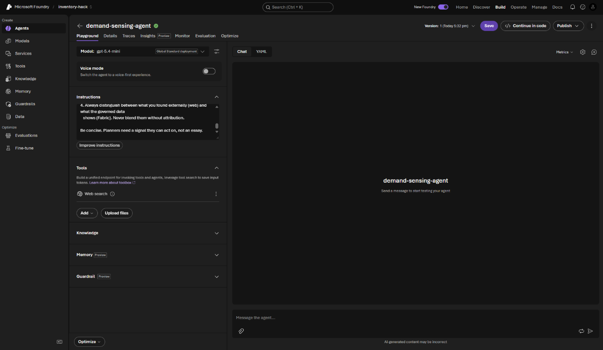
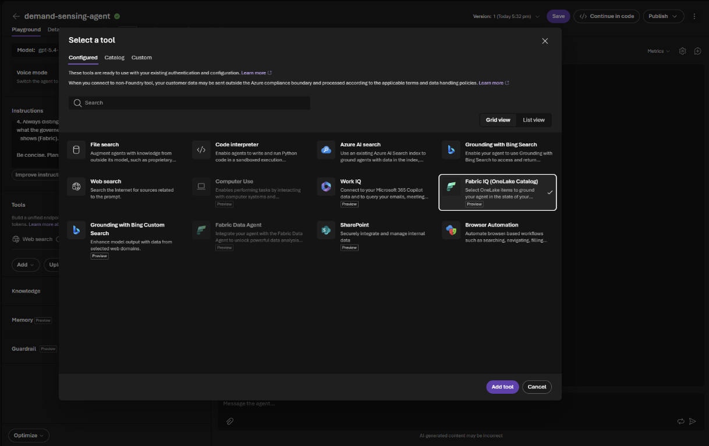
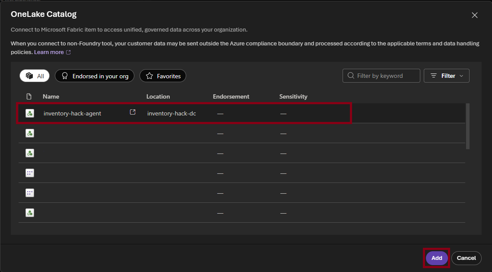
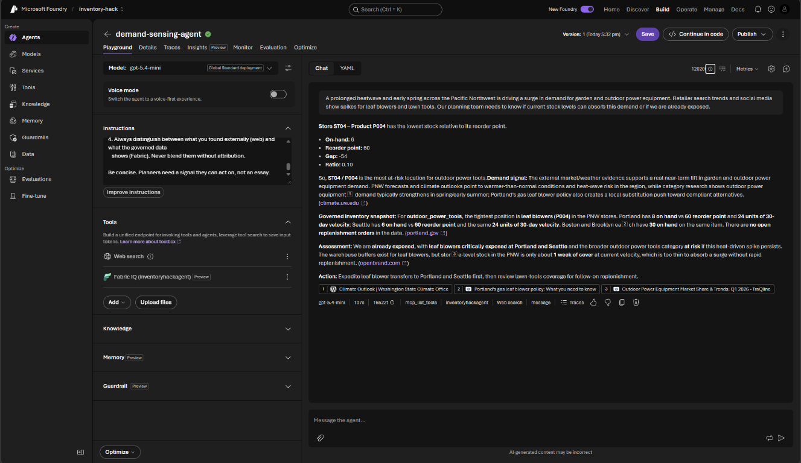

# Challenge 2 — Demand Sensing Agent

**[← Previous](challenge-01.md)** - [Home](../README.md) - [Next Challenge →](challenge-03.md)

## 🎯 Objective

Build your first Foundry prompt agent. Configure it with two tools — **Web Search** and **Fabric IQ** (connected to your published Fabric Data Agent) — and use it to sense a real-world demand change and reconcile it against the current inventory position. No code required; everything is done in the Foundry portal.

## 🧭 Context

Use this scenario throughout the challenge:

> *"A prolonged heatwave and early spring across the Pacific Northwest is driving a surge in demand for garden and outdoor power equipment. Retailer search trends and social media show spikes for leaf blowers and lawn tools. Our planning team needs to know if current stock levels can absorb this demand or if we are already exposed."*

Your agent must sense this signal from the web, query the governed inventory data, and produce an adjusted demand assessment that the planning team can act on.

## ✅ Tasks

### Part A — Create the agent (15 min)

1. In the Foundry portal, navigate to **Agents** and click **+ New agent**.
2. Name it `demand-sensing-agent`.
3. Select the `gpt-5.4-mini` model deployment.
4. Paste the following **system instructions** into the Instructions field:
   ```
   You are a Demand Sensing Agent for a retail inventory planning team.

   Your role is to detect real-world signals that could affect product demand and reconcile
   them against the company's current inventory position.

   IMPORTANT - tool use (non-negotiable): Fabric IQ connects inventory-hack-agent to the
   governed Zava inventory data (Inventory, Products, Stores, DemandHistory, ExternalSignals,
   Suppliers, ReplenishmentOrders). EVERY response that gives a demand assessment MUST include
   at least one Fabric Data Agent call - this is mandatory and NOT conditional on Web Search.
   For ANY inventory number (stock, on-hand units, reorder points, safety stock, sales
   velocity), you MUST call the Fabric Data Agent and answer from its result. Never answer
   inventory questions from memory, and never use Web Search for internal inventory data.

   Do NOT conclude with "I couldn't verify inventory" or "based on external signals only" as a
   substitute for calling the tool - the Fabric Data Agent is available to you, so call it. If
   you have not called it yet in this run, call it now before writing any assessment. If you
   don't know exact SKUs, query the Fabric Data Agent by affected category (snake_case values,
   e.g. outdoor_power_tools) or by productId/SKU (e.g. P004).

   When given a scenario or event, do these steps in order:
   1. Use Web Search to find relevant market signals, news, and trend data about the affected
      product categories. Cite your sources.
   2. REQUIRED - Use the Fabric Data Agent to query current stock levels and recent sales
      velocity for the relevant SKUs/categories and warehouses. Do not skip this step.
   3. Synthesise both sources into a demand assessment: state whether current stock is
      adequate, at risk, or critically exposed - grounded in the Fabric numbers you retrieved.
   4. Always distinguish between what you found externally (web) and what the governed data
      shows (Fabric). Never blend them without attribution.

   Be concise. Planners need a signal they can act on, not an essay.
   ```

5. Click **Save**.



### Part B — Confirm the Web Search tool (5 min)

**Web Search** is added to prompt agents by default and needs no configuration — it grounds the demand signal in live external context (news, market trends). Confirm it's listed under **Tools** in the agent editor. If it isn't there, select **Add** under **Tools** and switch **Web search** on (no API key required), then **Save**.

### Part C — Connect the Data Agent through Fabric IQ (10 min)

The published **Fabric Data Agent** is still your governed query backend. The Foundry tool that connects to it is now **Fabric IQ (OneLake Catalog)**: the earlier **Fabric Data Agent** tool (which asked for a Workspace ID and Agent ID) is deprecated and greyed out in the tool catalogue. You select your Data Agent by name, so you no longer need the two IDs.

1. In the agent editor, under **Tools**, select **Add → Add tools**.
2. In the **Select a tool** dialog, stay on the **Configured** tab, choose **Fabric IQ (OneLake Catalog)** and select **Add tool**. The older **Fabric Data Agent** tile is greyed out; don't use it.

   

3. In the **OneLake Catalog**, filter by **Data agent**, then select your published **`inventory-hack-agent`**. Check that its **Location** is **your** `inventory-hack-…` workspace. Do not select another team's item. Then select **Add**.

   

4. If the portal asks you to sign in or consent for Fabric, do so with your lab account in the same browser. Then select **Save**. The tool appears under **Tools** as **Fabric IQ (inventoryhackagent)**; later challenges reuse this connection.

> [!TIP]
> **Data Agent missing from the catalog?** Your Fabric capacity must be running (Azure portal → your Fabric capacity → **Resume**), and the setup notebook must have published the agent.

> [!NOTE]
> **Why two tools?** Web Search gives the agent access to what is happening *outside* the business. The Fabric Data Agent gives access to what is happening *inside* — including the `ExternalSignals` table of pre-loaded market signals. Combining live web context with governed internal data is the core pattern of this hack.

### Part D — Test the agent (20 min)

1. Open the **Agents playground** (click **Test in playground**).
2. Send this scenario as your first message:

   ```text
   A prolonged heatwave and early spring across the Pacific Northwest is driving a surge in demand for garden and outdoor power equipment. Retailer search trends and social media show spikes for leaf blowers and lawn tools. Our planning team needs to know if current stock levels can absorb this demand or if we are already exposed.
   ```
3. Observe the agent's response — look for:
   - At least one web source cited with a URL.
   - At least one inventory query result from Fabric (stock level or sales velocity).
   - A clear demand assessment: adequate / at risk / critically exposed.

   

   > [!TIP]
   > **Agent answered from web only and said it "couldn't verify inventory"?** It skipped the Fabric Data Agent call — `gpt-5.4-mini` is a reasoning model and occasionally skips an available tool. Recover it by replying: *"Call the Fabric Data Agent now and pull current stock and sales velocity for the affected SKUs (e.g. P004, P006) before giving your assessment."* If it keeps skipping, set **tool choice = required** in the agent's tool/run settings so a tool call is mandatory. The strengthened instructions above make this rare.
4. Ask a follow-up question:

   ```text
   Which store or warehouse has the lowest stock of outdoor power tools relative to its reorder point?
   ```
5. Ask:

   ```text
   What external signals in the last 30 days could affect demand for outdoor power tools in the Pacific Northwest?
   ```

## 🏁 Success criteria

- [ ] The `demand-sensing-agent` prompt agent exists in your Foundry project with Fabric IQ connected to `inventory-hack-agent` (and Web Search too, if it is enabled).
- [ ] A test run produces a response backed by at least one governed data point from the Fabric Data Agent (and an external web source, if Web Search is enabled).
- [ ] The agent produces a clear demand assessment (adequate / at risk / critically exposed) with reasoning.
- [ ] You can explain in your own words what each tool contributed to the response.

## 🛠️ Troubleshooting

| Symptom | Fix |
|---------|-----|
| **Web Search** isn't listed on the agent | Under **Tools**, select **Add** and switch **Web search** on. It needs no extra configuration. |
| **Fabric IQ (OneLake Catalog)** or your Data Agent isn't there | The integration needs **your** Fabric capacity to be running — resume it (Azure portal → your Fabric capacity → **Resume**) and confirm the setup notebook published the agent. |
| The agent answers inventory questions from memory | Strengthen the *IMPORTANT – tool use* line in the instructions; it must call the Fabric Data Agent for any stock number. |
| The agent gives a demand assessment from web signals only (says it *"couldn't verify inventory"*) | It skipped the Fabric call. Reply *"Call the Fabric Data Agent now for current stock + sales velocity of the affected SKUs before assessing,"* or set **tool choice = required** in the agent's tool settings. `gpt-5.4-mini` (a reasoning model) sometimes skips available tools. |
| The agent has `fx` functions like `query_inventory` / `list_low_stock` instead of Fabric IQ | The portal **auto-generated stub functions** from your instructions — they're empty and never reach your Lakehouse. Remove them (each tool row → **⋮ → Remove**) and add **Fabric IQ (OneLake Catalog)** (Part C). |
| You see a message that the **Fabric Data Agent** tool is deprecated, or it asks for a Workspace ID and Agent ID | That is the earlier connector. Cancel and use **Add → Add tools → Fabric IQ (OneLake Catalog)** (Part C). You select the agent by name, so you don't need the IDs. |
| *"Your requests to gpt-5.4-mini … exceeded rate limit"* | You hit the model's tokens-per-minute (TPM) limit. Wait ~30–60s and retry, and avoid firing many runs back-to-back. Facilitators can raise the deployment TPM or give each attendee their own subscription (see [`labautomation/README.md`](../labautomation/README.md)). |
| The run fails with **`Stage configuration not found`** (or *configuration not found*) | Your Fabric Data Agent works in Fabric's **Test data agent** pane but isn't **published** — the Foundry tool consumes the *published* stage, not the draft/Preview runtime. In Fabric, open `inventory-hack-agent` → confirm the 7 tables → click **Publish**, then retry. |

## 🚀 Go further

- Ask the agent to rank **all** warehouses by demand exposure, not just the most exposed one.
- **Stretch:** invent your own scenario (e.g. a supplier delay or a competitor stockout) and see whether the agent changes its assessment.
- Have the agent state its confidence and list exactly which data points drove the conclusion.

## 🧠 Reflection

- What did **Web Search** contribute that the governed data could not — and vice versa?
- How did the instructions force the agent to separate external signals from governed facts, and why does that matter for trust?
- Where in your own organisation is a decision made on stale data that this *sense → reconcile* pattern could improve?

## 📚 Learning resources

- [Create a prompt agent in Foundry](https://learn.microsoft.com/azure/foundry/agents/quickstarts/prompt-agent)
- [Web Search tool — Foundry Agent Service](https://learn.microsoft.com/azure/foundry/agents/how-to/tools/web-search)
- [Fabric Data Agent with Foundry agents](https://learn.microsoft.com/fabric/data-science/data-agent-foundry)
- [Tool best practices — Foundry](https://learn.microsoft.com/azure/foundry/agents/concepts/tool-best-practice)
