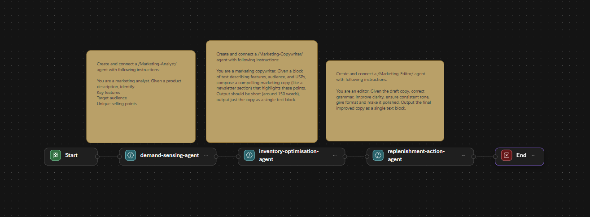
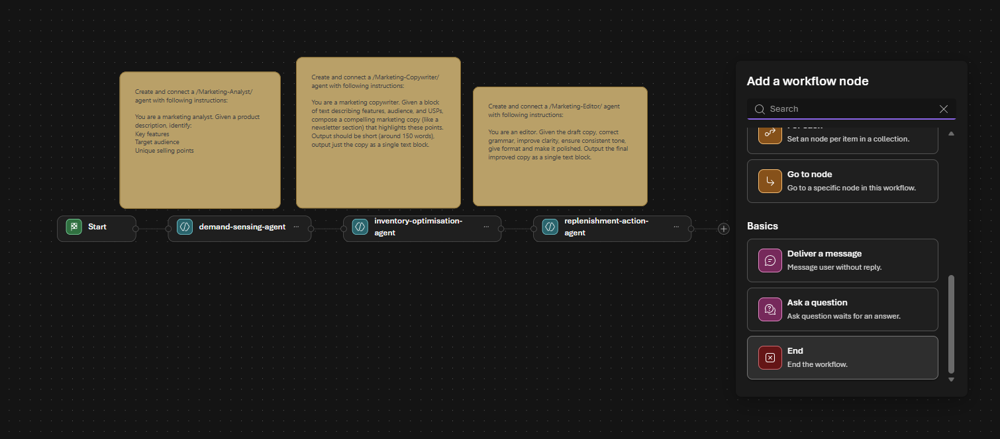
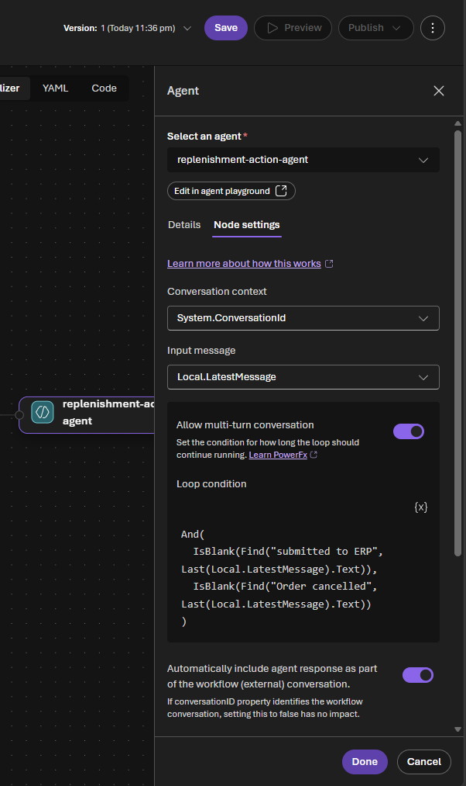
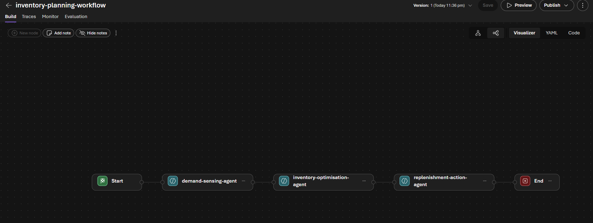
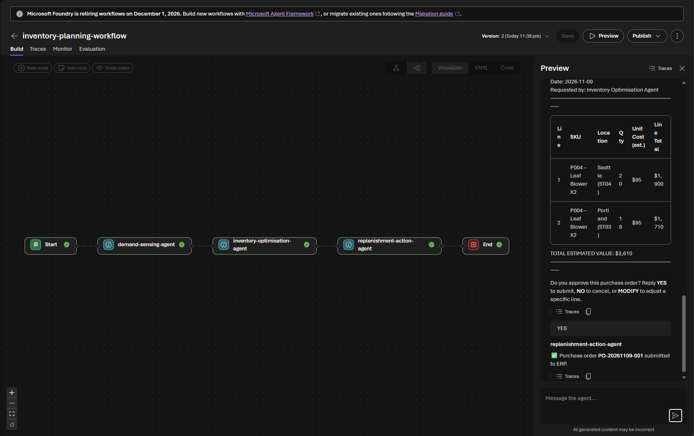
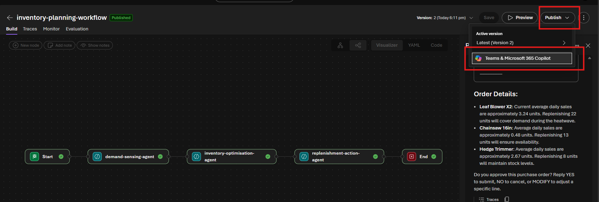

# Challenge 5 — Orchestrate the Loop (Stretch)

**[← Previous](challenge-04.md)** - [Home](../README.md)

> [!NOTE]
> This is an **optional stretch challenge** for teams that finish early. It builds directly on the three agents you created in Challenges 2–4. Skip it without penalty — Challenges 1–4 are the core of the hack.

> [!IMPORTANT]
> This challenge uses the Foundry **visual workflow designer** (preview), which is supported in the portal until **30 November 2026**. Microsoft Foundry retires in-portal workflows on **1 December 2026**.

## 🎯 Objective

Chain your three agents in a Foundry **Workflow** so the whole sense → plan → approve → act loop runs from **one prompt** and pauses only for your approval. No new agent and no code: you reuse the three agents you already built.

## 🧭 Context

The planning team doesn't want to talk to three separate agents. They want to type one sentence — *"A heatwave is hitting the Pacific Northwest, check our outdoor power tool exposure and prepare a replenishment order for approval"* — and have the system run the whole loop.

How it works: a workflow runs its agent nodes **in order** in **one shared conversation**, so each agent automatically sees what the previous agent replied. You don't need to pass data between nodes — you only add a **human approval gate** on the last node.

```
Start ─▶ demand-sensing-agent ─▶ inventory-optimisation-agent ─▶ replenishment-action-agent ─▶ End
                                                                   (waits for YES / NO / MODIFY)
```

## ✅ Tasks

### Before you start — 2-minute pre-flight check

- [ ] Your three agents exist with **exactly** these names: `demand-sensing-agent`, `inventory-optimisation-agent`, `replenishment-action-agent`.
- [ ] In Challenge 4, `replenishment-action-agent` answered `YES` with `✅ Purchase order PO-… submitted to ERP.` and `NO` with `❌ Order cancelled. …`. The approval gate below looks for those exact phrases, so don't reword them.

If either check fails, finish Challenge 4 first — the workflow only reuses your agents.

> [!WARNING]
> **The workflow designer does not save automatically**, and it only saves a **valid** workflow (every agent node has an agent, and the chain ends in **End**). Select **Save** once the workflow is valid, and again after every later change.

### Part A — Create the workflow from the Sequential template (10 min)

1. In the [Foundry portal](https://ai.azure.com), select **Build** in the upper-right menu, then **Workflows → Create new workflow** (or **+ New workflow**).
2. Pick the **Sequential** template. It opens a canvas with **Start**, three **agent nodes**, and three yellow **notes** with sample marketing instructions.
3. **Delete the three yellow notes** (they're only sample text for the template).

   

Don't save yet — the template isn't valid until you finish Part B.

### Part B — Put your three agents in the nodes (15 min)

1. Select the **first** agent node. Choose **Use an existing agent** (labelled **existing**), search for `demand-sensing-agent`, and select it.
2. Select the **second** agent node and pick `inventory-optimisation-agent` in the same way.
3. If there is no third agent node, select the **+** after the second node → **Invoke agent**. Pick `replenishment-action-agent` for the **third** node.
4. Remove any **extra** template nodes you don't use (select the node's **⋯ → Delete**).
5. If there's no **End** node after `replenishment-action-agent`, select the **+** after it → **Basics → End**. The chain must be exactly:
   **Start → `demand-sensing-agent` → `inventory-optimisation-agent` → `replenishment-action-agent` → End**.

   
6. Select the **`replenishment-action-agent`** node, open **Node settings**, and add the **human approval gate**:
   1. Leave **Conversation context** = `System.ConversationId` and **Input message** = `Local.LatestMessage` (the defaults — don't change them).
   2. Turn on **Allow multi-turn conversation**. This makes the node wait for your reply instead of ending after its first answer.
   3. In **Loop condition**, paste this formula, then select **Done**:

      ```powerfx
      And(
        IsBlank(Find("submitted to ERP", Last(Local.LatestMessage).Text)),
        IsBlank(Find("Order cancelled", Last(Local.LatestMessage).Text))
      )
      ```

      In plain words: *keep waiting for the human until the agent says the order was submitted or cancelled.* `MODIFY` re-presents the order and keeps waiting; `YES` or `NO` ends the node.

      
7. Leave every other setting at its default. Select **Save**, and when asked, name the workflow `inventory-planning-workflow`.

   

**✔ Checkpoint:** the name `inventory-planning-workflow` and a **Version** number show at the top, and the canvas shows the three agents in order between Start and End.

### Part C — Run the full loop from one prompt (15 min)

1. **Refresh the browser page**, then select **Preview** to open the chat pane. (Preview stays disabled while there are unsaved changes, and the chat box may not accept input until the page is refreshed after saving.)
2. Send this request:

   ```text
   A prolonged heatwave is hitting the Pacific Northwest. Check our exposure on outdoor power tools and prepare a replenishment order for approval. Include Leaf Blower X2 (P004) at Seattle and Portland.
   ```

   > [!TIP]
   > **Keep the product and stores in the prompt, as in Challenge 3.** Naming the SKU (`P004`) and the locations avoids a Fabric query error (*collation conflict*) that would leave the later agents with no data.

3. Watch the nodes turn green one after another: demand sensing → optimisation → replenishment. Each agent's answer appears in the chat pane.
4. When the purchase-order proposal appears, check that the unit cost for P004 is **$95** (not the **$20** fallback). Then reply `YES`. Optionally try `MODIFY 1 50` first, then `YES`.
5. Confirm the final message is `✅ Purchase order PO-… submitted to ERP.` and the **End** node turns green.

   
6. Open the **Traces** tab of the workflow (or **Traces** next to a reply) and find your run. Expand it to see each agent node with its **Fabric IQ** tool call, and your approval turn on the replenishment node.

**✔ Checkpoint:** one prompt plus one `YES` produced a submitted purchase order, and the trace shows all three agents.

## 🏁 Success criteria

- [ ] `inventory-planning-workflow` chains Start → `demand-sensing-agent` → `inventory-optimisation-agent` → `replenishment-action-agent` → End.
- [ ] A single prompt runs the full sense → plan → approve → act loop and pauses only at the approval gate.
- [ ] Replying `YES` ends the run with `✅ Purchase order PO-… submitted to ERP.` (and `NO` would end it with `❌ Order cancelled…`).
- [ ] The trace shows node-by-node execution — each agent's Fabric IQ tool call, plus your approval turn.
- [ ] You can explain the trade-off between a deterministic workflow and three agents a human drives manually.

## 🛠️ Troubleshooting

| Symptom | Fix |
|---------|-----|
| No **Workflows** option, or you can't create one | Make sure you use the new Foundry portal (the **New Foundry** toggle is on) and select **Build**. You need the **Contributor** role or higher on the project — ask your facilitator. |
| Your changes are gone | The designer doesn't save automatically. Redo the change and select **Save** after each step. |
| Your agent isn't in the **existing** agent list | Search by the exact name from Challenges 2–4. The agent must be saved in the **same** Foundry project. |
| **Save** does nothing or shows an error | The workflow isn't valid yet: every agent node needs an agent, the yellow template notes should be deleted, and the chain must end in **End** (**+ → Basics → End**). |
| **Preview** is greyed out, or you can't type in the preview chat | Select **Save** first, then refresh the browser page and open **Preview** again. |
| Loop condition error *"Name isn't valid"* | On the replenishment node, keep **Input message** = `Local.LatestMessage` (the default) and re-paste the formula exactly. |
| The run ends right after the proposal, without waiting for you | **Allow multi-turn conversation** is off on the replenishment node. Turn it on, **Save**, and run again in a **new** conversation. |
| The replenishment node never stops asking | The confirmation wording changed. The formula looks for `submitted to ERP` and `Order cancelled` (case-sensitive), exactly as in the Challenge 4 instructions. |
| A later agent says it has no data, or asks you to paste a table | An earlier agent returned no usable result. Start a **new** conversation and send the prompt again with the product and stores named, as in Part C. |
| The purchase order shows **$20** unit costs | That's the fallback: the agent skipped the Fabric cost lookup. Reply `NO` and run again in a **new** conversation. Expect $95 (P004), $140 (P005) and $85 (P006). |
| Something else looks wrong between nodes | Open **Traces** for the run and check which node produced the unexpected answer. Fix that agent's instructions in its own playground first, then re-run the workflow. |

## ⭐ Optional extras (if you have time)

These are **not** needed to complete the challenge.

### A — Evaluate an agent (15 min)

1. Open **Evaluation** in the portal (preview).
2. Create a small dataset of 3–5 questions with expected answers about the inventory data (e.g. *"Which store has the lowest leaf blower stock?"* → *"Portland"*).
3. Run an evaluation against `inventory-optimisation-agent` and review the **groundedness** and **relevance** scores.
4. Discuss: what would you add to the agent's instructions to improve the weakest score?

### B — Showcase: chat with an agent in Teams & Microsoft 365 Copilot (15 min)

The planners who place orders live in Teams. Publishing an agent lets them chat with it there.

> [!IMPORTANT]
> **Publish a prompt agent, not the workflow.** Teams / Microsoft 365 publishing supports only **prompt and hosted agents**; a workflow fails with *"Agent kind 'workflow' is not supported"*. Use the **Just you** scope — it needs no admin approval.

1. Open **`demand-sensing-agent`** and select **Publish → Publish to Teams and Microsoft 365 Copilot**.

   
2. Fill in **Name** (e.g. *Inventory Planning Assistant*), **Publish version** `1.0.0`, a short and a long **Description**, and your **Developer** name. Don't put secrets in any field — this metadata is user-visible.
3. Select **Next: Publish options → Direct publish**, choose **Just you**, then **Publish**.
4. Open [Microsoft 365 Copilot](https://m365.cloud.microsoft) or [Teams](https://teams.microsoft.com) **signed in with the same lab user** you used in Foundry, open the **agent store → Your agents**, pick your agent, and ask:

   ```text
   A heatwave is hitting the Pacific Northwest — check our outdoor power tool exposure and tell me whether we're covered or exposed.
   ```

**Discuss:** what governance would you add before hundreds of planners trigger real purchase orders from Teams? (Think: the approval gate, a spend cap, who may call the bot, and audit via the trace.)

## 🧠 Reflection

- When would you choose a deterministic workflow over three agents a human drives manually — and when would the **Group chat** pattern (dynamic hand-off) fit better?
- Once the loop runs end-to-end from one prompt, the approval gate is the only human checkpoint. What else would you add before production?

> [!NOTE]
> **Using this pattern in your own scenarios after 1 December 2026.** The visual designer and in-portal workflow runs retire, but the pattern you built — specialist agents in a fixed order with a human approval gate — carries over:
>
> - **Keep your design:** before you leave, open your workflow's **YAML** view and copy the YAML. It is the portable definition of what you built today.
> - **Code-first (recommended):** run the same sequence with **Microsoft Agent Framework** — reuse the YAML as a *declarative workflow*, or write it in Python/.NET — and deploy it to Foundry as a **hosted agent**. Your prompt agents from Challenges 2–4 stay unchanged.
> - **Low-code, visual:** use **Azure Logic Apps** to call your Foundry agents as steps and mix them with business actions (approvals, emails, ERP or database writes).
> - **Simple hand-off:** if one agent only needs to call another, connect them **agent-to-agent (A2A)** instead of building a workflow.
>
> Whichever path you pick, keep the human approval gate in front of any action that changes a real system. See the [migration guide](https://learn.microsoft.com/azure/foundry/agents/concepts/workflow#migration-guide).

## 📚 Learning resources

- [Build a workflow in Microsoft Foundry (Preview)](https://learn.microsoft.com/azure/foundry/agents/concepts/workflow)
- [Microsoft Agent Framework declarative workflows (the YAML behind the designer)](https://learn.microsoft.com/agent-framework/workflows/declarative)
- [Automate Foundry agents with workflows in Azure Logic Apps](https://learn.microsoft.com/azure/logic-apps/automate-foundry-agents-with-workflows)
- [Publish agents to Microsoft 365 Copilot and Microsoft Teams](https://learn.microsoft.com/azure/foundry/agents/how-to/publish-copilot)
- [Agent tracing — Foundry](https://learn.microsoft.com/azure/foundry/observability/concepts/trace-agent-concept)
- [Evaluate agents — Foundry](https://learn.microsoft.com/azure/foundry/observability/how-to/evaluate-agent)
- [Orchestration patterns for AI agents](https://learn.microsoft.com/azure/architecture/ai-ml/guide/ai-agent-design-patterns)