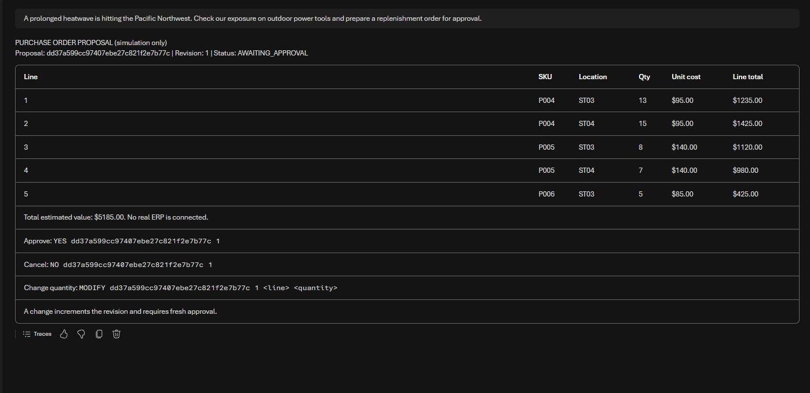
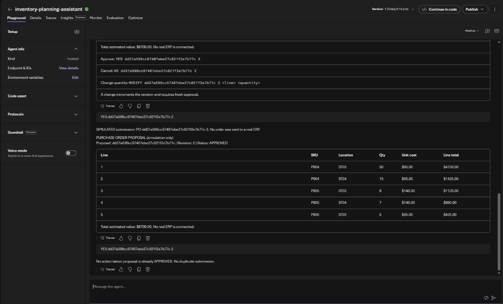
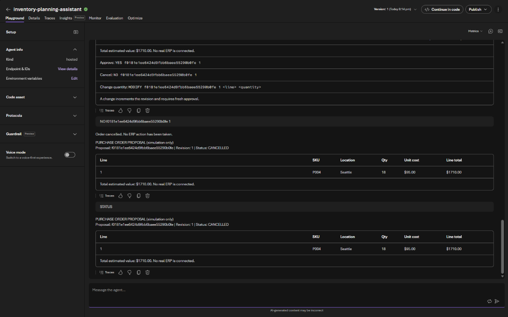
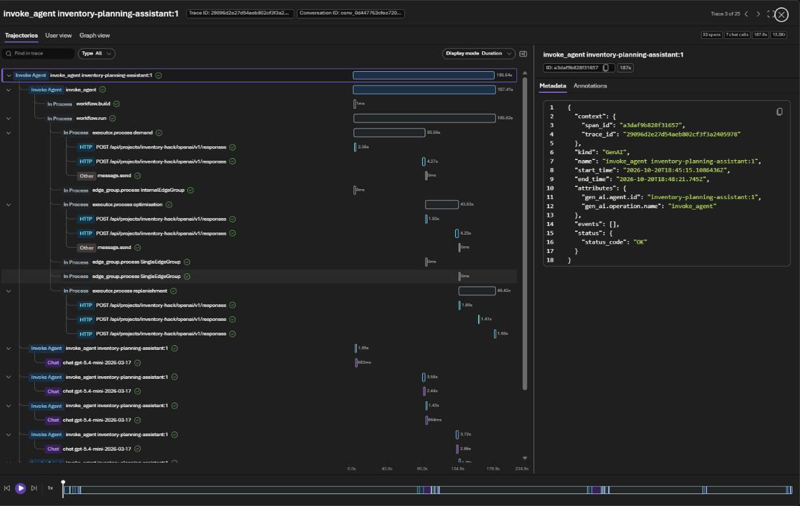
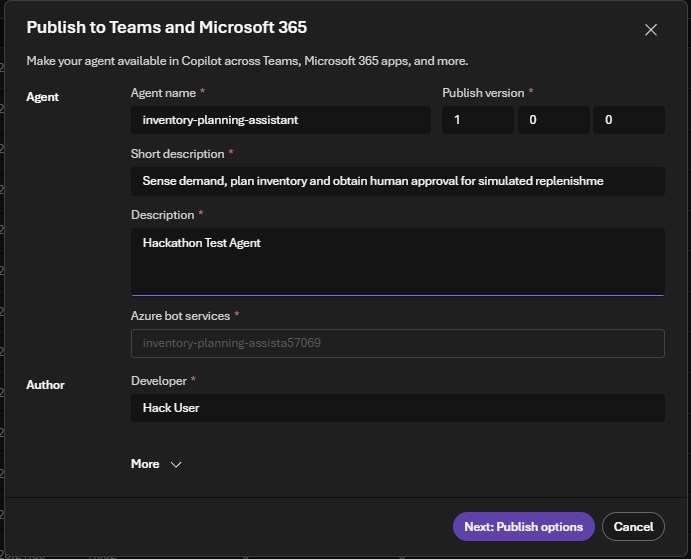
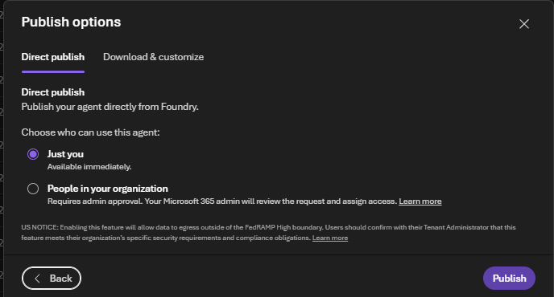
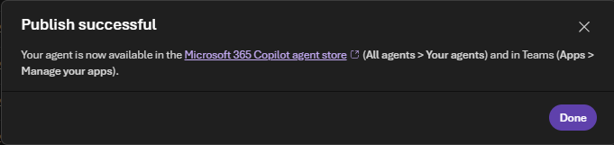

# Challenge 5 — Run and Publish the Inventory Planning Assistant (Stretch)

**[← Previous](challenge-04.md)** - [Home](../README.md)

## 🎯 Objective

Run the whole loop — demand sensing, inventory optimisation and a replenishment proposal — from **one prompt**, using a hosted assistant that you deploy from your browser. Approve the order with exact commands, inspect the trace, then (optionally) publish the assistant to Teams and Microsoft 365 Copilot. The final action stays a simulation: no real ERP is called.

> [!NOTE]
> **Stretch challenge.** The Foundry visual workflow designer retires on **1 December 2026**, so this challenge uses a small hosted assistant instead. It chains the three agents you built in Challenges 2–4. The earlier visual-workflow instructions are archived in the repository's `archive` folder on GitHub.

## 🧭 Context

In Challenges 2–4 you ran each agent by hand and pasted the result into the next one. Now one hosted app does that for you: it runs your three agents' saved instructions in order and returns a purchase order proposal.

The approval is **not** left to the AI. The app only accepts exact commands (`YES`, `NO`, `MODIFY`), so a model can never approve an order by itself.

## ✅ Tasks

### Part A — Deploy the assistant from your browser (15 min)

You don't install anything on your computer.

1. Make sure your three agents from Challenges 2–4 are **saved**, use **Fabric IQ**, and that your Fabric capacity is **running**.
2. Follow the [deployment guide](../orchestrator/README.md). It takes you through three short steps: open Cloud Shell in a private window, download the lab files, and run one command with the **ResourceGroupName** from your lab dashboard.
3. Wait for `PASS: hosted multi-turn checks` (about 10 minutes in total). If it fails, read the message and ask your facilitator before moving on.

> [!IMPORTANT]
> Never type your Temporary Access Pass (TAP) into the terminal. Enter it only on the Microsoft sign-in page. If you change an agent later, run the deployment again so the assistant picks up the new version.

### Part B — Run the complete planning loop (10 min)

1. In the Foundry portal, open the **hosted** agent `inventory-planning-assistant` and select **Test in playground**. Start a new conversation.
2. Send:

   ```text
   A prolonged heatwave is hitting the Pacific Northwest. Check our exposure on outdoor power tools and prepare a replenishment order for approval. Include Leaf Blower X2 (P004) at Seattle and Portland.
   ```

   > [!TIP]
   > **Name the product, as in Challenge 3.** A category-only request can make the
   > Fabric Data Agent generate a query with a collation conflict. Naming `P004`,
   > Seattle and Portland makes the request more precise. If inventory cannot be
   > verified, retry the request before approving anything.

3. Wait 2–4 minutes: three agents run in turn and query your Fabric data. You should get **PURCHASE ORDER PROPOSAL (simulation only)** with status **AWAITING_APPROVAL**, a proposal ID, revision 1 and one or more lines. Locations appear as store IDs (`ST03` is Portland, `ST04` is Seattle). The model decides how many lines to propose.

   
4. Check the unit costs against your data. For the seed data they are **$95** (P004 Leaf Blower X2), **$140** (P005 Chainsaw) and **$85** (P006 Hedge Trimmer). Quantities vary a little between runs.

### Part C — Modify, approve and cancel (15 min)

Use the exact proposal ID printed in your answer, and stay in the **same conversation**.

1. Change line 1: `MODIFY <proposal-id> 1 1 50`. Confirm the new quantity, the new total and **revision 2**.
2. Try the old approval: `YES <proposal-id> 1`. It must be rejected as stale.
3. Send the new one: `YES <proposal-id> 2`. Expect **SIMULATED submission** and a statement that nothing went to a real ERP.
4. Send the same approval again. It must **not** submit twice.

   
5. Send `NEW`, then ask for another plan, and cancel it with `NO <new-proposal-id> <revision>`.
6. Send `STATUS` to see the saved result.

   

### Part D — Inspect the trace (10 min)

Open the assistant's **Traces** tab and select your run (a planning run lasts about three minutes and has many spans). Expect a tree like this:

```text
invoke_agent inventory-planning-assistant:<version>
  invoke_agent
    workflow.build
    workflow.run                       (the fixed graph)
      executor.process demand          -> model and Fabric calls
      executor.process optimisation    -> model and Fabric calls
      executor.process replenishment   -> model and Fabric cost lookup
```



Under each stage you see `POST .../openai/v1/responses` calls: the model calls that run your agent's instructions and the Fabric lookups that return the data. Short calls elsewhere in the same trace are your commands (`MODIFY`, `YES` and so on), which are handled by code and not by a model. Your own agents' instructions drive each stage. Span names can change between preview versions, so look for the three stages rather than the exact names.

### Part E — Publish and try it in Teams and Microsoft 365 (optional, 20 min)

Ask your facilitator whether publishing is enabled for your lab before you start.

1. In the hosted agent, choose the latest **active** version, then **Publish → Teams & Microsoft 365 Copilot**.
2. In the dialog, keep the pre-filled **Agent name**, **Publish version** and **Azure bot services** name. Check the **Short description**, write a one-sentence **Description** (for example, *Plans replenishment for outdoor power tools and asks for approval before a simulated order*), and enter your own name as the **Developer**.

   

3. Select **Next: Publish options**. On the **Direct publish** tab, choose **Just you** (the default, available immediately). Leave **People in your organization** alone: it needs approval from your Microsoft 365 admin. Then select **Publish**.

   

   When it finishes you see **Publish successful**. It says your assistant is now in the **Microsoft 365 Copilot agent store** (**All agents → Your agents**) and in Teams (**Apps → Manage your apps**). Select **Done**.

   

4. Open a **new private window**, sign in with your lab account, and open [Teams for the web](https://teams.cloud.microsoft/). Find your assistant under **Apps → Manage your apps** and repeat Parts B and C.
5. In another tab, open [Microsoft 365 Copilot for the web](https://m365copilot.com/). Open **All agents → Your agents**, start a **new chat** with the assistant, run Part B, then cancel an order and send `STATUS`.
6. If you are asked to sign in or consent, use the same private window and your lab account.

> [!TIP]
> Use the **web** apps, not desktop clients. **Just you** means only you can use the assistant. A private window can reset your browser sign-in, but your conversation stays on the server — use **New chat** to start fresh.

## 🏁 Success criteria

- [ ] The assistant deployed from Cloud Shell and the check printed `PASS`.
- [ ] One prompt ran all three agents and produced a proposal with **AWAITING_APPROVAL** and Fabric unit costs.
- [ ] `MODIFY` changed the revision and total, and the old approval was rejected as stale.
- [ ] `YES` gave a **simulated** submission, and repeating it did not submit again.
- [ ] `NO` cancelled an order and `STATUS` showed it.
- [ ] You found the three stages and the Data Agent calls in the trace.
- [ ] *(Optional)* You tried the assistant in Teams for the web and Microsoft 365 Copilot for the web.

## 🛠️ Troubleshooting

| Symptom | Fix |
|---------|-----|
| The deployment says permission denied | Tell your facilitator — a lab role may be missing. Don't ask for Owner. |
| No `inventory-planning-assistant` in Foundry | Rerun Part A. You don't create a visual workflow in this challenge. |
| Planning fails and mentions Fabric | Check that your Fabric capacity is **running**, that your Data Agent is **published**, and that you can query it in Fabric. Rerun, and give your facilitator the request ID from the error. |
| The proposal is missing or has no costs | Send the request again. Costs must come from Fabric, and the assistant retries once by itself. |
| The assistant asks you to paste a recommendation table or SKU data | An earlier stage returned no usable recommendation. Start a new conversation and name Leaf Blower X2 (`P004`) at Seattle and Portland, as in Part B. |
| An approval is rejected | Copy the command from the **newest** proposal in the **same** conversation. The ID and revision must match. |
| You changed an agent but the assistant behaves as before | Rerun Part A so the assistant is deployed with the new version. |
| You can't find the assistant in Teams or Microsoft 365 | Publishing can take a few minutes, and your lab might not enable it. Ask your facilitator. |
| Sign-in loops or shows a blank page in the private window | Ask your facilitator for the approved browser settings. Don't switch to a desktop client. |

## 🚀 Go further

- Open the assistant's code in the `orchestrator` folder, change the graph or the approval rules, run its tests and deploy a new version.
- Ask for a different scenario, for example a paint-and-supplies spike, and compare the proposal.
- Compare the Data Agent's source descriptions with the agent-level description overrides. You don't need an ontology for this lab.

## 🧠 Reflection

- Why is a fixed graph of three agents easier to trust than letting a model choose its own next agent?
- Why does the app, not the AI, decide whether an order was approved?
- What would you add before connecting this to a real ERP (think idempotency, audit trail and spend limits)?

## 📚 Learning resources

- [Workflow retirement and supported migration paths](https://learn.microsoft.com/azure/foundry/agents/concepts/workflow#migration-guide)
- [Agent Framework hosting and persistent sessions](https://learn.microsoft.com/agent-framework/hosting/foundry-hosted-agent?pivots=programming-language-python)
- [Fabric IQ migration](https://learn.microsoft.com/azure/foundry/agents/how-to/tools/fabric-iq#migrate-from-the-fabric-data-agent-tool)
- [Publishing and personal/tenant access](https://learn.microsoft.com/azure/foundry/agents/how-to/publish-copilot)
