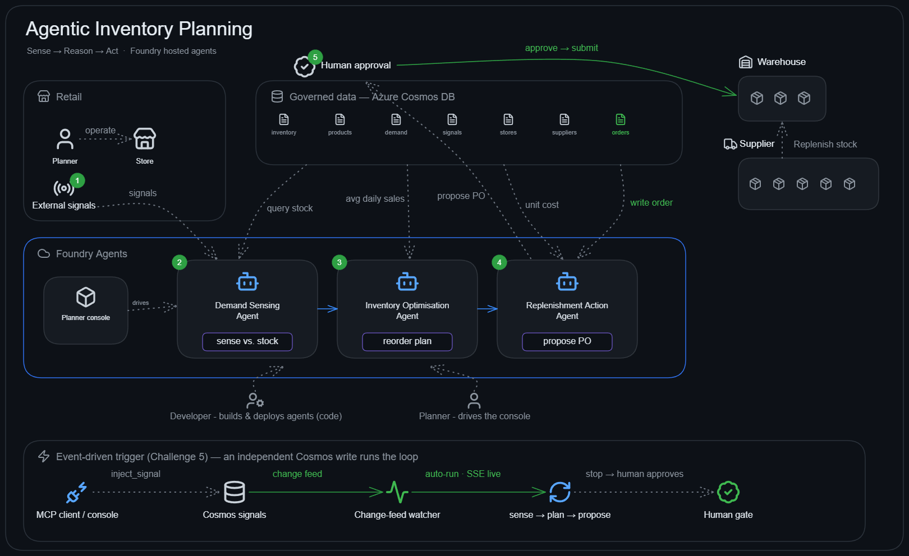

# Agentic Inventory Planning

Welcome to the **Agentic Inventory Planning** MicroHack. In this hands-on workshop you
write Python code to build **AI agents**. The agents read company inventory data and
suggest actions. A person must approve every action before it happens. Together, the
agents run a complete planning cycle for a retail company: they detect a change in
demand, plan how much stock to order, and submit a purchase order after a person
approves it.

- [**Introduction**](#introduction)
- [**Learning objectives**](#learning-objectives)
- [**Scenario**](#scenario)
- [**Architecture**](#architecture)
- [**A note on the model**](#a-note-on-the-model)
- [**Requirements**](#requirements)
- [**Glossary**](#glossary)
- [**Challenges**](#challenges)
- [**Repository layout**](#repository-layout)
- [**Contributors**](#contributors)

## Introduction

In this MicroHack you use **Python** and the **Microsoft Foundry Agent Service** to build
three AI agents. Each agent has one job:

1. **Demand Sensing** finds out which products are at risk because demand is changing.
2. **Inventory Optimisation** calculates how many units to reorder, and where.
3. **Replenishment Action** prepares a purchase order. It submits the order only after a
   person approves it.

The three agents work in sequence. This is the **planning loop**. You connect them to a
small web page, the **planner console**, where you run the loop step by step.

The data is stored in **Azure Cosmos DB**, a database the lab creates for you. Each
participant has their own database. The agents read and write this data through
**function tools**: small Python functions that the AI model can call. Each agent is a
**hosted agent**: you write its definition in Python, and it runs in your Foundry
project. You do all the work in a **GitHub Codespace**, a ready-made development
environment in the browser, so you don't install anything on your computer.

> New to some of these terms? See the [Glossary](#glossary).

## Learning objectives

By completing this MicroHack you will be able to:

- Define **hosted agents** in Python and deploy them to the Foundry Agent Service.
- Give agents **function tools**, and understand how the model decides to call them.
- Add a **human approval step** in code, so nothing is written until a person approves.
- Connect agents into a **workflow** that always runs them in the same order.
- Use **tracing** in the Foundry portal to see what an agent did and why.
- Work entirely in a **Codespace** and run the loop from a simple web page.

## Scenario

You are a developer at **Zava**, a retail company. Zava's planning team makes decisions
based on last month's data, so they react too late when demand changes. Your job is to
fix this. You build three agents that detect changes, decide what to order, and act. The
planning team uses them through a small web page, the planner console.

❶ **The business.** Zava sells products in four categories: `garden_and_lawn`,
`outdoor_power_tools`, `paint_and_supplies` and `smart_home`. It has four stores (Boston,
Brooklyn, Portland, Seattle) and two warehouses (Chicago, Dallas). For each product
(SKU) at each location, the data records three numbers:

- `onHand`: units in stock now.
- `reorderPoint`: when stock drops to this level, it's time to reorder.
- `safetyStock`: the minimum stock the location should always keep.

❷ **The signal.** Events in the real world change demand, for example weather, search
trends, a competitor running out of stock, or news. These events are stored in the
database next to the inventory. This lets an agent compare *what is happening in the
world* with *what is on the shelf*.

❸ **The decision.** A product is **AT_RISK** when its stock is at or below the reorder
point. It is **CRITICAL** when its stock is below the safety stock. Someone must then
decide which products to reorder, how many units, and for which location, and then place
the order. A person must approve every purchase order.

❹ **The agents.** Three hosted agents handle this. Each agent calls its own function
tools to read or write the data:

| # | Agent (Python) | Tools it calls | What it produces |
|---|----------------|----------------|------------------|
| 1 | **Demand Sensing** | `get_external_signals`, `list_low_stock`, `query_inventory` | A demand-exposure assessment |
| 2 | **Inventory Optimisation** | `list_low_stock`, `calc_reorder`, `get_product`, `query_inventory` | A structured reorder recommendation |
| 3 | **Replenishment Action** | `get_product`, `submit_purchase_order` *(gated)* | A **human-approved** purchase order |
| ⭐ *(stretch)* | **Workflow** | The three agents, called in order by Python code | The full loop, started with one click |

❺ **The console.** The **planner console** is a small web app (FastAPI and one HTML page,
with no build step). It shows the four steps in order, and the planner clicks through
them: **Sense → Plan → Approve → Act**.

## Architecture



The parts you work with:

❶ **This repository** contains the instructions, the starter code and Zava's sample
data. You open it in a Codespace (or a local dev container) and work there.

❷ **GitHub Codespaces / dev container** gives every participant the same environment.
Python, `uv` and the Azure CLI are already installed, so you don't need to set anything
up on your computer.

❸ **Hosted agents in Microsoft Foundry.** You define each agent in Python and create it
with the Foundry agents API. The agent then appears in the Foundry portal, where a
**Traces** tab shows each run.

❹ **Function tools.** Python functions such as `query_inventory`, `calc_reorder` and
`submit_purchase_order` are given to the model as tools. The agent calls them to read
and write real data, instead of guessing an answer.

❺ **Azure Cosmos DB** stores the data. Each participant has their own database. It
needs no keys or passwords: you sign in with your lab account. The app loads the sample
data from `src/data` the first time it runs. Only one tool, `submit_purchase_order`,
changes data: it **writes the order to Cosmos DB**.

❻ **Application Insights** records a **trace** of every model call and tool call, so you
can see exactly *what the agent did and why*.

❼ **The planner console** runs the whole loop from the browser. It makes sure nothing is
written until a person approves.

## A note on the model

**We chose this model on purpose.** The hack only works if the agent **calls its function
tools** and returns **structured JSON** (data in a fixed format that the code can read).
The lab deploys **`gpt-5.4-mini`**. It is a low-cost GPT-5 model, and its **Foundry model
card** confirms that it supports both **Functions/Tools** and **Structured Outputs**. Of
the low-cost GPT-5 models, it is supported the longest (until **2027-03-18**). It runs in
**GlobalStandard** deployments in EU regions, so it should stay available until the **end
of 2027**.

> [!IMPORTANT]
> If you change the model, choose one whose **Foundry model card** lists both
> **Functions/Tools** and **Structured Outputs** as supported. Avoid the older
> **o-series** reasoning models (o1, o3, o4): in agents that use tools, they sometimes
> refuse to call the tools. Also avoid models that are already **deprecated**:
> `gpt-4.1-mini` and `gpt-4o-mini` retire in October 2026. To change the model, change one
> setting, `MODEL_DEPLOYMENT_NAME` (a good alternative is `gpt-5-mini`). Then run a step in
> the console again to check that the agent still calls its tools.

> [!TIP]
> GPT-5 models are *reasoning* models: they think before they answer. The lab sets
> **`REASONING_EFFORT=minimal`** in `.env`, so the planner console responds quickly. For
> harder problems, set it to `low`, `medium` or `high`. Set it to `default` to let the
> model decide. If the model doesn't support this setting, the code ignores it.

## Requirements

To complete this MicroHack you need:

- The **lab account from your Hackbox**. It signs you in to the Azure portal. It also
  signs you in to **GitHub** through single sign-on, where you fork the repository and
  start a **Codespace**. If you prefer to work on your own computer, use **VS Code**,
  **Docker Desktop** and the **Dev Containers** extension to run the same dev container.
- Access to the **Foundry project** and **Cosmos DB** that the lab created for you. Your
  Hackbox shows three values: `FoundryProjectEndpoint`, `ModelDeploymentName` and
  `CosmosEndpoint`.
- Basic skills in **reading and editing Python**. The full working code is provided.
- Nothing else. You don't need to prepare any data (the app loads it the first time it
  runs), and you don't need any other software.

> [!TIP]
> **You're ready to start when** you can open your fork in a Codespace using the
> **Azure / AI / Inventory Planning Agentic** dev container, run `az login`,
> and paste your three Hackbox values into `src/.env`.

## Glossary

| Term | Meaning in this hack |
|------|----------------------|
| **Agent** | An AI model plus instructions and tools. It decides which tools to call to finish a task. |
| **Hosted agent** | An agent you define in Python and create in your Foundry project. It runs in Foundry and appears in the Foundry portal. |
| **Function tool** | A Python function that the model is allowed to call, for example `query_inventory`. This is how an agent reads or changes real data. |
| **Governed data** | The company's official data, stored in one controlled place (here: your Cosmos DB). Agents use it instead of guessing. |
| **Planning loop** | The four steps the agents run in order: **Sense → Plan → Approve → Act**. |
| **Human approval step** (human-in-the-loop) | The point where the loop stops and waits for a person to approve, before anything is written. |
| **Side effect** | An action that changes data. Here, only `submit_purchase_order` has a side effect: it writes an order. |
| **Trace** | A record of one agent run: every model call and tool call, with inputs and outputs. |
| **Structured output (JSON)** | An answer in a fixed data format, so code can read it reliably. |
| **Change feed** | A Cosmos DB feature that reports every new or changed document. Challenge 6 uses it to start the loop automatically. |
| **MCP** (Model Context Protocol) | A standard way for AI tools and apps to call each other's functions. Challenge 6 uses it to add a signal from outside the console. |
| **Codespace / dev container** | A ready-made development environment with all tools installed. A Codespace runs in the browser; a dev container runs in Docker on your computer. |

## Challenges

This MicroHack has six challenges. Each one builds on the previous one. First you set
up your environment. Then you build one agent at a time. Next you connect the agents
into one loop. Finally, you make the loop **start automatically when new data arrives**.

### Challenge structure

Each challenge has the same sections, so you always know where to look:

| Section | Description |
|---------|-------------|
| 🎯 **Objective** | What you will achieve, and why it matters |
| 🧭 **Context** | The scenario, the main ideas, and the code to read first |
| ✅ **Tasks** | Step-by-step instructions |
| 🏁 **Success criteria** | A checklist to confirm you have finished |
| 🛠️ **Troubleshooting** | Common problems and how to fix them |
| 🚀 **Go further** | Optional extra tasks if you finish early |
| 📚 **Learning resources** | Documentation to learn more |

### Challenge list

- **Challenge 1**: **[Set Up and Explore](challenges/challenge-01.md)** *(60 min)*: understand the scenario and the data, start your Codespace, and open the planner console.
- **Challenge 2**: **[Demand Sensing](challenges/challenge-02.md)** *(60 min)*: build and deploy your first hosted agent, with function tools that read the data.
- **Challenge 3**: **[Inventory Optimisation](challenges/challenge-03.md)** *(60 min)*: build an agent that recommends what to reorder, then read its trace.
- **Challenge 4**: **[Replenishment + Human Approval](challenges/challenge-04.md)** *(75 min)*: make sure a person must approve before the only tool that writes data can run.
- **Challenge 5** *(stretch)*: **[Connect the Loop](challenges/challenge-05.md)** *(45 min)*: run all three agents in order from one button.
- **Challenge 6** *(stretch)*: **[The Loop Starts Itself](challenges/challenge-06.md)** *(60 min)*: when a new signal is added to Cosmos DB (from the console or an MCP client), the loop runs automatically and stops for your approval.

> [!TIP]
> Don't rush. After each challenge, think about your own organisation: which planning
> decisions could agents help with, if a person still approves the final action? This
> is how you get the most out of the hack.

> Full reference solutions for every challenge are in [`walkthrough/`](walkthrough/).

## Repository layout

```
.devcontainer/        Dev container for this folder + post-create.sh (Codespaces uses
                      /.devcontainer/03-azure-01-04-ai-03-inventory-planning-agentic)
labautomation/        Lab setup script: creates Foundry, Cosmos DB and Application Insights
src/
  pyproject.toml      Python dependencies (managed by uv; there is no requirements.txt)
  data/               Zava sample data, loaded into Cosmos DB the first time the app runs
  inventory_store.py  Reads and writes Cosmos DB, and loads the sample data
  tools.py            Function tools the agents call (read/write Cosmos DB)
  agents/             The definitions of the three hosted agents
  agent_runtime.py    Creates and runs the hosted agents; enforces the approval step
  orchestrator.py     Runs the loop step by step for the console
  workflow.py         Stretch: runs the whole loop as one workflow
  live.py             Stretch: watches Cosmos DB and starts the loop when a signal arrives
  mcp_server.py       Stretch: MCP server with the inject_signal tool (outside trigger)
  mcp_client.py       Stretch: MCP client that starts the server and calls inject_signal
  ui/                 The planner console (FastAPI + one HTML page), the only UI
challenges/           Challenge instructions
walkthrough/          Reference solutions (one per challenge)
images/               Screenshots referenced by the challenges
```

## Contributors

| Name | Role |
|------|------|
| Digvijay Chauhan | Author & maintainer |
| Fatih Durgut | Reviewer |

## Contributing

This project welcomes contributions and suggestions. Most contributions require you to agree to a
Contributor License Agreement (CLA). For details, visit [https://cla.opensource.microsoft.com](https://cla.opensource.microsoft.com).

This project has adopted the [Microsoft Open Source Code of Conduct](https://opensource.microsoft.com/codeofconduct/).

## Trademarks

This project may contain trademarks or logos for projects, products, or services. Authorized use of Microsoft
trademarks or logos is subject to and must follow
[Microsoft's Trademark & Brand Guidelines](https://www.microsoft.com/en-us/legal/intellectualproperty/trademarks/usage/general).
