# Challenge 1 — Set Up and Explore

**[Home](../README.md)** - [Next Challenge →](challenge-02.md)

## 🎯 Objective

In this challenge you:

- sign in with your lab account,
- fork the hack repository and start your **Codespace**,
- connect to your **Foundry project**,
- learn the inventory scenario and the data, and
- open the **planner console**.

At the end of this challenge the console works, but no agent exists yet. You add one
agent in each of the next three challenges.

## 🧭 Context

You are a developer at **Zava**, a retail company. Zava's planning team makes decisions
based on last month's data, so they react too late when demand changes. Your job is to
build three **hosted agents** in Python and show them in a small web page, the planner
console:

1. **Demand Sensing**: notices changes in the real world that affect demand.
2. **Inventory Optimisation**: calculates how much stock is needed.
3. **Replenishment Action**: submits the order, but only after a person approves it.

The agents get their data through **function tools** (Python functions in `src/tools.py`).
The sample data is in `src/data`. The first time the app runs, it loads this data into
your Cosmos DB database, so you don't need to prepare anything.

Use the credentials from your **Hackbox** for all of this setup (see the **Credentials**
section at the top of the Hackbox page). Don't use a personal or work account. Only the
lab account has access to the correct Azure subscription, resource group, GitHub
organization and repository.

## ✅ Tasks

### Part A — Sign in to Azure (5 min)

1. Open the [Azure portal](https://portal.azure.com) and sign in with your Hackbox
   credentials. When asked to choose an account, select **Use another account**. Don't
   use your personal or work account.

   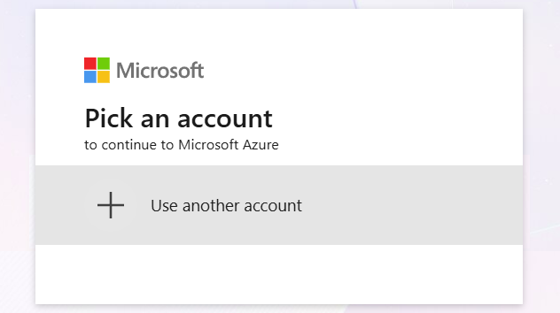

2. Select **Resource groups** and open the resource group assigned to you.

   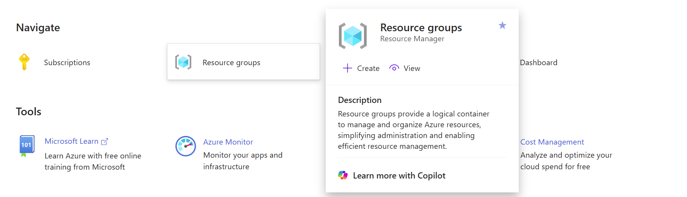

3. Confirm it contains your lab resources: an **Azure AI Services / Foundry** account
   (`inv-…`) with the `inventory-hack` project, an **Azure Cosmos DB** account
   (`inv-cos-…`), a **Log Analytics** workspace, and **Application Insights**.

### Part B — Sign in to GitHub and fork the repository (10 min)

1. Open [GitHub](https://github.com) and select **Sign in**. You **don't have a separate
   GitHub username or password**. GitHub uses single sign-on with the **same lab account**
   that you used for the Azure portal. When asked to choose an account, select **Use
   another account**. Then select **Sign in with your identity provider** and sign in
   with the lab account.

   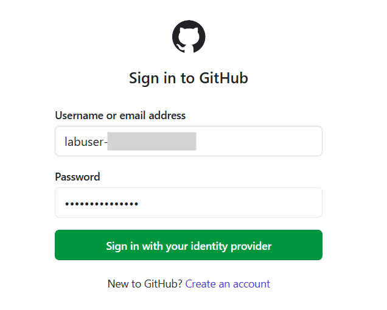

2. Open your profile menu → **Organizations** and select the lab organization
   assigned to your account.

   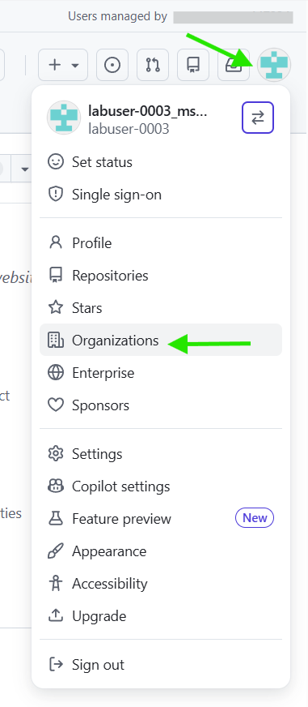

3. Open the `microhack` repository and click **Fork** (top-right). You need your own
   fork before you can create a Codespace.

   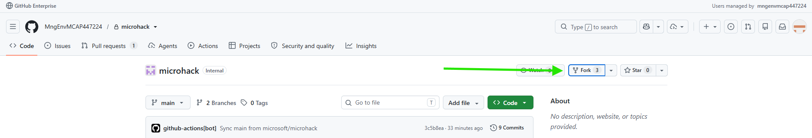

4. Give the fork a **unique name**, so that it's different from other participants' forks.
   For example, add your lab username: `microhack-labuser-0001`. Then select
   **Create fork**.

   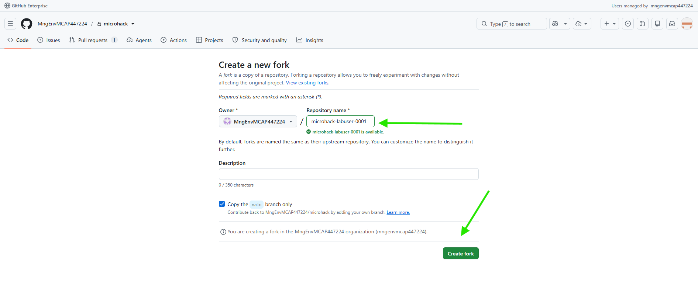

5. You should now see your fork with all files and folders from the original
   repository.

   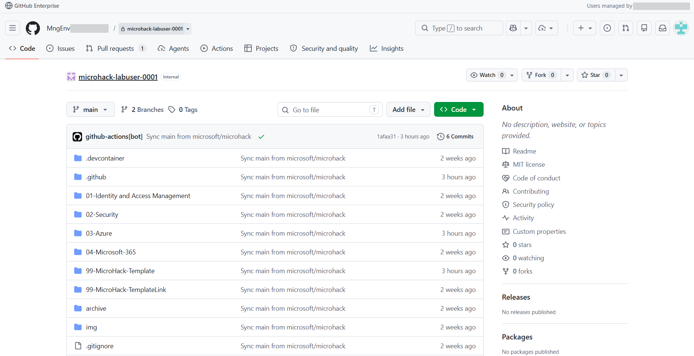

### Part C — Create the development environment (10 min)

**Option 1 — GitHub Codespaces (recommended)**

1. On your fork, select **Code → Codespaces**, open the `...` menu and choose
   **New with options...**. Don't use *Create codespace on main*: it uses a different
   dev container.

   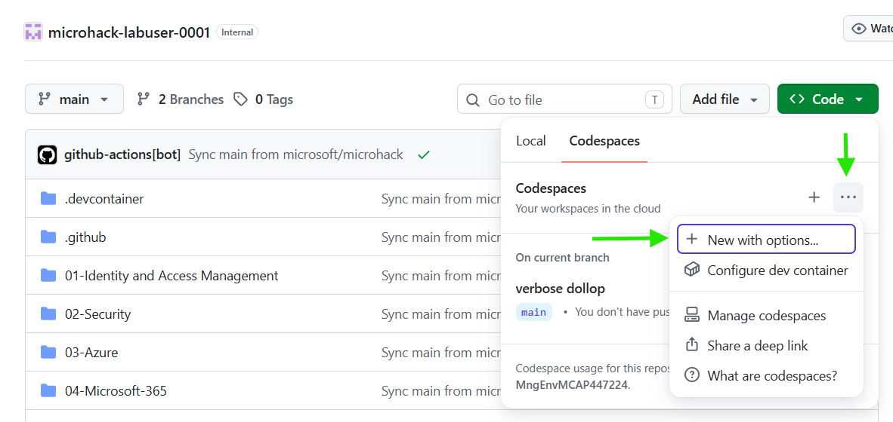

2. Set **Dev container configuration** to
   **Azure / AI / Inventory Planning Agentic**. You may need to scroll: the list is
   sorted by MicroHack area.

   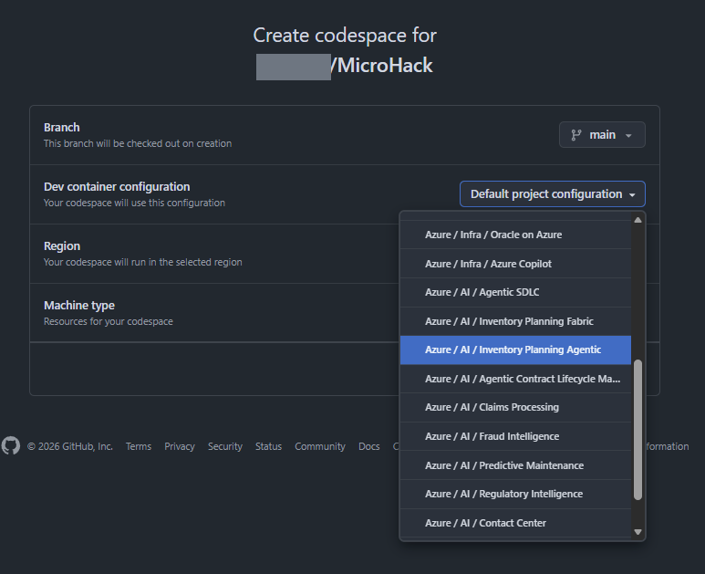

   Keep the **2-core** machine type and select **Create codespace**.

   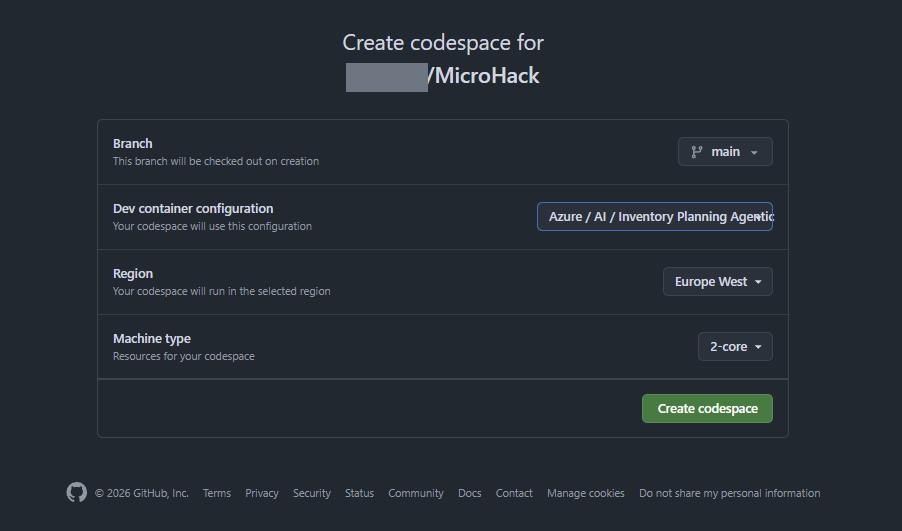

3. GitHub opens the Codespace in a new tab. The first start takes a few minutes. The
   container installs Python 3.12, `uv`, the Azure CLI and `azd`. Then
   `.devcontainer/post-create.sh` installs the Python packages (`uv sync`) and creates
   `src/.env`. When it's ready:
   - the Explorer shows the `03_Inventory_Planning_Agentic` folder,
   - the README opens as a formatted preview, and
   - new terminals use the project's Python environment: the prompt starts with
     `(agentic-inventory-hack)`.

   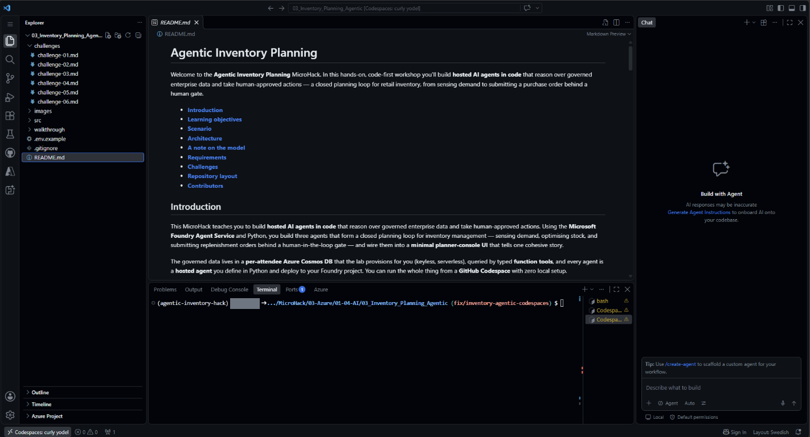

   > [!IMPORTANT]
   > When VS Code asks whether to open the git repository found in the parent folders,
   > select **Never**. You only need the hack folder.
   >
   > 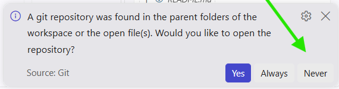

   > [!IMPORTANT]
   > If VS Code asks **Do you trust the authors of the files in this folder?** (for
   > example when you open a terminal), select **Trust Folder & Continue**. If you
   > don't, the terminal and the Python extension don't work fully (Restricted Mode).
   >
   > 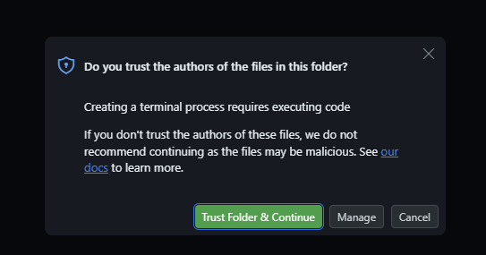

**Option 2 — Local VS Code Dev Containers**

Prerequisites: [Docker Desktop](https://www.docker.com/products/docker-desktop/) (running)
and the [Dev Containers](https://marketplace.visualstudio.com/items?itemName=ms-vscode-remote.remote-containers)
extension.

1. Clone your fork and open the **repository root** folder in VS Code:
   ```bash
   git clone https://github.com/<your-org>/<your-fork>.git
   code <your-fork>
   ```
2. Run **Dev Containers: Reopen in Container** from the Command Palette
   (`Ctrl/Cmd+Shift+P`) and select **Azure / AI / Inventory Planning Agentic**. The
   same image and `post-create.sh` run as in Codespaces.

**Verify the environment** (either option) — in a new terminal:

```bash
python --version   # 3.12.x
uv --version
az --version
ls src/.env src/.venv
```

The setup log ends with **Ready. Next steps**. If any check fails, re-run the setup
script from the hack folder: `bash .devcontainer/post-create.sh`.

### Part D — Connect to your Foundry project (10 min)

1. In the terminal, sign in with your Hackbox credentials:
   ```bash
   az login --use-device-code
   ```
   Open the URL shown, enter the code, and sign in with the lab account. If prompted
   to choose a subscription, pick the one that contains your resource group.
2. Open `src/.env` and paste the three values from your **Hackbox** credentials:
   ```
   PROJECT_ENDPOINT=<FoundryProjectEndpoint>
   MODEL_DEPLOYMENT_NAME=<ModelDeploymentName>   # gpt-5.4-mini
   COSMOS_ENDPOINT=<CosmosEndpoint>              # your Cosmos DB database
   ```
3. Confirm the model is deployed: open [ai.azure.com](https://ai.azure.com), select
   your project, and check **Models + endpoints** shows `gpt-5.4-mini` = *Succeeded*.

### Part E — Read the data model (15 min)

The data is stored in an **Azure Cosmos DB** database that the lab created for you. You
sign in to it with your lab account, so there are no keys or passwords. The code in
`src/inventory_store.py` loads the sample data from `src/data` the first time it runs.
It then gives the tools access to these containers (a container is like a table):

| Container | What it contains | Tool that exposes it |
|-----------|------------------|----------------------|
| `inventory` | `onHand`, `reorderPoint`, `safetyStock` per product per location | `query_inventory`, `list_low_stock` |
| `products` | `name`, `category`, `unitCost`, `leadTimeDays`, `supplierId` | `get_product` |
| `demand` | Weekly sales per product per retail store | `calc_reorder` (avg daily sales) |
| `signals` | Weather, search trends, competitor, news | `get_external_signals` |
| `orders` | Purchase orders / transfers | `submit_purchase_order` (**writes data**) |

**Categories:** `garden_and_lawn`, `outdoor_power_tools`, `paint_and_supplies`, `smart_home`
**Locations:** Boston, Brooklyn, Portland, Seattle stores + Chicago, Dallas warehouses

A row is **CRITICAL** when `onHand` is less than `safetyStock`. It is **AT_RISK** when
`onHand` is at or below `reorderPoint`.

### Part F — Open the planner console (10 min)

1. From `src/`, start the console:
   ```bash
   cd src && uv run uvicorn ui.app:app --reload --port 8000
   ```
2. Open the forwarded **port 8000** (Codespaces opens it automatically).
3. The **first** time the page loads, the app copies the sample data from `src/data` into
   Cosmos DB. This takes a few seconds. Then the **current exposure** panel (products at
   risk) and the **order book** panel (existing orders) show data from the database.
4. The **Sense demand** button already calls the agent you build in Challenge 2. Steps
   2–4 stay **locked** until the step before them succeeds. Don't click **Sense demand**
   yet: it creates and runs your first hosted agent, which is the task of Challenge 2.

## 🏁 Success criteria

- [ ] You can see your lab resource group (Foundry, Cosmos DB, Application Insights) in the Azure portal.
- [ ] You forked the `microhack` repository in the lab GitHub organization under a unique name.
- [ ] Your Codespace (or local Dev Container) runs the **Azure / AI / Inventory Planning Agentic** configuration and `python`, `uv`, `az` all work.
- [ ] `az login` succeeded and `src/.env` has your endpoint, model name, and Cosmos endpoint.
- [ ] `gpt-5.4-mini` shows *Succeeded* in your Foundry project.
- [ ] The planner console loads and shows the current exposure and order book panels (the sample data is in Cosmos DB).
- [ ] You can name the tools each of the three agents will use.

## 🛠️ Troubleshooting

| Symptom | Fix |
|---------|-----|
| GitHub organization or `microhack` repository missing | Sign out of GitHub and sign in again via **Sign in with your identity provider** using the lab account (the same one as the Azure portal). If the organization is still missing, ask your facilitator: the lab user needs GitHub access (`GHCPUsers`). |
| **Azure / AI / Inventory Planning Agentic** not in the dev container list | Make sure you're on your **fork** of the `microhack` repository and used **New with options...**. |
| `python: command not found` / `uv: command not found` / `src/.venv` missing | The Codespace was created with the wrong dev container (e.g. *Create codespace on main*). Delete it and recreate it with **New with options...** → **Azure / AI / Inventory Planning Agentic**. If the config is right, open a new terminal or re-run `bash .devcontainer/post-create.sh`. |
| `post-create.sh` fails locally with `$'\r': command not found` | The script was checked out with Windows line endings before the LF rule applied. In the container terminal run `sed -i 's/\r$//' .devcontainer/post-create.sh && bash .devcontainer/post-create.sh`. |
| Local Dev Container: `uv sync` fails with SSL / connection errors | Your network blocks direct access to PyPI (corporate proxy). Codespaces is not affected. Set your company's proxy (`export HTTPS_PROXY=...`) or package mirror (`export UV_DEFAULT_INDEX=...`) in the container terminal and re-run `bash .devcontainer/post-create.sh`. Or use Codespaces instead. |
| `gpt-5.4-mini` missing | Tell your facilitator. The lab setup should have deployed it. |
| Port 8000 didn't open | Open the **Ports** tab and click the globe on 8000. |
| `az login` opens no browser | Use `az login --use-device-code` and follow the URL. |
| Panels show "not connected" | Set `COSMOS_ENDPOINT` in `src/.env` and `az login`. If the lab was just created, your database permission can take a few minutes to become active. Wait, then reload the page. |
| `Forbidden` / 403 from Cosmos | Either your **Cosmos DB Built-in Data Contributor** permission isn't active yet (wait a few minutes), or you're signed in to the wrong tenant. Check `az login`. |

## 🚀 Go further

- Open `src/tools.py` and read `list_low_stock`. The console's **current exposure**
  panel shows exactly what this function returns.
- Before you start Challenge 3, guess which locations it will mark as CRITICAL.

## 📚 Learning resources

- [What is Microsoft Foundry Agent Service?](https://learn.microsoft.com/azure/foundry/agents/overview)
- [Develop in a Codespace / devcontainer](https://code.visualstudio.com/docs/devcontainers/containers)
