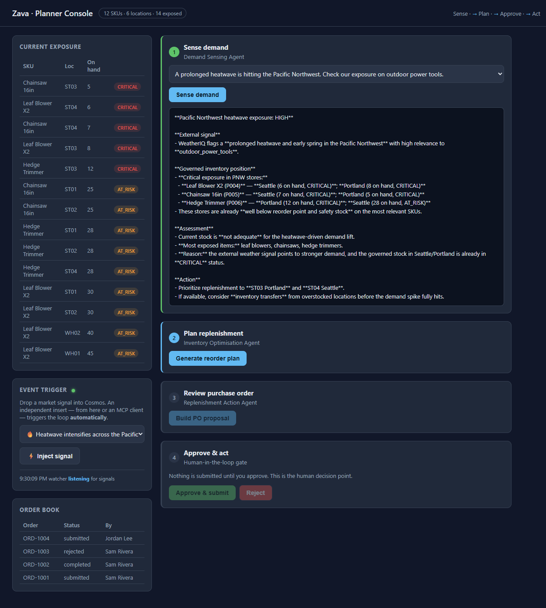

# Challenge 2 — Demand Sensing (Hosted Agent)

**[← Previous](challenge-01.md)** - [Home](../README.md) - [Next Challenge →](challenge-03.md)

## 🎯 Objective

Build and deploy your first **hosted agent** in Python. Give it **function tools** that
read the inventory data. Then run it with a real-world scenario. When it works, **Step 1**
of the planner console turns green.

## 🧭 Context

Your facilitator announces a scenario, for example:

> *"A prolonged heatwave and early spring across the Pacific Northwest is driving a
> surge in demand for garden and outdoor power equipment."*

Your agent must:

1. find the market signals that match this scenario,
2. compare them with the current stock in the database, and
3. write a short **demand assessment** that tells planners how exposed they are.

## ✅ Tasks

### Part A — Read the agent definition (15 min)

Open [`src/agents/__init__.py`](../src/agents/__init__.py) and study `DEMAND_SENSING`:

- **`name`**: the agent's name in your Foundry project.
- **`instructions`**: the system prompt (the rules the model follows). Note the strict
  *TOOL USE* rule: the agent must get numbers from the tools, not invent them.
- **`functions`**: the tools the agent may call: `query_inventory`, `list_low_stock`
  and `get_external_signals`, from [`src/tools.py`](../src/tools.py).

Open [`src/agent_runtime.py`](../src/agent_runtime.py) and read `AgentRuntime.ensure`.
It uses the Foundry agents API to **create a new version of the agent** in your project,
and makes the agent's endpoint use that version. Because the agent is created in
Foundry, it is a *hosted* agent: you can see it in the portal under **Agents**, with a
**Traces** tab.

### Part B — Run the agent from the console (20 min)

You run the agent from the planner console. You don't need to run any scripts.

1. Launch the console (if it isn't already running) and open the forwarded port 8000:
   ```bash
   cd src && uv run uvicorn ui.app:app --reload --port 8000
   ```
2. Pick a scenario and click **Sense demand**.

The first click does two things. First, `AgentRuntime.ensure()` **creates the
`demand-sensing-agent` hosted agent** in your Foundry project. Then it runs the agent.
Step 1 turns green and shows an assessment that:
- mentions at least one **external signal** (from `get_external_signals`),
- includes at least one **stock number from the database** (from `list_low_stock` or
  `query_inventory`), and
- says whether stock is **adequate**, **at risk** or **critically exposed**.

Step 2's button unlocks once Step 1 succeeds.



Now check that the agent is hosted in Foundry. Open [ai.azure.com](https://ai.azure.com)
→ your project → **Agents**. You'll see **`demand-sensing-agent`** in the list: your click
just created it. To change the agent, edit its instructions in `src/agents/__init__.py`
and save. The server restarts automatically. Click **Sense demand** again, and the agent
in Foundry is updated.

> [!NOTE]
> In the agent's **Playground** tab, its function tools may show *"Not supported by
> the selected model."* You can ignore this message for `gpt-5.4-mini`: it's only a
> label in the portal. The tools **do** run when your code calls the agent (through the
> Responses API). The stock numbers in the assessment come from those tool calls.

### Part C — (Optional) add Web Search grounding (10 min)

The `get_external_signals` tool already gives the agent market signals that are stored
in the database. So you can finish this challenge without a live web search. If your
project has the Web Search (Bing grounding) tool enabled, you can add it: set
`ENABLE_WEB_SEARCH=true` in `src/.env` and extend the agent (see **Go further**).

## 🏁 Success criteria

- [ ] `demand-sensing-agent` appears under **Agents** in your Foundry project.
- [ ] The agent returns an assessment that uses a number from the database **and** an
      external signal, and clearly says adequate, at risk or critically exposed.
- [ ] The planner console's **Step 1** turns green and unlocks Step 2.
- [ ] You can explain what each function tool added to the answer.

## 🛠️ Troubleshooting

| Symptom | Fix |
|---------|-----|
| `PROJECT_ENDPOINT is not set` | Fill in `src/.env` with the values from your Hackbox (Challenge 1). |
| `DefaultAzureCredential` error | Run `az login` in the same terminal. |
| The agent invents numbers instead of using the tools | Make the *TOOL USE* rule in the instructions stricter. |
| The agent never calls a tool | Check that the model's Foundry model card lists **Functions/Tools** support (for example `gpt-5.4-mini`). Don't use the older o-series models. |

## 🚀 Go further

- Add the Bing grounding tool: create a `BingGroundingTool` in `agent_runtime.ensure`
  when `config.ENABLE_WEB_SEARCH` is true, and pass a `BING_CONNECTION_ID`.
- Ask the agent to rank **all** locations by risk, not only the worst one.
- Add a second scenario (for example, a supplier delay) and compare the two assessments.

## 📚 Learning resources

- [Create and run agents with the Foundry Agents SDK](https://learn.microsoft.com/azure/ai-foundry/agents/quickstart)
- [Function tools for agents](https://learn.microsoft.com/azure/ai-foundry/agents/how-to/tools/function-calling)
