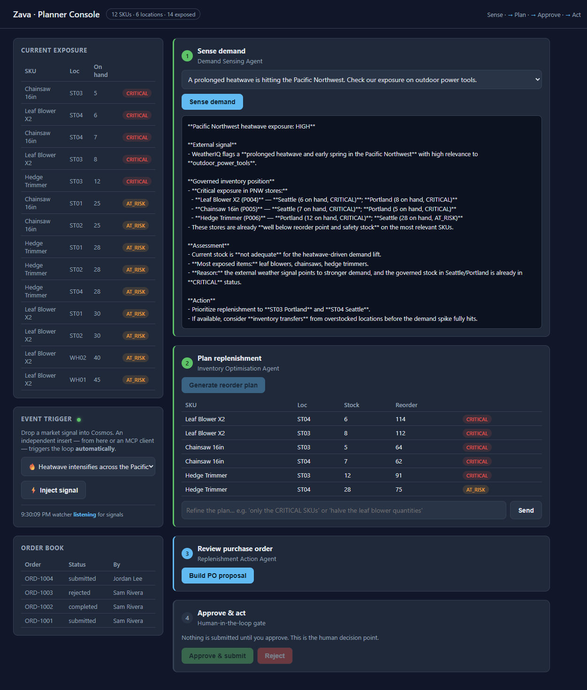
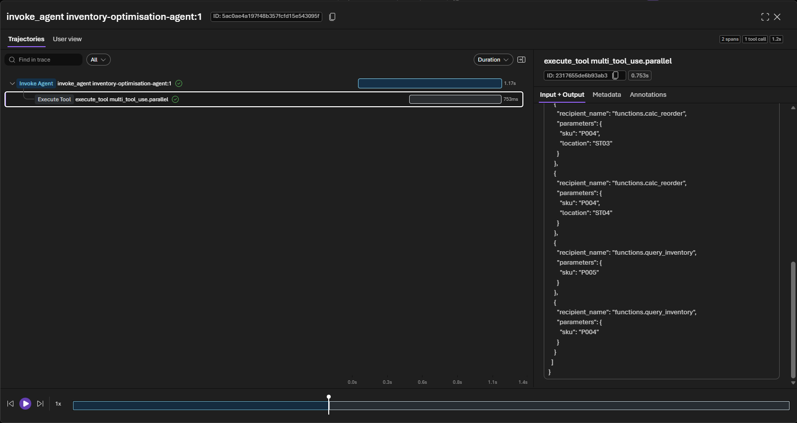

# Challenge 3 — Inventory Optimisation (Hosted Agent) and Tracing

**[← Previous](challenge-02.md)** - [Home](../README.md) - [Next Challenge →](challenge-04.md)

## 🎯 Objective

Build the second hosted agent. It reads the demand assessment from Challenge 2 and
creates a **reorder recommendation**: which products to order, and how many. It uses a
fixed planning rule and the data in the database. Then you use **tracing** in the
Foundry portal to see every tool call the agent made.

## 🧭 Context

The demand assessment shows which products are at risk. Now the planning team needs to
know *which SKUs* to reorder, *how many units*, *for which location*, and *why*.

## ✅ Tasks

### Part A — Read the agent & the reorder rule (15 min)

Open [`src/agents/__init__.py`](../src/agents/__init__.py) → `INVENTORY_OPTIMISATION`
and [`src/tools.py`](../src/tools.py) → `calc_reorder`. The rule is:

```
reorder_qty = max(0, average_daily_sales * 30 - current_stock)
```

The agent's instructions tell it to return the recommendation as **structured JSON**
(data in a fixed format), so the console can show it as a table. Any SKU below its safety
stock is marked **CRITICAL**.

### Part B — Run the optimisation step (15 min)

In the console, after Step 1, click **Generate reorder plan**. The first click
**creates the `inventory-optimisation-agent` hosted agent** and then runs it. Step 2
shows the recommendation table, and Step 3 unlocks.

Check that at least one item is marked **CRITICAL**. Leaf blowers and chainsaws at
Portland and Seattle are likely. In the background, the agent returns a JSON list called
`recommendations`, and the console shows it as a table.



### Part C — Inspect the trace (25 min)

> [!IMPORTANT]
> To trust an AI agent, you must be able to see *what it did and why*. Tracing shows you
> exactly that.

1. In the Foundry portal, open your agent and select the **Traces** tab. Tracing is
   already on: the lab connected Application Insights for you.
2. Find the most recent `inventory-optimisation-agent` run.
3. Locate and read:
   - the **model call**: the instructions and input the model received,
   - each **tool call**: for example `calc_reorder` and the values passed to it,
   - the **tool response**: the numbers your code returned,
   - the **final answer**: how the model built the JSON.
4. Answer from the trace:
   - Did the agent call `calc_reorder` once or per SKU? Why?
   - Are the reorder quantities traceable to real `avgDailySales × 30 − stock` numbers?
   - Did it correctly flag the CRITICAL items?



## 🏁 Success criteria

- [ ] `inventory-optimisation-agent` exists in your project, with only tools that read data.
- [ ] The plan step returns a recommendation with at least one **CRITICAL** item.
- [ ] The console's **Step 2** shows the table and unlocks Step 3.
- [ ] You can use the trace to show *why* a quantity was recommended.

## 🛠️ Troubleshooting

| Symptom | Fix |
|---------|-----|
| No run under **Traces** | A trace can take one or two minutes to appear. Wait, then refresh. Also check that the agent really ran. |
| Tools show "Not supported by the selected model" | You can ignore this label for `gpt-5.4-mini`. The tools do run through the Responses API: the real reorder numbers prove it. |
| Output isn't valid JSON | The code can handle JSON wrapped in a code block. If it still fails, add *"Return ONLY the JSON"* to the instructions. |
| No CRITICAL item | Use a scenario touching outdoor power tools (Portland/Seattle are below safety stock). |
| Quantities look wrong | Check the trace: confirm that `calc_reorder` was called and returned real numbers. |

## 🚀 Go further

- Extend `calc_reorder` to respect `safetyStock` as well as `reorderPoint`.
- Have the agent sort the recommendations by estimated cost, using `unitCost`.
- Suggest a `transfer` from another location when that location has extra stock.

## 📚 Learning resources

- [Trace agents in Foundry](https://learn.microsoft.com/azure/ai-foundry/observability/concepts/trace-agent-concept)
- [Responsible AI for agents](https://learn.microsoft.com/azure/ai-foundry/responsible-use-of-ai-overview)
