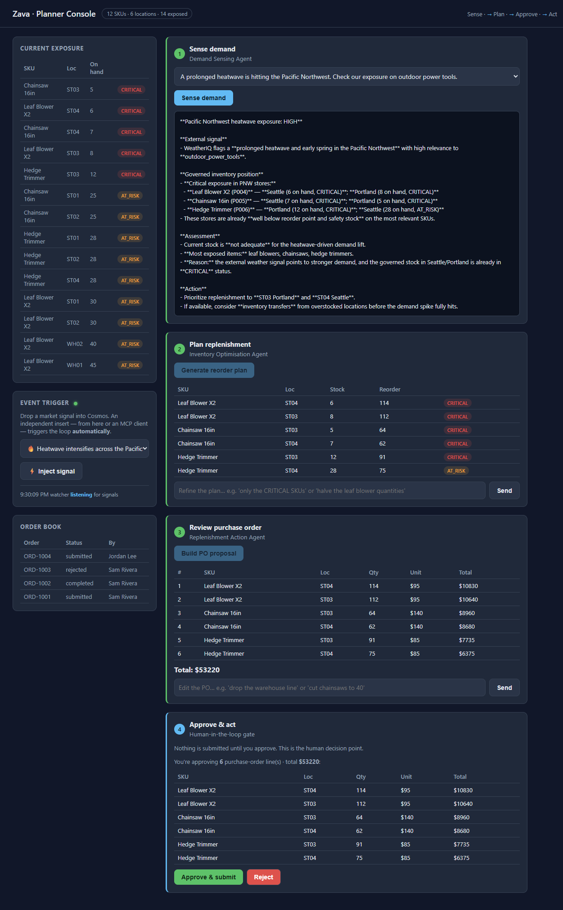

# Challenge 4 — Replenishment Action and Human Approval

**[← Previous](challenge-03.md)** - [Home](../README.md) - [Next Challenge →](challenge-05.md)

## 🎯 Objective

Build the third hosted agent. It proposes a purchase order. Then a **person approves
or rejects it**, and your code enforces this. Only after approval does the one tool that
writes data run. This approval step is what lets an AI agent take real actions safely.

## 🧭 Context

Someone has to place the order, and every purchase order needs a person's approval. So
the work is split into three parts: the Replenishment Action agent **proposes** the order,
a person **decides**, and only then the tool **acts**.

## ✅ Tasks

### Part A — Read the agent and the approval step (20 min)

Open [`src/agents/__init__.py`](../src/agents/__init__.py) → `REPLENISHMENT`. It has
two tools: `get_product` (looks up unit costs) and `submit_purchase_order` (the only
tool that writes data). Its instructions tell it to **propose** a purchase order (PO) as
JSON, and to **never** submit it without approval.

Now open [`src/agent_runtime.py`](../src/agent_runtime.py). Look at the line
`APPROVAL_REQUIRED = {"submit_purchase_order"}`. Because of it, the code **never runs
that tool automatically**. If the model asks to call it, `run()` returns a
`ToolApprovalRequest` and does nothing else. The person's decision is handled in
[`src/orchestrator.py`](../src/orchestrator.py) → `approve()`. It runs the tool only
after a person says yes.

> [!NOTE]
> The approval doesn't depend on the prompt, which a model could ignore. The code itself
> **blocks** the tool until a person approves.

### Part B — Build the proposal (20 min)

In the console, after Steps 1–2, click **Build PO proposal**. The first click
**creates the `replenishment-action-agent` hosted agent** and then runs it.

- **Step 3** shows the proposed purchase order: one line per product, and a total.
- **Step 4 (Approve & act)** unlocks. It shows a summary of **exactly what you are
  approving** (each line and the total), with **Approve** and **Reject** buttons.

Nothing is submitted yet. The agent only *proposes*. You test the approval in Part C.

### Part C — Approve in the console (25 min)

> [!IMPORTANT]
> This is the main result of the hack: the whole loop, including the approval step,
> running in the console.

1. With the proposal at **Step 3** and the **Approve** / **Reject** buttons at **Step 4** (from Part B):
2. First click **Reject**. Check that you see *"Order cancelled. No action taken."* and
   that the order book does **not** change.
3. Refresh the page and run Steps 1–3 again. Then click **Approve & submit**. You see
   the confirmation `✅ Purchase order PO-… submitted and recorded in the order book.`,
   and the new order appears in the **order book** panel. It was written to Cosmos DB.

### Part D — Trace the acting run (10 min)

In the portal, open the **Traces** tab of `replenishment-action-agent` and select the
latest run. You see the `get_product` calls that looked up unit costs. You **don't** see
a `submit_purchase_order` call: the code stopped it and handed the decision to a person
before it could run.

## 🏁 Success criteria

- [ ] `replenishment-action-agent` exists with the tools `get_product` and `submit_purchase_order`.
- [ ] The proposal is a table with a cost for each line and a total.
- [ ] **Reject** writes nothing. **Approve** adds a `PO-…` to the order book.
- [ ] You can show in the code *why* the agent can't submit an order by itself.

## 🛠️ Troubleshooting

| Symptom | Fix |
|---------|-----|
| An order is written without approval | Confirm `submit_purchase_order` is in `APPROVAL_REQUIRED`. |
| Unit costs all show `$20` | The `get_product` lookup failed. Check the trace. `$20` is only the default value used when the lookup fails. |
| Proposal isn't valid JSON | Add *"Return ONLY the JSON"* to the instructions. |
| Approve does nothing | Check that the proposal contains `submitItems` (see the agent instructions). |

## 🚀 Go further

- Add a **spending limit**: reject any proposal above a set amount and send it to a
  manager instead.
- Record the approver's **name and reason**, and show them in the confirmation.
- Open the Cosmos DB `orders` container in the portal's Data Explorer. Find your new
  PO next to the sample orders.

## 📚 Learning resources

- [Human-in-the-loop tool approvals for agents](https://learn.microsoft.com/agent-framework/agents/tools/tool-approval)
- [Agent development lifecycle](https://learn.microsoft.com/azure/ai-foundry/agents/concepts/development-lifecycle)
