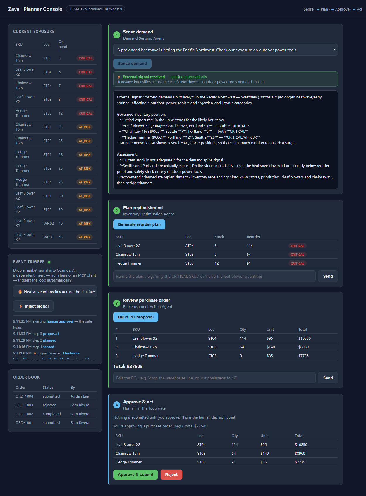

# Challenge 6 — The Loop Starts Itself (Event-Driven, Stretch)

**[← Previous](challenge-05.md)** - [Home](../README.md)

> [!NOTE]
> This is an optional final challenge for teams that finish early. It uses the three
> agents from Challenges 2–4. You can skip it: Challenges 1–4 are the main part of the hack.

## 🎯 Objective

Until now, the loop runs only when someone clicks a button. In this challenge, the loop
**starts by itself when new data arrives**. This is called *event-driven*.

It works like this:

1. A new market signal is added to the `signals` container in Cosmos DB. It can come from
   the console, from an **MCP** client, or from any other system.
2. A background process, the **watcher**, notices the new signal. It reads the Cosmos DB
   **change feed**, a list of every new or changed document.
3. The watcher runs Sense → Plan → Propose and shows the progress live in the console.
4. The loop **stops and waits for a person to approve**.

You don't need any new Azure resources. The change feed is built into Cosmos DB, and the
watcher runs inside the console app you already have.

## 🧭 Context

Planners don't watch a dashboard all day. In real work, a *signal* arrives in a system:
for example a weather alert, a competitor running out of stock, or a supplier delay. The
planning process should react to it automatically and prepare a decision for a person to
approve.

The important idea: **writing the signal starts the loop**. It doesn't matter who adds the
signal to the database. Your agents react to it automatically, and a person still makes
the final decision with **Approve**.

## ✅ Tasks

### Part A — Read the code that reacts to signals (15 min)

Open [`src/live.py`](../src/live.py) and find three parts:

- **`start_watcher`**: reads the **change feed** of the `signals` container. It checks
  for new documents at regular intervals and remembers where it stopped (with a
  *continuation token*). It starts from *now*, so the sample data loaded at startup
  doesn't start a run.
- **`_auto_run`**: for each new signal, runs `sense → plan → propose` with the same
  orchestrator the console uses. It sends an event after each step. Then it **stops** and
  sends `awaiting_approval`. It never submits an order.
- **`EventBus`**: sends these events to the browser with **SSE** (Server-Sent Events, a
  simple way for a server to push updates to a web page) at `/api/events`.

Then look quickly at [`src/ui/app.py`](../src/ui/app.py):

- the `startup` function starts the watcher,
- `POST /api/signal` only **writes** the signal. It never calls an agent: the change feed
  starts the loop, and
- `GET /api/events` is the SSE stream that the console listens to.

### Part B — Watch the console react (15 min)

1. Start the console and open port 8000. When the watcher is **listening**, the
   **Event trigger** panel shows a green dot.
2. Choose a signal and click **⚡ Inject signal**. **Steps 1–3 run by themselves**, and the
   activity log describes each step. The loop **stops at Step 4**.
   - **Sense demand** becomes disabled and shows the banner *"⚡ External signal
     received"*. This shows that the signal started the run, not a click.
   - If several signals arrive at the same time, Step 1 shows a **queue** and runs them
     one after another.
3. **Step 4 shows exactly what you are approving**: each line of the purchase order and the
   total. Click **Approve & submit**. A `PO-…` is written to Cosmos DB, the same as in
   Challenge 4. The code ran every step *except* the person's decision.



### Part B2 — Change the plan in your own words (10 min)

The automatic run creates a *draft*. The planner can still change it in plain English
before approving. Each change runs the matching agent again:

- Under **Step 2**, type in *"Refine the plan…"*, for example *"only the CRITICAL SKUs"*
  or *"halve the leaf blower quantities"*. The **Inventory Optimisation agent** creates a
  new recommendation (`POST /api/plan/refine`).
- Under **Step 3**, type in *"Edit the PO…"*, for example *"drop the warehouse line"* or
  *"cut chainsaws to 40"*. The **Replenishment agent** rewrites the proposal
  (`POST /api/propose/refine`). The summary in Step 4 updates to match.

The approval step doesn't change: these edits only change the *proposal*. Nothing is
written until a person clicks **Approve**.
### Part C — Trigger it from outside via MCP (20 min)

The signal can come from any system, including an **MCP** client such as GitHub Copilot,
Claude or another agent. [`src/mcp_server.py`](../src/mcp_server.py) offers one tool,
`inject_signal`. It writes to the same `signals` container.

The server uses the **stdio transport**. This means it sends and receives messages through
standard input and output, **not through a network port**. You don't start it by itself:
an **MCP client** starts it as a child process and talks to it.
[`src/mcp_client.py`](../src/mcp_client.py) is a small client that does this.

1. Keep the planner console running in its terminal. Open a **second terminal** (**+** in
   the terminal panel) and go to `src/`:
   ```bash
   cd src
   ```
2. Call the tool through MCP. The client starts `mcp_server.py`, lists its tools and calls
   **`inject_signal`**:
   ```bash
   uv run python mcp_client.py "Competitor out of stock on chainsaws in the West" --region West
   ```
   You should see:
   ```text
   Connected to MCP server 'zava-signals' - tools: inject_signal
   Injected signal SIG-… — the planner loop will react automatically.
   ```
3. Switch to the console. It **reacts by itself** to the new signal: it runs the loop and
   waits for approval. A system outside the console has just started your planning loop.

> [!IMPORTANT]
> **Don't run `uv run python mcp_server.py` by itself.** It starts and then waits, without
> any output, for messages from a client. If you press **Enter**, it receives an empty line
> and prints `Invalid JSON: EOF while parsing a value … input_value='\n'`. This is normal.
> Use `mcp_client.py` (or another MCP client) instead. To stop the server, press **Ctrl+C**.

### Part D — (Go further) Any source, same reaction

The signal and the loop are **independent of each other** (*decoupled*). The watcher
reacts to the *data*, not to who wrote it. Test this by writing a signal in a third way:
in the Cosmos DB Data Explorer in the portal, with an `az cosmosdb` or SDK script, or from
a scheduled job. Then watch the console react.

## 🏁 Success criteria

- [ ] The **Event trigger** panel shows the watcher **listening** (green dot).
- [ ] Adding a signal (from the console **or** through MCP) runs Sense → Plan → Propose
      **without any clicks**. The progress appears live, and **Sense demand** is disabled
      with the external-signal banner.
- [ ] You can **change the plan and the PO in plain English**, and each change runs the agent again.
- [ ] **Step 4 shows exactly what you are approving** (each PO line and the total).
- [ ] The loop **stops for approval**: nothing is submitted until a person approves.
- [ ] **Approve** writes a `PO-…` to the order book.
- [ ] You can explain why the change feed makes the signal independent of the loop.

## 🛠️ Troubleshooting

| Symptom | Fix |
|---------|-----|
| Watcher dot never turns green | Check `COSMOS_ENDPOINT` in `.env` and run `az login`. The watcher starts only when Cosmos DB is set up. |
| Nothing happens after adding a signal | The watcher only sees signals added *after* the app started. Add the signal again now. Check the server log for `watcher: …` errors. |
| A step fails during the automatic run | The automatic run uses the same agents as Challenges 2–4. First check that they work when you click the buttons, and that `az login` is still valid. |
| The page doesn't update (SSE) | Some company proxies hold back `text/event-stream` data. Open the forwarded port directly, or check the `/api/events` connection in the browser console. |
| Watcher dot turns gray | The SSE connection was lost. It **reconnects automatically**, and the dot turns green again with the next event. If it stays gray, reload the page. |
| `Invalid JSON: EOF while parsing a value … input_value='\n'` | You ran `mcp_server.py` by itself and pressed Enter. It's a stdio server that waits for a client. Press **Ctrl+C**, and use `uv run python mcp_client.py "<headline>"` instead (Part C). |
| `mcp_client.py` fails calling the tool | Run it from `src/` (so `uv run` finds the project). Check `COSMOS_ENDPOINT` in `src/.env`, and check that `az login` is valid: the tool writes to Cosmos DB. |

## 🚀 Go further

- Add a **debounce**: when many signals arrive in a short time, run the loop only once.
- Send a **completion event**, and show a short pop-up message in the console when a
  proposal is ready.
- Replace the watcher inside the console with an **Azure Function that Cosmos DB
  triggers**. The pattern is the same, but it runs without the console. Note that this
  needs an extra Function App resource.
- Give the MCP server a second tool, `list_exposure`, so an outside agent can *check* the
  risk before it *adds* a signal.
- Use a full MCP host instead of the script: add the server in **GitHub Copilot Chat**
  (agent mode) as a **stdio** server, with command `uv`, arguments `run python mcp_server.py`
  and working directory `src/`. Then ask Copilot to add a signal.

## 📚 Learning resources

- [Change feed in Azure Cosmos DB](https://learn.microsoft.com/azure/cosmos-db/change-feed)
- [Change feed pull model](https://learn.microsoft.com/azure/cosmos-db/nosql/change-feed-pull-model)
- [Model Context Protocol](https://modelcontextprotocol.io/)
- [Server-Sent Events (MDN)](https://developer.mozilla.org/docs/Web/API/Server-sent_events)
