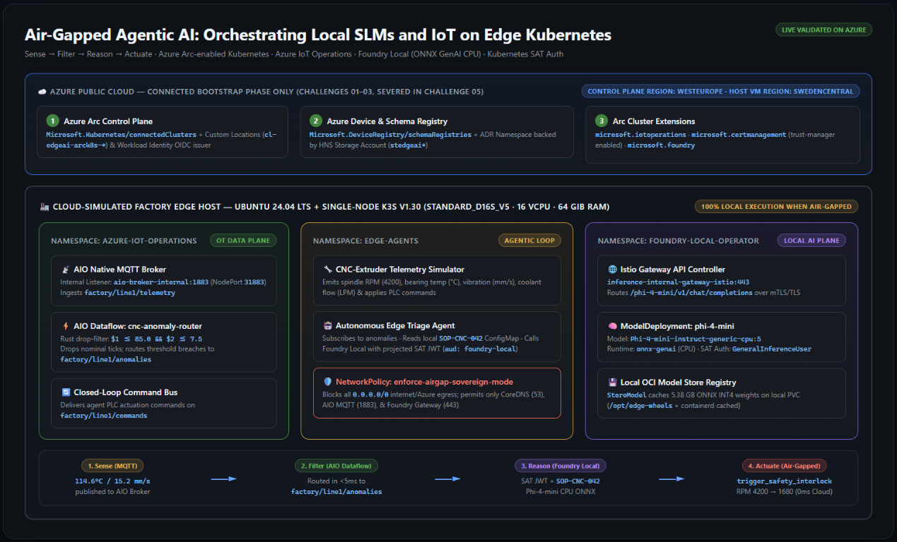
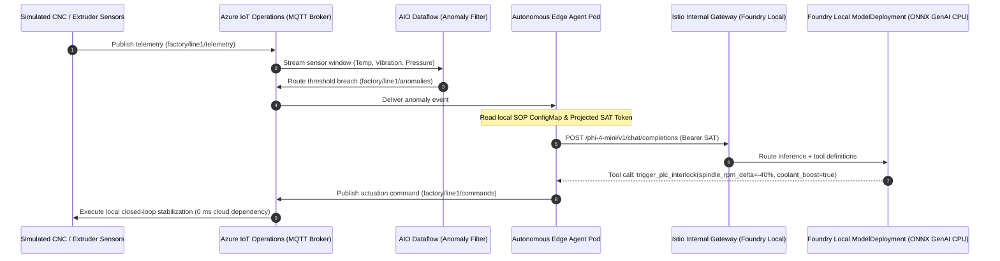
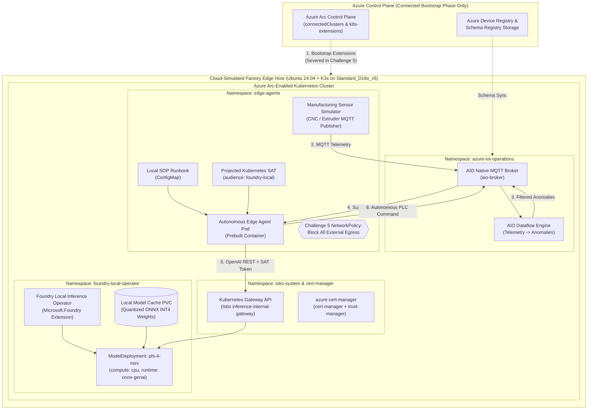

# **Air-Gapped Agentic AI: Orchestrating Local SLMs and IoT on Edge Kubernetes**

- [**MicroHack Introduction**](#microhack-introduction)
- [**What You'll Build**](#what-youll-build)
- [**MicroHack Context & Scenario**](#microhack-context--scenario)
- [**Architecture**](#architecture)
- [**Objectives**](#objectives)
- [**General Prerequisites & Facilitator Guidance**](#general-prerequisites--facilitator-guidance)
- [**MicroHack Challenges**](#microhack-challenges)
- [**Contributors**](#contributors)

---

## MicroHack Introduction

Industrial, manufacturing, defense, and critical-infrastructure organizations increasingly require **sovereign edge intelligence**: the ability to ingest high-frequency OT sensor streams, reason over local Standard Operating Procedures (SOPs), and execute low-latency autonomous corrective actions **even when severed from the public cloud**.

This **Ops & Architecture-focused MicroHack** walks you through building and operating a disconnected, end-to-end **Agentic AI + Industrial IoT workflow** running entirely on **Azure Arc-enabled Kubernetes**. You will combine **Azure IoT Operations** (as the unified edge MQTT and dataflow plane) with **Foundry Local** (`Microsoft.Foundry` Arc extension serving quantized CPU Small Language Models via Kubernetes Gateway API and Istio) and a prebuilt **Autonomous Edge Triage Agent** that authenticates locally via Kubernetes **Service Account Tokens (SAT)**.

Finally, you will **"Cut the Cord"** using strict Kubernetes network isolation policies to prove that your edge AI agent continues to detect anomalies, reason against local runbooks, and actuate PLC safety interlocks with **zero outbound cloud traffic**.

> [!TIP]
> **No application coding required.** All simulator and agent workloads are provided as ready-to-deploy Kubernetes manifests. You will spend your time on the **sovereign edge platform, dataflow routing, local model serving, workload identity, and air-gap enforcement layers**.

---

## What You'll Build

Across five progressive challenges, you will assemble a complete closed-loop industrial edge AI stack on your own isolated Kubernetes cluster:

| # | Layer / Challenge | Core Technology | What It Produces |
| :--- | :--- | :--- | :--- |
| **01** | **Sovereign Edge Foundation** | Ubuntu 24.04 + K3s + **Azure Arc (`connectedk8s`)** | An Arc-connected Kubernetes cluster with OIDC, Workload Identity, Custom Locations, and kernel `inotify` tuning |
| **02** | **Unified Edge IoT Data Plane** | **Azure IoT Operations (`Microsoft.IoTOperations`)** | Native MQTT Broker + CNC Telemetry Simulator + an AIO Dataflow that filters anomalies to `factory/line1/anomalies` |
| **03** | **Local CPU SLM Serving** | **Foundry Local (`Microsoft.Foundry`)** + Istio Gateway API | A locally cached **`Phi-4-mini-instruct-generic-cpu:5`** ONNX INT4 model served at an internal `/v1/chat/completions` gateway |
| **04** | **Zero-Cloud SAT Auth & Edge Agent** | Kubernetes **Service Account Tokens (SAT)** + Local SOP `ConfigMap` | An autonomous agent pod that authenticates locally (`audience: foundry-local`), reasons over **SOP-CNC-042**, and throttles PLC RPM |
| **05** | **"Cut the Cord" Air-Gap Mode** | Kubernetes `NetworkPolicy` + Critical Fault Injector | Verified sub-8-second emergency safety interlock (`-60%` RPM, `SAFE_HOLD`) while public internet/Azure egress is blocked |

---

## MicroHack Context & Scenario

### Sovereign Manufacturing Line Scenario

Contoso Precision Manufacturing operates a high-speed CNC & Extrusion line in a regulated facility where intermittent WAN links and strict data-sovereignty rules prohibit streaming raw high-frequency machine telemetry to public cloud LLM endpoints for real-time control.

### Required & Optional Reading

- [Deployment overview for Foundry Local on Azure Local](https://learn.microsoft.com/azure/azure-sovereign-clouds/private/foundry-local/deploy-overview)
- [Deploy Foundry Local as an Azure Arc extension](https://learn.microsoft.com/azure/azure-sovereign-clouds/private/foundry-local/deploy-foundry-local-arc-extension)
- [Deploy a catalog model on Foundry Local (`ModelDeployment` CRD)](https://learn.microsoft.com/azure/azure-sovereign-clouds/private/foundry-local/how-to-deploy-model)
- [Configure Kubernetes Service Account Token (SAT) authentication for Foundry Local](https://learn.microsoft.com/azure/azure-sovereign-clouds/private/foundry-local/how-to-configure-service-account-token-authentication)
- [Azure IoT Operations overview](https://learn.microsoft.com/azure/iot-operations/overview-iot-operations)
- [Prepare an Azure Arc-enabled Kubernetes cluster for Azure IoT Operations](https://learn.microsoft.com/azure/iot-operations/deploy-iot-ops/howto-prepare-cluster)

---

## Architecture

Both **Azure IoT Operations (`Microsoft.IoTOperations`)** and **Foundry Local (`Microsoft.Foundry`)** deploy onto **Azure Arc-enabled Kubernetes (`Microsoft.Kubernetes/connectedClusters`, K8s 1.29+)**.

### Edge Simulation Environment (`fast-k3s`)

To make this MicroHack fast, reliable, and cost-effective for workshops, [`resources/infra/main.bicep`](resources/infra/main.bicep) provisions a single **Ubuntu 24.04 Azure VM (`Standard_D16s_v5` — 16 vCPUs, 64 GiB RAM)** with Premium SSDs and a single-node **K3s** cluster (`v1.33+`, the Microsoft GA validated baseline for Azure IoT Operations) in **~10 minutes**.

> **Note on Production Topologies:** Single-node and multi-node K3s on Ubuntu are officially validated by Microsoft for Azure IoT Operations. Because all workloads in this MicroHack deploy via **Azure Arc-enabled Kubernetes (`connectedClusters`)** extensions and standard Kubernetes CRDs, the exact same workload manifests and extensions also run unchanged on physical **Azure Local (`aksarc`)** clusters in factory datacenters.

---

## Objectives

After completing this MicroHack, you will be able to:

- Prepare and onboard an edge Kubernetes cluster to **Azure Arc (`connectedk8s`)** with OIDC issuer, Workload Identity, and kernel parameters tuned for industrial edge workloads.
- Deploy **Azure IoT Operations** (`Microsoft.IoTOperations`) and configure its native MQTT Broker and Dataflows to filter high-frequency manufacturing telemetry at the edge.
- Deploy **Foundry Local** (`Microsoft.Foundry` Arc extension) with Kubernetes Gateway API, Istio, and `azure-cert-manager`, and provision a CPU-optimized quantized Small Language Model (`compute: cpu`, `runtime: onnx-genai`) via a declarative `ModelDeployment` custom resource.
- Configure **Kubernetes Service Account Token (SAT)** authentication (`audience: foundry-local`, role `GeneralInferenceUser`) so in-cluster AI agents can invoke Foundry Local endpoints without cloud identity dependencies.
- Prove **air-gapped operational sovereignty** by blocking external cluster egress with Kubernetes `NetworkPolicy` and verifying sub-3-second autonomous fault mitigation.

---

## General Prerequisites & Facilitator Guidance

Before starting Challenge 1, ensure you have:

- A modern browser (Edge, Chrome, or Firefox) to connect to your **Edge Host VM** via **Azure Bastion** in the Azure Portal.
- **Azure Subscription** with **Owner** (or **Contributor** + **User Access Administrator** / **RBAC Administrator**) permissions on your lab Resource Group.
- **Registered Resource Providers** (handled automatically by [`labautomation/shared-deploy-lab.ps1`](labautomation/shared-deploy-lab.ps1) or [`resources/infra/register-providers.sh`](resources/infra/register-providers.sh)):
  - `Microsoft.Kubernetes`, `Microsoft.KubernetesConfiguration`, `Microsoft.ExtendedLocation`
  - `Microsoft.IoTOperations`, `Microsoft.DeviceRegistry`, `Microsoft.SecretSyncController`
- **CLI Tools** (pre-installed automatically on the Edge Host VM via `cloud-init`):
  - Azure CLI (`az`) >= 2.67 with extensions: `connectedk8s`, `k8s-extension`, `customlocation`, `azure-iot-ops`
  - `kubectl` >= 1.33, `helm` >= 3.14, `jq`, and `mosquitto-clients`

> [!TIP]
> **You're ready to start when:**
> 1. You can open the **`AzurePortalEdgeVmUrl`** from your lab dashboard (Credentials tab) and connect to your `edgeai-host-...` VM via **Azure Bastion** using `EdgeHostAdminUsername` (`edgeadmin`) and `EdgeHostAdminPassword`.
> 2. Running `cat /var/log/edge-bootstrap-complete.log` inside the VM prints `Edge host bootstrap completed successfully.` and `kubectl get nodes` shows your K3s node as `Ready`.

> [!IMPORTANT]
> **Facilitator Guidance (from Live Azure Run Validation):**
> - **Isolated Per-Attendee Stack:** [`labautomation/deploy-lab.ps1`](labautomation/deploy-lab.ps1) provisions a dedicated `Standard_D16s_v5` (16 vCPUs, 64 GiB RAM) Ubuntu 24.04 K3s host, NAT Gateway, Azure Bastion, Key Vault, and HNS-enabled Storage Account per attendee. There is **no shared cluster contention** between attendees.
> - **Quota & Subscription Packing:** `lab-defaults.json` packs **4 attendees per subscription** (64 DSv5 vCPUs total, well within the standard 100-vCPU regional quota). To cut compute cost in half for smaller budgets, you can override `vmSize = 'Standard_D8s_v5'` (8 vCPUs, 32 GiB RAM), which still comfortably fits both Azure IoT Operations (`--broker-mem-profile Low`) and Foundry Local's `Phi-4-mini` CPU deployment.
> - **Regional Split (`swedencentral` VM + `westeurope` Arc/AIO Control Plane):** `lab-defaults.json` defaults to `swedencentral` for VM deployment (where `Standard_D16s_v5` capacity is abundant), while Challenges 01–02 register the **Azure Arc `connectedCluster`**, **Schema Registry**, **Device Registry Namespace**, and **Azure IoT Operations** resources in **`westeurope`** (an officially supported AIO control-plane region). All four control-plane resources must share the same `ARC_LOCATION` (`westeurope`) to avoid `HostResourceRegionMismatch`.
> - **Expected Timing:** Total machine/CLI wait time across all 5 challenges is **~40–45 minutes** (Challenge 01: ~5m, Challenge 02: ~14m, Challenge 03: ~11m including the 5.38 GB `Phi-4-mini` ONNX download, Challenge 04: ~2m, Challenge 05: ~2m), making this ideal for a **3- to 5-hour MicroHack** with architectural discussion and reflection.

---

## MicroHack Challenges

* [**Challenge 01 — Provision & Verify the Sovereign Edge Kubernetes Foundation**](challenges/challenge-01.md) **<- Start here**
* [**Challenge 02 — Deploy Azure IoT Operations & Simulated Manufacturing Telemetry**](challenges/challenge-02.md)
* [**Challenge 03 — Deploy Foundry Local Operator & Serve a Quantized CPU SLM**](challenges/challenge-03.md)
* [**Challenge 04 — Wire the Autonomous Edge Agent with Zero-Cloud SAT Authentication**](challenges/challenge-04.md)
* [**Challenge 05 — "Cut the Cord": Air-Gapped Fault Simulation & Verification**](challenges/challenge-05.md)
* [**Finish & Takeaways**](challenges/finish.md)

## Solutions — Spoiler Warning

* [**Solution 01 — Edge Kubernetes & Azure Arc Onboarding**](walkthrough/challenge-01/solution-01.md)
* [**Solution 02 — Azure IoT Operations & Telemetry Pipeline**](walkthrough/challenge-02/solution-02.md)
* [**Solution 03 — Foundry Local Extension & CPU ModelDeployment**](walkthrough/challenge-03/solution-03.md)
* [**Solution 04 — Autonomous Edge Agent & SAT Authentication**](walkthrough/challenge-04/solution-04.md)
* [**Solution 05 — Air-Gapped NetworkPolicy & Autonomous Actuation**](walkthrough/challenge-05/solution-05.md)

---

## Contributors

* Digvijay Chauhan
