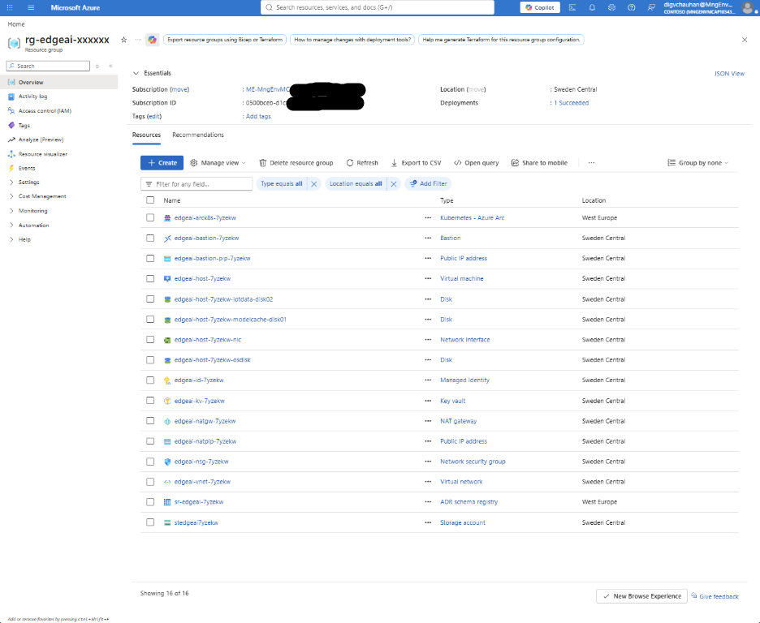
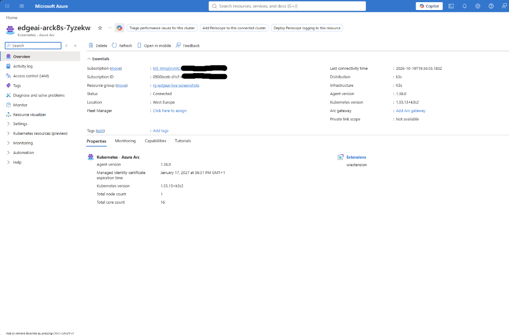
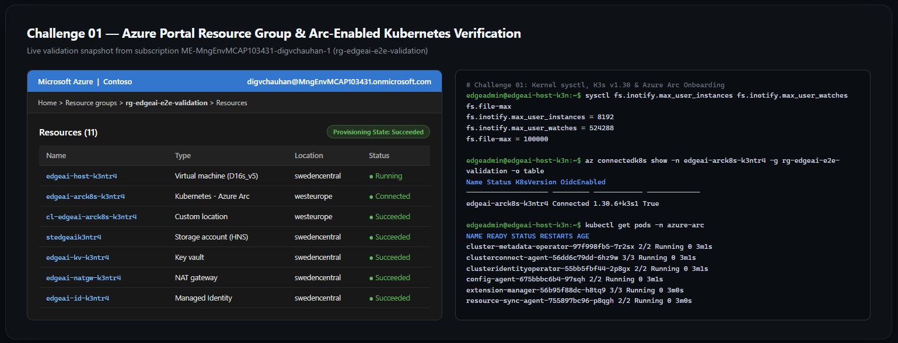

# Challenge 01 — Provision & Verify the Sovereign Edge Kubernetes Foundation

**[Home](../Readme.md)** - [Next Challenge →](challenge-02.md)

## 🎯 Objective

Validate your cloud-simulated Edge Host environment, inspect the Linux kernel and Kubernetes prerequisites required for industrial edge workloads, and onboard the Kubernetes cluster to **Azure Arc (`Microsoft.Kubernetes/connectedClusters`)** with OIDC Issuer, Workload Identity, and Custom Locations enabled.

## 🧭 Context

Before deploying industrial telemetry brokers or local language models at a manufacturing site, platform engineers must establish a resilient, Arc-connected Kubernetes foundation. In production factories, this foundation runs on **AKS enabled by Azure Arc (`aksarc`) on Azure Local** hardware racks or **Ubuntu + K3s** edge nodes.

In this challenge, you will connect to your isolated **Edge Host VM** (`Standard_D16s_v5` running Ubuntu 24.04 + single-node K3s), verify that kernel `inotify` and file-descriptor limits are tuned for high-throughput MQTT and AI model serving, and connect your Kubernetes cluster to Azure Arc.

> [!IMPORTANT]
> **Every subsequent challenge builds on this cluster registration.** Take time to verify that both `oidcIssuerProfile.enabled` and `custom-locations` are active before moving to Challenge 02.

## ✅ Tasks

1. **Connect to your Edge Host VM via Azure Bastion.** *(~2 min)*
   Open the **`AzurePortalEdgeVmUrl`** link from your lab dashboard (or navigate to your `EdgeHostVmName` in the Azure Portal under `ResourceGroupName`), select **Connect → Bastion**, and sign in with `EdgeHostAdminUsername` (`edgeadmin`) and `EdgeHostAdminPassword`.

2. **Verify Edge Host Bootstrap, Kernel Limits & K3s Readiness.** *(~3 min)*
   - Confirm that `cloud-init` has finished (`/var/log/edge-bootstrap-complete.log`).
   - Check that the Linux kernel parameters (`fs.inotify.max_user_instances`, `fs.inotify.max_user_watches`, and `fs.file-max`) meet Azure IoT Operations requirements.
   - Verify that your single-node **K3s** cluster (`v1.30+`), `kubectl`, `helm`, and the Azure CLI extensions (`connectedk8s`, `k8s-extension`, `customlocation`, `azure-iot-ops`) are installed and `Ready`.
   - Clone the MicroHack repository (`https://github.com/microsoft/MicroHack.git`) to `~/MicroHack` and change into `03-Azure/01-04-AI/09_Air_Gapped_Agentic_Edge_AI`.

3. **Sign In to Azure CLI & Configure Your Environment File (`~/edge-env.sh`).** *(~3 min)*
   - Sign in with `az login --use-device-code` (or use the VM's pre-authorized User-Assigned Managed Identity).
   - Create `~/edge-env.sh` using the VM's Azure Instance Metadata Service (`169.254.169.254`) to automatically set `SUBSCRIPTION_ID`, `RESOURCE_GROUP`, `VM_LOCATION`, `ARC_LOCATION="westeurope"`, `CLUSTER_NAME`, and `SCHEMA_STORAGE_ACCOUNT`.
   - Verify that all required Azure Resource Providers (`Microsoft.Kubernetes`, `Microsoft.KubernetesConfiguration`, `Microsoft.ExtendedLocation`, `Microsoft.IoTOperations`, `Microsoft.DeviceRegistry`, `Microsoft.SecretSyncController`) are in the `Registered` state.

4. **Onboard the K3s Cluster to Azure Arc & Enable Custom Locations.** *(~5 min)*
   - Connect your cluster to Azure Arc in `$ARC_LOCATION` (`westeurope`) using `az connectedk8s connect` with `--enable-oidc-issuer`, `--enable-workload-identity`, and `--disable-auto-upgrade`.
   - Enable `cluster-connect` and `custom-locations` on your connected cluster using `az connectedk8s enable-features` and the `Microsoft.ExtendedLocation` Service Principal Object ID (`CustomLocationsRpObjectId` from your dashboard, or resolved via `az ad sp show --id bc313c14-388c-4e7d-a58e-70017303ee3b`).

> [!TIP]
> **Why do we pass `--disable-auto-upgrade` when onboarding an industrial edge cluster?**
> Azure IoT Operations depends on specific validated versions of system Arc extensions. Disabling automatic agent upgrades prevents unplanned control-plane restarts during active manufacturing production shifts.

## 📊 Key Parameters & Technical Reference

| Parameter / Concept | Value / Hint | Why It Matters |
| :--- | :--- | :--- |
| **Control-Plane Region (`ARC_LOCATION`)** | `westeurope` | While your Edge Host VM runs in `swedencentral` (for VM SKU capacity), **Azure Device Registry** and **Azure IoT Operations** require an AIO control-plane region (`westeurope`, `northeurope`, `eastus2`, `westus2`, `westus3`, `germanywestcentral`, `uksouth`). Your `connectedClusters` resource, `CustomLocation`, `SchemaRegistry`, and `IoTOperations` instance must all share this region. |
| **OIDC & Workload Identity** | `--enable-oidc-issuer --enable-workload-identity` | Required by Azure IoT Operations (`adr-schema-registry` and secret sync controller). |
| **Custom Locations App ID** | `bc313c14-388c-4e7d-a58e-70017303ee3b` | Application ID of the first-party `Microsoft.ExtendedLocation` resource provider (`az ad sp show --id bc313c14-388c-4e7d-a58e-70017303ee3b --query id -o tsv`, or use `CustomLocationsRpObjectId` from your lab dashboard). |

## 🤔 Grounding & Architecture Questions

Before moving to Challenge 02, consider these architectural questions (suggested answers are in the Solution walkthrough):

1. **Why must `fs.inotify.max_user_watches` and `fs.inotify.max_user_instances` be raised on the Linux host before deploying Azure IoT Operations and Foundry Local?**
2. **What is the role of an Azure Arc Custom Location (`Microsoft.ExtendedLocation/customLocations`), and how does it allow Azure Resource Manager (ARM) to deploy resources onto an on-premises Kubernetes cluster?**
3. **Why can the Edge Host VM reside in `swedencentral` while the Azure Arc `connectedCluster` resource is registered in `westeurope`?**

## ✅ Success Criteria

* `kubectl get nodes` shows your edge node in the `Ready` state on Kubernetes v1.33+.
* `sysctl fs.inotify.max_user_instances fs.inotify.max_user_watches fs.file-max` confirms the tuned kernel values (`8192`, `524288`, `100000`).
* `az connectedk8s show` reports `connectivityStatus: Connected` and `oidcIssuerProfile.enabled: true` in `westeurope`.
* All 9 pods in the `azure-arc` namespace are in the `Running` state.

## 📚 Learning Resources

* [Prepare an Azure Arc-enabled Kubernetes cluster for Azure IoT Operations](https://learn.microsoft.com/azure/iot-operations/deploy-iot-ops/howto-prepare-cluster)
* [Connect an existing Kubernetes cluster to Azure Arc](https://learn.microsoft.com/azure/azure-arc/kubernetes/quickstart-connect-cluster)
* [Create and manage Custom Locations on Azure Arc-enabled Kubernetes](https://learn.microsoft.com/azure/azure-arc/kubernetes/custom-locations)

## 🔓 Solution — Spoiler Warning

[Solution Steps](../walkthrough/challenge-01/solution-01.md)

[Next Challenge →](challenge-02.md) | [Back to Overview](../Readme.md)
