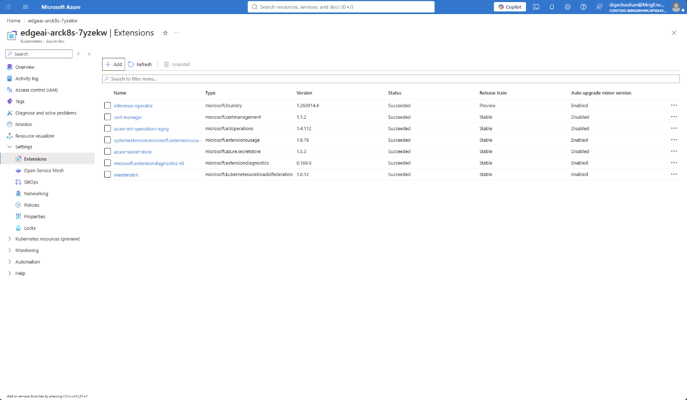
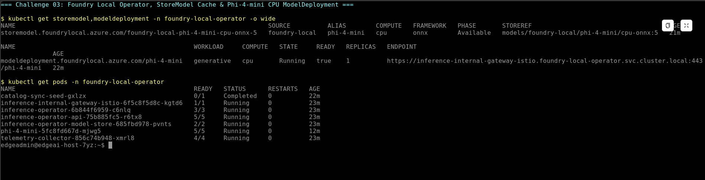
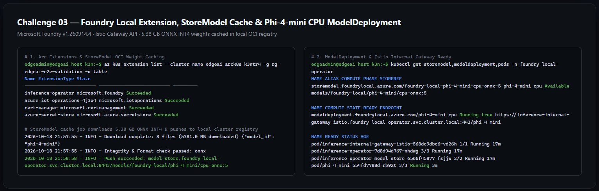

# Challenge 03 — Deploy Foundry Local Operator & Serve a Quantized CPU SLM

**[Home](../Readme.md)** - [← Previous Challenge](challenge-02.md) - [Next Challenge →](challenge-04.md)

## 🎯 Objective

Deploy **Foundry Local on Azure Arc-enabled Kubernetes** using its production operator architecture (**Kubernetes Gateway API**, **Istio**, **`cert-manager`**, and the **`Microsoft.Foundry` Arc extension**), then deploy a quantized CPU Small Language Model (`Phi-4-mini-instruct-generic-cpu:5` via `onnx-genai`) using a declarative `ModelDeployment` Custom Resource.

## 🧭 Context

In sovereign edge environments, local AI inference must be managed with the same Kubernetes-native rigor as the rest of the platform. Rather than running unmanaged ad-hoc containers, **Foundry Local** (`Microsoft.Foundry` Arc extension) installs the `foundry-local-operator` control plane on your cluster:
- It synchronizes a local model catalog (`foundry-local-catalog` ConfigMap with 177 models across CPU and GPU).
- It caches model weights onto an on-cluster OCI registry PVC (`StoreModel` job + `inference-operator-model-store`) so inference survives network outages and pod restarts.
- It routes OpenAI-compatible inference traffic (`/v1/chat/completions`) through the **Kubernetes Gateway API** (`inference-internal-gateway-istio`) backed by **Istio**.
- It supports CPU-backed quantized inference (`compute: cpu`, `runtime: onnx-genai`) when edge hosts do not have dedicated GPUs.

> [!IMPORTANT]
> **Critical Coexistence Step (`cert-manager` + `Microsoft.Foundry`):** When you ran `az iot ops init` in Challenge 02, Azure IoT Operations already installed the `cert-manager` (`microsoft.certmanagement`) extension, but set `trust-manager.secretTargets.enabled=false`. Before installing `Microsoft.Foundry`, you **must** run `az k8s-extension update --name cert-manager` to enable `trust-manager.secretTargets.enabled=true` and `config.enableGatewayAPI=true`—otherwise Foundry Local pods will fail to mount `secret "foundry-local-operator-ca-bundle"`.

## ✅ Tasks

1. **Install Kubernetes Gateway API CRDs & Istio (`istio-base` + `istiod`).** *(~2 min)*
   - Apply the Kubernetes Gateway API CRDs (`v1.4.0` standard channel) and Gateway API Inference Extension CRDs (`v1.5.0`) using `kubectl apply --server-side`.
   - Install `istio-base` and `istiod` in `istio-system` via Helm with `pilot.env.ENABLE_GATEWAY_API_INFERENCE_EXTENSION=true`.
   - Confirm that `kubectl get gatewayclass istio` shows `ACCEPTED = True`.

2. **Update the Existing `cert-manager` Extension for Foundry Local.** *(~1 min)*
   - Run `az k8s-extension update` on `--name "cert-manager"` to enable `config.enableGatewayAPI=true`, `trust-manager.secretTargets.enabled=true`, and `trust-manager.secretTargets.authorizedSecretsAll=true`.

3. **Install the Foundry Local Extension (`Microsoft.Foundry`) & Inspect the Catalog.** *(~1 min)*
   - Run `az k8s-extension create` with `--name "inference-operator"`, `--extension-type Microsoft.Foundry`, `--release-namespace "foundry-local-operator"`, `--config entraAuth.enabled=false`, `--config satAuth.enabled=true`, and `--config satAuth.audience="foundry-local"`.
   - Query the `foundry-local-catalog` ConfigMap in `foundry-local-operator` using `jq` to list all models that support `"cpu"` compute.

4. **Deploy the `phi-4-mini` CPU `ModelDeployment` & Cache Weights Locally.** *(~8–9 min)*
   - Apply [`resources/manifests/02-foundry-local/caller-service-account.yaml`](../resources/manifests/02-foundry-local/caller-service-account.yaml) and [`resources/manifests/02-foundry-local/model-deployment-cpu.yaml`](../resources/manifests/02-foundry-local/model-deployment-cpu.yaml).
   - Watch the `StoreModel` resource (`foundry-local-phi-4-mini-cpu-onnx-5`) download the 5.38 GB ONNX INT4 weights and push them into the local cluster model store (`PHASE: Available`).
   - Confirm that `kubectl get modeldeployment phi-4-mini -n foundry-local-operator` reaches `STATE: Running` and `READY: true`.

## 📊 Key Parameters & Technical Reference

| Component | Value / Hint | Why It Matters |
| :--- | :--- | :--- |
| **Gateway API Installation Order** | Install Gateway API CRDs (`v1.4.0`) + Inference Extension CRDs (`v1.5.0`) **before** `istiod` | `istiod` discovers the Gateway API & `InferencePool` CRDs at startup; installing CRDs after `istiod` requires an `istiod` restart. |
| **Updating `cert-manager` First** | `az k8s-extension update --name cert-manager ... --config trust-manager.secretTargets.enabled=true --config trust-manager.secretTargets.authorizedSecretsAll=true` | `az iot ops init` in Challenge 02 already installed `cert-manager` (`microsoft.certmanagement`), but with `trust-manager.secretTargets.enabled=false`. Updating it in place allows Foundry Local pods to mount `foundry-local-operator-ca-bundle`. |
| **Catalog Model Alias** | `spec.model.catalog.name: phi-4-mini` | In `foundry-local-catalog`, the alias `phi-4-mini` with `compute: cpu` and `runtime: onnx-genai` resolves to `Phi-4-mini-instruct-generic-cpu:5` (5.15 GB ONNX INT4 weights). |
| **Internal Endpoint URL** | `https://inference-internal-gateway-istio.foundry-local-operator.svc.cluster.local:443/phi-4-mini` | Populated in `.status.endpoints.internal` once the `StoreModel` cache job (~7 min) and pod startup (~2 min) complete. |

## 🤔 Grounding & Architecture Questions

1. **How does Foundry Local's `StoreModel` + `inference-operator-model-store` architecture ensure that model pods can restart or scale when the cluster is air-gapped?**
2. **Why did we set `entraAuth.enabled=false` and `satAuth.enabled=true` on the `inference-operator` extension for this sovereign edge scenario?**

## ✅ Success Criteria

* `kubectl get gatewayclass istio` shows `ACCEPTED = True`.
* `az k8s-extension list` shows both `cert-manager` (`microsoft.certmanagement`) and `inference-operator` (`microsoft.foundry`) with `provisioningState: Succeeded`.
* `kubectl get storemodel -n foundry-local-operator` shows `foundry-local-phi-4-mini-cpu-onnx-5` in `PHASE = Available`.
* `kubectl get modeldeployment phi-4-mini -n foundry-local-operator` reaches `STATE = Running` (`READY = true`) and populates `.status.endpoints.internal`.

## 📚 Learning Resources

* [Deployment overview for Foundry Local on Azure Local](https://learn.microsoft.com/azure/azure-sovereign-clouds/private/foundry-local/deploy-overview)
* [Deploy Foundry Local as an Azure Arc extension](https://learn.microsoft.com/azure/azure-sovereign-clouds/private/foundry-local/deploy-foundry-local-arc-extension)
* [Deploy a catalog model on Foundry Local (`ModelDeployment` CRD)](https://learn.microsoft.com/azure/azure-sovereign-clouds/private/foundry-local/how-to-deploy-model)

## 🔓 Solution — Spoiler Warning

[Solution Steps](../walkthrough/challenge-03/solution-03.md)

[← Previous Challenge](challenge-02.md) | [Next Challenge →](challenge-04.md) | [Back to Overview](../Readme.md)
