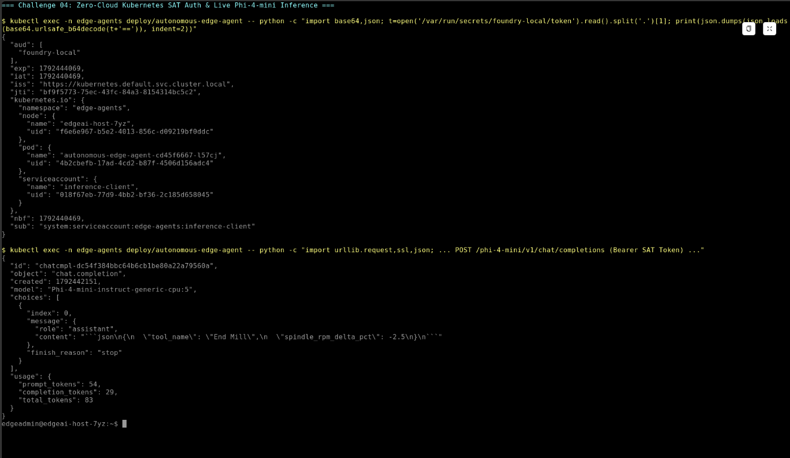

# Challenge 04 — Wire the Autonomous Edge Agent with Zero-Cloud SAT Authentication

**[Home](../Readme.md)** - [← Previous Challenge](challenge-03.md) - [Next Challenge →](challenge-05.md)

## 🎯 Objective

Configure **Kubernetes Service Account Token (SAT)** authentication between the `edge-agents` namespace and Foundry Local, deploy the local **Manufacturing SOP Runbook (`SOP-CNC-042`)**, and deploy the prebuilt **Autonomous Edge Triage & Actuation Agent** to close the loop between Azure IoT Operations and Foundry Local.

## 🧭 Context

When an industrial facility loses internet connectivity, workloads inside the Kubernetes cluster cannot reach Microsoft Entra ID in the public cloud to mint or refresh OAuth tokens.

To ensure uninterrupted authentication in both connected and disconnected modes, Foundry Local supports **Kubernetes Service Account Token (SAT)** authentication (`method: serviceAccountToken`):
- The Kubernetes API server projects a short-lived, audience-bound JWT (`audience: foundry-local`) into the `autonomous-edge-agent` pod at `/var/run/secrets/foundry-local/token`.
- The `phi-4-mini` `ModelDeployment` authorizes `serviceAccountName: inference-client` in `serviceAccountNamespace: edge-agents` with role `GeneralInferenceUser`.
- When an anomaly arrives on `factory/line1/anomalies`, the Edge Agent reads the local SOP ConfigMap (`/etc/edge-sop/sop.md`), calls Foundry Local's `/v1/chat/completions` endpoint with its SAT token, and publishes the resulting PLC stabilization command back to `factory/line1/commands`.

> [!TIP]
> **Always re-read projected Service Account Tokens from disk.** Kubernetes automatically rotates projected tokens before `expirationSeconds` (`3600s`). In `edge-agent-deployment.yaml`, the agent re-reads `/var/run/secrets/foundry-local/token` on every inference call so token rotation never causes a `401 Unauthorized` failure during long-running shifts.

## ✅ Tasks

1. **Test SAT Authentication Against the Internal Foundry Local Endpoint.** *(~3 min)*
   - Mint a temporary 10-minute token using `kubectl create token inference-client -n edge-agents --audience foundry-local --duration 10m`.
   - Call `https://inference-internal-gateway-istio.foundry-local-operator.svc.cluster.local:443/phi-4-mini/v1/chat/completions` from inside the cluster with `"model": "Phi-4-mini-instruct-generic-cpu:5"` and verify you receive a `200 OK` completion (`"content": "READY"`).

2. **Deploy the Local Manufacturing SOP Runbook (`SOP-CNC-042`).** *(~1 min)*
   - Inspect and apply [`resources/manifests/03-edge-agent/local-sop-configmap.yaml`](../resources/manifests/03-edge-agent/local-sop-configmap.yaml) into the `edge-agents` namespace.

3. **Deploy the Prebuilt Autonomous Edge Agent.** *(~2 min)*
   - Inspect [`resources/manifests/03-edge-agent/edge-agent-deployment.yaml`](../resources/manifests/03-edge-agent/edge-agent-deployment.yaml) to see how `serviceAccountName: inference-client`, the projected `foundry-local-sat` volume, and the `local-sop-runbook` ConfigMap are mounted.
   - Apply the deployment and verify that `/var/run/secrets/foundry-local/token` is mounted inside the running pod.

4. **Verify Closed-Loop Autonomous PLC Stabilization.** *(~3 min)*
   - Tail the logs of `deploy/autonomous-edge-agent` and `deploy/manufacturing-telemetry-simulator` in `edge-agents` to watch live warning anomalies (`85°C–104.9°C`) trigger `adjust_plc_setpoint` (`spindle_rpm_delta_pct: -25`, `enable_coolant_boost: true`), reducing the simulated PLC spindle speed from `4200 RPM` to `3150 RPM`.

## 📊 Key Parameters & Technical Reference

| Component / Setting | Value / Hint | Why It Matters |
| :--- | :--- | :--- |
| **Caller ServiceAccount** | `name: inference-client`, `namespace: edge-agents`, `automountServiceAccountToken: false` | Prevents mounting the default Kubernetes API token; the pod explicitly mounts an audience-bound projected token instead. |
| **Projected Token Volume** | `audience: foundry-local`, `mountPath: /var/run/secrets/foundry-local` | Foundry Local's SAT sidecar validates that the incoming `Bearer` JWT has `aud: foundry-local` and matches `authorizedSubjects` (`GeneralInferenceUser`). |
| **Served Model Identifier** | `Phi-4-mini-instruct-generic-cpu:5` | The exact model ID exposed at `/v1/models` and `/v1/chat/completions` by the `phi-4-mini` `ModelDeployment`. |
| **Internal Inference URL** | `https://inference-internal-gateway-istio.foundry-local-operator.svc.cluster.local:443/phi-4-mini/v1/chat/completions` | Routes in-cluster HTTPS requests through the Istio Gateway to the `phi-4-mini` pod with zero external network traffic. |

## 🤔 Grounding & Architecture Questions

1. **Why does `caller-service-account.yaml` set `automountServiceAccountToken: false` on the `inference-client` ServiceAccount when the pod still needs a Service Account Token?**
2. **How does the Foundry Local auth sidecar verify a Kubernetes Service Account Token without calling out to Microsoft Entra ID?**

## ✅ Success Criteria

* A manual request using a token minted for `inference-client` (`--audience foundry-local`) returns a `200 OK` chat completion from `Phi-4-mini-instruct-generic-cpu:5`.
* `kubectl get pods -n edge-agents` shows both `manufacturing-telemetry-simulator` and `autonomous-edge-agent` in `Running` status.
* `kubectl logs -n edge-agents deploy/autonomous-edge-agent` shows incoming anomalies from `factory/line1/anomalies` and outgoing autonomous PLC commands (`adjust_plc_setpoint`) to `factory/line1/commands`.
* `kubectl logs -n edge-agents deploy/manufacturing-telemetry-simulator` prints `=== PLC ACTUATED: spindleRpm=3150, coolantBoost=True ===`.

## 📚 Learning Resources

* [Configure Kubernetes Service Account Token (SAT) authentication for Foundry Local](https://learn.microsoft.com/azure/azure-sovereign-clouds/private/foundry-local/how-to-configure-service-account-token-authentication)
* [Kubernetes Projected Service Account Token Volumes](https://kubernetes.io/docs/tasks/configure-pod-container/configure-service-account/#serviceaccount-token-volume-projection)

## 🔓 Solution — Spoiler Warning

[Solution Steps](../walkthrough/challenge-04/solution-04.md)

[← Previous Challenge](challenge-03.md) | [Next Challenge →](challenge-05.md) | [Back to Overview](../Readme.md)
