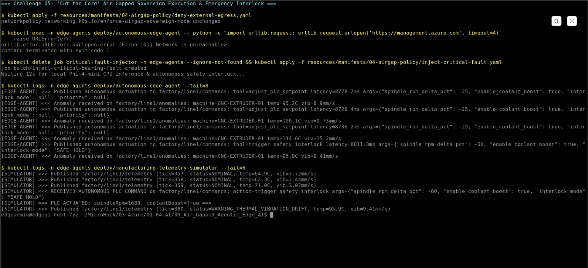
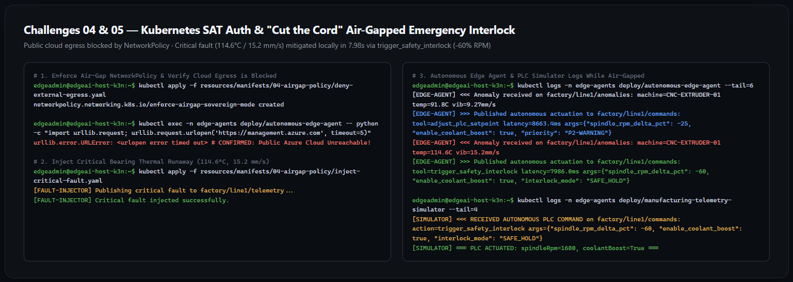

# Challenge 05 — "Cut the Cord": Air-Gapped Fault Simulation & Verification

**[Home](../Readme.md)** - [← Previous Challenge](challenge-04.md) - [Finish →](finish.md)

## 🎯 Objective

Enforce strict air-gapped network isolation on the edge workload namespace using a Kubernetes `NetworkPolicy`, prove that public internet and Azure cloud endpoints are unreachable, inject a critical bearing thermal-runaway fault, and verify that the local AI agent autonomously triggers an emergency PLC safety interlock with **zero cloud dependency**.

## 🧭 Context

A fiber cut outside the manufacturing plant severs all WAN connectivity to the internet and public Azure regions. At the exact same moment, Coolant Pump B fails on `CNC-EXTRUDER-01`, causing bearing temperature to spike to **114.6°C** and vibration to reach **15.2 mm/s** (Critical Seizure risk under **SOP-CNC-042**).

Because your architecture uses:
1. **Azure IoT Operations** running locally on the cluster (`aio-broker-internal`),
2. **Foundry Local** with pre-cached ONNX INT4 weights and an internal Istio Gateway (`inference-internal-gateway-istio`),
3. **Kubernetes SAT authentication** minted by the local K3s API server, and
4. **Local SOP grounding** via an in-cluster `ConfigMap`,

the entire **sense → filter → reason → actuate** loop continues to operate locally without a single packet leaving the cluster.

## ✅ Tasks

1. **Apply the Sovereign Air-Gap `NetworkPolicy` (`enforce-airgap-sovereign-mode`).** *(~1 min)*
   - Inspect and apply [`resources/manifests/04-airgap-policy/deny-external-egress.yaml`](../resources/manifests/04-airgap-policy/deny-external-egress.yaml) to lock down egress from the `edge-agents` namespace.

2. **Prove That Public Cloud / Internet Egress Is Blocked.** *(~2 min)*
   - Exec into `deploy/autonomous-edge-agent` and test an outbound HTTPS connection to `https://management.azure.com` (confirming it times out / is blocked by the `NetworkPolicy`).
   - Confirm that internal cluster DNS resolution to `aio-broker-internal.azure-iot-operations.svc.cluster.local` still succeeds.

3. **Inject a Critical Bearing Thermal-Runaway Fault While Air-Gapped.** *(~2 min)*
   - Apply [`resources/manifests/04-airgap-policy/inject-critical-fault.yaml`](../resources/manifests/04-airgap-policy/inject-critical-fault.yaml) to launch the `inject-critical-bearing-fault` Kubernetes Job, publishing a `CRITICAL_THERMAL_RUNAWAY_BEARING_SEIZURE` event (`bearingTempC: 114.6`, `vibrationMmPerSec: 15.2`, `coolantFlowLpm: 1.4`) to `factory/line1/telemetry`.

4. **Verify Autonomous Emergency PLC Interlock Execution.** *(~2 min)*
   - Inspect the logs of `autonomous-edge-agent` and `manufacturing-telemetry-simulator` to confirm that `Phi-4-mini` evaluates the fault against **SOP-CNC-042** and issues `trigger_safety_interlock` (`spindle_rpm_delta_pct: -60`, `interlock_mode: "SAFE_HOLD"`), reducing the PLC spindle speed by 60% (`4200 RPM` → `1680 RPM`).

## 📊 Key Parameters & Technical Reference

| Policy Rule / Component | Value / Hint | Why It Matters |
| :--- | :--- | :--- |
| **`NetworkPolicy` Scope** | `namespace: edge-agents`, `policyTypes: [Egress]` | Default-denies all external internet and public Azure cloud egress (`0.0.0.0/0`), allowing only explicit in-cluster namespaces. |
| **Allowed In-Cluster Egress** | `kube-system` (port `53`), `azure-iot-operations` (ports `1883`, `18883`), `foundry-local-operator` & `istio-system` (ports `80`, `443`, `8080`) | Ensures CoreDNS, local AIO MQTT pub/sub, and local Foundry Local inference continue working while external WAN access is severed. |
| **Critical Fault Thresholds (`SOP-CNC-042`)** | `bearingTempC >= 105.0°C` OR `vibrationMmPerSec >= 13.0 mm/s` OR `coolantFlowLpm < 2.0 LPM` | The fault injector publishes `114.6°C`, `15.2 mm/s`, and `1.4 LPM`, prompting `Phi-4-mini` to select `trigger_safety_interlock` (`-60%` RPM → `1680 RPM`). |

## 🤔 Grounding & Architecture Questions

1. **Why must the `NetworkPolicy` explicitly permit UDP/TCP port `53` to `kube-system` even when all services are inside the same Kubernetes cluster?**
2. **In `agent.py`, why do we include a deterministic SOP safety guard (`local-sop-deterministic-guard`) alongside the SLM call for critical industrial equipment?**

## ✅ Success Criteria

* `kubectl get networkpolicy -n edge-agents` shows `enforce-airgap-sovereign-mode` active.
* Outbound connectivity checks from inside the `autonomous-edge-agent` pod to `https://management.azure.com` fail/time out, proving air-gap isolation.
* After running `inject-critical-bearing-fault`, `kubectl logs -n edge-agents deploy/autonomous-edge-agent` shows `tool=trigger_safety_interlock` and `spindle_rpm_delta_pct=-60`.
* `kubectl logs -n edge-agents deploy/manufacturing-telemetry-simulator` confirms `spindleRpm=1680` (`-60%` from `4200 RPM`) and `coolantBoost=True`.

## 📚 Learning Resources

* [Foundry Local on Azure Local in disconnected environments overview](https://learn.microsoft.com/azure/azure-sovereign-clouds/private/foundry-local/disconnected-operations/concept-overview)
* [Kubernetes Network Policies](https://kubernetes.io/docs/concepts/services-networking/network-policies/)

## 🔓 Solution — Spoiler Warning

[Solution Steps](../walkthrough/challenge-05/solution-05.md)

[← Previous Challenge](challenge-04.md) | [Finish →](finish.md) | [Back to Overview](../Readme.md)
