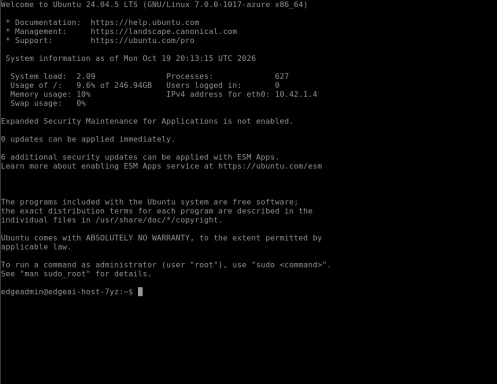

# Solution 01 — Provision & Verify the Sovereign Edge Kubernetes Foundation

**[Home](../../Readme.md)** - [Back to Challenge 01](../../challenges/challenge-01.md) - [Next Solution →](../challenge-02/solution-02.md)

**Duration:** 30 minutes

## Step 1: Connect to the Edge Host VM

1. Open the [Azure Portal](https://portal.azure.com) and navigate to your lab Resource Group (`ResourceGroupName` from your lab credentials).
2. Select your **Edge Host VM** (`EdgeHostVmName`, default `edgeai-host-...`).
3. Select **Connect** > **Bastion**, enter `EdgeHostAdminUsername` (`edgeadmin`) and `EdgeHostAdminPassword`, and open a browser terminal session.
   > **Where do I find `EdgeHostAdminUsername` and `EdgeHostAdminPassword`?**
   > - **Hackbox / Workshop Portal:** Copy `EdgeHostAdminUsername` (`edgeadmin`) and `EdgeHostAdminPassword` (and the direct `AzurePortalEdgeVmUrl` link) from your **Lab Credentials** tab.
   > - **Azure Portal Key Vault:** In your lab Resource Group, open the Key Vault (`edgeai-kv-...`) -> **Objects** > **Secrets**, where `EdgeHostAdminUsername` and `EdgeHostAdminPassword` are stored automatically by `main.bicep`.
   > - **No-Password Alternative:** You can also select **Operations** > **Run command** > **RunShellScript** directly on the VM blade in the Azure Portal, or reset the password anytime via **Help** > **Reset password**.
   > - **Manual / Self-Paced Deployment:** If you are running in your own subscription without pre-provisioned lab automation, deploy [`resources/infra/main.bicep`](../../resources/infra/main.bicep) with your own password:
   > ```bash
   > az deployment group create \
   >   --resource-group <your-rg> \
   >   --template-file resources/infra/main.bicep \
   >   --parameters edgeProfile=fast-k3s adminPasswordOrKey='<StrongPassword123!>'
   > ```



---

## Step 2: Verify Kernel Limits, K3s, and CLI Tooling

Inside the Edge Host VM terminal, verify that `cloud-init` has completed:

```bash
cat /var/log/edge-bootstrap-complete.log
```

Verify the Linux kernel `inotify` and file-descriptor limits required by **Azure IoT Operations** and **Foundry Local**:

```bash
sysctl fs.inotify.max_user_instances fs.inotify.max_user_watches fs.file-max
```

Expected output:

```text
fs.inotify.max_user_instances = 8192
fs.inotify.max_user_watches = 524288
fs.file-max = 100000
```

Verify that your single-node K3s cluster is `Ready` and clone the MicroHack repository onto the Edge Host if not already present:

```bash
export KUBECONFIG=~/.kube/config
kubectl get nodes -o wide
helm version --short
az version
```

Clone the repository and navigate to this MicroHack folder:

```bash
git clone https://github.com/microsoft/MicroHack.git ~/MicroHack
cd ~/MicroHack/03-Azure/01-04-AI/09_Air_Gapped_Agentic_Edge_AI
```

---

## Step 3: Sign In to Azure & Set Environment Variables

Sign in to Azure on the Edge Host VM. You can sign in either with your workshop user account (`az login --use-device-code`) or directly via the Edge Host VM's User-Assigned Managed Identity (which is pre-authorized with `Contributor` and `Role Based Access Control Administrator` on your lab Resource Group):

```bash
# Option A: Sign in with your workshop user account
az login --use-device-code

# Option B (Fast Unattended Alternative): Sign in with the Edge Host VM's Managed Identity
# UAMI_CLIENT_ID=$(curl -s -H Metadata:true "http://169.254.169.254/metadata/identity/oauth2/token?api-version=2018-02-01&resource=https://management.azure.com/" | jq -r .client_id)
# az login --identity --client-id "$UAMI_CLIENT_ID"
```

Next, create and source `~/edge-env.sh`. This block automatically queries the Azure Instance Metadata Service (`169.254.169.254`) on the Edge Host VM to discover your `SUBSCRIPTION_ID`, `RESOURCE_GROUP`, and `VM_LOCATION`—**no manual placeholder editing required**:

```bash
cat << 'EOF' > ~/edge-env.sh
export SUBSCRIPTION_ID=$(curl -s -H Metadata:true "http://169.254.169.254/metadata/instance/compute/subscriptionId?api-version=2021-02-01&format=text")
export RESOURCE_GROUP=$(curl -s -H Metadata:true "http://169.254.169.254/metadata/instance/compute/resourceGroupName?api-version=2021-02-01&format=text")
export VM_LOCATION=$(curl -s -H Metadata:true "http://169.254.169.254/metadata/instance/compute/location?api-version=2021-02-01&format=text")
export ARC_LOCATION="westeurope"
export CLUSTER_NAME="edgeai-arck8s-$(echo -n "$RESOURCE_GROUP" | md5sum | cut -c1-6)"
export SCHEMA_STORAGE_ACCOUNT=$(az storage account list -g "$RESOURCE_GROUP" --query "[0].name" -o tsv)
export KUBECONFIG=~/.kube/config
EOF

source ~/edge-env.sh
az account set --subscription "$SUBSCRIPTION_ID"
echo "Subscription: $SUBSCRIPTION_ID | RG: $RESOURCE_GROUP | VM Location: $VM_LOCATION | Arc/AIO Location: $ARC_LOCATION | Cluster: $CLUSTER_NAME | Storage: $SCHEMA_STORAGE_ACCOUNT"
```

> **Why is `ARC_LOCATION` set to `westeurope`?**
> Even when your Edge Host VM runs in `swedencentral` (for `Standard_D16s_v5` SKU availability), **Azure Device Registry** and **Azure IoT Operations** require an officially supported AIO control-plane region (`westeurope`, `northeurope`, `germanywestcentral`, `uksouth`, `eastus`, `eastus2`, `westus2`, `westus3`, `centralus`). Setting `ARC_LOCATION="westeurope"` ensures your `ConnectedCluster`, `CustomLocation`, `SchemaRegistry`, `DeviceRegistry Namespace`, and `IoTOperations` instance all share the same supported region.

If resource providers have not yet been registered in your subscription, run the helper script:

```bash
bash resources/infra/register-providers.sh
```

---

## Step 4: Connect the Kubernetes Cluster to Azure Arc (~4 minutes)

Connect your K3s cluster to **Azure Arc** in `$ARC_LOCATION` with **OIDC Issuer** and **Workload Identity** enabled (required by Azure IoT Operations):

```bash
az connectedk8s connect \
  --name "$CLUSTER_NAME" \
  --resource-group "$RESOURCE_GROUP" \
  --location "$ARC_LOCATION" \
  --subscription "$SUBSCRIPTION_ID" \
  --enable-oidc-issuer \
  --enable-workload-identity \
  --disable-auto-upgrade
```

Enable **Custom Locations** on the cluster using the Microsoft Entra Object ID of the `Microsoft.ExtendedLocation` service principal (or use `CustomLocationsRpObjectId` from your lab credentials dashboard if your account does not have Microsoft Graph directory-read permissions):

```bash
CUSTOM_LOCATION_RP_OID=$(az ad sp show --id bc313c14-388c-4e7d-a58e-70017303ee3b --query id -o tsv 2>/dev/null || echo "<CustomLocationsRpObjectId-from-dashboard>")

az connectedk8s enable-features \
  --name "$CLUSTER_NAME" \
  --resource-group "$RESOURCE_GROUP" \
  --custom-locations-oid "$CUSTOM_LOCATION_RP_OID" \
  --features cluster-connect custom-locations
```

---

## Step 5: Verify Azure Arc Connectivity

Confirm that the cluster shows `Connected` in Azure and all `azure-arc` pods are `Running`:

```bash
az connectedk8s show \
  --name "$CLUSTER_NAME" \
  --resource-group "$RESOURCE_GROUP" \
  --query "{Name:name, Status:connectivityStatus, K8sVersion:kubernetesVersion, OidcEnabled:oidcIssuerProfile.enabled}" \
  --output table

kubectl get pods -n azure-arc
```


**Common stumbles:** `Unable to fetch the Custom Location OID` warning during `az connectedk8s enable-features` (harmless when `--custom-locations-oid` is explicitly supplied) · `kubectl` permission denied (ensure `export KUBECONFIG=~/.kube/config` is set).

---

## Grounding Questions — Suggested Answers

**1. Why must `fs.inotify.max_user_watches` and `fs.inotify.max_user_instances` be raised on the Linux host before deploying Azure IoT Operations and Foundry Local?**
Kubernetes operators, Istio sidecars, OpenTelemetry collectors, and Azure IoT Operations broker pods all watch ConfigMaps, Secrets, and projected SAT token files via Linux `inotify`. Default Ubuntu limits (`128` instances / `8192` watches) are quickly exhausted by multi-extension clusters, causing `too many open files` errors in kubelet and ConfigMap reloaders.

**2. What is the role of an Azure Arc Custom Location (`Microsoft.ExtendedLocation/customLocations`), and how does it allow Azure Resource Manager (ARM) to deploy resources onto an on-premises Kubernetes cluster?**
A Custom Location maps an Azure Resource Manager target scope onto a specific Kubernetes namespace and set of Arc cluster extensions. When you create an Azure resource targeting that Custom Location, the `resource-sync-agent` pod inside `azure-arc` translates the ARM resource into Kubernetes Custom Resources (CRs) on the local cluster.

**3. Why can the Edge Host VM reside in `swedencentral` while the Azure Arc `connectedCluster` resource is registered in `westeurope`?**
An Azure Arc `connectedCluster` is a metadata projection of an edge Kubernetes cluster that could physically sit in any factory worldwide. Its Azure region only determines which regional Azure Arc and Azure IoT Operations control-plane endpoints manage its ARM metadata.

[Back to Challenge 01](../../challenges/challenge-01.md) | [Next Solution →](../challenge-02/solution-02.md)
