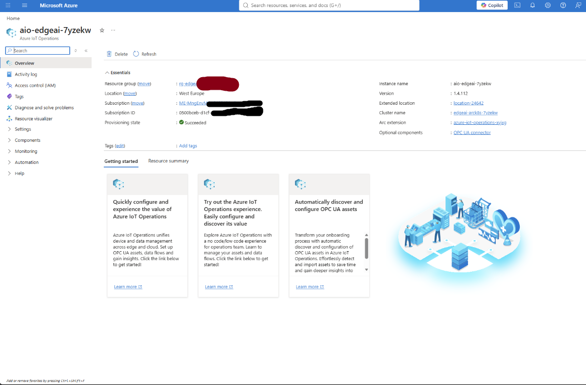
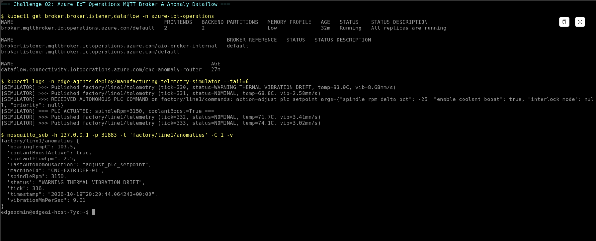
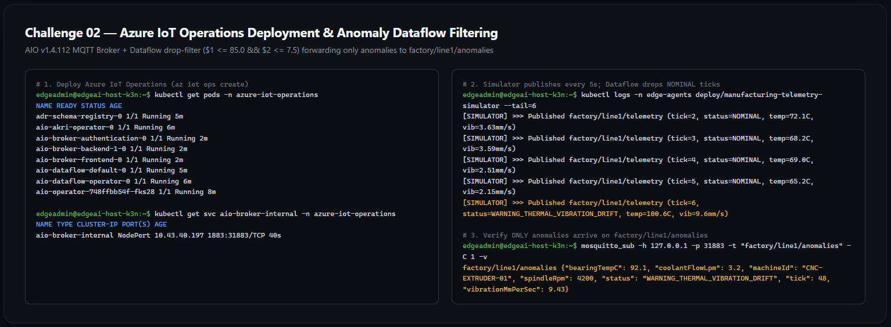

# Solution 02 — Deploy Azure IoT Operations & Simulated Manufacturing Telemetry

**[Home](../../Readme.md)** - [← Previous Solution](../challenge-01/solution-01.md) - [Back to Challenge 02](../../challenges/challenge-02.md) - [Next Solution →](../challenge-03/solution-03.md)

**Duration:** 45 minutes

## Step 1: Create the Schema Registry, Device Registry Namespace & Initialize AIO

Source your environment variables from Challenge 01:

```bash
source ~/edge-env.sh
cd ~/MicroHack/03-Azure/01-04-AI/09_Air_Gapped_Agentic_Edge_AI
```

Get the Resource ID of your HNS-enabled Storage Account, create the **Azure IoT Operations Schema Registry**, and create the **Azure Device Registry Namespace**:

```bash
export STORAGE_ACCOUNT_ID=$(az storage account show \
  --name "$SCHEMA_STORAGE_ACCOUNT" \
  --resource-group "$RESOURCE_GROUP" \
  --query id -o tsv)

export SCHEMA_REGISTRY_NAME="sr-${CLUSTER_NAME}"
export SCHEMA_REGISTRY_NAMESPACE="srns-${CLUSTER_NAME}"
export ADR_NAMESPACE_NAME="adrns-${CLUSTER_NAME}"

az iot ops schema registry create \
  --name "$SCHEMA_REGISTRY_NAME" \
  --resource-group "$RESOURCE_GROUP" \
  --location "$ARC_LOCATION" \
  --registry-namespace "$SCHEMA_REGISTRY_NAMESPACE" \
  --sa-resource-id "$STORAGE_ACCOUNT_ID"

az iot ops ns create \
  --name "$ADR_NAMESPACE_NAME" \
  --resource-group "$RESOURCE_GROUP" \
  --location "$ARC_LOCATION"
```

Initialize the cluster for **Azure IoT Operations** (this installs the foundational `cert-manager` and `azure-secret-store` Arc extensions):

```bash
az iot ops init \
  --cluster "$CLUSTER_NAME" \
  --resource-group "$RESOURCE_GROUP"
```

---

## Step 2: Deploy the Azure IoT Operations Instance

Create the Azure IoT Operations instance on your Arc-enabled Kubernetes cluster:

```bash
export AIO_INSTANCE_NAME="aio-${CLUSTER_NAME}"
export CUSTOM_LOCATION_NAME="cl-${CLUSTER_NAME}"

export SCHEMA_REGISTRY_ID=$(az iot ops schema registry show \
  --name "$SCHEMA_REGISTRY_NAME" \
  --resource-group "$RESOURCE_GROUP" \
  --query id -o tsv)

export ADR_NAMESPACE_ID=$(az iot ops ns show \
  --name "$ADR_NAMESPACE_NAME" \
  --resource-group "$RESOURCE_GROUP" \
  --query id -o tsv)

az iot ops create \
  --cluster "$CLUSTER_NAME" \
  --resource-group "$RESOURCE_GROUP" \
  --name "$AIO_INSTANCE_NAME" \
  --location "$ARC_LOCATION" \
  --custom-location "$CUSTOM_LOCATION_NAME" \
  --sr-resource-id "$SCHEMA_REGISTRY_ID" \
  --ns-resource-id "$ADR_NAMESPACE_ID" \
  --broker-frontend-replicas 1 \
  --broker-frontend-workers 1 \
  --broker-backend-part 1 \
  --broker-backend-workers 1 \
  --broker-backend-rf 2 \
  --broker-mem-profile Low
```

Verify that the Azure IoT Operations pods are running in the `azure-iot-operations` namespace:

```bash
kubectl get pods -n azure-iot-operations
```

---

## Step 3: Configure the Internal MQTT BrokerListener and Anomaly Dataflow

Apply [`resources/manifests/01-iot-sim/aio-anomaly-dataflow.yaml`](../../resources/manifests/01-iot-sim/aio-anomaly-dataflow.yaml) to expose the internal cluster MQTT listener (`aio-broker-internal.azure-iot-operations.svc.cluster.local:1883`) and create the `cnc-anomaly-router` Dataflow:

```bash
kubectl apply -f resources/manifests/01-iot-sim/aio-anomaly-dataflow.yaml
```

Verify the `BrokerListener` service and `Dataflow`:

```bash
kubectl get brokerlistener,dataflow -n azure-iot-operations
kubectl get svc aio-broker-internal -n azure-iot-operations
```

---

## Step 4: Deploy the Manufacturing Telemetry Simulator

Apply [`resources/manifests/01-iot-sim/telemetry-simulator.yaml`](../../resources/manifests/01-iot-sim/telemetry-simulator.yaml) to create the `edge-agents` namespace and start publishing CNC-Extruder telemetry every 5 seconds (with an anomaly injected every 6th tick):

```bash
kubectl apply -f resources/manifests/01-iot-sim/telemetry-simulator.yaml
kubectl rollout status deployment/manufacturing-telemetry-simulator -n edge-agents
```

Inspect the live simulator logs:

```bash
kubectl logs -n edge-agents deploy/manufacturing-telemetry-simulator --tail=20 -f
```

You will see output similar to:

```text
[SIMULATOR] Connected to AIO MQTT Broker at aio-broker-internal.azure-iot-operations.svc.cluster.local:1883 (rc=Success)
[SIMULATOR] >>> Published factory/line1/telemetry (tick=1, status=NOMINAL, temp=68.4C, vib=2.41mm/s)
...
[SIMULATOR] >>> Published factory/line1/telemetry (tick=6, status=WARNING_THERMAL_VIBRATION_DRIFT, temp=96.3C, vib=10.12mm/s)
```

---

## Step 5: Verify Anomaly Filtering on `factory/line1/anomalies`

> **Important Technical Note:** In Azure IoT Operations Dataflows, `builtInTransformationSettings.filter` acts as a **drop filter**—when `expression` evaluates to `true`, the message is dropped. Therefore, `aio-anomaly-dataflow.yaml` uses `expression: "$1 <= 85.0 && $2 <= 7.5"` to drop normal messages and pass only threshold breaches (`bearingTempC > 85.0` or `vibrationMmPerSec > 7.5`) to `factory/line1/anomalies`.

Verify that `cnc-anomaly-router` routes only anomalous events to `factory/line1/anomalies` using the `mosquitto_sub` client pre-installed on the Edge Host (connecting via `nodePort: 31883`):

```bash
mosquitto_sub -h 127.0.0.1 -p 31883 -t "factory/line1/anomalies" -C 1 -v
```

Once a single anomaly message (`status: WARNING_THERMAL_VIBRATION_DRIFT`) is printed and `mosquitto_sub` exits, proceed to Challenge 03!







**Common stumbles:** `LocationNotAvailableForResourceType` when creating Schema Registry (ensure `--location "$ARC_LOCATION"` is set to `westeurope`) · `HostResourceRegionMismatch` during `az iot ops create` (the `connectedCluster` in Challenge 01 and `az iot ops create` in Challenge 02 must both use `westeurope`).

---

## Grounding Questions — Suggested Answers

**1. Why do we filter normal sensor ticks inside an Azure IoT Operations Dataflow rather than forwarding every 5-second MQTT message to the Edge AI Agent?**
Small Language Models running on CPU take several seconds per completion and consume significant CPU/memory bandwidth. Using the high-throughput Rust-based AIO Dataflow engine to drop normal readings at the broker ensures the SLM is only invoked when an actual threshold drift or fault occurs.

**2. Why did `aio-broker-webhook` reject creating a second `BrokerListener` with `serviceType: ClusterIp`, and how does a `NodePort` service still provide an internal cluster DNS name (`aio-broker-internal.azure-iot-operations.svc.cluster.local:1883`)?**
Azure IoT Operations' admission webhook enforces at most one `BrokerListener` per Kubernetes Service type (`ClusterIp`, `NodePort`, `LoadBalancer`) per broker. Because every Kubernetes `NodePort` service automatically allocates an internal `ClusterIP` and CoreDNS record in addition to its host nodePort (`31883`), in-cluster pods can connect over `aio-broker-internal.azure-iot-operations.svc.cluster.local:1883` while host CLI tools can also test against `127.0.0.1:31883`.

[← Previous Solution](../challenge-01/solution-01.md) | [Back to Challenge 02](../../challenges/challenge-02.md) | [Next Solution →](../challenge-03/solution-03.md)
