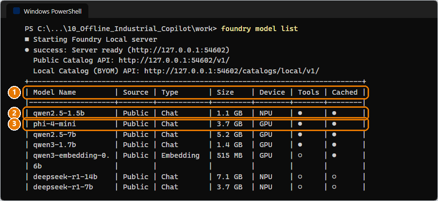

# Challenge 1 - Get set up

**[Home](../Readme.md)** - [Next Challenge](challenge-02.md)

## Goal

Get a small language model running **on your own device** and call it from Python, using the same OpenAI library you would use for a cloud model.

## Actions

* Install Foundry Local on your laptop or VM:
  * Windows: `winget install Microsoft.FoundryLocal`
  * macOS: `brew tap microsoft/foundrylocal` and then `brew install foundrylocal`
* Open a new terminal and check that the `foundry` command works. Find out how to list the models in the catalog.

  

  *① Read the header: where each model runs, and whether it can call tools · ② and ③ The same catalog can place models on different hardware on your device*

* Download the model with the alias `phi-4-mini` and chat with it in the terminal. Type `/exit` to leave the chat.
* Create a folder named `work` inside this lab folder, next to `resources`. Create a Python virtual environment there and install the packages from `resources/starter/requirements.txt`. Copy `resources/starter/fl.py` into `work`. If you ran `resources/starter/setup.ps1` before the day, this is already done: activate the environment in `work\.venv`.
* Write a short Python script that sends one question to the local model and prints the answer. The helper in `fl.py` gives you the model ID and a ready-to-use OpenAI client.
* Find the address of the local service. What is special about it?

## Success criteria

* `foundry` is installed and the model `phi-4-mini` is downloaded.
* Your Python script prints an answer from the local model.
* You can tell, in one sentence, why the address of the service is not reachable from another computer.

## Learning resources

* [What is Foundry Local?](https://learn.microsoft.com/azure/foundry-local/what-is-foundry-local)
* [Use the Foundry Local CLI](https://learn.microsoft.com/azure/foundry-local/how-to/how-to-use-foundry-local-cli)
* [Foundry Local CLI reference](https://learn.microsoft.com/azure/foundry-local/reference/reference-cli)
