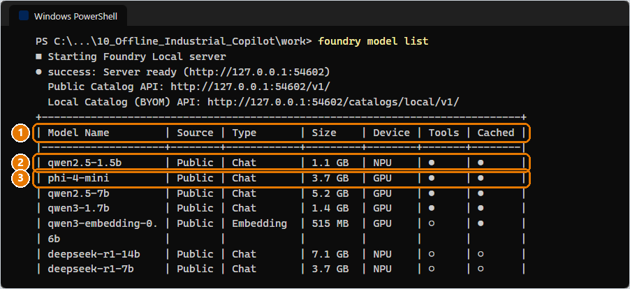
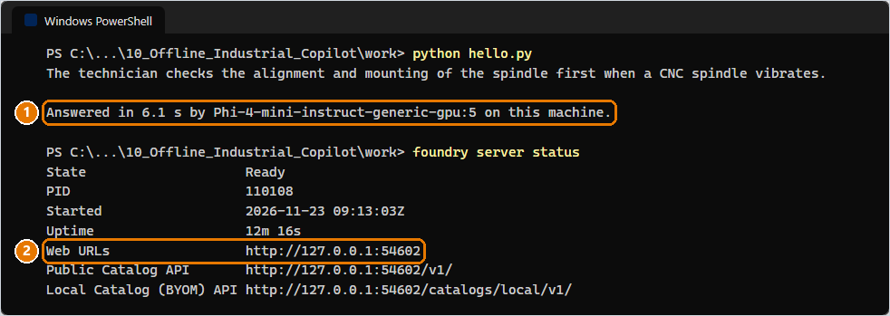

# Walkthrough Challenge 1 - Get set up

**[Home](../../Readme.md)** - [Next Challenge Solution](../challenge-02/solution-02.md)

Duration: 20 minutes

## Prerequisites

Please ensure that you successfully verified the [General prerequisites](../../Readme.md#general-prerequisites) before continuing with this challenge.

### **Task 1: Install Foundry Local**

Windows (x64 or ARM64):

```powershell
winget install Microsoft.FoundryLocal
```

macOS on Apple silicon:

```bash
brew tap microsoft/foundrylocal
brew install foundrylocal
```

Open a **new** terminal and check the installation:

```powershell
foundry --version
foundry model list
```

`foundry model list` shows the catalog. The *Device* column says where each model runs (NPU, GPU or CPU) and the *Tools* column shows which models support tool calling.



*① Device and Tools: where a model runs and whether it can call tools · ② `qwen2.5-1.5b` runs on the NPU here · ③ `phi-4-mini` runs on the GPU. The first command also starts the local service.*

### **Task 2: Download a model and chat with it**

```powershell
foundry model download phi-4-mini
foundry run phi-4-mini
```

Type a question, then leave the chat with `/exit` (in Foundry Local 0.14, a plain `exit` is sent to the model as a message). The model files are stored in `~/.foundry/cache/models`.

### **Task 3: Call the model from Python**

```powershell
cd 10_Offline_Industrial_Copilot
mkdir work
cd work
python -m venv .venv
.venv\Scripts\activate
pip install -r ..\resources\starter\requirements.txt
copy ..\resources\starter\fl.py .
```

If the team ran `resources\starter\setup.ps1` (or `setup.sh`) before the day, all of this is done: run `cd work` and `.venv\Scripts\activate`.

[fl.py](../code/fl.py) finds the local service, loads a model and returns the **model ID** that the service expects. Then call the model with the normal OpenAI library ([hello.py](../code/hello.py)):

```python
import fl

model = fl.load("phi-4-mini")
client = fl.client()
reply = client.chat.completions.create(
    model=model,
    messages=[{"role": "user", "content": "In one sentence: what does a technician check first when a CNC spindle vibrates?"}],
    max_tokens=80,
)
print(reply.choices[0].message.content)
```

Expected: one sentence about the spindle, in 1 to 3 seconds on a laptop with a GPU or NPU. The very first call also loads the model, so it takes longer (6.1 s on the Snapdragon laptop, then 2.5 s).

### **Task 4: Find the address of the local service**

```powershell
foundry server status
```



*① The model ID the service expects (`Phi-4-mini-instruct-generic-gpu:5`), not the alias · ② The service listens on `127.0.0.1` only*

The address is `http://127.0.0.1:<port>`. `127.0.0.1` is the **loopback** address: only programs on the same computer can reach it, so no other device and no one on the internet can call your model. The port is chosen when the service starts. `foundry server start --port 5273` pins it, and the `FOUNDRY_LOCAL_URL` environment variable tells `fl.py` where to look.

You successfully completed challenge 1! 🚀🚀🚀

## Coach notes

- **Re-verified end to end on 23 November 2026** with Foundry Local **0.14.0** on a Snapdragon X Elite laptop (Windows 11 on ARM, Python 3.12): challenges 1 to 6, including the Azure Machine Learning studio path and the offline run. The screenshots in this walkthrough come from that run.
- **Install the Python packages before the day.** Creating the virtual environment and installing `requirements.txt` took **9.5 minutes** through a corporate package proxy on that laptop (all three packages have ready-made ARM64 wheels, nothing is compiled). Ask teams to run `resources\starter\setup.ps1` (or `setup.sh`) before the session: it does Task 3 and downloads the models, and took 12 minutes end to end with the models already cached.
- **Pre-cache the models. Verified on the VM.** Sizes on the VM (CPU variants): `phi-4-mini` 4.8 GB, `qwen2.5-1.5b` 1.8 GB, `qwen3-1.7b` 1.3 GB, `qwen3-embedding-0.6b` 0.5 GB. Downloading `phi-4-mini`, `qwen2.5-1.5b` and the embedding model took 92 s, 33 s and 7 s, together 7.6 GB. To build an image with the models already in it:
  1. Download the models once with `foundry model download <alias>`.
  2. Copy the cache folder (`foundry cache location` shows it, `~/.foundry/cache/models`) to a shared folder. `robocopy` copied 7.6 GB in 71 s.
  3. Point the service at that folder: `foundry config set cache-directory C:\foundry-models --force`. The service restarts by itself.

  After this, `foundry model list --cached` shows the models and `foundry model download phi-4-mini` finishes in 0.1 s. **Always pass `--force`** in a script: without it `foundry config set cache-directory` and `foundry cache cd` ask for a confirmation and **wait for ever** when no one is at the keyboard. *Not tested:* copying the cache to a different machine.
- **The service needs the model ID, not the alias.** A raw REST call with `phi-4-mini` returns *404 Model not found*. The service expects an ID such as `Phi-4-mini-instruct-generic-gpu:5`. `fl.load()` looks it up with `foundry model list --loaded -o json`. The OpenAI library and the CLI hide this until a team writes its own REST call.
- **Foundry Local picks the variant for the hardware.** The same alias is a GPU variant on one laptop, an NPU variant on a Snapdragon laptop and a CPU variant on the VM. This is why the numbers in challenge 2 differ between teams.
- **Linux is not supported by the command-line tool.** Foundry Local has a Linux SDK, but not the `foundry` command that this MicroHack uses. Use Windows or macOS.
- **The VM from the lab automation. Verified.** It is Windows 11 with Python 3.12 and the Visual C++ runtime installed by the deployment (6.1 minutes for the whole lab). The participant installs Foundry Local with `winget install Microsoft.FoundryLocal`, which took 11 seconds and gave version 0.11.0. Re-checked on 1 November 2026 with version 0.12.1 (14 seconds): challenges 1 to 6 work unchanged, including the offline run. Two things to know:
  - **The Visual C++ runtime is required.** On a fresh Windows image without it, `foundry` installs fine, but the service stops at start-up and every command says `Daemon closed the connection mid-stream`. The log (`~/.foundry/logs`) shows `Unable to load DLL 'foundry_local' or one of its dependencies`. The lab automation installs the runtime. A team that builds its own image needs `winget install Microsoft.VCRedist.2015+.x64`.
  - **`winget` is not there for a brand-new user for the first minute or so.** Registering the App Installer once fixes it: `Add-AppxPackage -RegisterByFamilyName -MainPackage Microsoft.DesktopAppInstaller_8wekyb3d8bbwe`.

  The VM has no GPU, so Foundry Local picks the CPU variants. `hello.py` answers in 1.4 to 1.8 s there. A tool-using answer takes 18 to 45 s, so plan more time for the VM teams in challenges 3 and 4. *Not tested:* a participant signing in over Remote Desktop. We used the same user's interactive session on the VM console.
- **Teams that finish early:** stream the answer (`stream=True`) and measure the time to the first token.
