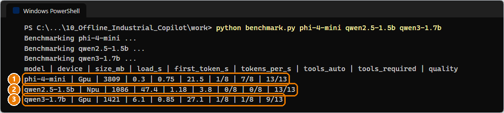

# Walkthrough Challenge 2 - Choose your edge model

[Previous Challenge Solution](../challenge-01/solution-01.md) - **[Home](../../Readme.md)** - [Next Challenge Solution](../challenge-03/solution-03.md)

Duration: 45 minutes

## Prerequisites

Please ensure that you successfully completed [Challenge 1](../../challenges/challenge-01.md) before continuing with this challenge.

### **Task 1: Choose the candidates**

```powershell
foundry model list
```

Good candidates have a **Tools** mark and are small enough for a shop-floor PC:

| Model | Size | Why |
|-------|------|-----|
| `phi-4-mini` | 3.7 GB | The suggested starting point. Microsoft model, MIT license. |
| `qwen2.5-1.5b` | 1.1 GB | Much smaller. Runs on the NPU on Snapdragon laptops. |
| `qwen3-1.7b` | 1.4 GB | A "reasoning" model: it thinks before it answers. |

Models without tool calling (for example `phi-4` and `phi-3.5-mini`) cannot be the agent model. A team that picks one learns this in challenge 3.

### **Task 2: Run the same questions against each model**

[benchmark.py](../code/benchmark.py) measures speed, tool calling and answer quality for every alias you give it. The reference scripts import `fl.py` and each other, so copy all of them into your `work` folder first:

```powershell
copy ..\walkthrough\code\*.py .
python benchmark.py phi-4-mini qwen2.5-1.5b qwen3-1.7b
```

Without the copy, `benchmark.py` stops with `ModuleNotFoundError: No module named 'tools'`. The run takes about 15 minutes for the three models on a laptop. Add `--quick` to ask 5 of the 13 quality questions (all tool cases stay): `python benchmark.py --quick phi-4-mini qwen3-1.7b` took 6 minutes and gave the same picture (phi-4-mini 7/8 tools with `required`, 5/5 quality; qwen3 1/8, 3/5).

How it measures:

- **Speed:** streams one answer and times the first token and the tokens per second.
- **Tool calling:** runs the 8 cases in `tool_eval.json` once with `tool_choice="auto"` and once with `"required"`. A case passes only if the model makes **exactly one** call, with the right tool and the right arguments (and no call for the question that needs none).
- **Quality:** gives the model the right SOP and counts how many of the 13 answers contain the expected facts (a simple, objective rubric).

### **Task 3: Read the results**

Example from a Snapdragon X Elite laptop (Windows 11 on ARM, 64 GB RAM, Foundry Local 0.14.0, 23 November 2026). **Your numbers will be different**, because the device decides which variant runs.



*① `phi-4-mini`: 7 of 8 tool cases with `required`, every answer correct · ② `qwen2.5-1.5b` on the NPU: correct answers, but no tool case passes · ③ `qwen3-1.7b`: fast, but 1 of 8 tool cases and 9 of 13 answers*

| Model | Runs on | Size | First token | Tokens/s | Tools `auto` | Tools `required` | Quality |
|-------|---------|------|-------------|----------|--------------|------------------|---------|
| `phi-4-mini` | GPU | 3.8 GB | 0.75 s | 21.5 | 1/8 | **7/8** | **13/13** |
| `qwen2.5-1.5b` | NPU | 1.1 GB | 1.2 s | 3.8 | 0/8 | 0/8 | 13/13 |
| `qwen3-1.7b` | GPU | 1.4 GB | 0.85 s | 27.1 | 1/8 | 1/8 | 9/13 |

What the teams should notice:

- **`tool_choice="auto"` almost never works with small models.** They describe the call in text, or answer from memory. `"required"` forces a structured call, and that is what the agent in challenge 3 uses. Note that the case without a tool (*"Why is the sky blue?"*) can **never** pass with `"required"`, so 7/8 is the best possible score in that column, and `"auto"` scores 1/8 because it passes only that one case.
- **`qwen2.5-1.5b` on the NPU** is the smallest, and its answers are as good as those of `phi-4-mini`, but **every request that includes tools** fails with *HTTP 500, inference failed* (`BuildToolCallContextForRequest`), with `"auto"` as well as `"required"`. That is why it scores 0/8 in both columns. On Foundry Local 0.14 it was also slow on this laptop (47 s to load, 3.8 tokens/s). It cannot be the agent model on this hardware. In an earlier run with Foundry Local 0.11 it was the fastest model (13 to 51 tokens/s) and failed only with `"required"`: the same model behaves differently between versions, which is one more reason to measure.
- **`qwen3-1.7b` calls both tools**, including `create_maintenance_ticket` with an invented summary, when asked only for a status. A model that takes actions nobody asked for is worse than a slow one. Its quality score is low partly because it spends its token budget on thinking. Its thinking text arrives in a separate `reasoning_content` field.
- **Memory:** on a GPU or NPU the model does not show up in the process memory. Look at the dedicated or shared GPU memory (Task Manager, Performance tab) or at the NPU. With all three models loaded the Foundry Local service held about 5.9 GB.

### **Task 4: Choose and explain**

A good answer for this scenario:

> *"We chose `phi-4-mini`: it is the only one of the three that made a correct tool call in 7 of 8 cases while giving a correct answer to every question. It is the largest, but 0.75 s to the first token is fine for a technician, and it fits on a normal PC."*

A different choice is fine **if the team has evidence**. A team that finds a smaller model that passes the tool cases has found something useful.

You successfully completed challenge 2! 🚀🚀🚀

## Coach notes

- Stress **the target device**. What fits on a shop-floor PC matters more than the best benchmark score.
- **Variants differ.** Ask teams which device each model ran on (`foundry model list --loaded`). A model that fails on the NPU may work on the CPU variant. Teams can pick a variant by its full ID.
- **Do not accept "it felt better"**. Ask for the numbers.
- **Stretch:** a third model or another variant (`foundry model info <alias>` lists them) and see how the trade-off shifts.
- The service rejects non-zero `frequency_penalty` and `presence_penalty` with *HTTP 400*. Teams that try to fix repetition with these will hit it.
