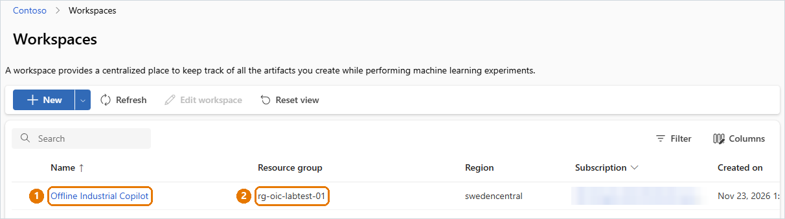
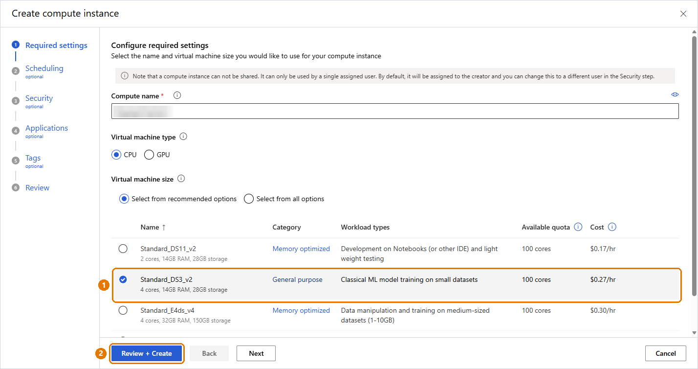
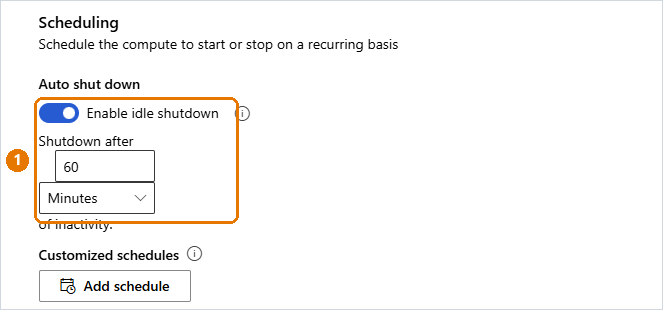
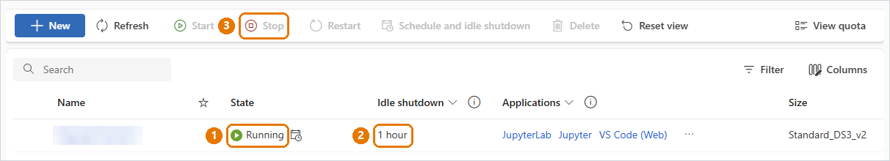
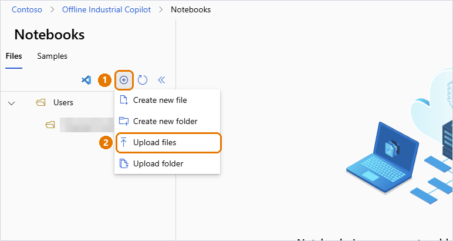
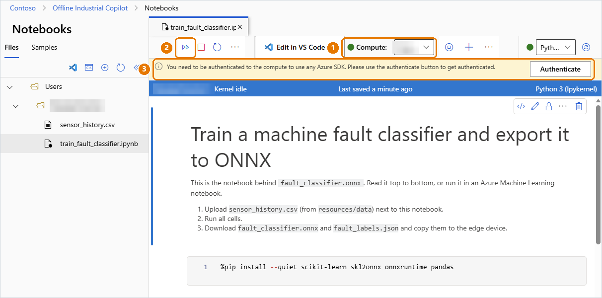
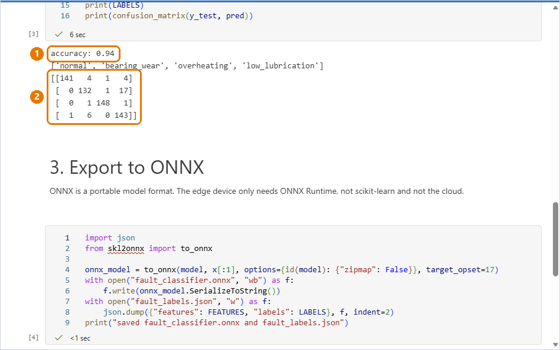
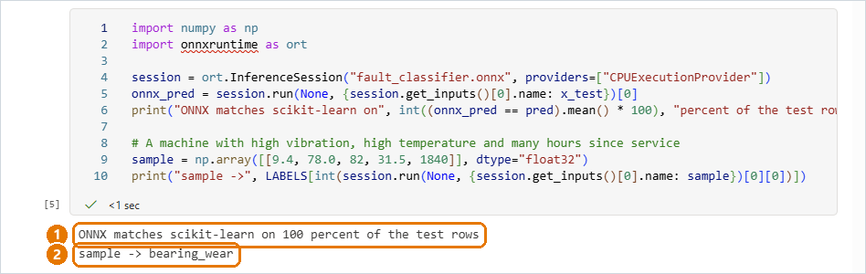
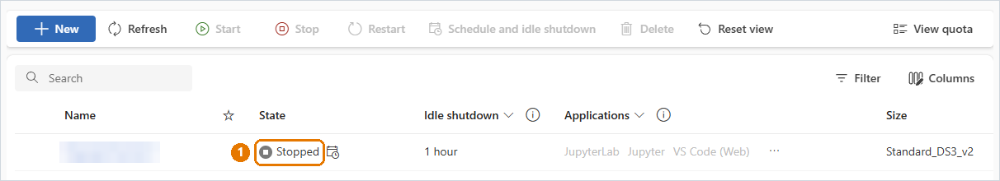
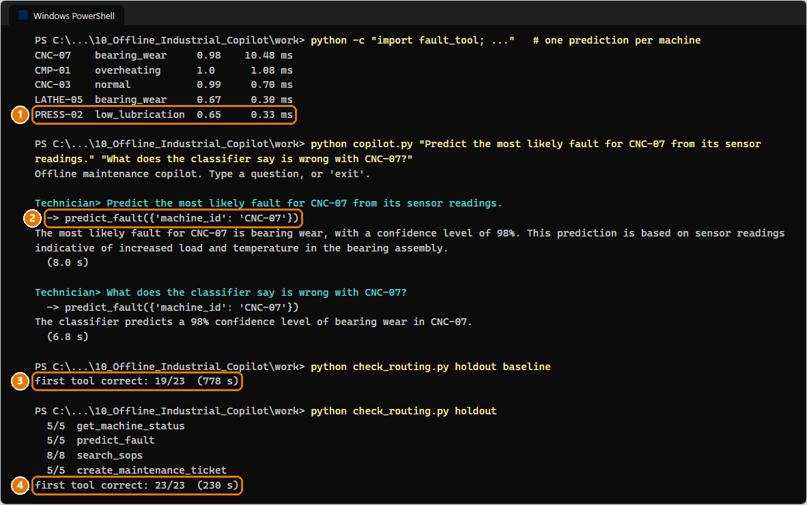

# Walkthrough Challenge 5 - Train in the cloud, deploy at the edge

[Previous Challenge Solution](../challenge-04/solution-04.md) - **[Home](../../Readme.md)** - [Next Challenge Solution](../challenge-06/solution-06.md)

Duration: 60 minutes (shortcut: 25 minutes)

## Prerequisites

Please ensure that you successfully completed [Challenge 4](../../challenges/challenge-04.md) before continuing with this challenge. The full path also needs the Azure Machine Learning workspace from your lab page.

### **Task 1 (full path): Train in Azure Machine Learning**

1. Open [Azure Machine Learning studio](https://ml.azure.com) and choose **Workspaces**. Your workspace is listed by its display name **Offline Industrial Copilot**, in the resource group from your lab page. (The studio's home page may say you have no recent workspaces; use the Workspaces list.)

   

   *① The lab workspace, by its display name · ② Your resource group from the lab page*

2. **Compute** > **Compute instances** > **New**. Keep the suggested name, choose **`Standard_DS3_v2`** (4 cores, a few cents an hour) and select **Review + Create**, then **Create**. Training takes a few seconds, so a small size is enough.

   

   *① A small CPU size is enough · ② Review + Create*

   **Idle shutdown is on by default** (after 60 minutes without activity), on the *Scheduling* page. Leave it on.

   

   The instance is **Running** after about 4 minutes. Prepare the next step while it starts.

   

   *① Running after about 4 minutes · ② Idle shutdown · ③ Stop, when you are done*

3. **Notebooks** > **Add files** (the ⊕ icon) > **Upload files**: choose `resources/shortcut/train_fault_classifier.ipynb` and `resources/data/sensor_history.csv`. They go into your own folder under *Users*. You can also paste the code of [train_fault_classifier.py](../code/train_fault_classifier.py) into a new notebook.

   

   *① Add files · ② Upload files*

4. Open the notebook, check that your compute instance is selected, and select **Restart kernel and run all cells** (the ▷▷ icon). The yellow *"You need to be authenticated to the compute to use any Azure SDK"* banner does not matter here: the notebook does not use the Azure SDK.

   

   *① Your compute instance and the Python 3 kernel · ② Restart kernel and run all cells · ③ The Authenticate banner: not needed for this notebook*

   The notebook:
   - installs `scikit-learn`, `skl2onnx`, `onnxruntime` and `pandas` (17 s),
   - loads the 2,400 labelled sensor readings,
   - trains a random forest (**accuracy 0.94** on held-out data),
   - exports it to **ONNX**,
   - loads the ONNX file with ONNX Runtime and checks that it gives the same answers as the training library.

   

   *① Accuracy on the held-out quarter of the data · ② Confusion matrix (rows: the real fault, columns: the prediction)*

   

   *① ONNX Runtime gives the same answer as scikit-learn on 100 percent of the test rows · ② A machine like CNC-07 is predicted as bearing wear*

5. Download `fault_classifier.onnx` and `fault_labels.json` (in the file list, **...** > **Download**) and copy them into your `work` folder, in a folder named `artifacts`.
6. **Stop** the compute instance (or delete it). It bills while it runs.

   

   *① Stopped: it no longer bills. Start it again from the same page if you need it.*

💡 The point of the exercise is the **workflow**: cloud tools for training, a portable file for delivery, a small runtime on the device. This model is tiny, so you could also train it on your laptop with `python train_fault_classifier.py`.

### **Task 1 (shortcut): Read the notebook and use the ready-made model**

Read through `resources/shortcut/train_fault_classifier.ipynb` and copy `fault_classifier.onnx` and `fault_labels.json` from `resources/shortcut`.

### **Task 2: Run the model on the device**

[fault_tool.py](../code/fault_tool.py) loads the ONNX file with ONNX Runtime and **no** training library:

```python
_session = ort.InferenceSession(str(ARTIFACTS / "fault_classifier.onnx"), providers=["CPUExecutionProvider"])

features = np.array([[machine[f] for f in _meta["features"]]], dtype=np.float32)
label_idx, probabilities = _session.run(None, {_session.get_inputs()[0].name: features})
```

The file is 140 KB. A prediction takes a few milliseconds on the CPU: no GPU, no NPU and no network.

### **Task 3: Make it a tool for the agent**

`predict_fault(machine_id)` reads the machine's current readings (the same data as the status tool) and returns the predicted fault with its probability. Add its schema to the agent:

```python
agent.run_agent(client, model, question, extra_tools=[(fault_tool.SCHEMA, fault_tool.predict_fault)])
```

```powershell
python copilot.py "Predict the most likely fault for CNC-07 from its sensor readings."
```

```text
  -> predict_fault({'machine_id': 'CNC-07'})
The most likely fault for CNC-07 is bearing wear, with a confidence level of 98%.
```

Without help, the agent often does not make this call (see task 3b). The copilot in [copilot.py](../code/copilot.py) uses the router from task 3b, so this request works.

### **Task 3b: Make the tool choice reliable**

💥 **A small model picks the wrong tool surprisingly often.** With all four tools in front of it, `phi-4-mini` sent most fault requests to the SOP search instead of the classifier. We measured this with 23 requests that were written once and never used to tune anything ([routing_holdout.json](../../resources/data/eval/routing_holdout.json), run with [check_routing.py](../code/check_routing.py)):

| `phi-4-mini` sees... | First tool correct | Fault prediction |
|----------------------|--------------------|------------------|
| all four tools (what we had) | 14 to 19 of 23 | 0 to 3 of 5 |
| the tool chosen by the router | **23 of 23** | 5 of 5 |

Without the router the score changed from run to run: 14 of 23 in the first test, 19 of 23 on 23 November 2026 (Foundry Local 0.14.0), when it still missed 2 of the 5 fault requests and 2 of the 5 ticket requests. With the router it was 23 of 23 both times.

The wording mattered a lot: *"Run the fault prediction model for CNC-07"* worked, while *"Predict the most likely fault for CNC-07 from its sensor readings"* or *"What does the classifier say is wrong with CMP-01?"* did not. The same prompts even routed differently from one session to the next, so there is no wording that "always works".

**The fix is to shorten the list the model chooses from.** This is called *tool retrieval*: the same idea as the SOP search, applied to tools. Foundry Local's own documentation says `tool_choice="required"` is only best-effort, and research on tool retrieval reports large gains in selection accuracy when the model sees fewer, more relevant tools. [tool_router.py](../code/tool_router.py) does two things:

1. **A tool whose required argument is missing is not a candidate.** Status, fault prediction and tickets all need a machine ID. A request that names none (*"At what vibration level must a spindle be stopped?"*) can only be a question for the SOPs. This one rule fixes most of the mix-ups.
2. **The rest is matched with the embedding model that is already loaded.** Every tool has a short *card*: what it is for and a few example requests. The request is embedded and compared with the cards.

```python
router = ToolRouter(client, embed_model)
agent.run_agent(client, model, question, extra_tools=tools, router=router)   # shortlist=1 by default
```

The agent then shows the model **only the best-matching tool**, and the model only fills in the arguments. The write tool is only shown if it is the best match, so the approval and the other protections from challenge 3 still apply.

```text
Technician> Predict the most likely fault for CNC-07 from its sensor readings.
  -> predict_fault({'machine_id': 'CNC-07'})
The most likely fault for CNC-07 is bearing wear, with a confidence level of 98%.
```

Results with `phi-4-mini`, first tool correct:

| Set | No router | Router, shows 1 tool | Router, shows 2 tools |
|-----|-----------|----------------------|-----------------------|
| Tuning set, 32 requests (used to build the cards) | 20 of 32 | **31 of 32** | 26 of 32 |
| Held-out set, 23 requests | 14 of 23 | **23 of 23** | not run |
| Held-out set on the **CPU variant** of the model | not run | **23 of 23** | not run |

- **Showing two tools is worse than showing one.** With *status* and *fault prediction* side by side the model chose *status* for 5 of the 8 fault requests. So the router decides and the model does not.
- **The one miss** is *"CNC-07 shows error E-SPN-214. What should I do about it?"*: it names a machine and an error code, so both *status* and *SOP search* are reasonable. The model then wrote a procedure that is not from any SOP. A good discussion: when the router cannot tell, should the agent ask?
- **Be careful with these numbers.** The cards were written by us after we had seen the first failures, and the held-out set is only 23 requests. The held-out result shows the idea works. It does not prove that a new phrasing can never fail. Teams should add their own requests to the two JSON files.
- The router costs one embedding call per request (about 0.2 s on the laptop GPU).



*① A prediction takes well under a millisecond on the CPU, and PRESS-02 is the least certain · ② The router sends the request to the classifier · ③ Without the router: 19 of 23 held-out requests reach the right tool first · ④ With the router: 23 of 23*

`check_routing.py` sends every request through the agent, so it is slow on a laptop: 4 minutes for the held-out set with the router, 13 minutes without it, and 17 minutes for the 32-request tuning set. Add `--quick` to send only the first 2 requests per tool (`python check_routing.py holdout --quick` took 1 minute, 8 of 8). Use it while tuning, then run one full set per team, or once at the front.


### **Task 4: How far do you trust it?**

| Machine | Reading | Predicted fault | Confidence |
|---------|---------|-----------------|------------|
| CNC-07 | vibration 9.4 mm/s, 78 °C | `bearing_wear` | 0.98 |
| CMP-01 | 104 °C, vibration 2.8 mm/s | `overheating` | 1.00 |
| CNC-03 | normal readings | `normal` | 0.99 |
| LATHE-05 | vibration 4.9 mm/s | `bearing_wear` | 0.67 |
| PRESS-02 | oil temperature warning E-HYD-031 | `low_lubrication` | 0.65 |

- **CNC-07, CMP-01 and CNC-03:** high confidence, and they agree with the error codes and the SOPs. Trust them.
- **PRESS-02:** the classifier says low lubrication with 0.65 while the controller says *oil temperature high* (E-HYD-031). The error code and the SOP are facts from the machine. The classifier is advice. **A known error code beats a low-confidence prediction.**
- **LATHE-05:** 0.67 is an early warning at best. Worth a look at the next planned stop, not a ticket.

A rule for the technician: a result below about 0.8 is a hint, not a diagnosis. The agent should show the confidence so the person can decide.

You successfully completed challenge 5! 🚀🚀🚀

## Coach notes

- **Decide the path per team at the start of the day**, based on experience and Azure access. Teams on the shortcut gain about 35 minutes. Give them a longer challenge 4 or the stretch goals.
- **Custom model serving in Foundry Local:** this MicroHack does **not** serve the classifier through Foundry Local. Foundry Local serves the catalog models, and a scikit-learn classifier is not a chat model. What we validated is the fallback from the outline: the ONNX classifier runs as an **agent tool next to** the small language model, with ONNX Runtime. A fine-tuned small language model served by Foundry Local is not covered here.
- **Cost:** the Azure Machine Learning workspace costs nothing while idle. The compute instance costs a few cents per hour. Remind teams to stop it.
- **Verified with the `az ml` command line** against the workspace that the lab automation creates: the compute instance (`Standard_DS3_v2`) was `Running` **3.7 minutes** after the request, and the training job (`pip install skl2onnx onnx`, then `train_fault_classifier.py`) ran in **2.5 minutes** on it. It reproduced the local result exactly: accuracy 0.940, the same confusion matrix, and an ONNX file that is **byte-identical** to `resources/shortcut/fault_classifier.onnx`. So the shortcut file is a faithful stand-in for a team's own result, and a team's file can be checked against it with a file hash.
- **Verified in the Azure Machine Learning studio** on 23 November 2026, in a workspace deployed by the lab automation: the compute instance (`Standard_DS3_v2`) was `Running` **4.2 minutes** after **Create**, *Restart kernel and run all cells* ran the notebook in under a minute (the package install took 17 s), with accuracy 0.94, *"ONNX matches scikit-learn on 100 percent of the test rows"*, and an ONNX file that is again **byte-identical** to `resources/shortcut/fault_classifier.onnx` (SHA-256 `112BB623…378B1F`). Plan the 4 minutes of start-up: let teams read the notebook while the instance starts.
- The notebook shows a yellow banner, *"You need to be authenticated to the compute to use any Azure SDK"*. It does not stop this notebook, which uses no Azure SDK. Teams can ignore it or select **Authenticate**.
- **Stretch:** compare the classifier's verdict with what the language model says about the same readings (*"given vibration 9.4 mm/s and 78 °C, what is wrong?"*) and discuss which to trust when.
