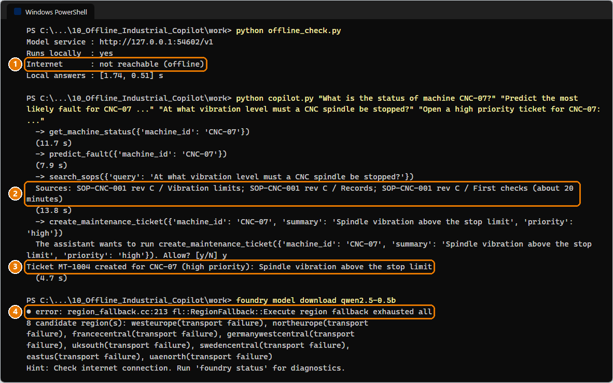

# Walkthrough Challenge 6 - Cut the cord

[Previous Challenge Solution](../challenge-05/solution-05.md) - **[Home](../../Readme.md)** - [Finish](../../challenges/finish.md)

Duration: 30 minutes

## Prerequisites

Please ensure that you successfully completed [Challenge 5](../../challenges/challenge-05.md) before continuing with this challenge. The reference copilot is [copilot.py](../code/copilot.py): one agent with four tools (machine status, tickets, fault prediction, SOP search).

### **Task 1: Run it while connected and write down the timings**

```powershell
python copilot.py "What is the status of machine CNC-07?" "Predict the most likely fault for CNC-07 from its sensor readings." "At what vibration level must a CNC spindle be stopped?" "Open a high priority ticket for CNC-07: spindle vibration above the stop limit."
```

Reference timings on the laptop (Snapdragon X Elite, GPU variant), **connected**, for the first run after the service started. Your numbers will differ with your hardware.

| Step | Laptop |
|------|--------|
| Machine status (tool call and answer) | 13 s |
| Fault prediction (ONNX model and answer) | 9 s |
| SOP question (split, embed, search, answer) | 17 s |
| Ticket (tool call and confirmation) | 6 s |

The ticket time includes the seconds the technician needs to type `y`. The first request is the slowest because the models are still cold. The times for the Windows VM are in task 5.

Re-run on 23 November 2026 (Foundry Local 0.14.0, same laptop, warm models): status 9.2 s, fault prediction 10.9 s, SOP question 16.6 s, ticket 5.2 s.

### **Task 2: Get ready, then disconnect**

💥 **Start everything before you disconnect, and test a restart before you rely on it.** Older versions of the `foundry` service (0.11 and 0.12, see the coach notes) load their model catalog from the internet when they start: restarted offline, they could not find any model, even a model that was on the disk. **Foundry Local 0.14.0 no longer has this problem:** on 23 November 2026 we restarted the service with the internet blocked, it loaded `phi-4-mini` in 5 s and the embedding model in 3 s from the disk, and the whole copilot worked. Downloads still fail offline (*"region fallback exhausted all 8 candidate regions"*), so get every model and package first.

1. Make sure the service is running and both models are loaded:

   ```powershell
   foundry server status
   foundry model list --loaded
   ```

2. Ask one question of each kind, so every model is warm and the SOP index exists.

💡 **If your device must be able to restart while it is offline**, start the models with [serve_offline.py](../code/serve_offline.py) instead of the `foundry` service. It uses the Foundry Local Python SDK, which finds the models in your local cache without contacting the internet:

```powershell
pip install foundry-local-sdk                  # while you are still online
python serve_offline.py                        # serves phi-4-mini and the embedding model
$env:FOUNDRY_LOCAL_URL = "http://127.0.0.1:5272/v1"    # in the terminal where you run the copilot
```

By default it uses the **CPU** variants of the models. On the VM that is what you get anyway. On a laptop with a GPU or NPU, add `--accelerate` to use those variants instead. That works offline as long as you ran a GPU model once while you were online (see the coach notes). It prints `failed to fetch catalog from http://127.0.0.1:9` at the start: that is expected, it is the catalog address the script makes fail on purpose. Verified offline on 23 November 2026 with `--accelerate` (SDK 2.5.0, Foundry Local 0.14.0): it served the GPU variants of both models, and the copilot answered status, SOP and fault questions through it.

### **Task 3: Disconnect**

**Laptop**, in a terminal started as administrator. This blocks outbound traffic to the internet and leaves the loopback address that Foundry Local uses alone:

```powershell
New-NetFirewallRule -DisplayName "Offline copilot test" -Direction Outbound -Action Block -RemoteAddress Internet
```

Remove it afterwards with `Remove-NetFirewallRule -DisplayName "Offline copilot test"`. Turning Wi-Fi off or unplugging the cable works as well.

⚠️ **Check that the block really covers the model service.** On a company-managed laptop, a rule with `-RemoteAddress Internet` blocked Python, but the Foundry Local service (`foundrylocald.exe`) still downloaded a model. Test it with `foundry model download qwen2.5-0.5b`: it must fail. If it does not, block the two programs for **every** remote address instead (loopback traffic is not affected):

```powershell
$fl = (Get-Process foundrylocald).Path
$py = python -c "import sys; print(sys._base_executable)"   # the real interpreter, not the .venv launcher
New-NetFirewallRule -DisplayName "Offline copilot test" -Direction Outbound -Action Block -RemoteAddress Any -Program $fl
New-NetFirewallRule -DisplayName "Offline copilot test" -Direction Outbound -Action Block -RemoteAddress Any -Program $py
foundry server stop; foundry server start    # connections that were already open survive a new rule
```

On that laptop the service then failed to download (*"region fallback exhausted all 8 candidate regions"*), while every local answer still worked.

**VM**: add an outbound rule to the network security group of the VM. It blocks the internet and keeps your Remote Desktop session and the Azure management path:

```powershell
az network nsg rule create -g <resource-group> --nsg-name <nsg-name> -n deny-internet-out `
  --priority 100 --direction Outbound --access Deny --protocol '*' `
  --source-address-prefixes '*' --source-port-ranges '*' `
  --destination-address-prefixes Internet --destination-port-ranges '*'
```

Wait about 30 seconds for the rule to take effect.

### **Task 4: Check that you are really offline**

[offline_check.py](../code/offline_check.py) checks three things: the model service is on a loopback address, the internet is **not** reachable, and a local answer still comes back.

```powershell
python offline_check.py
```

Expected output when the block works (this is the real output from the VM test below):

```text
Model service : http://127.0.0.1:59668/v1
Runs locally  : yes
Internet      : not reachable (offline)
Local answers : [2.48, 1.05] s
```

If it says `REACHABLE`, the block does not work yet. Do not continue until it says `not reachable`.



*From the laptop on 23 November 2026 (Foundry Local 0.14.0), with the firewall block above. ① The internet is not reachable · ② The SOP answer still has its sources · ③ The ticket is written · ④ A download cannot reach any region. The scenario ran after the `foundry` service had been stopped and started again while offline.*

### **Task 5: Run the whole scenario again**

Repeat the questions from task 1 and write down the timings. Every capability from challenges 3 to 5 must work: the tools, the SOP search with sources, the ONNX model and the ticket.

Offline results on the VM (8 vCPU, no GPU, CPU variants), with the internet blocked at the network level **and the service freshly started while offline** with `serve_offline.py`:

| Step | Offline, on the VM |
|------|--------------------|
| Machine status (first request after the start, models still cold) | 26 s |
| Fault prediction (ONNX model and answer) | 19 s |
| SOP question (split, embed, search, answer) | 38 s |
| Ticket (tool call and confirmation) | 13.5 s |
| Error code plus machine ID (goes to the SOP search) | 40 s |
| The very first chat call after the start | 26 s, the next one 0.4 s |

In an earlier run with the `foundry` service (started online, block applied afterwards) the connected and the offline times were the same within normal variation: status 18.5 s against 20.1 s, SOP question 25.7 s against 26.4 s. **Nothing in the question path needs the internet.**

### **Task 6: What still needs the cloud?**

Go through the copilot and the Foundry Local service and ask *"does this need the internet?"* A good list:

| Needs the internet | When |
|--------------------|------|
| Starting or restarting the Foundry Local service | Versions 0.11 and 0.12: whenever it starts (it fetches the model catalog). 0.14.0: not for models already on the disk |
| Downloading a model or a model update | Once, and when a model is refreshed |
| Updating Foundry Local itself and the Python packages | On a schedule, from a controlled place |
| Syncing the maintenance tickets to the central system | When the device is back online |
| Retraining the fault classifier with new sensor history | Periodically, in the cloud (challenge 5) |
| Monitoring and logs to a central place | When connected |

💡 A good routine for the stretch goal: when the device reconnects, it uploads the new tickets, then checks for a newer model, downloads it, tests it with the evaluation set from challenge 4, and only then switches to it.

You successfully completed challenge 6! 🚀🚀🚀

## Coach notes

### What was verified (on a Windows 11 VM in Azure, 8 vCPU, no GPU)

- The outbound deny rule above blocks the internet (`aka.ms`, `huggingface.co` and `pypi.org` all time out) and the **Azure management path keeps working**: a coach can still run commands on the VM with `az vm run-command`. Do not add an inbound deny rule.
- With the service started and the models loaded **before** the block, the whole copilot works offline, with the same timings as connected.
- Starting the service takes 2 seconds, loading `phi-4-mini` and the embedding model about 17 seconds, and the first chat answer after that 0.6 s.

### What broke offline in older versions: restarting the service

With Foundry Local 0.11 and 0.12, after `foundry server restart` with the internet blocked, `foundry model load` and every other command that names a model failed with `No model matching 'phi-4-mini' was found in the catalog`, **also for a model that was already downloaded** and also when the full variant ID was used. The service log shows why:

```text
GetModelVariant: 'Phi-4-mini-instruct-generic-cpu:5' not in cache, fetching from catalog source.
Region detection probe failed (status 0); defaulting to 'centralus'.
RegionFallback: region 'centralus' unhealthy (transport failure); trying next candidate.
... (7 regions, about 21 seconds each)
```

It tries 7 regions in turn, which is about 2.5 minutes of waiting, and then gives up. Teams that block the network and then restart the service (or reboot the VM) will lose the copilot and will think the network block broke something.

- **Tell teams in the briefing:** start and warm up first, disconnect second, and test a restart before relying on it.
- **Foundry Local 0.14.0 (23 November 2026, Snapdragon laptop):** the same test passed. With the service and Python blocked for every remote address (a model download failed in all 8 regions), `foundry server stop`, `foundry server start` (7 s) and `foundry model load` brought back `phi-4-mini` in 5 s and the embedding model in 3 s, and status, fault prediction, SOP question and ticket all worked (11.7 s, 7.9 s, 13.8 s, 4.7 s). Teams on an older version still need the briefing above or `serve_offline.py`. `foundry server restart` itself timed out once while the old process was still shutting down; `stop`, then `start`, worked.

### The fix we verified: start the models from the SDK

[serve_offline.py](../code/serve_offline.py) starts the models with the Foundry Local Python SDK. It gives the SDK a catalog address that fails at once (`http://127.0.0.1:9`, nothing listens there), so the SDK never goes looking for the 7 cloud regions. It finds the models in the local cache on the disk and serves them on an OpenAI-compatible address. [fl.py](../code/fl.py) reads what it serves when `FOUNDRY_LOCAL_URL` is set.

Verified on a fresh Windows VM (SDK installed with `pip` and the two CPU model variants downloaded with the SDK while online, 93 s for 5.8 GB):

- Started online: ready in 30 s. Then the internet was blocked and the launcher was **stopped and started again while offline**: ready again in 30 s, both models served. The `foundry` service could not do this.
- Offline, against that freshly started service: all 5 copilot requests went to the right tool, and the 23 held-out routing requests scored 23 of 23 (see [solution 5](../challenge-05/solution-05.md)).
- It runs fine as a Windows scheduled task under the `SYSTEM` account, so it can start at boot without anyone signing in.

Details and limits:

- **GPU and NPU variants (`--accelerate`). Verified on the laptop with the network blocked for the process** (a firewall rule for the Python interpreter, administrator terminal). The root cause of the problem we first saw:
  - The **NPU** (QNN) execution provider is installed with Foundry Local, registers offline in about 2 s, and the NPU model loaded.
  - The **GPU** (WebGPU) execution provider is downloaded the first time a GPU model runs online and kept in `~/.foundry/ep/webgpu-ep`. But the SDK **tries to download it again at every start** (`https://foundrypackages-....azurefd.net/webgpu_ep_0.2.1_win-arm64.zip`). Offline that fails, the provider is not registered, and every GPU model refuses to load with `requires WebGpuExecutionProvider which is not registered`. The call to register the providers still reports `success=True`, which is misleading.
  - The native library has an undocumented environment variable, **`FOUNDRY_LOCAL_WEBGPU_EP_LIBRARY`**, that points to a provider on the disk. With it set to the copy in `~/.foundry/ep`, both providers register offline in 1.6 s with no download, the GPU variant of `phi-4-mini` loads and answers in 1.3 s. `serve_offline.py --accelerate` sets it for you.
  - With the launcher under the same block: CPU variants ready in 18 s, GPU variants ready in 12 s, and the copilot answered correctly in both (fault prediction 8.4 s on CPU against 5.7 s on GPU).
  - **Caveats.** The variable is undocumented, so it may change in a later version (Foundry Local 0.11.0, SDK 2.1.0 here). The provider must have been downloaded once, so run a GPU model online before you disconnect. We cut the network for one process and did not reboot the laptop, but everything the launcher needs is a file on the disk. A CUDA provider has a similar variable (`FOUNDRY_LOCAL_CUDA_EP_LIBRARY`), which we did not test.
- The `foundry` command line cannot see a service that the SDK started (`foundry model list --loaded` will not list its models). That is why `fl.py` reads a small file.
- The first chat request after any start is slow on a CPU (26 s here for the first one, 0.4 s for the next). Send a warm-up request before the technician asks.
- On the VM, embedding the 25 SOP chunks takes 36 s on the CPU and one SOP retrieval about 1 s. The ONNX prediction takes about 1 ms.

### Other observations

- **The service keeps trying to reach the internet in the background.** Even in a steady state, `Get-NetTCPConnection` shows connections in the `SynSent` state to Azure addresses on port 443 (for example `20.42.73.27`) that never complete. They do not slow the answers. This is useful for the discussion about *"does it phone home?"*: with the network blocked the attempts fail quietly and nothing in the copilot depends on them. We did not find out what the service sends.
- **Python packages must be installed before the disconnect.** `pip` has no internet either.
- **The block must not stop the loopback address.** `127.0.0.1` is not "Internet" for the firewall rule above, and on the laptop a program rule for **every** remote address (Task 3) did not stop loopback traffic either. If a team's own block stops the copilot, check that it does not cover `127.0.0.1`.

### Verified on a laptop (Windows 11 ARM64)

`New-NetFirewallRule -Direction Outbound -Action Block -RemoteAddress Internet` was run in an administrator terminal. With the rule active, `offline_check.py` printed `not reachable (offline)`, the local model still answered (1.5 s, loopback is not "Internet") and a full copilot question worked. We scoped the rule to the Foundry service and to Python with `-Program`, because the documented rule without `-Program` would have cut our own session. **The rule exactly as written in task 3 (for all programs) was not run.** Two things to know:

- If you scope the rule to Python with `-Program`, use the **real interpreter**, not the one in the virtual environment. `.venv\Scripts\python.exe` is only a launcher that starts the real one, so a rule for it blocks nothing (our first attempt printed `REACHABLE`). `python -c "import sys; print(sys._base_executable)"` shows the real path. The first rule in task 3 has no `-Program`, so it does not have this problem; the per-program fallback uses the real path.
- Remove the rule when you are done, also if a test fails halfway. A `try ... finally` around the test is a good habit.

### A Foundry Local documentation claim that does not hold for the CLI service

The documentation says: *"After the initial download, models run entirely offline from the local cache."* With Foundry Local 0.11 and 0.12 that was true for a service that was already running, and for the SDK as shown above, but **not** for a `foundry` service that was restarted offline. With 0.14.0 it held for a restart as well.

### Not verified

- Turning Wi-Fi off or unplugging the cable.
- A real reboot of a GPU or NPU device with no network. We blocked the network for the service and Python and restarted the service, not the machine.
- The `foundry` service itself with a local provider: we only fixed the SDK path.

**Stretch:** design the reconnection routine from task 6 and write the ticket-sync part.
