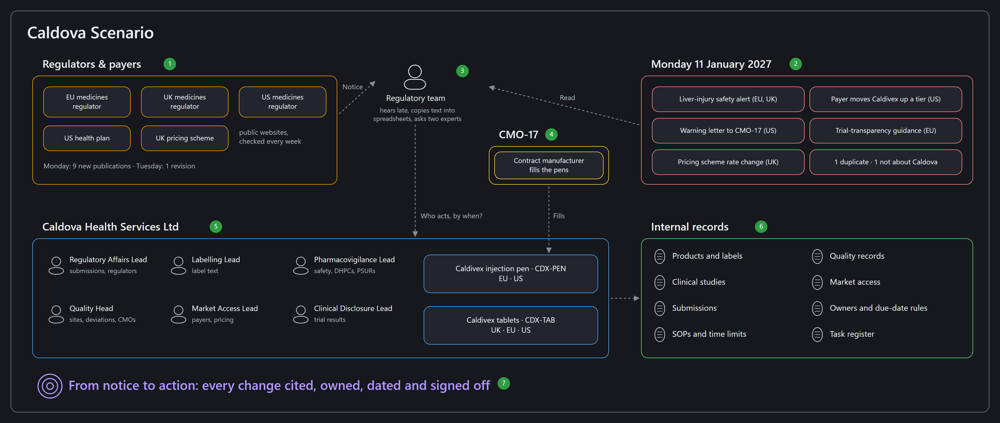
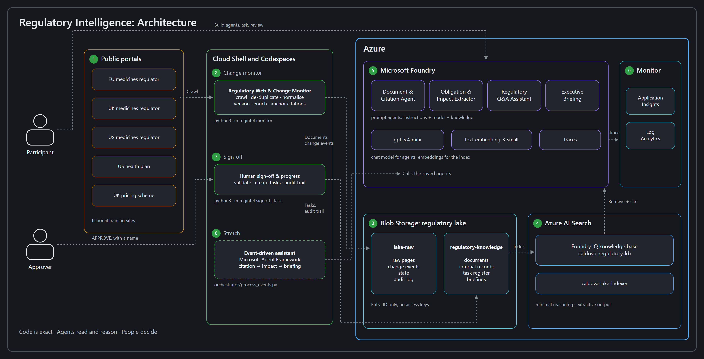

# Regulatory Intelligence: From Notice to Action

- [**MicroHack introduction**](#microhack-introduction)
- [**What you'll build**](#what-youll-build)
- [**MicroHack context**](#microhack-context)
- [**Objectives**](#objectives)
- [**MicroHack challenges**](#microhack-challenges)
- [**Contributors**](#contributors)

## MicroHack introduction

Regulators and payers publish changes every week. Someone has to notice them, read them, work out what they mean for each product and get the right people moving before a deadline slips. **Regulatory Intelligence: From Notice to Action** does that job with agents in Microsoft Foundry.

In one day, you crawl regulator and payer websites into a regulatory lake and build four Foundry agents on top of it. One cites documents to the paragraph, one works out what a change means for the company, one answers staff questions and one briefs leadership. A person signs off every action plan, and the decision is recorded.

Everything happens in the browser: the agents in the **Microsoft Foundry portal**, the supplied tools in **Azure Cloud Shell**. You don't write code. The optional last challenge runs the agents automatically from GitHub Codespaces.

> [!TIP]
> The same approach suits contracts, tenders, standards and internal policies: anywhere outside documents change and people have to act on them.

## The story

**Caldova Health Services Ltd** is a fictional UK life-sciences company. It sells one medicine, **Caldivex**, in two forms:

| Product | Where it is sold |
|---|---|
| **Caldivex tablets** (`CDX-TAB`) | UK, EU, US |
| **Caldivex injection pen** (`CDX-PEN`) | EU, US (the pens are filled by a contract manufacturer, `CMO-17`) |

On **Monday 11 January 2027**, nine new publications appear on the websites that Caldova's regulatory team is supposed to watch: a safety alert asking for a liver-injury warning on the Caldivex label, a US payer moving Caldivex to a more expensive tier, a warning letter to the contract manufacturer that fills the pens, a new trial-transparency rule, a pricing change and more. One of them is published twice. One has nothing to do with Caldova. On Tuesday the payer quietly revises its policy.

Today the team hears about changes late, copies text into spreadsheets, argues over which version is current and sends every question to the same two experts.

**Only two names matter: Caldova, the company, and Caldivex, its medicine.** Everyone else is a role, such as *Labelling Lead* or *Quality Head*.

> [!IMPORTANT]
> Every regulator, payer, publication, product and date in this lab is fictional. Nothing here is legal, regulatory or medical advice.

## What you'll build

Six challenges take one change from a website to a signed-off plan:

| Challenge | Capability | Built with | What it produces |
|---|---|---|---|
| 1 | **Regulatory Web & Change Monitor** | Supplied tool in Cloud Shell + Azure Blob Storage + **Foundry IQ** | Crawls the portals, de-duplicates and normalises documents, loads the regulatory lake and indexes it |
| 2 | **Document & Citation Agent** | Foundry prompt agent + Foundry IQ | A citation card: what the document says, its dates and version history, with an exact citation for every statement |
| 3 | **Obligation & Impact Extractor** | Foundry prompt agent + Foundry IQ | Obligations, timelines and affected areas, linked to Caldova's products, labels, studies, submissions, SOPs and quality records, with proposed actions and owners |
| 4 | **Regulatory Q&A Assistant** | Foundry prompt agent + Foundry IQ | Grounded answers for staff, plus drafts of emails, change requests, notices and label updates |
| 5 | **Executive Briefing** + human sign-off | Foundry prompt agent + Foundry IQ + supplied sign-off tool | A briefing by region and portfolio with risks, deadlines and progress, routed for approval; the decision recorded in an audit trail |
| 6 ⭐ *(stretch)* | **Event-driven Regulatory Intelligence Assistant** | Microsoft Agent Framework in Codespaces: run it as supplied, or write the agent chain yourself from a skeleton | Every change event processed automatically by the agent chain, waiting for human sign-off |

The editable sources are [readme-scenario.excalidraw](images/readme-scenario.excalidraw) and [readme-architecture.excalidraw](images/readme-architecture.excalidraw). Open them at <https://excalidraw.com> to change them.

### What each Azure service does here

| Service | Its job in this hack |
|---|---|
| **Azure Blob Storage** | The **regulatory lake**. `lake-raw` holds what the monitor crawled, the change events and the audit trail. `regulatory-knowledge` holds the normalised documents, Caldova's internal records and the task register. |
| **Foundry IQ** (on **Azure AI Search**) | Indexes `regulatory-knowledge` and returns the most relevant passages, with their source, to any agent that asks. Agents answer from Caldova's lake instead of from memory (they are *grounded*). |
| **Microsoft Foundry Agent Service** | Hosts your four prompt agents: a model, written instructions and the knowledge tool. You can inspect every model and tool call in **Traces**. |
| **Microsoft Agent Framework** *(stretch)* | Chains the saved agents and runs them for each change event. |
| **Azure Cloud Shell** | A browser terminal for the supplied monitor and sign-off tools. Nothing to install. |

Not everything is an AI job. **Crawling, de-duplication, versioning and recording a decision are ordinary code**: they must give the same answer every time. **Reading, linking, explaining and summarising are agent jobs.** The human decides.

## MicroHack context

### The problem today

- Regulations, guidance and enforcement letters are spread across many authority and payer websites. Watching them by hand is slow and inconsistent.
- Working out what a new requirement means, and mapping it to the affected products, labels, trials and procedures, takes time and is easy to get wrong.
- Staff questions depend on a few experts, and the reasoning and sources behind an answer are not recorded for audit.
- Leadership hears about changes late. Actions and owners are unclear, so changes stall.

### Coverage of the regulatory-intelligence use case

This hack implements every element of the healthcare and life sciences regulatory-intelligence case overview:

| Case overview element | Where you build or use it |
|---|---|
| Crawl health-authority and payer portals for **regulations, guidance, safety alerts, enforcement letters, coverage decisions and pricing rules**; de-duplicate and normalise | Challenge 1: the monitor crawls five allowlisted portals (UK, EU, US), and the lake holds one of each publication type. It ignores a mirrored copy and links outside the allowlist. |
| Extract obligations, **effective dates**, **geographies** and impacted domains (**clinical, labelling, manufacturing, vigilance, market access**) | Challenge 1 (metadata enrichment), Challenge 2 (citation card), Challenge 3 (obligations table) |
| Link obligations to internal **products, studies, submissions, standard operating procedures and quality records**; propose actions and **owners** | Challenge 3 |
| Chat interface that answers questions with citations and **drafts emails, change requests and label updates** | Challenge 4 |
| Executive summaries **by region and portfolio**, with risks, **deadlines** and **progress tracking**; route for review and **approval** | Challenge 5 |
| **Regulatory Web & Change Monitor** crawls, detects updates and loads documents into the lake | Challenge 1 (and the Tuesday update in Challenge 2) |
| **Document & Citation Agent**: text extraction, de-duplication, versioning, paragraph citations | Challenges 1 and 2: code extracts text, removes duplicates and creates versions with stable anchors; the agent turns them into a cited record |
| **Obligation & Impact Extractor** | Challenge 3 |
| **Regulatory Q&A Assistant** | Challenge 4 |
| **Executive Briefing**: summaries, owners and due dates, completion tracked for **audit** | Challenge 5 (task register and audit trail) |
| Agents collaborate via **events**, share context and hand off to humans for final sign-off | Challenge 6: change events trigger the chain; Challenge 5: human sign-off |
| Data: authority and payer publications; internal artefacts (products, studies, submissions, labels, SOPs, quality, **histories**); reference data (geographies, effective dates, product portfolios) | [The data guide](data/README.md) |
| Technical patterns: web crawling and change detection with document normalisation, **metadata enrichment** and authoritative **citation anchoring**; retrieval and grounded reasoning with event-driven workflows for assignment, approval and audit-ready evidence | Challenges 1, 2, 5 and 6 |

### Roles addressed

- **Regulatory affairs and quality leadership**: the approvers in Challenge 5.
- **Clinical, labelling, pharmacovigilance and post-market surveillance teams**: the owners of the actions in Challenge 3, and the people asking questions in Challenge 4.

### Why it matters

The case overview expects organisations to spend **30–50% less time** monitoring and interpreting regulatory change and **15–25% less remediation effort**, by catching issues before inspections or filings. It also expects faster approvals and market access, and better payer negotiations. In the finish challenge you estimate how much of that your agents could deliver for Caldova.

## Objectives

By the end of the day you can:

- Explain why monitoring, de-duplication and versioning belong in code, and reasoning in agents.
- Load a document lake into **Foundry IQ** and ground Foundry prompt agents in it.
- Build agents that **cite exact paragraphs**, separate current from superseded versions and say when they cannot find something.
- Link external obligations to internal records and propose owned, dated actions.
- Use **human sign-off** and an audit trail so that agents propose and people decide.
- Use **Traces** to see which model and knowledge calls an agent actually made.
- *(Stretch)* Run an **event-driven** chain of agents with the Microsoft Agent Framework.

## MicroHack challenges

### Prerequisites

- A modern browser (Edge, Chrome or Firefox), signed in with the lab account from your facilitator.
- Access to the [Microsoft Foundry portal](https://ai.azure.com), the [Azure portal](https://portal.azure.com) and Azure Cloud Shell.
- Your **lab dashboard** values: `ResourceGroupName`, `FoundryProjectEndpoint`, `ModelDeploymentName`, `EmbeddingDeploymentName`, `StorageAccountName` and `SearchServiceName`.
- No local software installation. For the stretch challenge, a GitHub account for Codespaces, or Docker with VS Code for the [devcontainer](environment/README.md).

> [!NOTE]
> Your Foundry project, model deployments, storage account and Azure AI Search service are deployed for you by the [lab automation](labautomation/README.md). You create everything else yourself.

### Challenges

| Challenge | Title | Duration |
|---|---|---|
| [Challenge 1](challenges/challenge-01.md) | Monitor the portals and build the regulatory lake | 60 min |
| [Challenge 2](challenges/challenge-02.md) | Document & Citation Agent | 45 min |
| [Challenge 3](challenges/challenge-03.md) | Obligation & Impact Extractor | 75 min |
| [Challenge 4](challenges/challenge-04.md) | Regulatory Q&A Assistant | 45 min |
| [Challenge 5](challenges/challenge-05.md) | Executive Briefing and human sign-off | 60 min |
| [Challenge 6 ⭐](challenges/challenge-06.md) | Event-driven Regulatory Intelligence Assistant (stretch) | 30 min (shortcut) or 50 min (write it) |
| [Finish](challenges/finish.md) | Measure the impact and clean up | 20 min |

Solutions and expected results for coaches are in [walkthrough](walkthrough/).

## Contributors

| Name | Role |
|---|---|
| Digvijay Chauhan | Author & maintainer |

<!-- Add your name here when you contribute -->
