# Challenge 1: Monitor the portals and build the regulatory lake

**[Home](../README.md)** - [Next Challenge →](challenge-02.md)

## 🎯 Objective

Run Caldova's **Regulatory Web & Change Monitor**, load what it finds into the **regulatory lake** in Azure Blob Storage, and index the lake with **Foundry IQ** so your agents can search it from Challenge 2 onwards.

## 🧭 Context

It is Monday 11 January 2027. Five websites matter to Caldova: the UK, EU and US medicines regulators, a large US health plan and the UK pricing scheme. Nobody has time to read them every day, and when someone does, the same notice often turns up twice.

The monitor does the boring, must-be-exact part **in code**:

1. **Crawls** each allowlisted portal from its home page, follows links inside that portal only and ignores links that leave it.
2. **Normalises** each page: keeps the main text, drops menus and footers, and tidies whitespace.
3. **De-duplicates** by document ID and a fingerprint (hash) of the text. A copy at another address is not a new document.
4. **Versions**: changed text under the same document ID becomes version 2, and version 1 is marked superseded.
5. **Enriches metadata**: region, publisher, document type, dates, impacted domains and any Caldova products named.
6. **Anchors citations**: every paragraph gets a stable label such as `EU-SA-2027-004 v1 p3`.
7. **Raises a change event** for every new or updated document and loads everything into the lake.

Foundry IQ then turns the lake into a **knowledge base**: a search index that returns the best passages, with their source, to any agent that asks.

> [!NOTE]
> The portals are fictional training websites stored in this repository, so everyone gets the same results. Pointing the monitor at real regulator sites is a discussion point in the [finish](finish.md).

## ✅ Tasks

### Part A: Check your Foundry project (5 min)

1. Open [ai.azure.com](https://ai.azure.com) and make sure the **New Foundry** toggle at the top right is on.
2. Select **your** project from the project picker next to *Microsoft Foundry* at the top left. Its name is the last part of `FoundryProjectEndpoint` on your lab dashboard (`regulatory-intelligence`). The account name at the start of the endpoint tells your project apart from other attendees'.
3. In the top menu select **Build**, then **Models** in the left menu. On the **Deployments** tab, under **Serverless deployments**, confirm that the chat model (`ModelDeploymentName`, default `gpt-5.4-mini`) and the embedding model (`EmbeddingDeploymentName`, default `text-embedding-3-small`) both show **Deployment status: Succeeded**.

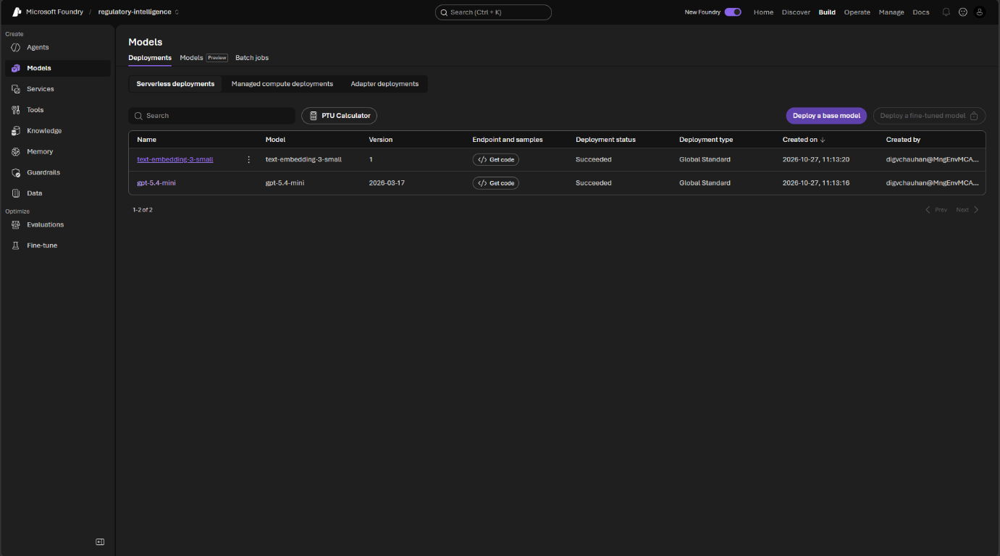

### Part B: Run the monitor in Cloud Shell (15 min)

1. In a private browser window, sign in to the [Azure portal](https://portal.azure.com) with your lab account. Select the **Cloud Shell** icon (`>_`) in the top bar and choose **Bash**. If you are asked about storage, choose the option without storage.

   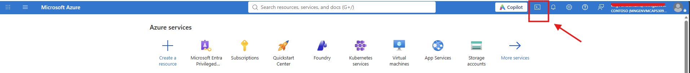

2. Copy only this lab from GitHub and move into it:

   ```bash
   git clone --depth 1 --filter=blob:none --sparse https://github.com/microsoft/MicroHack regintel-microhack
   cd regintel-microhack
   git sparse-checkout set 03-Azure/01-04-AI/11_Healthcare_Regulatory_Intelligence
   cd 03-Azure/01-04-AI/11_Healthcare_Regulatory_Intelligence
   ```

   If your facilitator gives you a fork or a branch, use that repository URL and add `--branch <name>` after `--sparse`.

   > [!NOTE]
   > Cloud Shell without storage starts empty every session. If it restarts or times out, you are back in your home folder (`~`) and the copy is gone: repeat this step. Nothing is lost, because everything the monitor finds is stored in your storage account.

3. Check that Cloud Shell uses your lab subscription: `az account show --query name -o tsv`. If not, run `az account set --subscription "<lab subscription>"`.
4. Run Monday's crawl. Replace `<StorageAccountName>` with the value from your dashboard:

   ```bash
   python3 -m regintel --account <StorageAccountName> monitor --day monday
   ```

5. Read the summary. Each run's summary is also saved in the lake, for example `lake-raw/reports/monitor-monday-run1.txt`, so you can find it in the Storage browser in Part C even if Cloud Shell closes. Answer for your team:
   - How many pages were crawled, and how many of them were just index pages?
   - Which document was found twice, and why is it **not** counted as new?
   - Which links were not followed, and why is that a good thing?

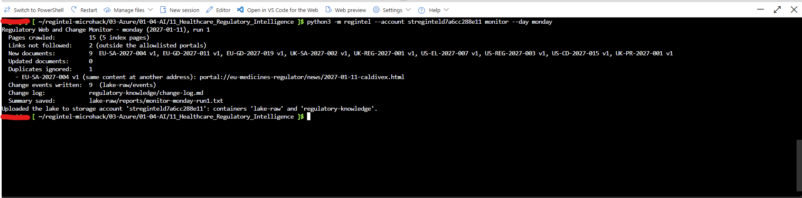

6. Run exactly the same command again. A monitor that runs every hour must not raise the same change twice. This time it reports **0 new** and **10 duplicates**, and writes no change events.

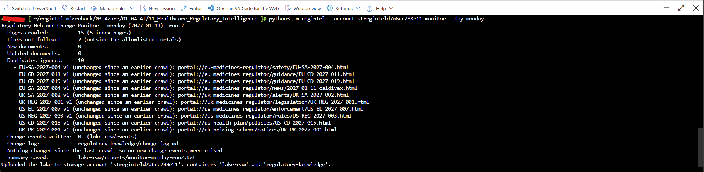

### Part C: Look inside the lake (10 min)

1. In the Azure portal, open your storage account (`StorageAccountName`), then **Storage browser** in the left menu, then **Blob containers**. The authentication method is already **Microsoft Entra ID**: the lake has no access keys.
2. Open the `regulatory-knowledge` container and select `change-log.md`. In the panel that opens, select the **Edit** tab to see the text, then **Preview** at the bottom to see the tables formatted. This is the list of everything the monitor found, with one row per monitor run at the end. Close the panel without saving.

   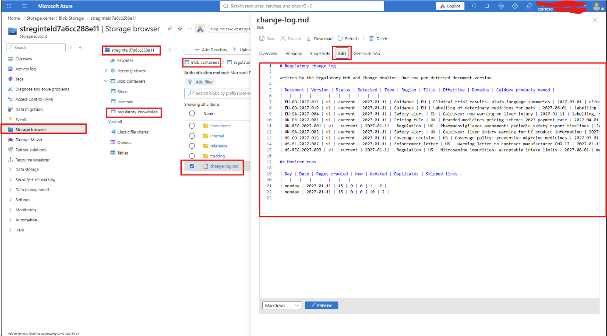

3. Open `regulatory-knowledge/documents/EU-SA-2027-004-v1.md` the same way. Find:
   - the metadata the monitor added (region, document type, effective date, impacted domains, products named),
   - the second address under **Also published at**,
   - the paragraph labels `[EU-SA-2027-004 v1 p1]` … `p5`.
4. Browse `regulatory-knowledge/internal/`. These are Caldova's records: products, labels, studies, submissions, SOPs, quality records, market access, owners and history. `tracking/task-register.md` lists the tasks already in progress.
5. Open the `lake-raw` container and its `events` folder. There is one **change event** per new document. In Challenge 6 these events trigger your agents automatically. The `reports` folder holds the summary of each monitor run.

### Part D: Build the Foundry IQ knowledge base (25 min)

1. In the Foundry portal, select **Build** in the top menu, then **Knowledge** in the left menu.
2. Connect Foundry IQ to your search service. Under **Foundry IQ resource**, select your existing service (`SearchServiceName` from the dashboard, for example `search-regintel-…`). Do not create a new one.
3. Set **Auth Type** to **Project Managed Identity**, then select **Connect**. The search service does not accept API keys; your project's identity already has the roles it needs.

   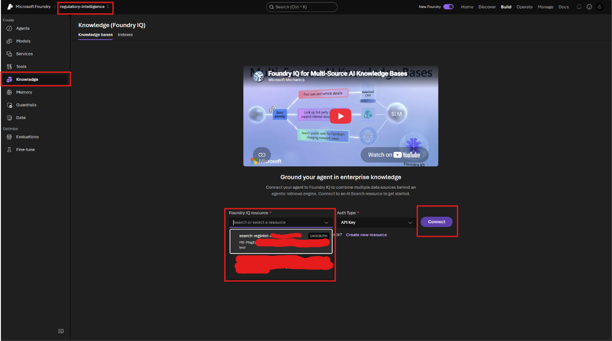

   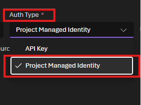

4. The **Knowledge bases** tab now shows your search service under **Connection**. Select **Create a knowledge base**.

   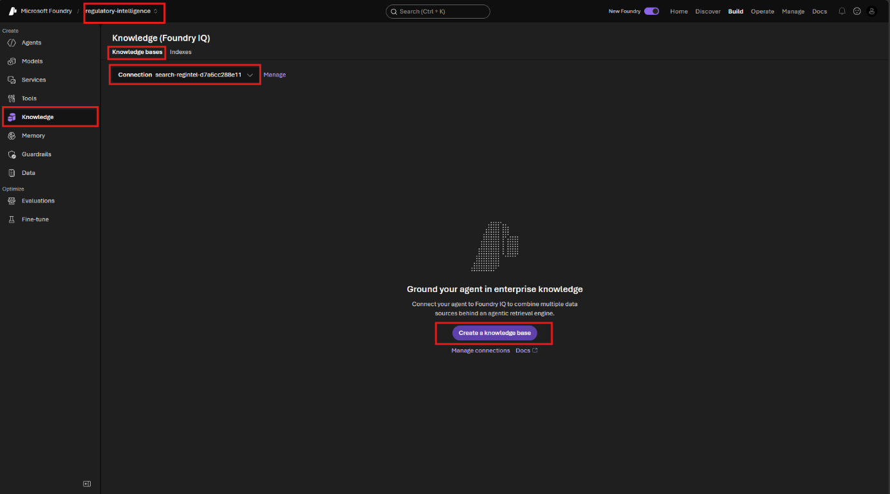

5. Fill in the basic configuration:
   - **Name:** `caldova-regulatory-kb`; **Description:** for example *Caldova regulatory lake*.
   - **Chat completions model:** your `ModelDeploymentName` (`gpt-5.4-mini`).
   - **Retrieval reasoning effort:** **Minimal**.
   - **Output mode:** **Extractive data**, so the knowledge base returns the raw passages and your agents do the reasoning.
   - Leave **Retrieval instructions** empty.

   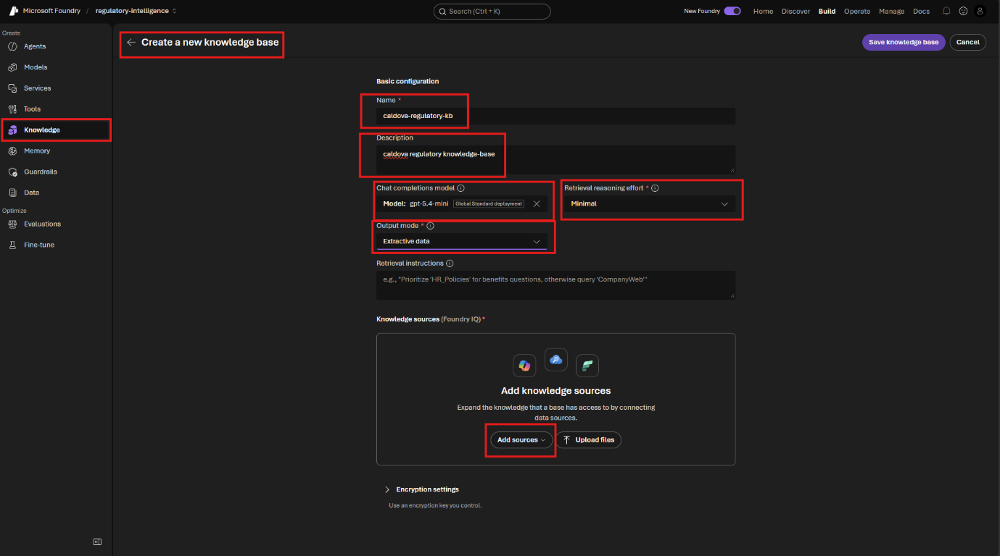

6. Under **Knowledge sources**, select **Add sources** and choose **Azure Blob Storage**. In **Create a knowledge source**, on the **General** tab:

   | Field | Value |
   |---|---|
   | Name | `caldova-lake` (replace the generated name) |
   | Description | *Caldova regulatory lake: monitored regulator and payer documents with paragraph citations, Caldova's internal records, change log and task register.* Agents read this to decide when to use the source. |
   | Storage account | `StorageAccountName` |
   | Container name | **`regulatory-knowledge`** (not `lake-raw`) |
   | Authentication type | **System assigned identity** (not *API Key*: the storage account accepts no keys; the search service's identity already has read access) |
   | Content extraction mode | **Minimal** (the lake is plain text) |
   | Embedding model | `EmbeddingDeploymentName` (`text-embedding-3-small`) |
   | Chat completions model | leave empty |

   Leave the **Advanced** tab as it is and select **Create**.

   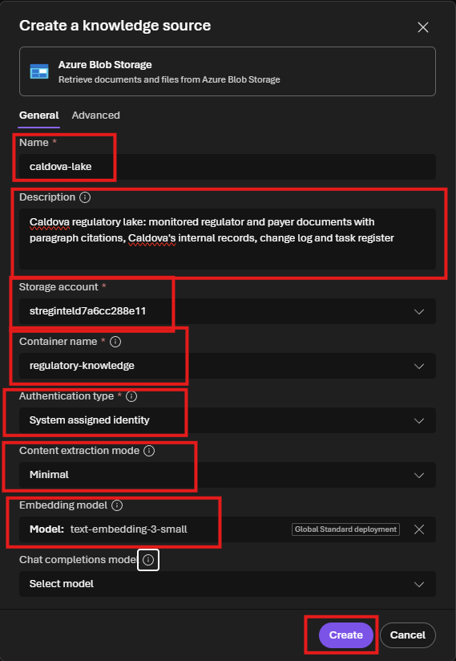

   The source appears under **Knowledge sources** with status **Creating**.

   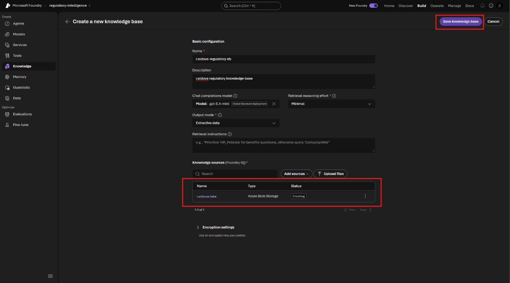
7. Select **Save knowledge base**. Within a few minutes the status of `caldova-lake` changes from **Creating** to **Active**: the lake is indexed and your agents can search it. The **Use in an agent** button is how you will attach it in Challenge 2.

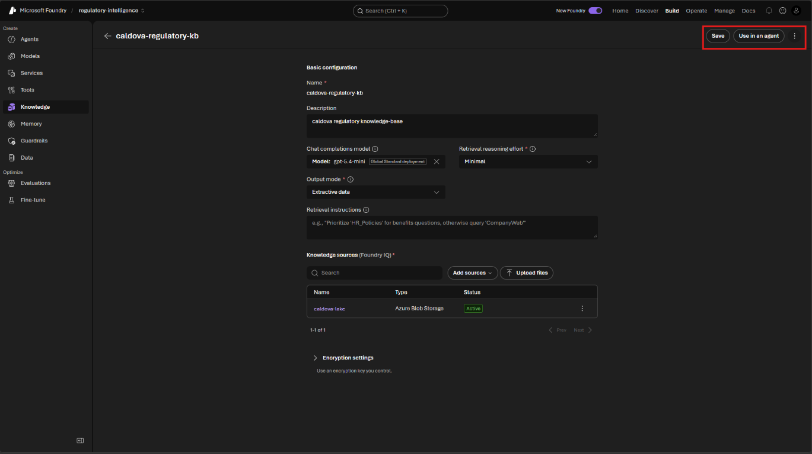

### Part E: Discuss (5 min)

Which steps of the monitor would you **never** hand to a language model, and why?

## ✔️ Success criteria

- [ ] The Monday monitor run reports **9 new documents** and **1 duplicate**.
- [ ] You can show the change log, one normalised document with its paragraph labels, and a change event in the lake.
- [ ] `caldova-regulatory-kb` exists, uses the `regulatory-knowledge` container, and its source `caldova-lake` is **Active**.
- [ ] You can explain why crawling, de-duplication and versioning are done in code.

## 📚 Learning resources

- [What is Foundry IQ?](https://learn.microsoft.com/azure/foundry/agents/concepts/what-is-foundry-iq)
- [Agentic retrieval in Azure AI Search](https://learn.microsoft.com/azure/search/agentic-retrieval-overview)
- [Azure Cloud Shell](https://learn.microsoft.com/azure/cloud-shell/overview)

[Coach solution and troubleshooting](../walkthrough/challenge-01/solution-01.md)
