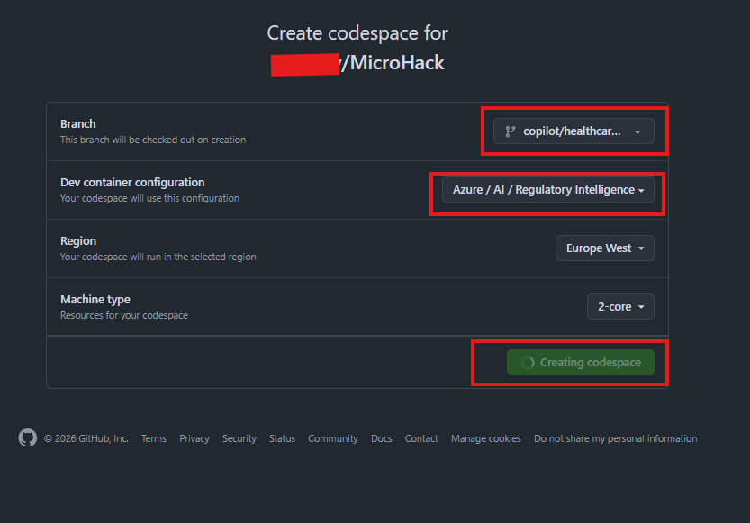
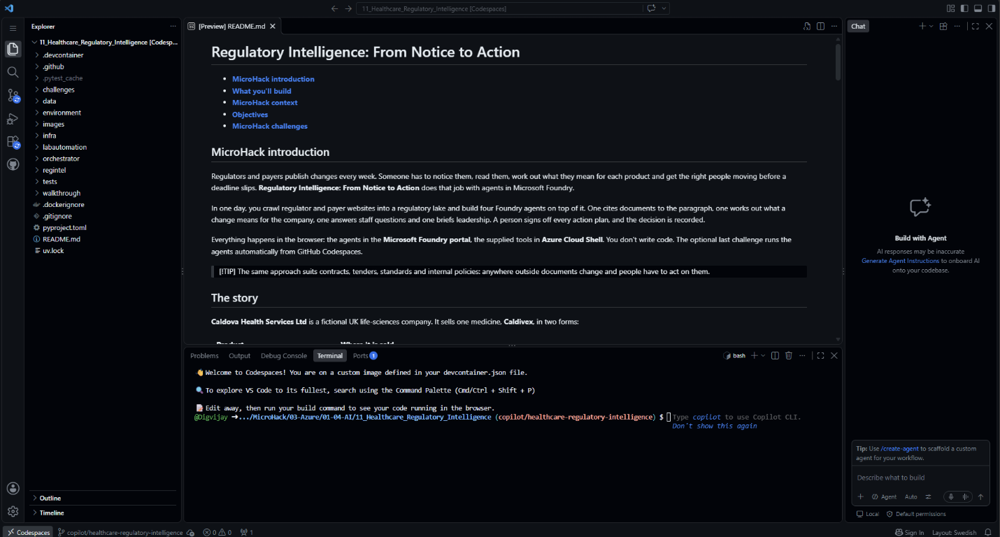
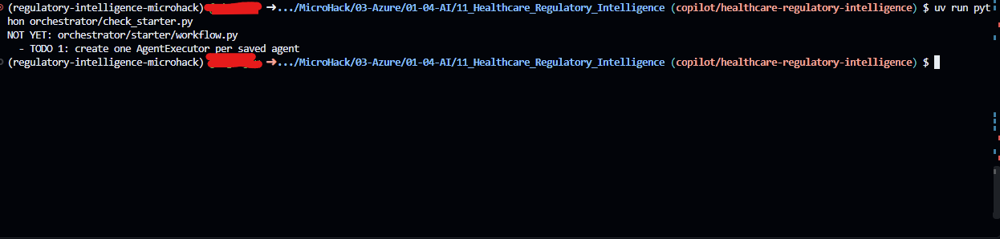
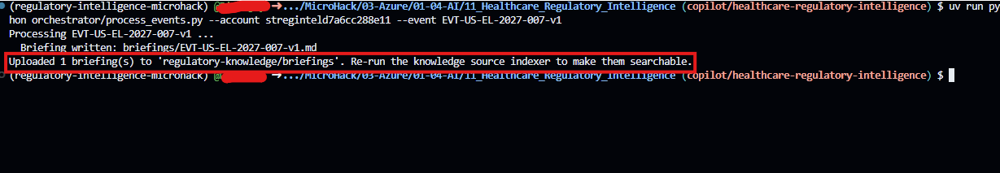
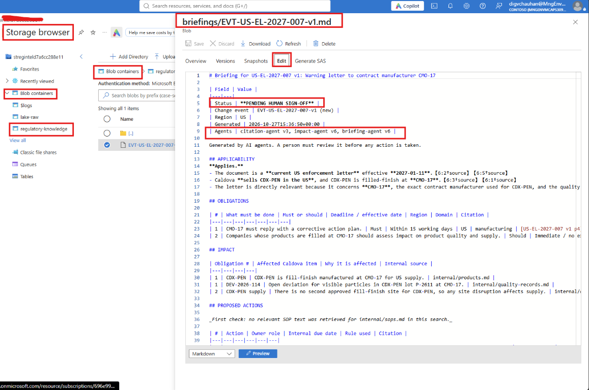

# Challenge 6 ⭐: Event-driven Regulatory Intelligence Assistant (stretch)

**[← Previous](challenge-05.md)** - [Home](../README.md) - [Finish →](finish.md)

## 🎯 Objective

Stop copying document IDs into chats. Run the **Regulatory Intelligence Assistant**: a small program that picks up every **change event** written by the monitor and runs your saved agents in order, **citation → impact → briefing**. It stores each result in the lake as a briefing **pending human sign-off**.

## 🧭 Context

In Challenges 2–5 you passed each change from agent to agent yourself. In production that hand-off is automated and **event-driven**: the monitor raises an event, and agents work on it in turn until a person has to decide.

```text
monitor ──► lake-raw/events/EVT-….json ──► citation-agent ──► impact-agent ──► briefing-agent
                                                                                 │
                         regulatory-knowledge/briefings/EVT-….md  ◄──────────────┘
                         (PENDING HUMAN SIGN-OFF) ──► you ──► regintel signoff ──► audit trail
```

The assistant uses the **Microsoft Agent Framework** to call the agents you saved in Foundry, so if you improve an agent's instructions, the assistant uses the improved version. It never approves anything: sign-off stays exactly as in Challenge 5.

### Choose your path

| | 🚀 Shortcut | 🛠️ Write it |
|---|---|---|
| What you do | Run the finished assistant, then read its code with a guided tour | Fill in three TODOs that build the agent chain, check them, then run your version |
| Time | about 30 min | about 50 min |
| Coding | none | about 10 lines of Python |
| You end up with | The same briefings in the lake | The same briefings in the lake |

Both paths share Parts A, B and D. Only Part C differs.

## ✅ Tasks

### Part A: Open the lab in GitHub Codespaces (10 min)

1. On GitHub, open the repository that your facilitator names (`microsoft/MicroHack` or a fork), then select **Code → Codespaces → … → New with options**.
2. Under **Dev container configuration**, choose **Azure / AI / Regulatory Intelligence**, then **Create codespace**. If the terminal greets you with *You are on our default image*, you picked the wrong configuration: delete that codespace and create a new one with this option.

   

3. Wait until the setup finishes (5–10 minutes the first time). It builds the lab's container, installs the pinned Python packages and runs every lab test. The terminal opens in the lab folder and says *You are on a custom image defined in your devcontainer.json file*.

   

4. Check that everything works. Run this in the terminal; it should end with a line such as **`48 passed`** and no failures:

   ```bash
   uv run --frozen --all-extras pytest -q
   ```

   Prefer your own machine? Use the lab's [devcontainer](../environment/README.md) in VS Code; the experience is identical.

### Part B: Connect to your lab (5 min)

In the Codespace terminal (it opens in the lab folder):

```bash
az login --use-device-code
az account set --subscription "<lab subscription>"
cp orchestrator/.env.example orchestrator/.env
```

Open `orchestrator/.env` and set `FOUNDRY_PROJECT_ENDPOINT` to the value from your dashboard. Leave the versions empty to use the latest saved version of each agent.

### Part C, 🚀 Shortcut: run it, then read it (10 min)

1. Run the finished assistant on one event, the warning letter:

   ```bash
   uv run python orchestrator/process_events.py --account <StorageAccountName> --event EVT-US-EL-2027-007-v1
   ```

2. While it runs (two to three minutes: three agents, two of them on medium reasoning), take the code tour. Open each file in the Codespace editor and find the function:

   | Stop | File and function | What to notice |
   |---|---|---|
   | 1 | `orchestrator/process_events.py` → `pending_events()` | Reads the change events from the lake and skips any that already have a briefing. That is why the assistant can run on a schedule. |
   | 2 | `orchestrator/process_events.py` → `prompt_for()` | The whole event becomes the first message. The agents get the document ID and version, nothing else. |
   | 3 | `orchestrator/workflow.py` → `resolve_versions()` | Looks up the **latest saved version** of each agent in Foundry, so your portal changes are used automatically. |
   | 4 | `orchestrator/workflow.py` → `build_workflow()` | The heart of it. Step 1 wraps each saved agent in an `AgentExecutor`; Step 2 says where the chain starts and which agent's answer is the result; Step 3 connects them. `handover(role)` gives each agent only the previous agent's answer, phrased as the request it was built for (*Assess this change for Caldova*, *Prepare the action plan for sign-off*). |
   | 5 | `orchestrator/process_events.py` → `write_briefing()` | Writes the answer with the status **PENDING HUMAN SIGN-OFF** and the agent versions used. Nothing here approves anything. |

### Part C, 🛠️ Write it: build the chain yourself (30 min)

1. Open `orchestrator/starter/workflow.py`. `resolve_versions()` is done for you. `build_workflow()` has three TODOs, each with a hint.
2. Check your work at any time. The check runs offline, with no Azure calls and no cost:

   ```bash
   uv run python orchestrator/check_starter.py
   ```

   It tells you which TODO to do next, and what is wrong if the chain is built incorrectly. Keep going until you see:

   ```text
   PASS: orchestrator/starter/workflow.py chains citation -> impact -> briefing correctly.
   ```

3. Run **your** version on the warning letter:

   ```bash
   uv run python orchestrator/process_events.py --starter --account <StorageAccountName> --event EVT-US-EL-2027-007-v1
   ```

   With `--starter`, the program refuses to run until your chain passes the check.

Stuck for more than 10 minutes? Compare with `orchestrator/workflow.py`, which is the finished version, or switch to the shortcut.



### Part D: Process the rest and follow one through (15 min)

1. Process the remaining events, up to three at a time. Add `--starter` if you wrote your own chain:

   ```bash
   uv run python orchestrator/process_events.py --account <StorageAccountName> --limit 3
   ```

   Run it again: events that already have a briefing are skipped.
2. In the Azure portal, open `regulatory-knowledge/briefings/`. Each file names its change event, the agent versions used and the status **PENDING HUMAN SIGN-OFF**.
3. In Foundry, open **Traces** for `briefing-agent` and select one run. What did it receive from `impact-agent`?
4. Discuss: what should trigger the assistant in production (a schedule, a storage event or a queue), and where would you publish it for staff?





## ✔️ Success criteria

- [ ] The Codespace or devcontainer finished setup with all tests passing.
- [ ] **Shortcut:** you can explain the five stops of the code tour. **Write it:** `check_starter.py` prints PASS.
- [ ] Briefings were written to the lake, each pending sign-off and naming the agent versions used.
- [ ] Re-running the assistant skips events that are already processed.
- [ ] You followed one event from `impact-agent` to `briefing-agent` in Traces.

## Going further

- Sign off one of the new briefings with `python3 -m regintel signoff`, as in Challenge 5.
- To host the same assistant in Foundry and chat with it there, see the [orchestrator guide](../orchestrator/README.md). This is facilitator-led and needs extra permissions.

[Coach solution and expected answers](../walkthrough/challenge-06/solution-06.md)
