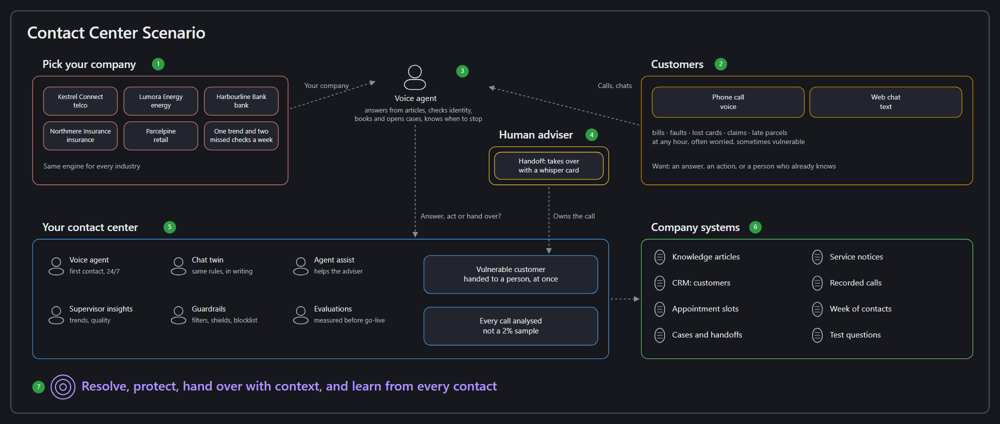
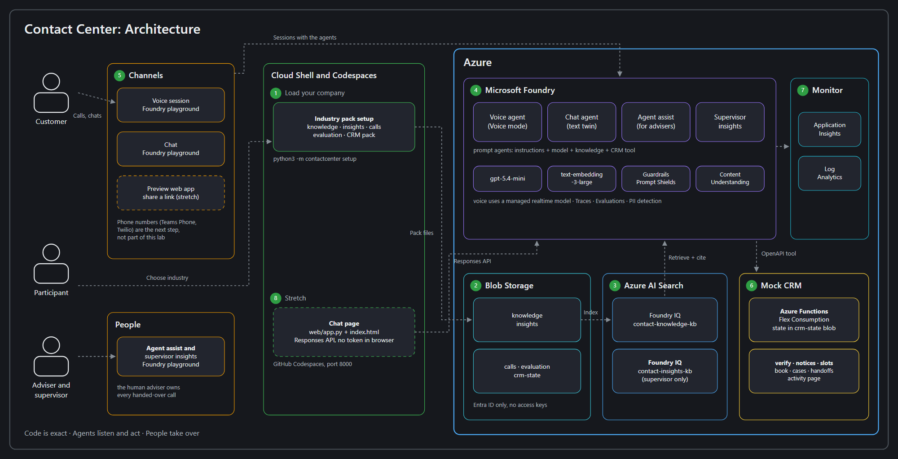

# Contact Center Agents: Voice-First Customer Service with Microsoft Foundry

- [**MicroHack introduction**](#microhack-introduction)
- [**What you'll build**](#what-youll-build)
- [**MicroHack context**](#microhack-context)
- [**Objectives**](#objectives)
- [**MicroHack challenges**](#microhack-challenges)
- [**Contributors**](#contributors)

## MicroHack introduction

Customers call when something matters to them: a bill they don't understand, a service that has stopped, a card they've lost. They want a fast answer, the right action and, when it gets difficult, a person who already knows the story. **Contact Center Agents** builds that experience with agents in Microsoft Foundry.

In one day you build a **voice agent** that answers from your company's knowledge articles, checks who it is talking to and takes real actions in a CRM. You add guardrails, hand difficult calls to a human with a summary, give that human an **agent-assist** copilot, analyse recorded calls and spot trends as a supervisor. Then you measure how good your agent really is.

Everything happens in the browser: the agents in the **Microsoft Foundry portal**, one setup command in **Azure Cloud Shell**. You don't write code. The optional last challenge publishes your agent to a web page, with a little code in GitHub Codespaces.

> [!TIP]
> You talk to your agent with your own voice, so bring a headset with a microphone, or use a quiet room.

## Pick your industry

The contact center works the same way in every industry, so **you choose the company you work for** in Challenge 1. Each industry pack has its own knowledge articles, customers, appointments, recorded calls and test questions:

| Pack | Company | What customers call about |
|---|---|---|
| `telco` | **Kestrel Connect** | Broadband outages, engineer visits, bills, moving home |
| `energy` | **Lumora Energy** | Estimated bills, smart meters, payment difficulties, power cuts |
| `bank` | **Harbourline Bank** | Lost cards, disputed payments, scams, mortgage appointments |
| `insurance` | **Northmere Insurance** | Storm damage, motor claims, assessor visits |
| `retail` | **Parcelpine** | Late deliveries, returns, damaged items |

Every company, customer, address and phone call is fictional. Postcodes use the unused `ZZ` area.

## What you'll build

| Challenge | Capability | Built with | What it produces |
|---|---|---|---|
| 1 | **Your company and its knowledge** | Supplied tool in Cloud Shell, Azure Blob Storage, **Foundry IQ** | Your industry pack loaded, and a knowledge base of articles your agents can cite |
| 2 | **Voice self-service agent** | Foundry **voice agent**, Foundry IQ | An agent you talk to that answers from the knowledge base, and a chat version of it |
| 3 | **Take action** | **OpenAPI tool** connected to the mock CRM | The agent checks who is calling, looks up the account, books appointments and opens cases |
| 4 | **Safety and compliance** | Foundry **guardrails**, instructions | Content filters, Prompt Shields and a blocklist; personal data handled safely; vulnerable customers recognised |
| 5 | **Handoff and agent assist** | OpenAPI tool, a second Foundry agent | Difficult calls go to a human with a summary, and the human gets suggested replies and the next best action |
| 6 | **Post-contact analytics and supervisor insights** | **Content Understanding**, Foundry IQ | Summary, sentiment, intent and a quality scorecard for each recorded call, and trends across a week of contacts |
| 7 | **Measure quality** | Foundry **evaluations** | Scores for task adherence, intent resolution and tool use on your industry's test questions, compared across two settings |
| 8 ⭐ *(stretch)* | **Publish** | Foundry publishing, a small web page in Codespaces | Your voice agent as a shareable web app, and the chat agent on your own page in GitHub Codespaces |

### What each Azure service does here

| Service | Its job in this hack |
|---|---|
| **Microsoft Foundry Agent Service** | Hosts your agents: the voice agent, its chat twin, the agent-assist copilot and the supervisor agent. You can inspect every model and tool call in **Traces**. |
| **Voice agents** in Foundry | Turn a prompt agent into a real-time spoken conversation with speech recognition, a realtime model and a natural voice. |
| **Foundry IQ** (on **Azure AI Search**) | Indexes the knowledge articles and returns the best passages, with their source, so agents answer from your company's content instead of from memory. |
| **Azure Functions** (Flex Consumption) | Runs the mock CRM that holds customers, appointment slots, cases and handoffs. Your agents call it through an **OpenAPI tool**. |
| **Content Understanding** | Turns a recorded call into a transcript, summary, sentiment, intent and your own quality fields. |
| **Azure Blob Storage** | Holds the knowledge articles, the supervisor's contact records, the recorded calls and the CRM's data. |

The editable sources are [readme-scenario.excalidraw](images/readme-scenario.excalidraw) and [readme-architecture.excalidraw](images/readme-architecture.excalidraw). Open them at <https://excalidraw.com> to change them.

Not everything is an AI job. **Checking identity, booking a slot and recording a case are ordinary code** in the CRM: they must give the same answer every time. **Listening, explaining and deciding what to do next are agent jobs.** And when a customer is vulnerable or asks for a person, **a human takes over**.

## MicroHack context

### The problem today

- Customers wait in queues for simple answers that are already in a knowledge article.
- Phone menus and scripts can't handle the way people actually talk.
- When a call is handed over, the customer has to explain everything again.
- Quality checks cover a tiny sample of calls, and trends are spotted weeks late.

### Why it matters

A good contact center agent resolves routine requests at any hour, takes real action instead of just answering, recognises when a person is needed and hands over without making the customer repeat themselves. Supervisors see every contact, not a sample. In the finish challenge you estimate what that could mean for your company.

## Objectives

By the end of the day you can:

- Build a Foundry **voice agent** and ground it in a **Foundry IQ** knowledge base with citations.
- Connect an agent to a business system with an **OpenAPI tool**, and make it check identity before acting.
- Protect an agent with **guardrails**, and design for **vulnerable customers** and personal data.
- Hand a conversation to a human with full context, and build an **agent-assist** copilot.
- Analyse recorded calls with **Content Understanding** and find trends as a supervisor.
- **Evaluate** an agent on a test set and compare settings with evidence.
- *(Stretch)* Publish an agent to the web.

## MicroHack challenges

### Prerequisites

- A modern browser (Edge or Chrome) with **microphone access**, signed in with the lab account from your facilitator. A headset is recommended.
- Access to the [Microsoft Foundry portal](https://ai.azure.com), the [Azure portal](https://portal.azure.com) and Azure Cloud Shell.
- Your **lab dashboard** values: `ResourceGroupName`, `FoundryProjectEndpoint`, `ModelDeploymentName`, `EmbeddingDeploymentName`, `AnalysisModelDeploymentName`, `StorageAccountName`, `SearchServiceName` and `CrmUrl`.
- No local software installation. For the stretch challenge, a GitHub account for Codespaces.

> [!NOTE]
> Your Foundry project, model deployments, storage account, Azure AI Search service and the mock CRM are deployed for you by the [lab automation](labautomation/README.md). You create everything else yourself.

### Challenges

| Challenge | Title | Duration |
|---|---|---|
| [Challenge 1](challenges/challenge-01.md) | Pick your company and build its knowledge base | 45 min |
| [Challenge 2](challenges/challenge-02.md) | Voice self-service agent | 45 min |
| [Challenge 3](challenges/challenge-03.md) | Take action with the CRM | 50 min |
| [Challenge 4](challenges/challenge-04.md) | Safety and compliance | 45 min |
| [Challenge 5](challenges/challenge-05.md) | Handoff and agent assist | 45 min |
| [Challenge 6](challenges/challenge-06.md) | Post-contact analytics and supervisor insights | 50 min |
| [Challenge 7](challenges/challenge-07.md) | Measure quality | 40 min |
| [Challenge 8 ⭐](challenges/challenge-08.md) | Publish your agent (stretch) | 30 to 45 min |
| [Finish](challenges/finish.md) | Estimate the impact and clean up | 15 min |

Solutions and expected results for coaches are in [walkthrough](walkthrough/).

## Contributors

| Name | Role |
|---|---|
| Digvijay Chauhan | Author & maintainer |

<!-- Add your name here when you contribute -->
