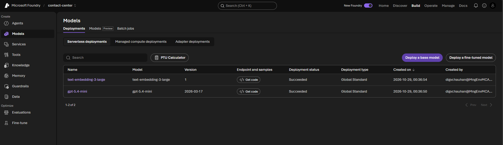
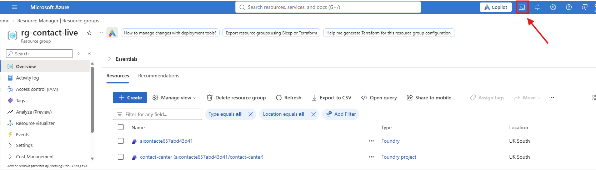
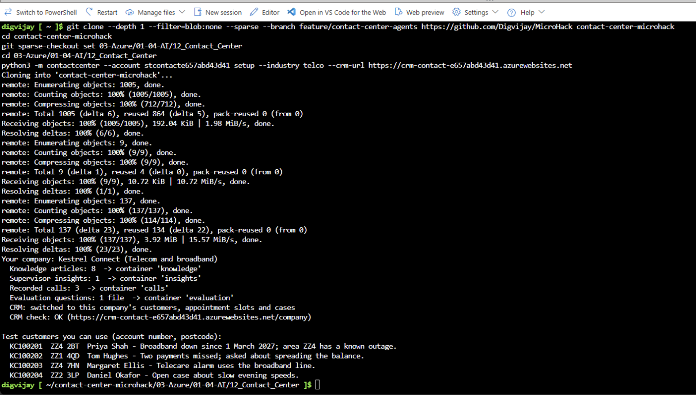
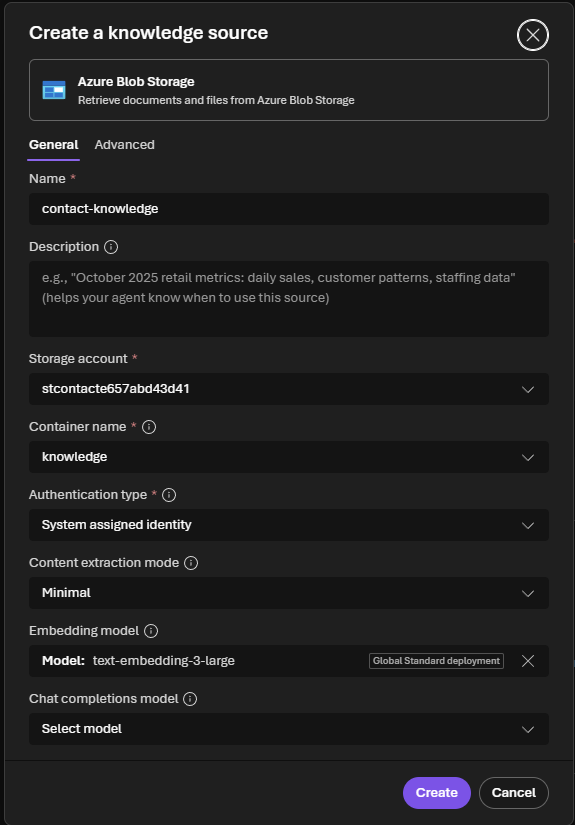
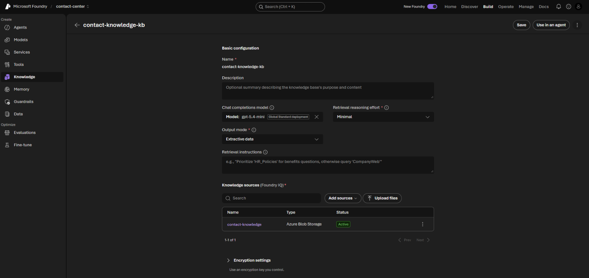

# Challenge 1: Pick your company and build its knowledge base

**[Home](../README.md)** - [Next Challenge →](challenge-02.md)

## 🎯 Objective

Choose the company your contact center works for, load its knowledge articles, recorded calls and customer records into your lab, and build a **Foundry IQ** knowledge base so your agents can answer from it with citations.

## 🧭 Context

A contact center agent is only as good as what it knows. Each company has its own **knowledge articles**: how bills work, what to do in an outage, how to check who is calling, when to hand over to a person. Your agents must answer from these articles, not from general knowledge, and say where an answer came from.

Your lab already has a **mock CRM** with the customers, appointment slots and cases of all five companies. The setup command tells it which company you chose.

## ✅ Tasks

### Part A: Check your Foundry project (5 min)

1. Open [ai.azure.com](https://ai.azure.com) and make sure the **New Foundry** toggle at the top right is on.
2. Select **your** project from the project picker next to *Microsoft Foundry* at the top left. Its name is the last part of `FoundryProjectEndpoint` on your lab dashboard (`contact-center`).
3. Select **Build**, then **Models** in the left menu. On the **Deployments** tab, check that the chat model (`ModelDeploymentName`, default `gpt-5.4-mini`) and the embedding model (`EmbeddingDeploymentName`, default `text-embedding-3-large`) show **Succeeded**.



### Part B: Choose your company (10 min)

1. With your team, pick one industry. The rest of the day works the same for every choice.

   | Industry | Company | Good if your team works in |
   |---|---|---|
   | `telco` | Kestrel Connect | Telecom, media, utilities with field engineers |
   | `energy` | Lumora Energy | Energy, water, regulated utilities |
   | `bank` | Harbourline Bank | Banking, payments, lending |
   | `insurance` | Northmere Insurance | Insurance, claims, financial services |
   | `retail` | Parcelpine | Retail, e-commerce, logistics |

2. In a private browser window, sign in to the [Azure portal](https://portal.azure.com) with your lab account. Select the **Cloud Shell** icon (`>_`) in the top bar and choose **Bash**. If you are asked about storage, choose the option without storage.

   

3. Copy only this lab from GitHub and move into it:

   ```bash
   git clone --depth 1 --filter=blob:none --sparse https://github.com/microsoft/MicroHack contact-center-microhack
   cd contact-center-microhack
   git sparse-checkout set 03-Azure/01-04-AI/12_Contact_Center
   cd 03-Azure/01-04-AI/12_Contact_Center
   ```

   If your facilitator gives you a fork or a branch, use that repository URL and add `--branch <name>` after `--sparse`.

4. Check that Cloud Shell uses your lab subscription: `az account show --query name -o tsv`. If not, run `az account set --subscription "<lab subscription>"`.
5. Load your company. Replace the values with your choice and the values from your dashboard:

   ```bash
   python3 -m contactcenter --account <StorageAccountName> setup --industry <telco|energy|bank|insurance|retail> --crm-url <CrmUrl>
   ```

   The command replaces the contents of three storage containers with your company's files and switches the CRM to your company. It ends with a few **test customers**: keep them, you will use them to test your agents.



> [!NOTE]
> Cloud Shell without storage starts empty every session. If it restarts, repeat step 3 to clone again. Your company's data is safe in your storage account.

### Part C: Look at your company (10 min)

1. Open your **CrmUrl** in a new browser tab. The CRM's home page shows your company and, later today, everything your agents do: appointments booked, cases opened and handoffs to people.
2. In the Azure portal, open your storage account (`StorageAccountName`), then **Storage browser**, then **Blob containers**:
   - `knowledge`: your company's eight knowledge articles. Open one: every paragraph has a label such as `[KB-KC-005 p2]`, so an answer can point to the exact paragraph.
   - `insights`: a week of analysed contacts, for the supervisor in Challenge 6.
   - `calls`: three recorded calls, for Challenge 6.
3. With your team, read two articles that customers will ask about: `KB-…-001` (checking who you are speaking to) and `KB-…-002` (vulnerable customers). Your agents must follow both.

### Part D: Build the Foundry IQ knowledge base (20 min)

1. In the Foundry portal, select **Build**, then **Knowledge** in the left menu.
2. Connect Foundry IQ to your search service. Under **Foundry IQ resource**, select your existing service (`SearchServiceName`, for example `search-contact-…`). Do not create a new one.
3. Set **Auth Type** to **Project Managed Identity**, then select **Connect**.
4. On the **Knowledge bases** tab, select **Create a knowledge base**, and fill in:
   - **Name:** `contact-knowledge-kb`; **Description:** for example *Customer service knowledge articles*.
   - **Chat completions model:** your `ModelDeploymentName`.
   - **Retrieval reasoning effort:** **Minimal**; **Output mode:** **Extractive data**.
5. Under **Knowledge sources**, select **Add sources**, then **Azure Blob Storage**, and fill in:

   | Field | Value |
   |---|---|
   | Name | `contact-knowledge` |
   | Description | *Customer service knowledge articles with paragraph labels: policies, processes, prices and service levels.* |
   | Storage account | `StorageAccountName` |
   | Container name | **`knowledge`** |
   | Authentication type | **System assigned identity** |
   | Content extraction mode | **Minimal** |
   | Embedding model | `EmbeddingDeploymentName` |
   | Chat completions model | leave empty |

   

   Select **Create**, then **Save knowledge base**. Within a few minutes the source changes from **Creating** to **Active**.



> [!IMPORTANT]
> Use only the `knowledge` container here. The `insights` container holds internal contact records for the supervisor; customers must never hear them. You will give the supervisor its own knowledge base in Challenge 6.

## ✔️ Success criteria

- [ ] Your team chose an industry, and the setup command printed your company, the CRM check and test customers.
- [ ] Your CRM home page shows your company's name.
- [ ] `contact-knowledge-kb` exists with the `contact-knowledge` source **Active**, built from the `knowledge` container only.
- [ ] You can explain why the supervisor's contact records are kept out of the customer-facing knowledge base.

## 📚 Learning resources

- [What is Foundry IQ?](https://learn.microsoft.com/azure/foundry/agents/concepts/what-is-foundry-iq)
- [Azure Cloud Shell](https://learn.microsoft.com/azure/cloud-shell/overview)

[Coach solution and troubleshooting](../walkthrough/challenge-01/solution-01.md)
