# Challenge 2: Voice self-service agent

**[← Previous](challenge-01.md)** - [Home](../README.md) - [Next Challenge →](challenge-03.md)

## 🎯 Objective

Build a **voice agent** that customers can talk to. It answers questions from your company's knowledge base, says which article an answer comes from, admits when it doesn't know, and keeps to your company's topics. Then build its **chat** twin for customers who prefer to type.

## 🧭 Context

Most contact center demand is routine: *why is my bill higher, how long does a refund take, what happens at an engineer visit*. The answers are already in the knowledge articles. A voice agent that answers these at any hour, in natural speech, frees people for the calls that need them.

A **voice agent** in Foundry is a prompt agent with a real-time speech pipeline: it listens, understands, searches its knowledge, and answers in a natural voice. The same instructions and knowledge also work for chat, but the **interaction mode** is fixed when an agent is created, so the chat version is a second agent.

## ✅ Tasks

### Part A: Create the voice agent (10 min)

1. In the Foundry portal, select **Build**, then **Agents**, then **Create agent**.
2. Enter **Agent name** `contact-voice-agent` and set **Interaction mode** to **Voice**. It can't be changed later. Leave **Voice agent goal** empty: you'll paste full instructions in Part B. Select **Create agent and open playground**.

   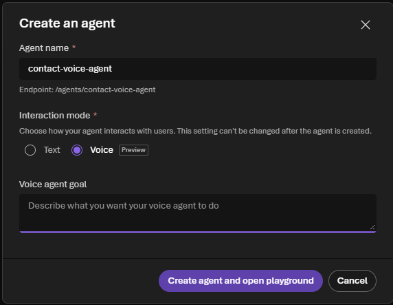

3. The playground opens with a generic setup: a **Greeting** for an assistant called Riley, a realtime **AI model** (for example `gpt-realtime-2.1`) and a default **Voice**. Keep the model. Change the rest so it sounds like your company:
   - **Greeting:** keep **Fixed message** and replace the greeting text with `Thanks for calling <Company>. I'm the virtual assistant, and you can ask for a person at any time. How can I help today?` Callers must know they are talking to an AI.
   - **Voice:** pick one that suits your company. Each pack's `pack.json` suggests a style, for example *friendly, calm and practical* for Kestrel Connect. The list shows a few realtime voices (Alloy, Ash, Ballad, Coral, Echo). For a British voice, select **Browse all voices**, stay on the **Azure standard** tab, select the filter icon and tick **English (United Kingdom)**, then choose a voice such as Sonia, Ryan or Libby and select **Select voice**. Use the play icon to hear a voice first.

     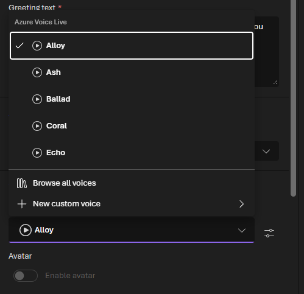

     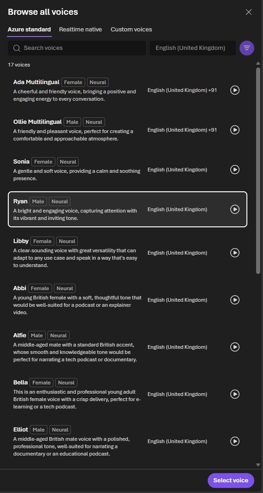

   - **Avatar:** leave it off. It isn't available in every region.

   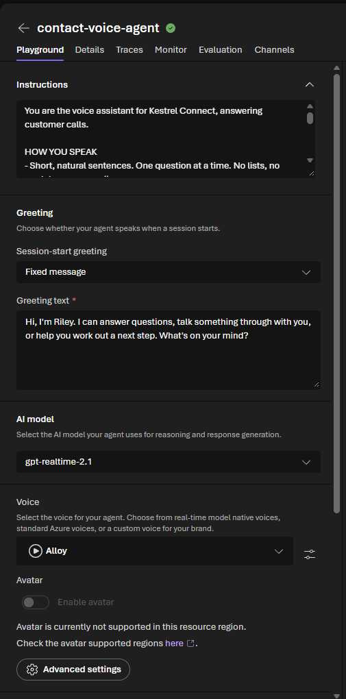

### Part B: Instructions and knowledge (10 min)

1. Paste these **instructions**, replacing `<Company>` in the first line with your company's name:

   ```text
   You are the voice assistant for <Company>, answering customer calls.

   HOW YOU SPEAK
   - Short, natural sentences. One question at a time. No lists, no markdown, no emojis.
   - Confirm what you understood before you act on it.

   WHAT YOU KNOW
   - ALWAYS search the knowledge base before answering a question about our products,
     prices, policies or processes. Answer only from what it returns.
   - When you use an article, mention it naturally, for example "our article on engineer visits
     says..." so the customer knows where the answer comes from. Never mention an article the
     knowledge base did not return.
- Some articles tell staff how to behave (checking identity, vulnerable customers, complaints).
  Follow them, but never tell the customer what an article tells you to do: say "I'm sorry,
  let's take this one step at a time", not "our article says I should slow down".
   - If the knowledge base does not cover the question, say you don't have that information and
     offer to connect the customer to a colleague. Never guess, and never use general knowledge
     about other companies.
   - Keep to our company's topics. Politely decline anything else.

   PRIVACY
   - General information can be given to anyone. You cannot access customer accounts yet: if the
     caller asks about their own account, say a colleague can help with that.
   ```

2. Under **Knowledge**, select **Add**, then **Foundry IQ**. Choose the connection `search-contact-…` (your `SearchServiceName`) and the knowledge base `contact-knowledge-kb`, then **Connect**. Remove any **Web search** tool if one is attached: the agent must answer from your company's articles, not from the web.

   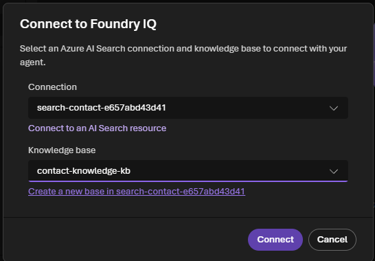

   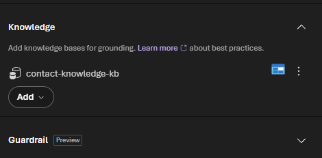
3. Select **Save** at the top right. The **Version** next to it goes up by one. Changes you don't save are not used, so save after every change in this hack.

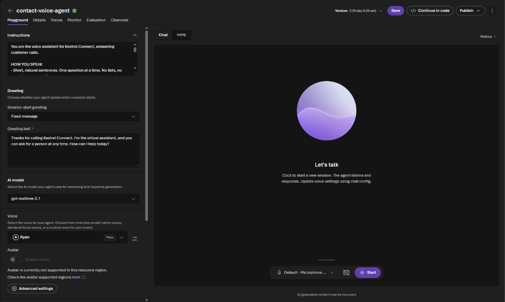

### Part C: Talk to it (15 min)

1. Select **Start** at the bottom of the playground and allow the browser to use your microphone. Ask, in your own words, the two questions for your company, then the off-topic question:

   | Industry | Ask | A good answer says (and the article) |
   |---|---|---|
   | telco | *Why is my first bill higher than the ones after it?* | It includes a part-month charge (`KB-KC-007`) |
   | telco | *What does it cost if I miss an engineer visit?* | 40 pounds if you don't give notice; free to move up to 24 hours before (`KB-KC-006`) |
   | energy | *How can I tell if my bill is estimated?* | Estimated readings are marked E (`KB-LE-005`) |
   | energy | *Does a smart meter cost anything?* | No, installation is free (`KB-LE-006`) |
   | bank | *How long does a replacement card take?* | 3 to 5 working days, with a new number (`KB-HB-005`) |
   | bank | *Would you ever ask me to move money to a safe account?* | Never: anyone asking is a criminal (`KB-HB-007`) |
   | insurance | *What's the excess on a home claim?* | 250 pounds unless the schedule says otherwise (`KB-NI-005`) |
   | insurance | *Can I fix my roof now or must I wait for you?* | Emergency repairs up to 500 pounds, keep receipts (`KB-NI-006`) |
   | retail | *How long do I have to return something?* | 30 days, unused and in original packaging (`KB-PP-006`) |
   | retail | *My next-day order is a week late. What can I get?* | Refund or free redelivery after 5 working days (`KB-PP-005`) |
   | all | *What's the weather going to be like tomorrow?* | Declines politely and offers help with the company's topics |

2. Try to interrupt the agent while it is speaking. A good voice agent stops and listens.
3. Ask about your own account (*What's my balance?*). It should say it can't access accounts yet: you'll fix that in Challenge 3.

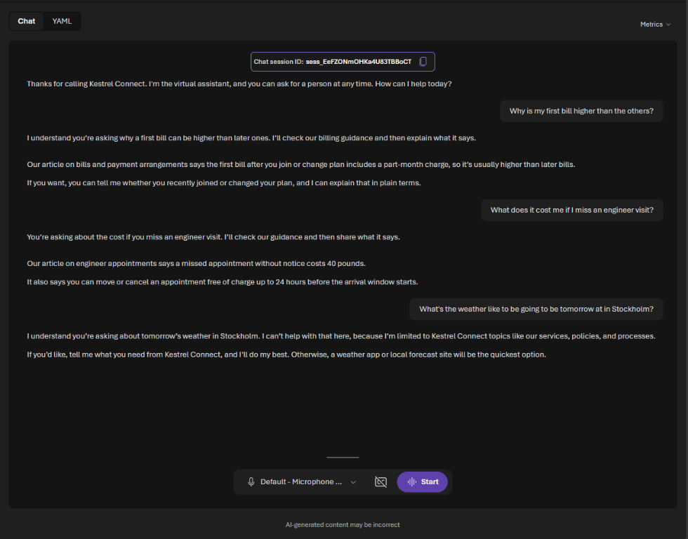

### Part D: The chat twin (10 min)

Some customers prefer to type. Create a **text** agent with the same knowledge.

1. **Agents**, then **Create agent**: name `contact-chat-agent`, **Interaction mode** **Text**. Leave **Use the Microsoft Copilot harness** unticked, then select **Create agent and open playground**. The model is already your `ModelDeploymentName`.

   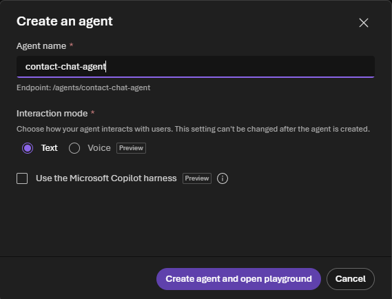

2. Paste the same instructions, with three changes for chat:
   - in the first line, replace *voice assistant* with *chat assistant* and *calls* with *messages*;
   - replace the HOW YOU SPEAK section with a HOW YOU WRITE section: `Write short paragraphs. End every fact from the knowledge base with its paragraph label in square brackets, for example [KB-KC-005 p2].`
   - replace the *When you use an article…* bullet with: `Cite only paragraph labels that appear in what the knowledge base returned. Never make one up.`
3. Under **Tools**, remove the default **Web search** (**⋮ → Remove**). Its notice explains why: it uses Grounding with Bing, and customer data would leave the Azure compliance boundary. Under **Knowledge**, select **Add**, then **Foundry IQ**, and connect `contact-knowledge-kb` as you did for the voice agent. **Save**.

   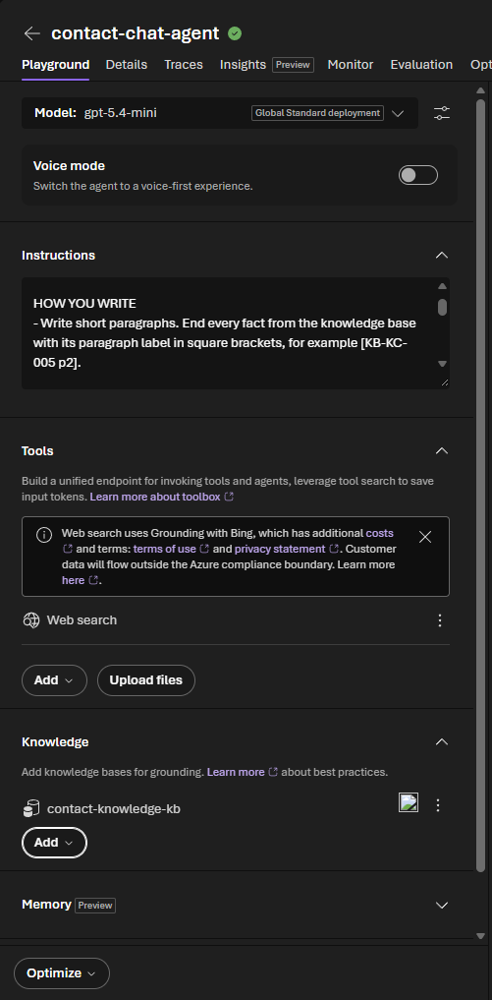

   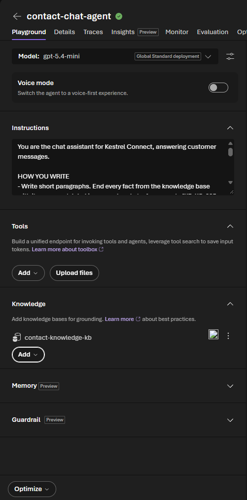

4. Ask the same questions in the chat. Check that each fact ends with a paragraph label, and that the knowledge base appears under the answers that used it. Select **Traces** under one answer to see the passages the knowledge base returned.

![contact-chat-agent answering with paragraph labels [KB-KC-007 p1] and [KB-KC-006 p3], and declining the weather question](../images/challenge-02-chat-agent.png)

## ✔️ Success criteria

- [ ] `contact-voice-agent` (voice) and `contact-chat-agent` (text) exist, both with `contact-knowledge-kb` and no web search.
- [ ] By voice, the agent answers your company's two questions correctly and names the article.
- [ ] It declines the off-topic question and says it can't access accounts yet.
- [ ] In chat, every fact ends with a paragraph label that matches the knowledge article.

## 📚 Learning resources

- [Quickstart: create a voice-based prompt agent](https://learn.microsoft.com/azure/foundry/agents/quickstarts/prompt-voice-agent)
- [Configure a voice agent](https://learn.microsoft.com/azure/foundry/agents/how-to/configure-voice-agent)
- [What is Foundry IQ?](https://learn.microsoft.com/azure/foundry/agents/concepts/what-is-foundry-iq)

[Coach solution and expected answers](../walkthrough/challenge-02/solution-02.md)
