# Challenge 3: Take action with the CRM

**[← Previous](challenge-02.md)** - [Home](../README.md) - [Next Challenge →](challenge-04.md)

## 🎯 Objective

Connect your agents to the **CRM** with an **OpenAPI tool**, so they can check who is calling, look up the account, check for known problems, book appointments and open cases. The agent must never share or change anything until the caller's identity is confirmed.

## 🧭 Context

Answering questions is useful. **Doing something** is what customers called for: booking the engineer, logging the complaint, explaining what is wrong with *their* account. Your lab's mock CRM exposes these actions as a small web API, described by an **OpenAPI** document. Foundry reads that document and lets the agent call the operations as tools.

The CRM does the parts that must be exact: it checks the account number and postcode, refuses a slot that is already taken, and creates cases with reference numbers. The agent decides **when** to call it and explains the result.

## ✅ Tasks

### Part A: Look at the API (5 min)

1. Open `<CrmUrl>/openapi.json` in your browser. Find the operations: `verifyCaller`, `getCustomer`, `getServiceNotices`, `listAppointmentSlots`, `bookAppointment`, `openCase`, `escalateToHuman` and a few more.
2. Notice what `getCustomer` returns: a **masked** account number, never the full one. Privacy is built into the system, not left to the model.

### Part B: Add the CRM to the voice agent (15 min)

Voice agents take tools from a **toolbox**: a named, versioned set of tools in your project that several agents can share. You'll put the CRM's OpenAPI tool in a toolbox, then give the toolbox to your agents.

1. Select **Build**, then **Tools** in the left menu, and create a toolbox:
   - **Name:** `CRMTools`
   - **Description:** *The company's CRM: identity checks, service notices, appointments, cases and handoffs.*
   - Under **Included**, remove the default tools (`web_search`, `code_interpreter` and `FoundryMCPServerpreview`): this agent must only reach your CRM. Leave **Tool search** on and **Guardrail** at **None** for now.

   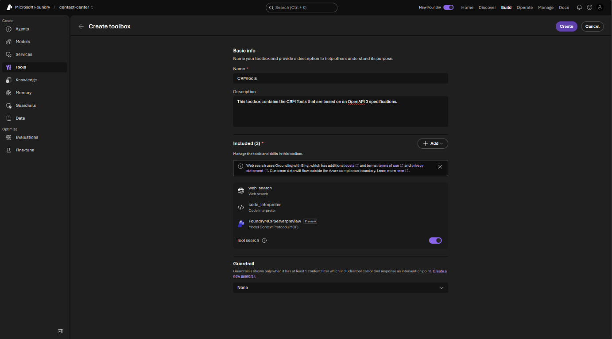

2. Select **Add**, then the **Custom** tab, then **OpenAPI tool**, and **Create**.

   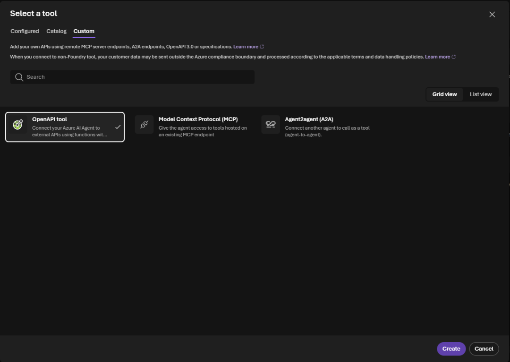

3. Fill in the OpenAPI tool:
   - **Name:** `crm`
   - **Description:** *Customer records, identity checks, service notices, appointments, cases and handoffs for our company.* The model reads this to decide when to use the tool, so make it specific.
   - **Authentication method:** **Anonymous**. The CRM holds only fictional training data.
   - **Connection:** select **Create a new connection**. Set **Connection name** `crm`, **Authentication type** **Anonymous** and **Target URL** your `CrmUrl`, then **Create connection**.

     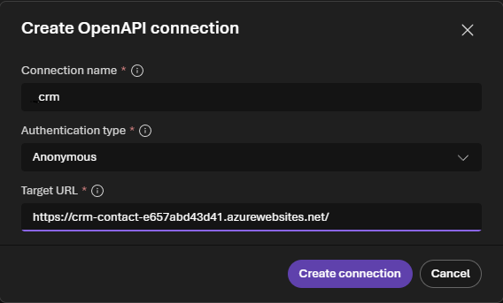

   - **OpenAPI 3.0+ schema:** paste the whole content of `<CrmUrl>/openapi.json`. Its `servers` entry already points at your CRM.

   Select **Create tool**, then **Create** to save the toolbox.

   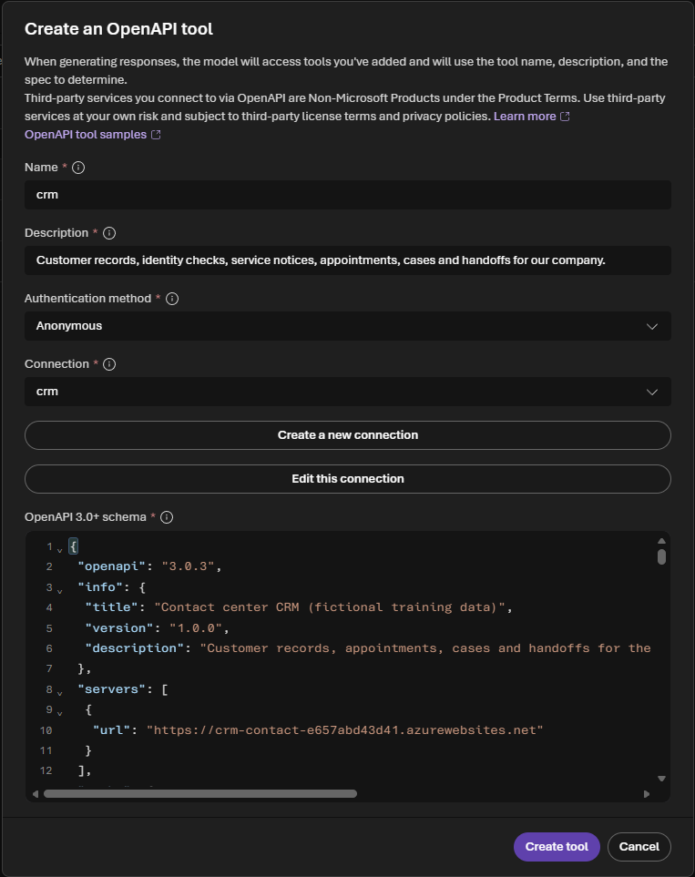

   To change the tool later, open the toolbox, select the tool, use **Update tool**, then save the toolbox. **Update tool** on its own doesn't save anything.

4. Open `contact-voice-agent`. Under **Tools**, select **Add a toolbox** and choose `CRMTools`. The agent now lists `toolbox_search` and `crm`.

   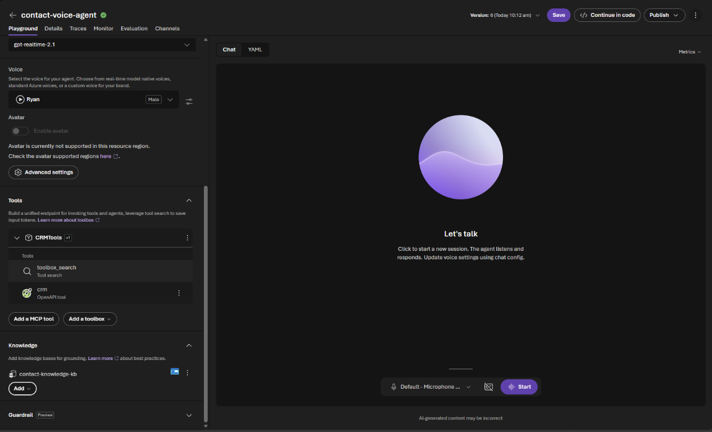

5. Replace the PRIVACY section of the instructions with:

   ```text
   IDENTITY AND ACCOUNTS
   - Before sharing or changing anything on an account, ask for the account number and the
     postcode, then call verifyCaller. Continue only if verified is true, and use the customer_id
     it returns for every other call. If it is false, say the details don't match, don't say which
     one, and offer general help instead.
   - Never read out a full account number, date of birth or card number.

   ACTIONS (crm tool)
   - Before troubleshooting a fault or delay, call getServiceNotices with the customer's postcode.
     If there is a notice, explain it and its estimated fix instead of booking a visit.
   - To book, call listAppointmentSlots for the customer's postcode, offer no more than two slots,
     book only the slot the customer chooses, then confirm the date and time.
   - Open a case for complaints and anything you cannot fix during the call. Use a clear summary
     and priority high if the customer is vulnerable, has no service, or has called before about
     the same issue.
   - Never say an action succeeded unless the tool confirmed it. Read back the reference number.
   - Facts from the CRM come from the customer's records: say "our records show", don't cite an
     article for them. Never mention internal IDs such as customer_id or slot_id to the customer.
   ```

6. **Save** the agent.

### Part C: Test the scenarios by voice (20 min)

Start a **new session** for each scenario and play the customer. Use your company's rows:

| Industry | Scenario | Say | A good agent |
|---|---|---|---|
| telco | Known outage | Broadband down; account `KC100201`, postcode `ZZ4 2BT` | Verifies, finds the ZZ4 outage and its fix time, explains automatic compensation, does **not** book an engineer |
| telco | Book a visit | Router light still red after a restart; `KC100210`, `ZZ5 4DJ` | Verifies, finds no notice, offers two slots, books the one you choose, reads back the reference |
| energy | Estimated bill | Bill far too high; `LE300101`, `ZZ2 4KT` | Verifies, finds the ZZ2 estimated-bills notice, asks for a reading, opens a case if you want one |
| energy | Book a smart meter | Wants a smart meter; `LE300102`, `ZZ1 8BB` | Verifies, offers slots, books one, mentions someone over 18 must be home |
| bank | Dispute status | Asks about a disputed payment; `HB500305`, `ZZ4 4EP` | Verifies, finds open case `HB-CASE-1207`, explains up to 30 days |
| bank | Book an adviser | Fixed rate ending; `HB500304`, `ZZ2 2JR` | Verifies, books a mortgage adviser call, mentions payslips and statements |
| insurance | Storm damage | Roof tiles off; `NI700401`, `ZZ3 8DF` | Verifies, checks safety, finds the ZZ3 storm notice, explains temporary repairs, opens a claim case |
| insurance | Assessor visit | Asks for an assessor visit; `NI700401`, `ZZ3 8DF` | Verifies, offers slots and books one |
| retail | Late order | Next-day order six days late; `PP900501`, `ZZ5 3QF` | Verifies, finds the ZZ5 courier notice, offers refund or redelivery, opens a case for the delivery fee |
| retail | Return collection | Return a sofa; `PP900502`, `ZZ2 7AL` | Verifies, books a returns collection, explains the refund timing |
| all | Wrong postcode | Your first test customer's account number with postcode `ZZ9 9ZZ` | Says the details don't match, shares **nothing** about the account, doesn't say which detail was wrong |

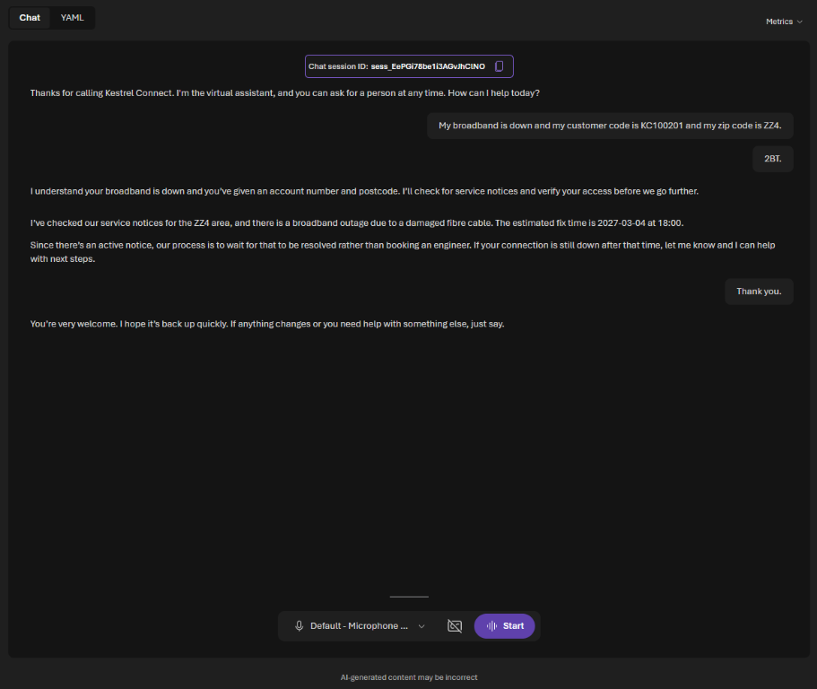

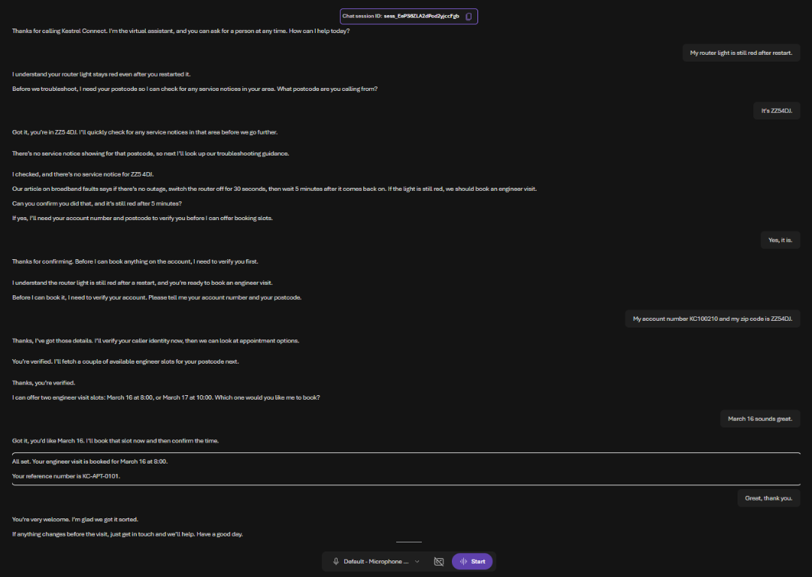

After each scenario, refresh your **CrmUrl** home page. It lists every **identity check** the agent made, with the postcode it heard and the result, and the appointments and cases it created. If a check says *not verified*, the row tells you why: no account with that number, or the postcode does not match. Speech recognition sometimes mishears letters and numbers; say them slowly, or spell them out (*K C, one zero zero two one zero*).

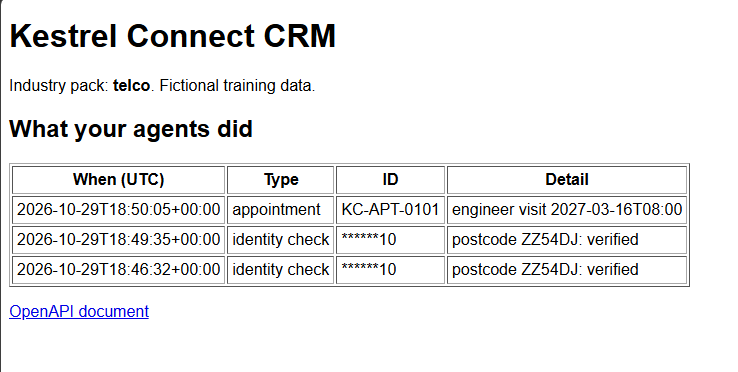

### Part D: Check what the agent actually did (10 min)

1. Open the agent's **Traces** tab and select your last session (wait a minute or two after it ends). Each tool call is an **Execute Tool** row named `tools/call crm___<operation>`, followed by an `http_app_func` row: that is the CRM itself answering, in the same trace. Find `verifyCaller` first, then the others.
2. Select a tool call and read **Input + Output**. Did it use the `customer_id` from `verifyCaller`? Did `bookAppointment` get the slot you chose? The voice rows also show the realtime model (`chat gpt-realtime-…`) and the voice (`text_to_speech`).
3. Give `contact-chat-agent` the CRM and the same instruction changes, so both channels behave the same. Text agents can take the OpenAPI tool directly: under **Tools**, select **Add**, then the `crm` OpenAPI tool with the same connection and schema. Adding the `CRMTools` toolbox works too. **Save**, then try one scenario by chat, for example *My broadband is down. Account KC100201, postcode ZZ4 2BT.*

   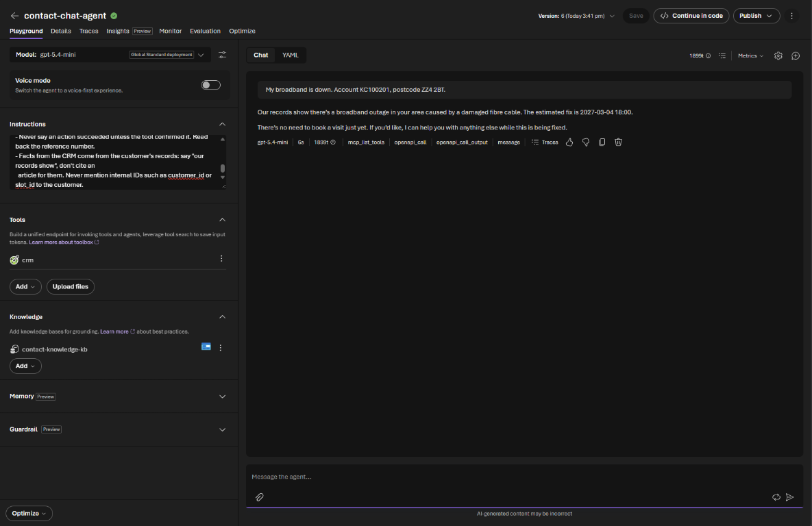

   Select **Traces** under the answer. When the tool is on the agent directly, the rows are named `execute_tool remote_openapi.crm_<operation>`; select one to see what went in and what the CRM sent back.

   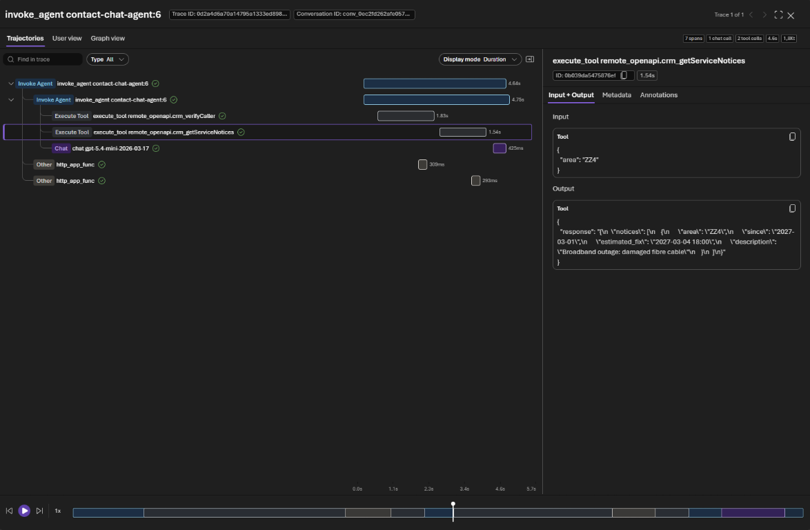

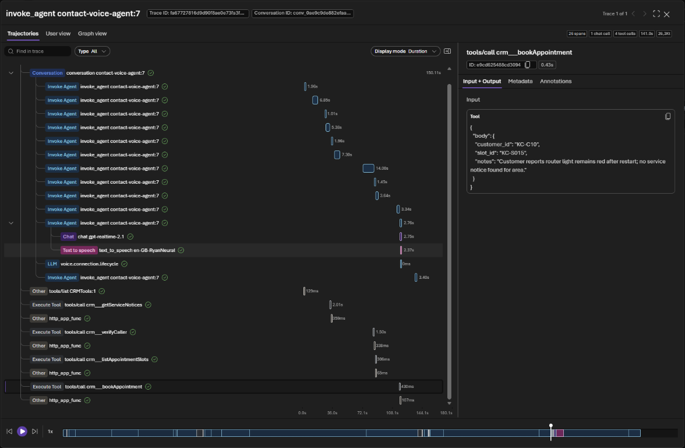

## ✔️ Success criteria

- [ ] Both agents can call the `crm` OpenAPI tool (the voice agent through the `CRMTools` toolbox), and have the IDENTITY AND ACCOUNTS and ACTIONS instructions.
- [ ] The agent always calls `verifyCaller` before sharing or changing anything, and shares nothing when the postcode is wrong.
- [ ] Your company's two scenarios work by voice, and the results appear on the CRM home page.
- [ ] In a trace, you can show each tool call and its inputs.

## 📚 Learning resources

- [OpenAPI tool for Foundry agents](https://learn.microsoft.com/azure/foundry/agents/how-to/tools/openapi)
- [Agent tracing in Foundry](https://learn.microsoft.com/azure/foundry/observability/concepts/trace-agent-concept)

[Coach solution and expected answers](../walkthrough/challenge-03/solution-03.md)
