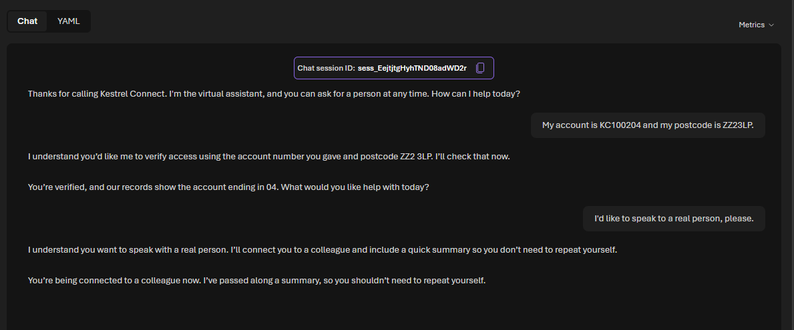
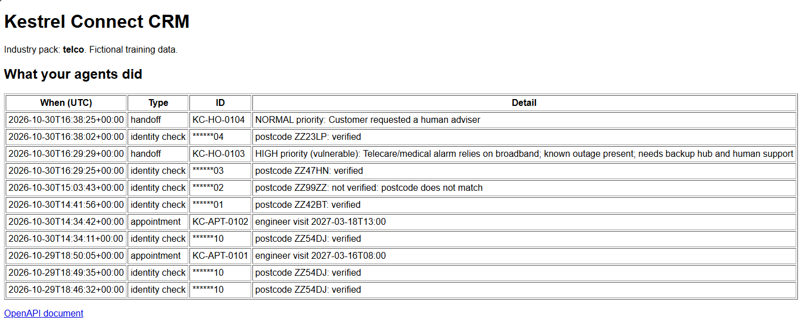
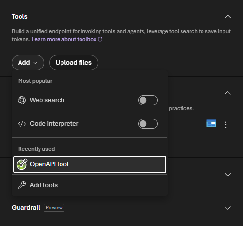
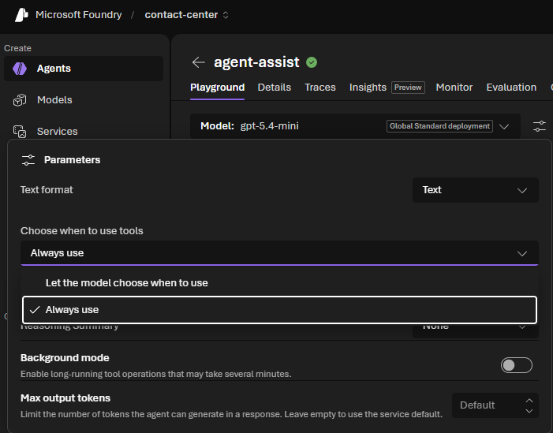
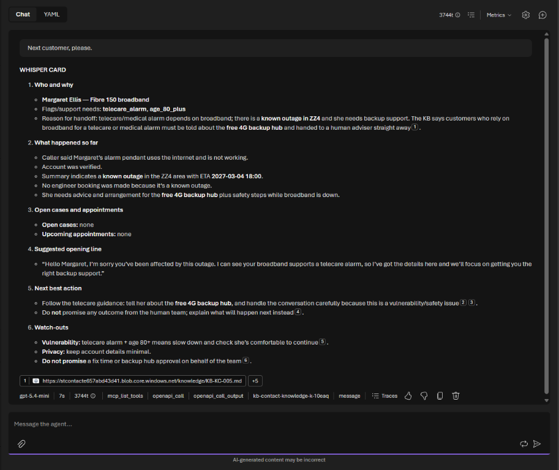
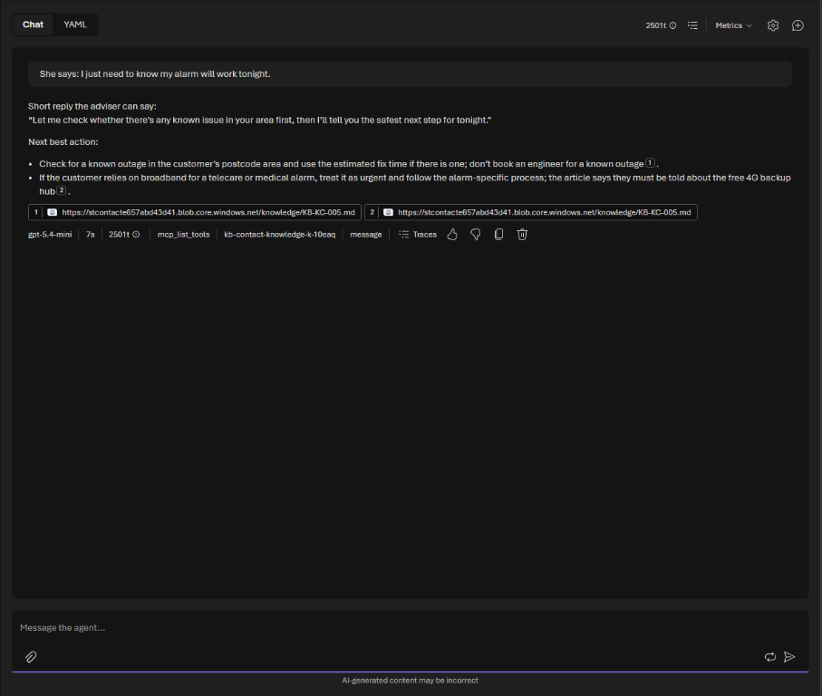
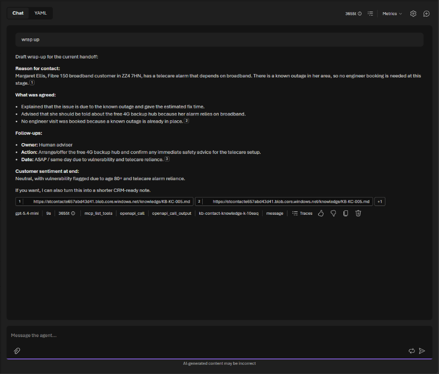

# Challenge 5: Handoff and agent assist

**[← Previous](challenge-04.md)** - [Home](../README.md) - [Next Challenge →](challenge-06.md)

## 🎯 Objective

Teach the voice agent **when** to hand a customer to a person and to pass on a summary, so the customer never has to repeat themselves. Then build **agent assist**: a copilot for the human adviser that briefs them on the customer, suggests what to say next, recommends the next best action from the knowledge articles, and writes the summary at the end.

## 🧭 Context

The worst moment in a contact center is the transfer: *"Can you tell me again what the problem is?"* A good handoff carries the context with it. In your lab, the voice agent calls the CRM's `escalateToHuman` operation with the reason, a summary, the customer's sentiment and whether they may be vulnerable. The handoff waits in a queue for a human adviser.

The adviser then works with **agent assist**, a second agent that reads the queue and the customer's record but **never changes anything**: the person decides, the copilot helps.

## ✅ Tasks

### Part A: Teach the voice agent to hand over (10 min)

Add this section to the instructions of `contact-voice-agent` (and `contact-chat-agent`) and **Save**:

```text
HANDOFF TO A PERSON
- Call escalateToHuman when the customer asks for a person, may be vulnerable (see the knowledge
  article on vulnerable customers), mentions a risk to their safety or health, has a complaint
  you cannot resolve, or needs a decision you cannot make.
- First tell the customer you are connecting them to a colleague. Then call escalateToHuman with:
  reason; a summary of what happened, what the customer needs and what you have already done
  (including any case or appointment reference); sentiment; vulnerability true or false; and
  priority high if vulnerable or without service.
- If the caller has not been verified and can give their account number and postcode quickly,
  check them first so your colleague has the account. Skip this if there is a risk to safety.
- Include customer_id only if the caller was verified.
- If the caller is verified after you have already handed over, call escalateToHuman again with
  their customer_id and a summary that starts "Update to earlier handoff:".
- Afterwards, tell the customer a colleague has the summary and they won't need to repeat it.
  Never promise what the colleague will decide.
```

### Part B: Test the handoff by voice (10 min)

1. Start a session and play your industry's **vulnerability scenario** from Challenge 4, giving your vulnerable test customer's details when asked:

   | Industry | Customer (account, postcode) |
   |---|---|
   | telco | `KC100203`, `ZZ4 7HN` (telecare alarm) |
   | energy | `LE300103`, `ZZ3 2PL` (oxygen equipment) |
   | bank | `HB500301`, `ZZ3 6LA` (parcel-fee scam) |
   | insurance | `NI700403`, `ZZ3 4JB` (ceiling leak, lives alone) |
   | retail | `PP900508`, `ZZ1 4TE` (low digital confidence) |

2. In a second session, verify as any test customer and then simply say *I'd like to speak to a real person, please.*
3. Refresh your **CrmUrl** home page: both handoffs are listed. The vulnerable one is **high** priority.





### Part C: Build agent assist (15 min)

1. Create an agent named `agent-assist` with **Interaction mode** **Text**.
2. Paste these instructions, replacing `<Company>`:

   ```text
   You are agent assist for <Company>'s human advisers. You help the adviser; you never talk to
   the customer and you never change anything in the CRM. The adviser decides. The adviser is the
   person the customer has been handed to, so never suggest handing the customer to a person.

   WHEN THE ADVISER ASKS FOR THE NEXT CUSTOMER
   - ALWAYS call listHandoffs from the crm tool first; never say you can't see the queue without
     calling it. Take the oldest high-priority handoff, otherwise the oldest one.
   - If it has a customer_id, call getCustomer for their account, open cases and appointments.
   - Reply with a WHISPER CARD:
     1. Who and why: name, product, any support needs (flags), and the reason for the handoff.
     2. What happened so far: from the handoff summary.
     3. Open cases and appointments, with references.
     4. Suggested opening line: warm, uses the customer's name, shows you already know their
        situation so they don't repeat it.
     5. Next best action: what the knowledge articles say to do, with the paragraph label.
     6. Watch-outs: vulnerability, privacy, anything not to promise.

   DURING THE CALL
   - When the adviser pastes what the customer just said, suggest one short reply the adviser can
     say, and the next best action, citing the paragraph label from the knowledge base.

   AT THE END
   - When the adviser says "wrap up", write an after-call summary: reason, what was agreed,
     follow-ups with owners and dates, and the customer's sentiment at the end.

   ALWAYS search the knowledge base before recommending an action. Never invent policies.
   ```

3. Under **Tools**, remove **Web search** (**⋮ → Remove**). Select **Add**, then **OpenAPI tool** (under *Recently used*, or **Add tools** then **Custom**), and fill it in as in Challenge 3: name `crm`, the same description, **Anonymous**, connection `crm` and the schema from `<CrmUrl>/openapi.json`. Select **Create tool**.

   

4. Under **Knowledge**, select **Add** and pick `contact-knowledge-kb` from the list. **Save**, and check the version number went up: a tool you added but didn't save is not used. Start a **new chat** after saving.
5. Select the parameters icon next to **Model** and set **Choose when to use tools** to **Always use**, then **Save**. Agent assist should never answer from memory: every reply must come from the CRM or the knowledge base. Don't do this for the customer agents; a greeting needs no tool.

   


### Part D: Be the human adviser (10 min)

In the `agent-assist` chat:

1. Ask *Next customer, please.* You should get a whisper card for the vulnerable customer from Part B, with their support needs, what the voice agent already did and a suggested opening line. Check that `openapi_call` appears under the answer. If only the knowledge base appears and the agent says it can't see the queue, it skipped the CRM: ask again in a new chat.
2. Paste something the customer might say next, for example *I just need to know my alarm will work tonight.* Check that the suggested reply is short and kind, and that the next best action cites an article.
3. Say *wrap up* and read the after-call summary. Would you be happy to store it on the customer's record?







## ✔️ Success criteria

- [ ] The voice agent hands over vulnerable customers and anyone who asks for a person, and both handoffs appear in the CRM.
- [ ] Each handoff summary is good enough that the customer would not have to repeat themselves.
- [ ] `agent-assist` produces a whisper card with the customer's needs, history, an opening line and a cited next best action.
- [ ] `agent-assist` suggests replies during the call and writes an after-call summary, without changing anything in the CRM.

## 📚 Learning resources

- [Foundry Agent Service overview](https://learn.microsoft.com/azure/foundry/agents/overview)
- [OpenAPI tool for Foundry agents](https://learn.microsoft.com/azure/foundry/agents/how-to/tools/openapi)

[Coach solution and expected answers](../walkthrough/challenge-05/solution-05.md)
