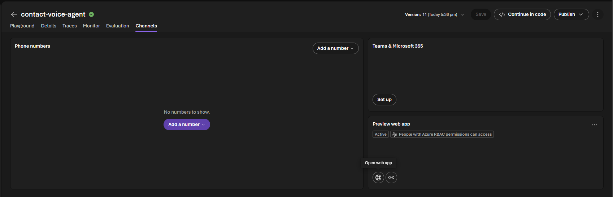
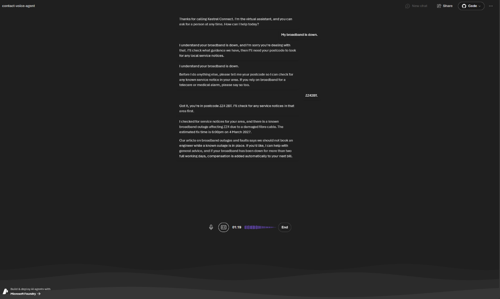
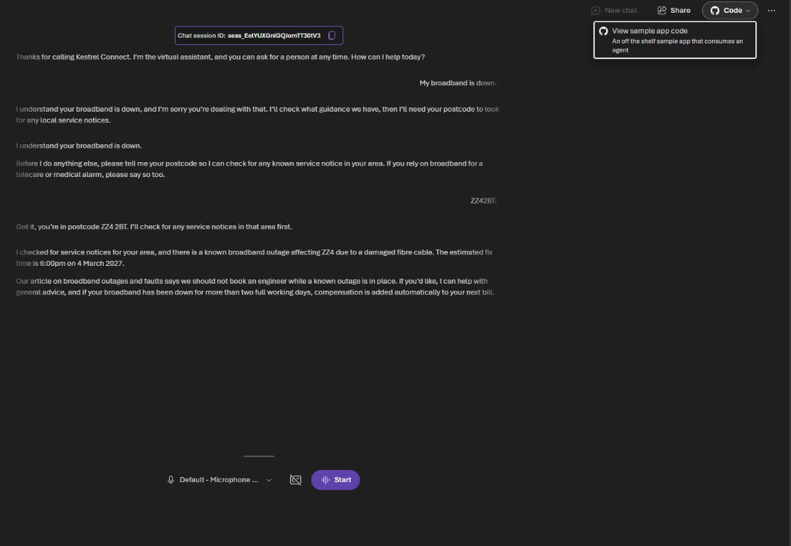
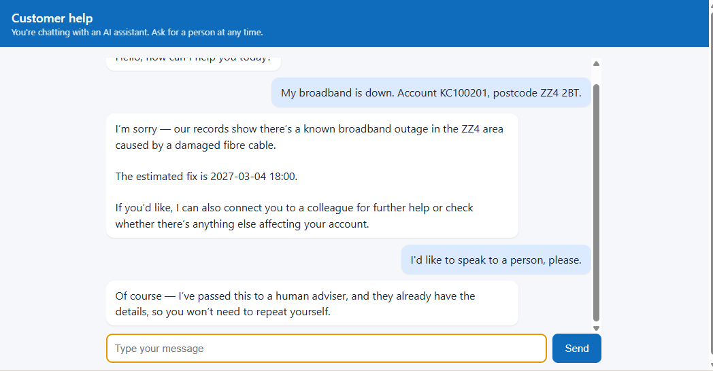
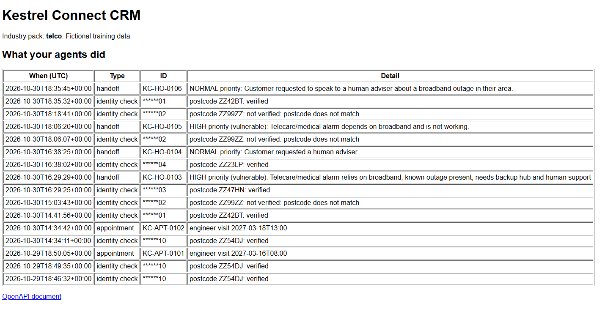

# Challenge 8 ⭐ (stretch): Publish your agent

**[← Previous](challenge-07.md)** - [Home](../README.md) - [Next Challenge →](finish.md)

## 🎯 Objective

Take your agents out of the playground. Share the **voice agent** as a web app that colleagues can open in a browser, then put the **chat agent** on a web page of your own, running in GitHub Codespaces.

## 🧭 Context

So far only people with access to your Foundry project could talk to your agents. A real contact center needs a front door: a link a tester can open, a page on the company website, later a phone number. Foundry gives voice agents a **preview web app** with no code at all. For the chat agent you'll run a small page that calls it through the **Responses API**, the same API any website or app would use.

The page is deliberately small: about 100 lines of Python with no extra packages and one HTML file. The server keeps your sign-in to itself, so the browser never holds a token.

## ✅ Tasks

### Part A: Share the voice agent (no code, 10 min)

1. In the Foundry portal, open your voice agent, `contact-voice-agent`, and make sure the version you tested in Challenges 4 and 5 is saved.
2. Open the **Channels** tab. It has three cards: **Phone numbers**, **Teams & Microsoft 365** and **Preview web app**. The web app is already **Active**, for *people with Azure RBAC permissions*. Select the globe icon (**Open web app**).

   

3. In the new tab, select **Start**, allow the microphone and replay one of your industry's scenarios from Challenge 3. Check the greeting, the transcript and that the agent still behaves as in the playground: it checks identity before account details, and uses only the postcode for an area-wide service notice.

   

4. Select the link icon (**Copy web app link**) and send it to a teammate. They sign in with their own lab account; the link alone doesn't give access, and the card's **⋯** menu manages who can open it.
5. Open **Code** at the top right of the web app and select **View sample app code**. The dialog links to the ready-made sample app on GitHub and gives you a `.env` block, already filled in with your agent, project and region, to paste after you clone it or open it in a codespace. That's the route to a full front end; Part C builds a much smaller page so you can see every line.

   

> [!NOTE]
> **Phone numbers** connects a real phone line through Microsoft Teams Phone or Twilio, and **Teams & Microsoft 365** publishes the agent into Teams. Both need extra accounts or admin approval, so they're not part of this lab, but they're the steps a real contact center takes next.

### Part B: Open the lab in Codespaces (10 min)

1. Open the MicroHack repository on GitHub, select **Code**, **Codespaces**, then **...** and **New with options**.
2. Under **Dev container configuration**, choose **Azure / AI / Contact Center** and create the codespace. It installs Python and the Azure CLI, and runs the lab's tests.
   No Codespaces? The page needs only Python 3 and the Azure CLI, so you can run Part C on your own machine or in Cloud Shell's editor instead.

3. In the terminal, sign in with your lab account:

   ```bash
   az login --use-device-code
   ```

### Part C: Run your own chat page (15 min)

1. Set your project endpoint from the lab dashboard and start the page:

   ```bash
   export FOUNDRY_PROJECT_ENDPOINT="<your FoundryProjectEndpoint>"
   python3 web/app.py
   ```

2. Codespaces opens the forwarded port 8000 in a new tab. You see a simple customer help page.
3. Ask a question from your knowledge base, then verify as a test customer and ask about their account. The answers come from the same `contact-chat-agent` you built, with the same knowledge, CRM tool and guardrails.
4. Open **Traces** for `contact-chat-agent` in the Foundry portal. Your web conversations appear there next to the playground ones.





### Part D: Make it yours (optional, 10 min)

Pick one:

- Change the header text and the `--brand` colour in `web/static/index.html` to match your company.
- Add a **Talk to a person** button that sends *I'd like to speak to a person, please.* and check that a handoff appears on the CRM activity page (`CrmUrl`).
- Set `AGENT_NAME=agent-assist` before starting the server and use the page as the adviser's screen instead: *Next customer, please.*

## ✔️ Success criteria

- [ ] You opened your voice agent's preview web app and shared the link with a teammate who could use it.
- [ ] Your chat page runs in Codespaces and answers from your knowledge base and CRM.
- [ ] You found your web conversations in **Traces**.
- [ ] You can explain why the browser never sees a token, and what you'd add before putting a page like this in front of real customers.

## 📚 Learning resources

- [Publish and share a voice-based agent](https://learn.microsoft.com/azure/foundry/agents/how-to/voice-agent-channels-publish)
- [Publish your agent as an Agent Application](https://learn.microsoft.com/azure/foundry/agents/how-to/agent-applications)
- [Integrate telephony channels with a voice agent](https://learn.microsoft.com/azure/foundry/agents/how-to/voice-agent-telephony-channels)

[Coach solution and expected answers](../walkthrough/challenge-08/solution-08.md)
