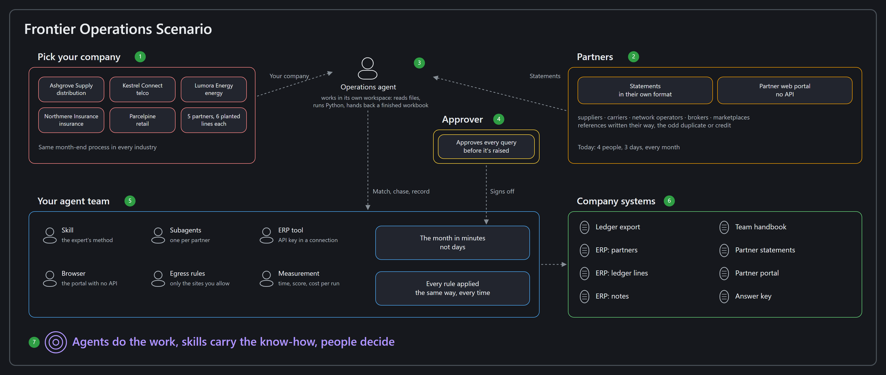
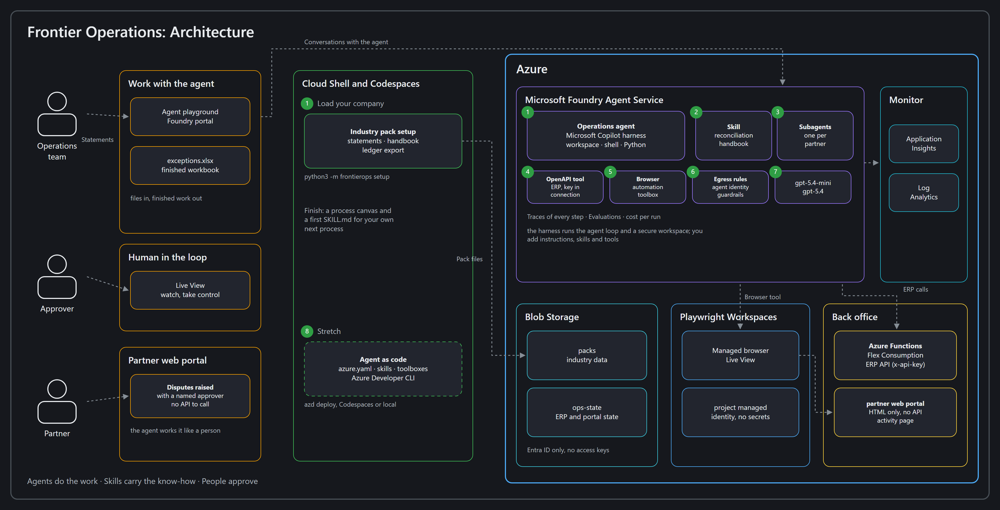

# Frontier Operations: Agents That Do the Work

- [**MicroHack introduction**](#microhack-introduction)
- [**The idea**](#the-idea)
- [**What you'll build**](#what-youll-build)
- [**What you'll take home**](#what-youll-take-home)
- [**MicroHack context**](#microhack-context)
- [**MicroHack challenges**](#microhack-challenges)
- [**Contributors**](#contributors)

## MicroHack introduction

The first wave of business AI answered questions: a chatbot over your documents, a copilot that drafts an email. Useful, but a person still did the work. The next wave is different. Agents now **do the work themselves**: they open the files, run the calculations, split a big job between helpers, update the systems your teams use every day, and hand back a finished result. People set the goal and make the decisions; agents carry out the steps in between. Organisations that work this way are what Microsoft calls **frontier firms**.

This MicroHack lets you experience that shift on a process every business has, and leave with a plan for one of your own.

You build everything in the **Microsoft Foundry portal**, with one setup command in **Azure Cloud Shell**. You don't need to write code, so business and technical people can work side by side. The optional stretch challenge puts the same agent into source control.

## The idea

Your team runs a back-office process the way most companies still do. Every month, someone downloads statements from partners, compares them line by line with the company's own records in a spreadsheet, chases the differences and types each query into a partner's web portal that has no API. Four people, three days, every month. It's careful, repetitive work, and it's exactly where mistakes and delays creep in.

During the day your team builds an **agent team** in Microsoft Foundry that does this in under an hour, with a person approving every decision that matters. Each challenge adds one new capability and measures one business result. At the end, you apply the same pattern to a process from **your** organisation.

**Pick your industry.** The process works the same way everywhere, so you choose the company you work for:

| Pack | Company | The monthly process | The partner portal with no API |
|---|---|---|---|
| `distribution` | **Ashgrove Supply** | Supplier statements against accounts payable | Supplier Hub |
| `telco` | **Kestrel Connect** | Wholesale carrier invoices against booked charges | Carrier Exchange |
| `energy` | **Lumora Energy** | Network operator charges against settlement | Network Settlements |
| `insurance` | **Northmere Insurance** | Broker premium statements against the policy system | Broker Gateway |
| `retail` | **Parcelpine** | Marketplace payouts against orders | Seller Central |

Every company, partner, person and amount is fictional.

## What you'll build

The thread that runs through the whole day: **instructions set the outcome, skills set the method, tools give access, and people make the decisions.**

| Challenge | Business outcome | The new capability you use |
|---|---|---|
| 1 | Hours of spreadsheet work in minutes | An agent on the **Microsoft Copilot harness** that works in its own workspace: it reads your files, runs Python and gives you back a finished workbook |
| 2 | Your best expert's know-how, captured once and reused | A **skill**: your team's rules and procedure, packaged so the agent applies them the same way every time |
| 3 | From one partner to all of them, at once | **Subagents**: the agent splits the work, one helper per partner, and combines the results |
| 4 | Your systems of record, safely | An **OpenAPI tool** that calls your ERP with an **API key** kept in a Foundry connection, never in the prompt |
| 5 | Reach the systems that have no API | **Browser automation**: the agent works in the partner's web portal, while a person watches live and approves |
| 6 | Trust you can sign off | **Network egress rules**, the agent's own identity, least privilege and **traces** of every step |
| 7 | Prove it before you scale it | Run two models, measure time, accuracy and **cost per run**, and build the business case |
| Finish | Your own next process | A **process canvas** and a first skill for a process from your organisation |
| 8 ⭐ *(stretch)* | From demo to delivery | The same agent, its skill and tools as code with the **Azure Developer CLI** |

### Three ways to build an agent in Foundry, and when to use each

| Approach | Choose it when | In this MicroHack series |
|---|---|---|
| **Prompt agent** | Instructions and a few tools are enough: answer from knowledge, call an API, hand over to a person | Hacks 11 and 12 |
| **Prompt agent with the Microsoft Copilot harness** | The agent must *do* work: files, code, many steps, helpers, reusable skills. Foundry runs the agent loop and a secure workspace for you | **This hack** |
| **Hosted agent** | You need your own framework, orchestration or runtime, in your own code | Pro-code; not covered today |

The **Microsoft Copilot harness** is the engine behind GitHub Copilot, now available to your own agents in Foundry Agent Service (public preview). Microsoft runs the agent loop and an isolated workspace; you bring the knowledge, procedures and tools that make the agent yours.

### What each Azure service does here

| Service | Its job in this hack |
|---|---|
| **Microsoft Foundry Agent Service** with the **Copilot harness** | Runs your agents, their workspace (files, shell, Python), skills and subagents. Every step is recorded in **Traces**. |
| **Browser Automation** (Playwright Workspaces) | A managed browser the agent uses to work in web portals, with **Live View** so a person can watch and take control. |
| **Azure Functions** (Flex Consumption) | Runs the company's **ERP API** (protected by an API key) and the partner's **web portal** (no API). |
| **Azure Blob Storage** | Holds your industry pack and the state of the ERP and the portal. |
| **Application Insights** | Stores agent traces so you can see and check every step. |

Not everything is an AI job. **Matching a reference or applying a tolerance is a rule**: the agent writes and runs code for it so the answer is the same every time. **Deciding what to chase, and approving it, is a judgement**: the agent prepares it, a person decides.

## What you'll take home

**If you lead a business area or own a process**

- How to spot processes that are ready for agents: people moving data between files and systems, following written rules and chasing exceptions.
- How to keep people in charge: approvals, watching the agent work live, and limits on what it can reach.
- How to build a business case from measured time, accuracy and cost per run, not from a demo.
- One ranked use case from your own organisation, on a one-page process canvas.

**If you build or run technology**

- When to choose a prompt agent, the Copilot harness or a hosted agent.
- How to write a good skill, and how to keep instructions, skills and tools apart.
- How to delegate work to subagents, and when not to.
- How to connect business systems safely: API keys in connections, browser automation with a person in the loop, network egress rules, agent identity and least privilege.
- How to compare models on quality, time and cost.
- *(Stretch)* How to keep agents, skills and tools in source control.

**Everyone** leaves with the same pattern, and a first draft of a skill for a process they own.

## MicroHack context

### Why this matters now

- Back-office processes still run on spreadsheets, email and portals with no API, so they've been hard to automate.
- Agents that only answer questions don't remove the work; agents that **do** the work do.
- The capabilities you use today are new: the Copilot harness in Foundry Agent Service is in public preview, and Browser Automation in Foundry is generally available.
- The hard part isn't the technology, it's knowing which process to start with, how to keep control and how to prove the value. That's what the day is about.

## MicroHack challenges

### Prerequisites

- A modern browser (Edge or Chrome), signed in with the lab account from your facilitator.
- Access to the [Microsoft Foundry portal](https://ai.azure.com), the [Azure portal](https://portal.azure.com) and Azure Cloud Shell.
- Your **lab dashboard** values: `ResourceGroupName`, `FoundryProjectEndpoint`, `FoundryProjectResourceId`, `ModelDeploymentName`, `CompareModelDeploymentName`, `StorageAccountName`, `BackOfficeUrl`, `ErpConnectionName` and `BrowserConnectionName`.
- No local software installation. For the stretch challenge, GitHub Codespaces or a machine with the Azure Developer CLI.

> [!NOTE]
> Your Foundry project, models, storage, the ERP and the partner portal, the browser workspace and their connections are deployed for you by the [lab automation](labautomation/README.md). You create the agents, skills, toolboxes and guardrails yourself.

### Challenges

| Challenge | Title | Duration |
|---|---|---|
| [Challenge 1](challenges/challenge-01.md) | Your first agent that does the work | 45 min |
| [Challenge 2](challenges/challenge-02.md) | Capture your expert's know-how in a skill | 50 min |
| [Challenge 3](challenges/challenge-03.md) | All partners at once with subagents | 40 min |
| [Challenge 4](challenges/challenge-04.md) | Connect your system of record | 40 min |
| [Challenge 5](challenges/challenge-05.md) | Work in a portal that has no API | 60 min |
| [Challenge 6](challenges/challenge-06.md) | Trust you can sign off | 45 min |
| [Challenge 7](challenges/challenge-07.md) | Prove it before you scale it | 40 min |
| [Finish](challenges/finish.md) | Your own next process | 30 min |
| [Challenge 8 ⭐](challenges/challenge-08.md) | From demo to delivery (stretch) | 45 min |

Solutions and expected results for coaches are in [walkthrough](walkthrough/).

## Contributors

| Name | Role |
|---|---|
| Digvijay Chauhan | Author & maintainer |
