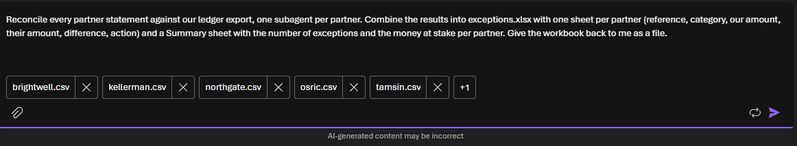
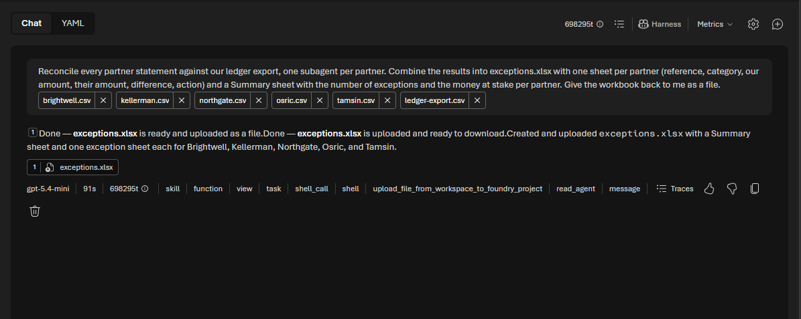

# Challenge 3: All partners at once with subagents

**[← Previous](challenge-02.md)** - [Home](../README.md) - [Next Challenge →](challenge-04.md)

## 🎯 Objective

Reconcile **every** partner in one request. Let the agent split the work into **subagents**, one per partner, and combine their results into one workbook with a summary your approver can act on.

## 🧭 Why this matters for your business

One partner is a demo; month-end is all of them. A person works through statements one after another. An agent with **subagents** works like a lead with a small team: it hands each partner to a helper with the same skill and the same files, waits for the results, checks them and writes one report.

That changes what a team can promise. The work that took days now fits in one coffee break, so it can run every week instead of every month and differences are caught while they're still small.

Subagents aren't always the answer. They pay off when the work splits into **independent** pieces of similar size. They cost more tokens, because each helper reads the files and the skill itself. You'll see both sides.

## ✅ Tasks

### Part A: Hand over the whole month (15 min)

1. Open `ops-agent` and start a **new chat**. Check that the `reconciliation` skill is still attached.
2. Attach **all five** statements and `ledger-export.csv` (the chat shows the first five files and **+1**), and ask:

   > *Reconcile every partner statement against our ledger export, one subagent per partner. Combine the results into exceptions.xlsx with one sheet per partner (reference, category, our amount, their amount, difference, action) and a Summary sheet with the number of exceptions and the money at stake per partner. Give the workbook back to me as a file.*

   

3. It takes a minute or two. When the answer arrives, look at the line under it: the time it took, the tokens, and the steps. New ones appear:
   - **skill**: the lead agent loads your method.
   - **task**: the lead starts a subagent, one per partner, each with its own brief.
   - **read_agent**: the lead collects each helper's result.
   - **shell_call** and **upload_file_from_workspace_to_foundry_project**: the lead builds and returns the workbook.

   

4. Compare the time with how long your team takes for the month today.

### Part B: Check the result (10 min)

1. Fetch the workbook into Cloud Shell and score it:

   ```bash
   python3 -m frontierops download
   python3 -m frontierops score ~/exceptions.xlsx
   ```

   **What this does:** the same check as in Challenge 2, now for all five partners: 30 planted lines in total.

2. Open the **Summary** sheet. Which partner has the most money at stake? That's where your approver will look first.
3. Open **Traces** for `ops-agent` (in the agent, select **Traces**) and find this run. Expand it and find the five subagent tasks. How long did the slowest one take?

> 📸 **Screenshot to add:** `images/challenge-03-workbook-summary.png`: The returned workbook: the Summary sheet and one sheet per partner.

### Part C: When not to use subagents (10 min)

Discuss as a team, then try one of these:

- Ask the same question with *"Do this yourself, without subagents."* in a new chat. Compare the time and the score.
- Ask for only **one** partner with *"one subagent per partner"*. Does the agent still start a helper? Is it worth it?

Write down one rule of thumb your team would use to decide.

## ✔️ Success criteria

- [ ] One request reconciled all five partners and returned one workbook with a Summary sheet.
- [ ] You saw the five subagent tasks in the steps or in **Traces**.
- [ ] You scored the result and recorded how long the whole month took.
- [ ] You can say when subagents help and when they only add cost.

## 📚 Learning resources

- [Use the Microsoft Copilot harness: harness tools and subagents](https://learn.microsoft.com/azure/foundry/agents/how-to/use-tools-skills-copilot-harness#configure-harness-tools)
- [Trace agent runs in Foundry](https://learn.microsoft.com/azure/foundry/observability/how-to/trace-agent-setup)

[Coach solution and expected answers](../walkthrough/challenge-03/solution-03.md)
