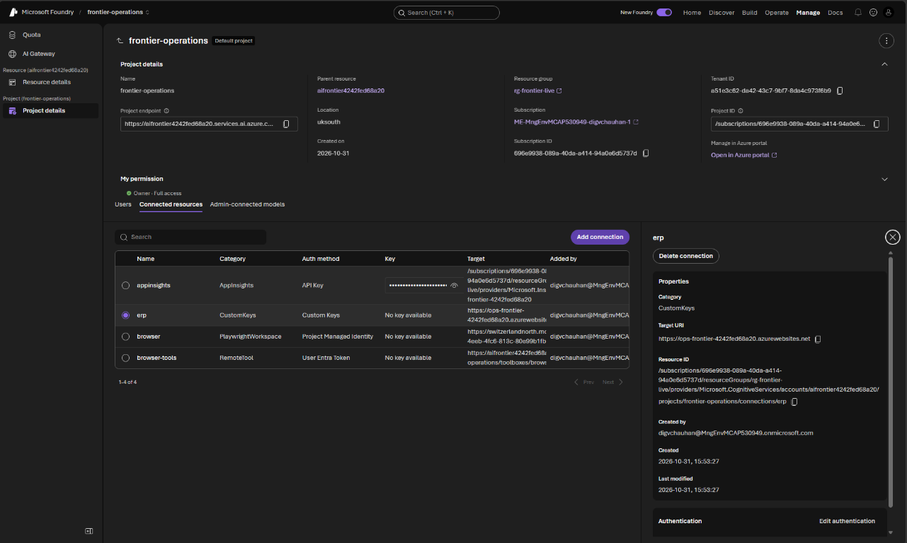
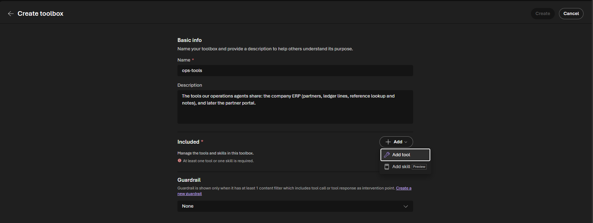
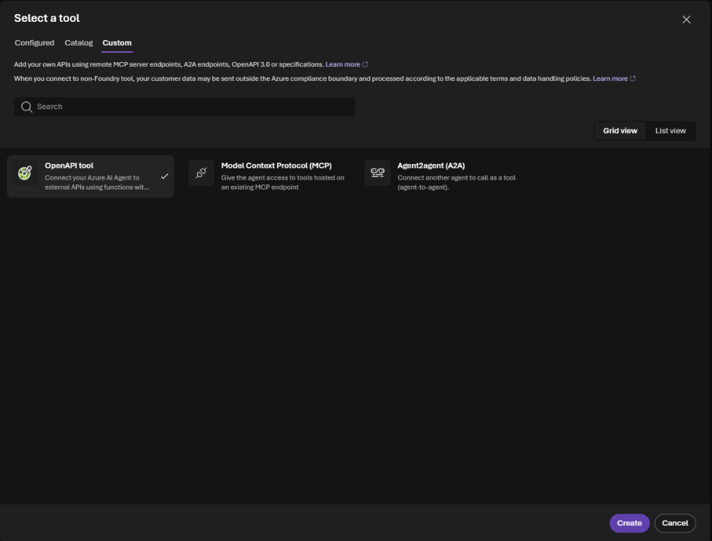
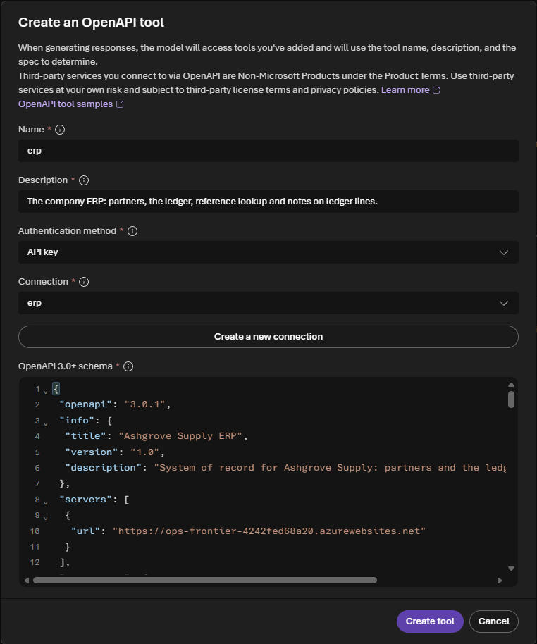
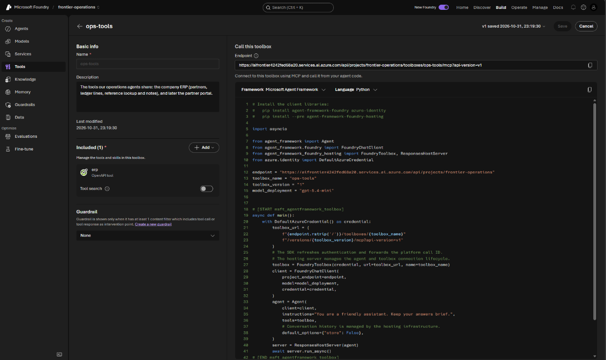
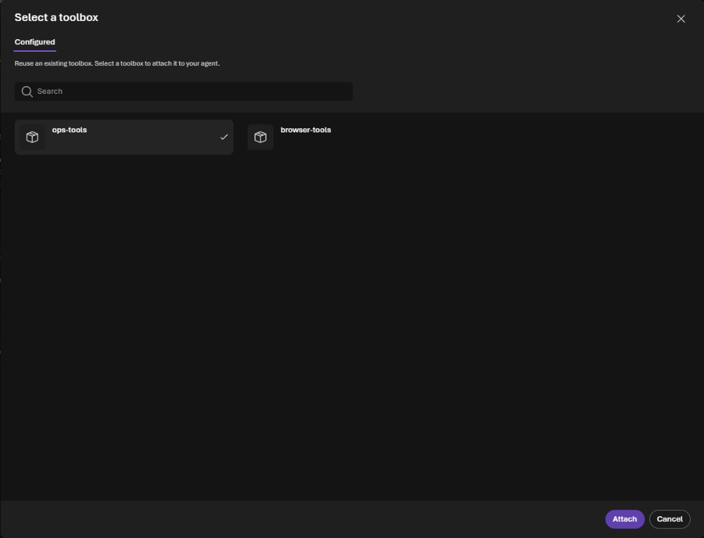
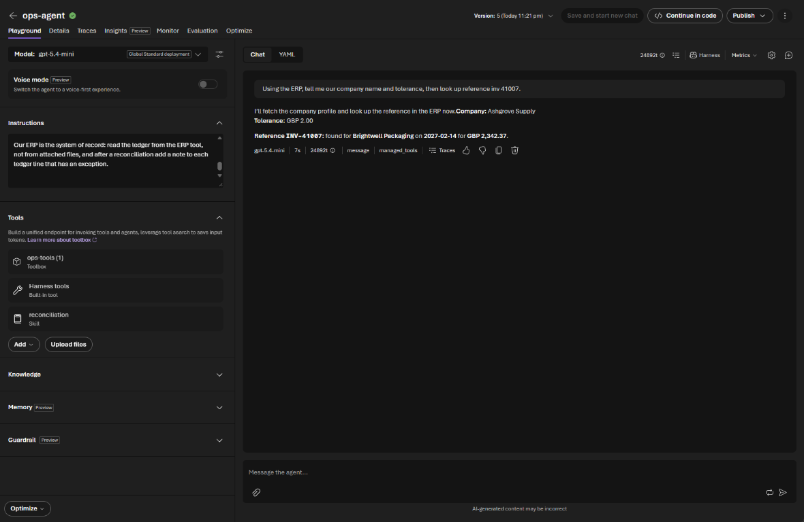
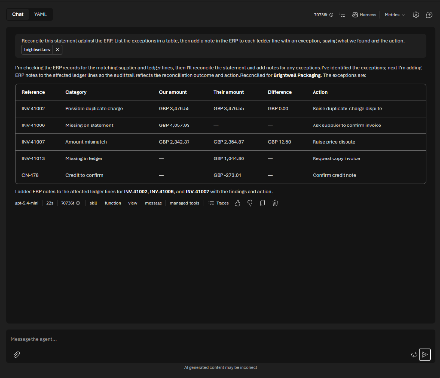
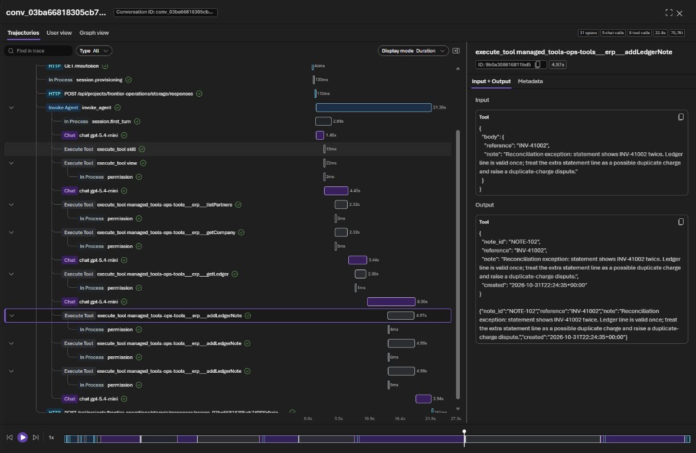
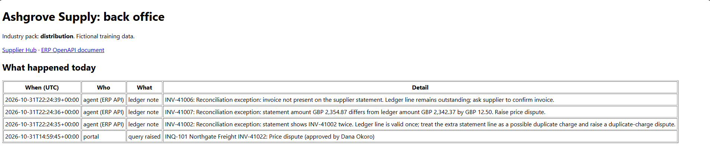

# Challenge 4: Connect your system of record

**[← Previous](challenge-03.md)** - [Home](../README.md) - [Next Challenge →](challenge-05.md)

## 🎯 Objective

Stop working from exports. Connect the agent to your company's **ERP** through an **OpenAPI tool** whose **API key** is kept in a Foundry connection, so the agent reads the live ledger and writes the outcome back, and nobody ever pastes a key into a prompt.

## 🧭 Why this matters for your business

Until now someone exported the ledger and attached it. That export is out of date the moment it's taken, and it's one more file to keep track of. The real value comes when the agent works in your **system of record** directly: it reads the latest data and records what it did, so the next person sees it.

Most business systems already have an API, and most APIs use a key. The question every security team asks is *where does the key live?* In Foundry the answer is a **connection**: an administrator stores the key once, the agent's tool uses it, and the key never appears in the agent's instructions, the chat or the traces. Revoke or rotate it in one place.

## ✅ Tasks

### Part A: Meet the ERP's front door (5 min)

1. Open `<BackOfficeUrl>/openapi.json` in a browser tab. This is the ERP's **OpenAPI document**: the list of things the ERP lets a program do. Find the five operations: `getCompany`, `listPartners`, `getLedger`, `lookupReference` and `addLedgerNote`. Find `securitySchemes`: every call needs an `x-api-key` header.
2. Open `<BackOfficeUrl>/erp/partners`. The ERP answers **401**: no key, no data.
3. In the Foundry portal, select **Manage** in the top bar, then **Project details**, and open the **Connected resources** tab. Select the connection named `ErpConnectionName` (`erp`). The lab automation created it with the key: its category is *CustomKeys*, its target is your back office, and the **Key** column says *No key available*. You can see that it exists and who created it, but nobody can read the key back, not even you.

   

### Part B: Build a toolbox with the ERP tool (10 min)

A **toolbox** is a named, versioned set of tools that agents share. You'll add the browser to the same toolbox in Challenge 5.

1. Select **Build**, then **Tools**, then **Create toolbox**. Name it `ops-tools` and describe it: *The tools our operations agents share: the company ERP (partners, ledger lines, reference lookup and notes), and later the partner portal.*
2. Under **Included**, select **Add**, then **Add tool**.

   

3. On the **Custom** tab, select **OpenAPI tool**, then **Create**.

   

4. Fill in the tool:
   - **Name**: `erp`
   - **Description**: *The company ERP: partners, the ledger, reference lookup and notes on ledger lines.* The model reads this to decide when to use the tool.
   - **Authentication method**: **API key**, and **Connection**: `erp`. The key travels from the connection to the ERP on every call; it never appears in the agent.
   - **OpenAPI 3.0+ schema**: copy the whole JSON from `<BackOfficeUrl>/openapi.json` and paste it.

   Select **Create tool**.

   

5. Back on the toolbox, `erp` is listed under **Included**. Select **Create**. The toolbox is saved as version **v1**, with its own endpoint that agents (and your own code) call.

   

### Part C: Give the toolbox to your agent (5 min)

1. Open `ops-agent`. In **Tools**, select **Add**, then **Browse toolboxes**. Select `ops-tools` and then **Attach**.

   

2. Add one sentence to the instructions:

   ```text
   Our ERP is the system of record: read the ledger from the ERP tool, not from attached files,
   and after a reconciliation add a note to each ledger line that has an exception.
   ```

3. Select **Save and start new chat**. The toolbox now appears under **Tools** as `ops-tools`, next to Harness tools and your skill.

The agent's identity already has the role it needs to use a toolbox: you gave it in Challenge 1.

4. Check it works with a quick question, with no files attached:

   > *Using the ERP, tell me our company name and tolerance, then look up reference inv 41007.*

   In seconds the agent answers from the ERP. The step under the answer is **managed_tools**: a call through the toolbox. Notice that `inv 41007` was found as `INV-41007`: the ERP normalises references too.

   

### Part D: Work from the live ERP (15 min)

1. In the new chat, attach **one** partner statement, and **no** ledger export. Ask:

   > *Reconcile this statement against the ERP. List the exceptions in a table, then add a note in the ERP to each ledger line with an exception, saying what we found and the action.*

2. Watch the steps: **skill** (your method), then **managed_tools**: the agent reads the company profile and that partner's ledger from the ERP through the toolbox, compares them in its workspace, and adds a note in the ERP to each ledger line with an exception.

   

   Count the notes. Lines that are only on the partner's statement (a missing invoice, a credit note) have no ledger line yet, so there's nothing to attach a note to: in our run five exceptions gave three notes. That's the agent respecting the system, not skipping work.

3. Open `<BackOfficeUrl>` (the activity page). Each note the agent wrote is there, with the time and its text. The reads don't change anything, so the ERP doesn't log them; you'll find them in **Traces**.
4. Open **Traces** on the answer line. Each ERP call is listed by name, as `managed_tools-ops-tools___erp___` followed by the operation: `listPartners`, `getCompany`, `getLedger`, then `addLedgerNote` once per note. Select an `addLedgerNote` call: the input is the reference and the note, the output is what the ERP saved. Is the API key anywhere in the trace?

   



### Part E: Discuss (5 min)

- The agent can now **write** to the ERP. What else is in an ERP API that you would *not* want an agent to call? How would you keep it out of the tool?
- Who in your organisation owns the key, and how would they revoke it in a hurry?

## ✔️ Success criteria

- [ ] You saw that the ERP refuses calls without a key, and that the key lives only in the `erp` connection.
- [ ] `ops-agent` reconciled a statement against the live ERP, with no ledger export attached.
- [ ] The agent wrote a note to each exception line, and you saw them on the activity page.
- [ ] You checked a trace and confirmed the key isn't in it.

## 📚 Learning resources

- [Connect to OpenAPI tools](https://learn.microsoft.com/azure/foundry/agents/how-to/tools/openapi)
- [Create and manage a toolbox](https://learn.microsoft.com/azure/foundry/agents/how-to/tools/toolbox)
- [Add a connection to your project](https://learn.microsoft.com/azure/foundry/how-to/connections-add)

[Coach solution and expected answers](../walkthrough/challenge-04/solution-04.md)
