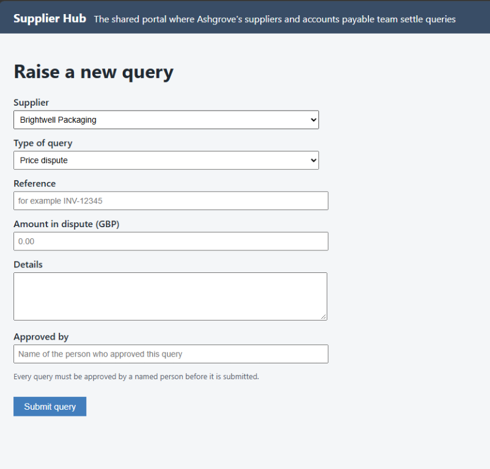
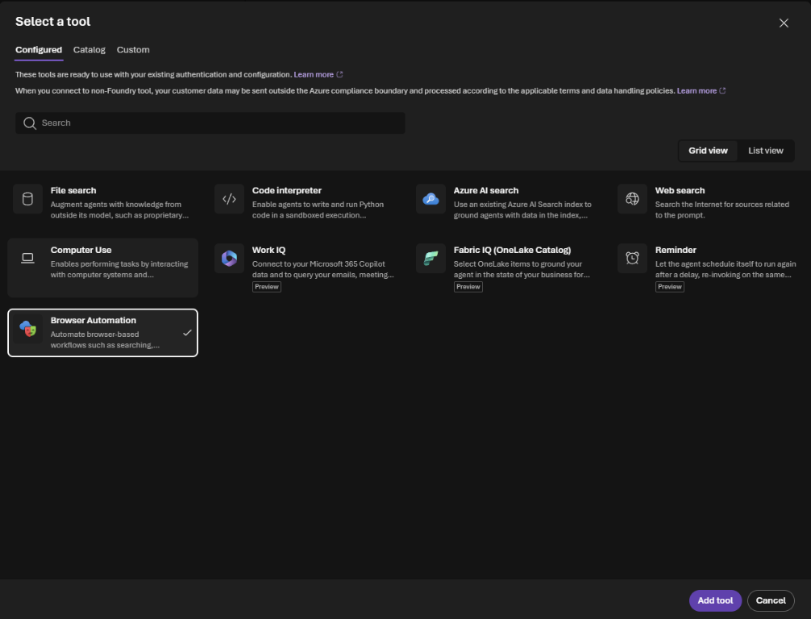
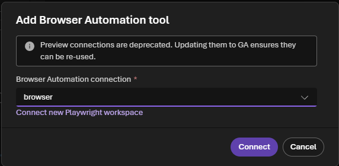
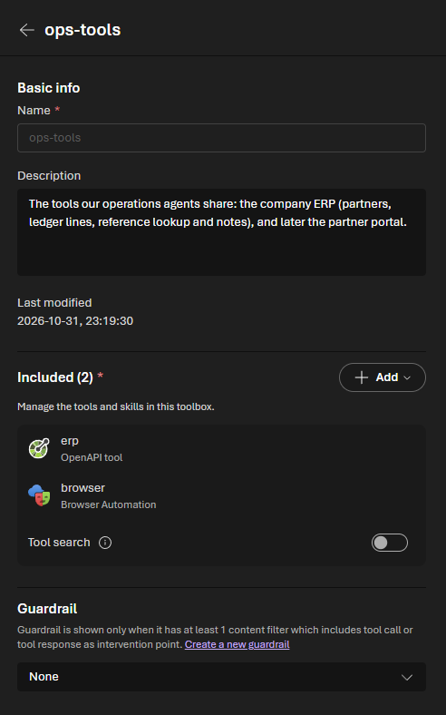

# Challenge 5: Work in a portal that has no API

**[← Previous](challenge-04.md)** - [Home](../README.md) - [Next Challenge →](challenge-06.md)

## 🎯 Objective

Raise the approved queries in your partner's **web portal**, the one with no API, by letting the agent use a **browser**. A named person approves every query before it's submitted, and the portal records who approved it.

## 🧭 Why this matters for your business

Every company has systems that only have a web page: a partner's portal, a government site, a supplier's ordering screen. Today people copy each item into those forms by hand, and it's often the step that stops a process from being automated at all.

**Browser Automation** in Foundry gives your agent a managed browser in Microsoft's cloud. It reads the page, fills the form and submits it, the way a person would. That reaches the last mile, and it's exactly why the controls matter: anything the agent submits is real. So in this challenge the agent **prepares**, a person **approves**, and only then does the agent **submit**.

## ✅ Tasks

### Part A: Do one by hand (5 min)

1. Open `<BackOfficeUrl>/portal` and select **Raise a new …**. Look at the form: partner, type, reference, amount, details and **Approved by**. The portal refuses a query without an approver.

   

2. Don't submit anything. Count the clicks and fields for one query, and multiply by the queries in your Summary sheet from Challenge 3.

### Part B: Add the browser to your toolbox (10 min)

1. Select **Build**, then **Tools**, and open your `ops-tools` toolbox. Under **Included**, select **Add**, then **Add tool**.
2. On the **Configured** tab, select **Browser Automation**, then **Add tool**.

   

3. Choose the connection `BrowserConnectionName` (`browser`) and select **Connect**. The lab automation connected it to your own Playwright workspace, which signs in with the project's identity: there's no password or key to manage. (If the dialog says preview connections are deprecated, that's expected in this lab; the connection works.)

   

4. The toolbox now has two tools, `erp` and `browser`. Save it: that creates a new version.

   

5. Open `ops-agent`. In **Tools**, select the `ops-tools` toolbox and switch it to the **new version**. Select **Save and start new chat**.

### Part C: Prepare, approve, submit (25 min)

1. In the new chat, attach your `exceptions.xlsx` from Challenge 3 (to get it onto your computer: in Cloud Shell, **Manage files**, **Download**, `exceptions.xlsx`) and ask:

   > *From this workbook, list the queries we should raise in the partner portal: partner, type of query, reference, amount and a one-line reason. Use your skill for the type and action. Don't submit anything yet: wait for my approval.*

2. Check the list as a team. Remove one item you'd rather handle by phone.
3. Approve in writing, as your company's approver (see the table below):

   > *Approved by <approver's name>. Raise these queries in the partner portal at <BackOfficeUrl>/portal: one form per query, with the approver's name in Approved by. Give me each reference number the portal returns.*

4. Watch it work. The agent opens the portal, picks the partner and the type, types the reference, amount and details, fills in **Approved by** and submits. Each query takes about a minute.
5. Open `<BackOfficeUrl>/portal` in your own tab and refresh: each query is listed with its reference number and the approver's name. The activity page shows the same.

| Company | Approver |
|---|---|
| Ashgrove Supply | Dana Okoro, Financial Controller |
| Kestrel Connect | Tom Ashby, Head of Carrier Relations |
| Lumora Energy | Helen Marsh, Finance Director |
| Northmere Insurance | Claire Dunmore, Chief Financial Officer |
| Parcelpine | Joanna Price, Finance Director |

> 📸 **Screenshot to add:** `images/challenge-05-portal-cases.png`: The partner portal listing the queries the agent raised, each with its approver.

### Part D: Watch live and take control (10 min)

1. Start one more query. While the agent works, look in its steps for the browser session and open its **Live View**: you watch the same browser the agent is using, in real time.
2. Select **Take control**, change one field yourself, and hand back. This is how a person steps in when a page asks for something the agent shouldn't decide.

> 📸 **Screenshot to add:** `images/challenge-05-live-view.png`: Live View of the agent filling in the partner portal form.

### Part E: Discuss (5 min)

- The approval here is a sentence in the chat. Where would a real approval come from in your organisation: an email, a Teams message, a workflow? What would you need to see in the trace to trust it?
- Which web-only systems in your organisation would you point this at first? Which would you never?

## ✔️ Success criteria

- [ ] The agent prepared a list of queries and waited for approval.
- [ ] After approval, it raised them in the portal with the approver's name, and gave you each reference number.
- [ ] You saw the queries in the portal yourself.
- [ ] You can explain why the browser is the riskiest tool so far, and what keeps it under control.

## 📚 Learning resources

- [Browser Automation tool in Foundry](https://learn.microsoft.com/azure/foundry/agents/how-to/tools/browser-automation)
- [Playwright Workspaces](https://learn.microsoft.com/azure/app-testing/playwright-workspaces/overview-what-is-microsoft-playwright-workspaces)
- [Create and manage a toolbox](https://learn.microsoft.com/azure/foundry/agents/how-to/tools/toolbox)

[Coach solution and expected answers](../walkthrough/challenge-05/solution-05.md)
