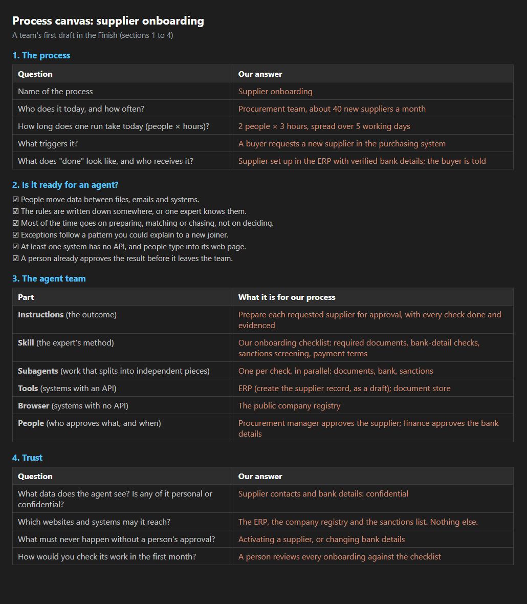

# Finish: Your own next process

**[← Previous](challenge-07.md)** - [Home](../README.md) - [Stretch Challenge →](challenge-08.md)

## 🎯 Objective

Take the pattern home. Pick one process from **your** organisation, map it on a one-page canvas, and write the first draft of the skill an agent would need to run it.

## 🧭 Why this matters for your business

Reconciliation was the practice process. The pattern is what you keep: **instructions set the outcome, skills set the method, tools give access, and people make the decisions.** It fits a surprising number of processes: supplier onboarding, expense checks, claims triage, contract renewals, compliance evidence, order exceptions. The teams that move first don't start with the technology. They start with a process they know well and a person who owns it.

## ✅ Tasks

### Part A: Choose the process (5 min)

As a team, list three processes from your own organisations where people move data between files and systems, follow written rules and chase exceptions. Vote for one.

### Part B: Fill in the canvas (15 min)

Setup put a copy of the [process canvas](../templates/process-canvas.md) in your files. Open it in Cloud Shell:

```bash
code my-files/process-canvas.md
```

Or open it on your computer: it's in the `my-files` folder you downloaded in Challenge 1. Work through it together:

1. **The process**: who, how often, how long.
2. **Is it ready for an agent?**: tick the checklist honestly.
3. **The agent team**: instructions, skill, subagents, tools, browser and people.
4. **Trust**: data, allowed sites, approvals, how you'd check it.
5. **The business case**: today against the agent, with your own estimates.
6. **First step**: the owner, the pilot and how you'd know it worked.

Keep a copy: download it from Cloud Shell (**Manage files**, **Download**, `frontier-ops/03-Azure/01-04-AI/13_Frontier_Operations/my-files/process-canvas.md`), or paste it into a document.

Here's what a first draft can look like, for supplier onboarding:



### Part C: Write the first skill (10 min)

1. Make a folder for your process and copy the starter skill into it. Use a short, lowercase name with hyphens, for example `supplier-onboarding`:

   ```bash
   mkdir -p my-files/skills/<your-process>
   cp my-files/skills/reconciliation/SKILL.md my-files/skills/<your-process>/SKILL.md
   code my-files/skills/<your-process>/SKILL.md
   ```

   **What this does:** makes a folder for your process's skill, copies your reconciliation skill into it as a model to follow, and opens it in the editor. Replace `<your-process>` in all three lines. (A blank starter with TODOs is in `templates/SKILL.md`.)

2. Change the **name** to your folder's name, and rewrite the headings and the content for your process. Don't put real names, customer data or secrets in it.
3. Optional: publish it with `publish-skill`, add it to a new harness agent and ask it to explain how it would handle one of your process's typical cases.

### Part D: Clean up (5 min)

1. In the Foundry portal, delete the agents you created if your facilitator asks you to. An agent with a recent chat may ask you to confirm deleting its sessions too.
2. Leave the resource group in place. Your facilitator removes the lab environment.

## ✔️ Success criteria

- [ ] Your team chose one process of its own and completed the canvas.
- [ ] You wrote a first `SKILL.md` for it, with no TODO left.
- [ ] You can name who owns the process and what a four-week pilot would prove.

## 🎉 Well done

Your team built an agent that does a real back-office job: it works in its own workspace, follows your expert's method, splits the work across helpers, reads and writes your system of record, works in a portal with no API, stays inside the controls you set and is measured before it scales. And you've started on the next one.

[Coach solution and expected answers](../walkthrough/finish/solution-finish.md)
