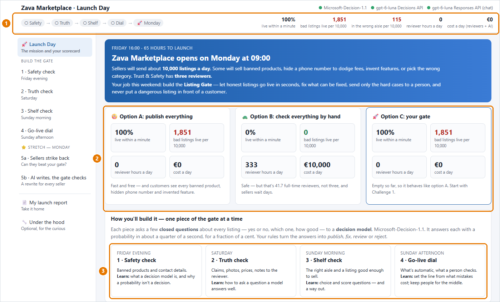
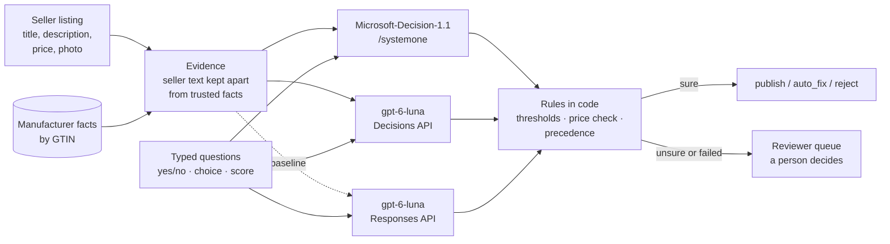

# Launch Day at Zava — Build a Listing Gate with Decision Models

- [**MicroHack introduction**](#microhack-introduction)
- [**What you'll build**](#what-youll-build)
- [**The story**](#the-story)
- [**What is a decision model?**](#what-is-a-decision-model)
- [**Objectives**](#objectives)
- [**How each challenge works**](#how-each-challenge-works)
- [**Challenges**](#challenges)
- [**Agenda**](#agenda)
- [**Facilitator notes**](#facilitator-notes)
- [**Architecture**](#architecture)
- [**Requirements**](#requirements)
- [**Glossary**](#glossary)
- [**Learn more**](#learn-more)
- [**Contributors**](#contributors)

## MicroHack introduction

Zava's new online marketplace opens on **Monday at 09:00**. Sellers will send about **10,000
listings a day**, and some of them will try to sell banned products, hide a phone number to dodge
fees, invent features, or file a desk lamp under *kitchen*. Trust & Safety has **three reviewers**.

Over one (simulated) weekend, you build the **Listing Gate** that decides, for every listing,
whether it goes live in seconds, gets its category fixed, goes to a person, or is rejected. You
build it from **decision models**: AI models that answer a closed question — *yes or no, which
one, how good* — with a **probability**, in about a quarter of a second, for a fraction of a cent.

You don't write a line of code unless you want to. Everything happens in your browser, in the
**Launch Day console**: you open listings, ask the model, add each piece of the gate, and watch a
**launch scorecard** in business terms — listings live within a minute, bad listings in front of
customers, reviewer hours a day, and cost a day. Developers can follow a **Build track** in every
challenge and do the same steps in code.

> [!TIP]
> **The pattern you take home works for any small, frequent decision**: routing a ticket,
> checking an invoice, flagging personal data, triaging an alert. You leave with a **launch
> report** and **Decision Design Cards** for decisions in your own work.

## What you'll build

One gate, built one piece at a time. Every piece is a few closed questions to
**Microsoft-Decision-1.1** plus a few rules in code:

| # | Gate piece | When | The questions it asks | What it decides |
|---|------------|------|-----------------------|-----------------|
| 1 | **Safety check** | Friday evening | Is it a banned product? Does it ask buyers to pay or contact the seller outside Zava? | **Reject** |
| 2 | **Truth check** | Saturday | Does a claim contradict the manufacturer? Is a feature invented? Does the photo match? Is there a note aimed at the reviewer? *(+ price and catalogue checks in code)* | **Reject** or **review** |
| 3 | **Shelf check** | Sunday morning | Which category is it really? How useful is the listing to a shopper? | **Fix the category** or **review** |
| 4 | **Go-live dial** | Sunday afternoon | — you set how sure each answer must be, from what each mistake costs | What's automatic, and what a person checks |
| ⭐ 5 | **Stretch** | Monday | Sellers try to beat your gate; AI rewrites listings and your gate judges them | — |



Your scorecard tells the story of the weekend (numbers from the recorded rehearsal, scaled to
10,000 listings a day):

| | Live within a minute | Bad listings live per 10,000 | Reviewer hours a day | Cost a day |
|---|---:|---:|---:|---:|
| 😬 Publish everything | 100% | 1,851 | 0 | €0 |
| 🐢 Check everything by hand | 0% | 0 | 333 | €10,000 |
| + Safety check | 94% | 1,240 | 0 | €0 |
| + Truth check, and a better question | 72% | 95 | 68 | €2,042 |
| + Shelf check | 71% | **0** | 71 | €2,138 |
| + Go-live dial | **82%** | **0** | **38** | **€1,126** |
| 🚀 Monday: 516 listings it has never seen | 75% | 19 | 61 | €1,842 |

The models cost **under €1 a day** of that; the rest is people. That is the point of the hack.

## The story

**Zava**, a home and garden retailer, is opening its online store to third-party sellers:
**Zava Marketplace**. Products come in six categories — garden and lawn, outdoor power tools,
paint and supplies, smart home, kitchen and dining, lighting.

Sellers list against a **product number** (GTIN). For every product it knows, Zava holds the
**manufacturer's facts**, so the gate can compare what a seller claims with what's true. Zava's
[Listing Policy](src/data/policy.md) defines four outcomes:

| Outcome | Meaning |
|---------|---------|
| `publish` | The listing goes live. |
| `auto_fix` | The gate corrects the seller's category, then publishes. |
| `review` | A person on Trust & Safety decides. |
| `reject` | The listing goes back to the seller with the reason. |

You work with **1,310 labelled listings** for 30 products, with photos. About 80% are fine; every
problem in the rest was added on purpose, so the right answer is always known:

| In the console | Listings | What it's for |
|----------------|---------:|---------------|
| **Starter set** | 24 | Listings you open and ask about live — every kind of problem is here |
| **Rehearsal** | 524 | Last week's trial listings: your scorecard, and where you set the dial |
| **Monday** | 516 | New listings — including products that didn't exist last week. You open them **once**. |

## What is a decision model?

A decision model answers **closed questions** about some evidence — text, JSON or a photo:

| You ask | You get back | Example in the gate |
|---------|--------------|---------------------|
| **Yes / no** — is this true? | The probability of *yes* | *Does the listing ask buyers to pay outside Zava?* → 0.999 |
| **Choice** — which option fits? | A probability for every option | *Which category?* → lighting 99.7%, kitchen 0.1%, … |
| **Score** — where on a scale? | A probability for every level | *How useful to a shopper?* → mostly *poor* |

It doesn't write explanations and doesn't take actions: **your rules** turn the probabilities
into decisions, and anything it isn't sure about goes to a person. Microsoft already uses one in
production — **Copilot uses Microsoft-Decision-1.1 to route each request** to Chat or Cowork
([Microsoft Ignite 2026 Book of News](https://news.microsoft.com/events/ignite/2026/book-of-news/)).

> The idea of fast, typed "System One" judgements — after *System 1* in Daniel Kahneman's
> *Thinking, Fast and Slow* — was popularised by [TypeSafe AI with
> Jev](https://docs.typesafe.ai/concepts/system-one.md). Microsoft's own introduction is the
> [decision models primer](https://github.com/microsoft-foundry/model-releases/blob/main/3-primers/decision-models.md).

## Objectives

After this MicroHack you will be able to:

- Explain what a decision model is, and why **a probability isn't a decision** — your rules are.
- **Ask questions a model answers well**: one idea per question, plain words, a way out such as
  *cannot tell*, and exact maths kept in code.
- Use the three question types — **yes/no, choice and score** — for gates, routing and rating.
- Set the line between **automatic and human** from what each mistake costs, and keep people for
  the uncertain middle.
- **Measure** the result on data you didn't tune on, in business terms, and say honestly how bad
  it could still be.
- Name **one decision in your own work** you'd automate this way, designed on a Decision Design Card.

## How each challenge works

Every challenge is one part of the weekend and follows the same four beats:

| Beat | What happens |
|------|--------------|
| 📖 **The story** | Where you are in the weekend, and who needs what. |
| 🔍 **The mystery** | Your scorecard shows something bad going live — with the listings that caused it. |
| 🔨 **Build** | You investigate a few listings with the model, then add or fix one piece of the gate. The scorecard moves. |
| 💡 **What you learned** | One sentence to remember — and a **Decision Design Card** for your own work. |

Two tracks, same story:

| | 🧭 **Explore** — everyone | 🛠️ **Build** — developers, optional |
|---|---|---|
| Where | The Launch Day console, in your browser | Azure Cloud Shell — or GitHub Codespaces with your own GitHub account, or a local dev container |
| How | Open listings, ask the model, add gate pieces, set the dial | Call the APIs, change the questions and rules in Python |
| You leave with | Your launch report and Decision Design Cards | All of that, plus code you ran and changed |

Every answer in the console has a **Show me the code** panel with the exact request and the few
lines of Python behind it. **My launch report** turns your gate, scorecard and design cards into
one Markdown file to share with your team.

## Challenges

| # | Challenge | You build | You learn | Duration |
|---|-----------|-----------|-----------|---------:|
| 1 | **[Safety Check](challenges/challenge-01.md)** | Reject banned products and hidden contact details | What a decision model is; a probability isn't a decision | 45 min |
| 2 | **[Truth Check](challenges/challenge-02.md)** | Check claims, photos and prices; fix a question that misses | How to ask a question a model answers well | 60 min |
| 3 | **[Shelf Check](challenges/challenge-03.md)** | Fix wrong categories, catch unsellable listings | Choice and score questions — and a way out | 45 min |
| 4 | **[Go-Live Dial](challenges/challenge-04.md)** | Your launch plan; open the doors on Monday | The line between automatic and human is a business decision | 60 min |
| ⭐ 5 | **[Monday: Sellers Strike Back](challenges/challenge-05.md)** | Attack your gate; judge AI-written listings | Test like an attacker; one model writes, another checks | 45 min |
| 🔧 6 | **[Under the Hood](challenges/challenge-06.md)** *(optional)* | Compare three models; read calibration; stress tests | How to trust a model's numbers | 30 min |

Each challenge has: 📖 The story · 🎯 What you'll build and learn · ✅ Tasks (🧭 Explore, then 🛠️
Build) · 🏁 Success criteria · 🛠️ Troubleshooting · 💡 What you learned · 📚 Learning resources.
Reference solutions with the expected numbers are in [`walkthrough/`](walkthrough/).

## Agenda

The hack is **self-guided**: the console and the challenges carry the story, so any facilitator
can run it without a talk. To open the day with one, use the 25-minute [tech talk](techtalk/README.md)
in the welcome slot, and hand out the [companion guide](techtalk/Decision_Models_101_Companion_Guide.pdf).

```
09:00 – 09:20   Welcome: open the console, read the Launch Day tab (Friday 16:00)
09:20 – 10:05   Challenge 1 — Safety check (Friday evening)
10:05 – 11:05   Challenge 2 — Truth check (Saturday)
11:05 – 11:15   Break
11:15 – 12:00   Challenge 3 — Shelf check (Sunday morning)
12:00 – 13:00   Lunch
13:00 – 14:00   Challenge 4 — Go-live dial, and Monday 09:00
14:00 – 14:45   Challenge 5 (stretch) or Challenge 6 (optional), or catch up
14:45 – 15:30   Finish your Decision Design Cards and download your launch report
15:30 – 16:00   Share: each table presents one decision from their own work
```

## Facilitator notes

- **Audience:** mixed, level 200–300. Non-developers follow 🧭 Explore; developers add 🛠️ Build.
  Everyone finishes the same story at the same time.
- **The thread:** if the room drifts, point back to the scorecard. Every task answers "what does
  this change for Monday?"
- **No special licences:** `lab-defaults.json` has `groups: []` — no GitHub Copilot seat needed.
- **Quota:** `gpt-6-luna` Data Zone quota (333 per subscription by default) allows **8 labs per
  subscription**. Plan one subscription per 8 attendees.
- **Recorded runs** make the rehearsal and Monday instant and free for everyone. Live calls use
  the 24-listing starter set and single listings.
- **Starting over:** the Launch Day tab has **Start the weekend again**; it keeps the design cards.
- **Before an event:** check that Microsoft-Decision-1.1 and gpt-6-luna are still offered in the
  regions in `lab-defaults.json`, and see [`labautomation/README.md`](labautomation/README.md).

## Architecture



What each attendee gets, created by the lab automation:

❶ **One Foundry resource** with two deployments: `decision` (**Microsoft-Decision-1.1**, also
used as the evaluation judge) and `gpt-6-luna` (used through the Decisions API and, as the
baseline, the Responses API). It's **keyless**: everything signs in with Entra ID.

❷ **The Launch Day console** as a web app that calls your models with its own managed
identity. You open it with the `ConsoleUrl` and `AccessCode` from your Hackbox.

❸ **This repository**: the gate library in Python (`src/gate/`), the listings, photos and
recorded reference runs of all three models on every listing.

| Deployment | Model | API | Used for |
|------------|-------|-----|----------|
| `decision` | **Microsoft-Decision-1.1** (GA) | `POST {DECISION_ENDPOINT}/providers/microsoft/v1/systemone` | The gate, and the judge in Foundry evaluations |
| `gpt-6-luna` | **gpt-6-luna** | `POST {OPENAI_ENDPOINT}/openai/v1/decisions` (`client.decisions.create`) | Second decision model |
| `gpt-6-luna` | the same deployment | Responses API with JSON output | Generative **baseline** — no probabilities |

> [!NOTE]
> Decision models are new and change every few weeks. If the portal or an API looks different
> from the text, the code and the [Microsoft Learn pages](#learn-more) are the reference.

## Requirements

- The **lab account from your Hackbox**, and a modern browser. Nothing to install.
- From your Hackbox: `ConsoleUrl` and `AccessCode` (everyone); `DecisionEndpoint`,
  `OpenAIEndpoint`, the capacities and `CloudShellStorage` (Build track).
- For the Build track only: basic Python, and one of:
  - **Azure Cloud Shell** (in the Azure portal, signed in with the lab account, with your lab's
    file share mounted so your files survive breaks) — needs nothing else;
  - **GitHub Codespaces** with **your own** GitHub account — the lab doesn't provide one; personal
    accounts include 120 core-hours and 15 GB of storage a month free;
  - VS Code with Docker and the Dev Containers extension.

> [!TIP]
> **You're ready to start when** the console opens and the three lights at the top are green.


## Glossary

| Term | Meaning in this hack |
|------|----------------------|
| **Decision model** | A model that answers closed questions with probabilities instead of writing text. |
| **Yes/no, choice, score** | The three question types (`noul`/`predicate`, `choice`, `score`). |
| **Probability** | How likely the model thinks an answer is, from 0 to 1. |
| **Gate piece** | A group of questions and rules you switch on: Safety, Truth, Shelf. |
| **Go-live dial** | The thresholds: how sure each answer must be before the gate acts without a person. |
| **Rehearsal** | Last week's 524 trial listings. Your scorecard, and where you set the dial. |
| **Monday** | 516 new listings the gate has never seen. You open them once. |
| **Launch scorecard** | Live within a minute · bad listings live · wrong aisle · reviewer hours · cost a day. |
| **Bad listing live** | A listing the gate published that should have gone to a person or been rejected. |
| **Upper bound** | How bad a rate could still plausibly be, given how few cases you checked. |
| **Calibration** | Whether probabilities can be trusted: of all answers given with 80%, about 80% should be right. |
| **Prompt injection** | Text in the input that tries to change what the model does ("approve this listing"). |
| **GTIN** | The product number, used to look up the manufacturer's facts. |
| **Chat model** | A model that writes text. Here it's the comparison in Challenge 1 and Under the hood. |
| **Judge** | A model that scores another model's output, for example in a Foundry evaluation. |
| **Decision Design Card** | Your design for one decision in your own work: the question, its type, the cost of mistakes, who decides when unsure. |

## Repository layout

```
labautomation/          Lab setup: Foundry resource, two deployments, the console web app
src/
  requirements.txt      Python packages (App Service and Cloud Shell); pyproject.toml for uv
  config.py             Settings from environment variables / src/.env
  data/
    policy.md           Zava's Listing Policy
    catalogue.json      Products, manufacturer facts and prohibited items
    listings.json       1,310 labelled listings (dev / threshold / test)
    images/             Product photos
    recorded/           Reference runs of all three models on every listing
  gate/                 The gate library (questions, clients, rules, launch scorecard, metrics, tuner, tests, judge)
  ui/                   The Launch Day console (FastAPI + one HTML page)
  tools/build_dataset.py  How listings.json was made (labels by construction)
challenges/             Challenge instructions
walkthrough/            Expected results and Build-track solutions; run-local.ps1 for facilitators
techtalk/               Optional 25-minute tech talk (open deck/index.html) and the companion guide
.devcontainer/          Optional dev container (local Docker or GitHub Codespaces) for the Build track
```

## Learn more

- [Decision Models 101: companion guide for this hack](techtalk/Decision_Models_101_Companion_Guide.pdf) ([Markdown](techtalk/companion-guide.md)), updated after Microsoft Ignite 2026
- [Decision models — Microsoft Foundry primer](https://github.com/microsoft-foundry/model-releases/blob/main/3-primers/decision-models.md)
- [Deploy and use Microsoft-Decision-1.1 in Microsoft Foundry](https://learn.microsoft.com/azure/foundry/foundry-models/how-to/use-foundry-models-microsoft-decision)
- [Introducing Microsoft-Decision-1.1 (quickstarts: images, single- and multi-select)](https://techcommunity.microsoft.com/blog/azure-ai-foundry-blog/introducing-microsoft-decision-1-1-build-faster-more-efficient-ai-applications-w/4573877)
- [Use the Azure OpenAI Decisions API](https://learn.microsoft.com/azure/foundry/openai/how-to/decisions)
- [Use a decision model as an evaluation judge](https://learn.microsoft.com/azure/foundry/observability/how-to/decision-model-judge)
- [Decision actions in Azure Logic Apps (preview)](https://techcommunity.microsoft.com/blog/integrationsonazureblog/announcing-decision-apis-as-actions-in-azure-logic-apps/4573643)
- [Microsoft Decision-Benchmarks](https://github.com/microsoftconnect/Decision-Benchmarks) — how Microsoft measures decision models

## Contributors

| Name | Role |
|------|------|
| Digvijay Chauhan | Author & maintainer |

## Contributing

This project welcomes contributions and suggestions. Most contributions require you to agree to a
Contributor License Agreement (CLA). For details, visit [https://cla.opensource.microsoft.com](https://cla.opensource.microsoft.com).

This project has adopted the [Microsoft Open Source Code of Conduct](https://opensource.microsoft.com/codeofconduct/).

## Trademarks

This project may contain trademarks or logos for projects, products, or services. Authorized use of Microsoft
trademarks or logos is subject to and must follow
[Microsoft's Trademark & Brand Guidelines](https://www.microsoft.com/en-us/legal/intellectualproperty/trademarks/usage/general).

