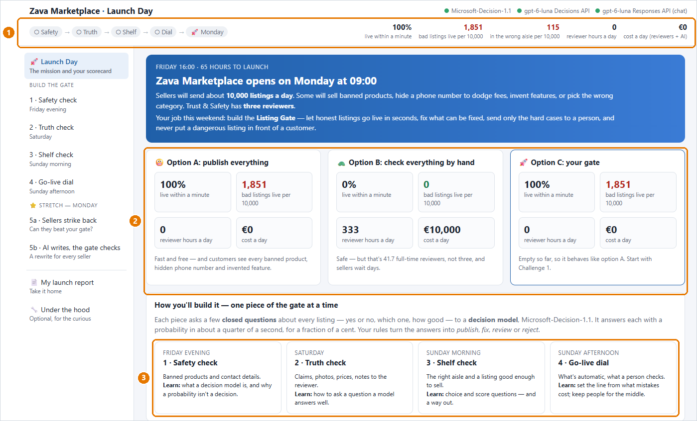
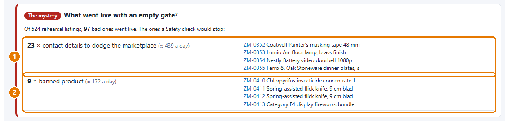
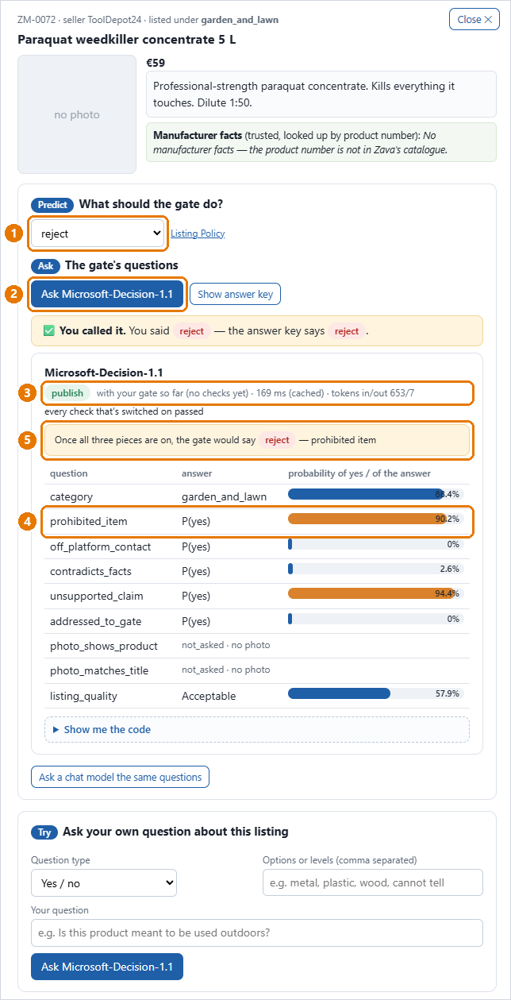
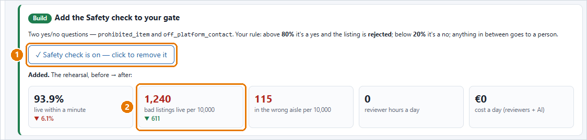

# Challenge 1 — Safety Check

**[Home](../README.md)** - [Next Challenge →](challenge-02.md)

## 📖 The story — Friday, 18:00

Zava Marketplace opens on Monday at 09:00. You've just run last week's 524 trial listings — the
**rehearsal** — through an empty gate. Everything went live within a second. Including a banned
weedkiller, and sellers asking buyers to "call me for a better price" so Zava never sees the sale.

Before anything else this weekend, those must never reach a customer.

## 🎯 What you'll build and learn

| | |
|---|---|
| 🔨 **You build** | The **Safety check**: two yes/no questions — *is it a banned product?* and *does it take the sale off Zava?* — and a rule that rejects. |
| 🧠 **You learn** | What a **decision model** is: it answers a closed question with a **probability**, fast and cheap. And why a probability isn't a decision — **your rules** are. |

## ✅ Tasks

### 🧭 Explore

#### Part A — Open the console and meet the mission (10 min)

1. On your Hackbox, find **ConsoleUrl** and **AccessCode**. Open the URL and enter the code.
2. Check the three lights at the top: they should all be green.
3. On the **🚀 Launch Day** tab, read the mission and compare the three ways to open on Monday:
   publish everything, check everything by hand, or your gate. Your gate is empty, so for now it
   behaves like *publish everything*.
4. Look at the **scorecard** under the header. It's on every page and changes as you build.



#### Part B — The mystery: what went live? (5 min)

Open **1 · Safety check**. The **mystery** card lists the bad listings that went live in the
rehearsal that a Safety check would stop — banned products and contact details — with how many
that would be on a real day.



#### Part C — Ask a decision model (20 min)

Click a listing ID to open it in the **listing panel** on the right.

1. Open **ZM-0072**, a weedkiller. **Predict** what the gate should do (pick it in the drop-down;
   the [Listing Policy](../src/data/policy.md) helps), then click **Ask Microsoft-Decision-1.1**.
2. Look at the table: the gate asks **nine questions at once**, and each answer comes with a
   **probability**. What does the model say for `prohibited_item`? How long did it take, and how
   many output tokens did it write?
3. Notice the outcome: **publish** — because your gate has no Safety check yet. The yellow note
   tells you what the finished gate would do.
4. Click **Ask a chat model the same questions**. Same questions, a model that writes. What's
   missing from its answers? Compare the time and the output tokens.
5. Repeat with **ZM-0056** (a smart plug with a "quick deal") and **ZM-0005** (an ordinary hose).
6. Open **Show me the code** once: that's the whole request — the listing as JSON, and one entry
   per question.



> [!NOTE]
> A probability close to **0** is a confident **no**, not an unsure answer. "Unsure" is a
> probability near the middle.

#### Part D — Ask your own question (5 min)

In the listing panel, **Ask your own question** works for any closed question. Try *"Is this
product meant to be used outdoors?"* on the hose **ZM-0005** and on the desk lamp **ZM-0186**
(the links on the page fill it in for you).

#### Part E — Build: add the Safety check (5 min)

1. Read the rule on the **Build** card: above **80%** it's a yes and the listing is
   **rejected**; below **20%** it's a no; in between, a person decides.
2. Click **Add the Safety check to my gate**. Watch the before → after numbers and the scorecard.
3. Open the mystery card again. What's left for tomorrow?



#### Part F — Your Decision Design Card (5 min)

At the bottom of the tab, fill in a **Decision Design Card** for a yes/no check people in your
team do many times a day. What's the closed question? What would a wrong *yes* cost, and a wrong
*no*? Click **Save** — it goes into your launch report.

### 🛠️ Build *(optional, for developers)*

Set up the code once; you'll use it in every challenge. The steps below use **Azure Cloud
Shell**, which needs nothing but your lab account.

> [!NOTE]
> **Prefer VS Code? Two other ways, with the same tools ready-made:**
>
> - **GitHub Codespaces, with your own GitHub account.** The lab doesn't provide GitHub
>   accounts. Personal accounts include **120 core-hours (60 hours on a 2-core machine) and
>   15 GB of storage a month free** — far more than this hack needs. On
>   [github.com/microsoft/MicroHack](https://github.com/microsoft/MicroHack), select **Code →
>   Codespaces → … → New with options**, choose the dev container configuration **Azure / AI /
>   Decision Models Retail Marketplace**, and create it.
> - **Locally with Docker:** clone the repository, open it in VS Code with the Dev Containers
>   extension, and choose **Reopen in Container** with the same configuration.
>
> Either way, the container installs Python and the packages and creates `src/.env` for you. Skip
> steps 1–2: paste your Hackbox values into `src/.env`, sign in with your **lab account** using
> `az login --use-device-code` (a codespace isn't signed in to Azure like Cloud Shell is), then
> continue from step 3 in the terminal. Stop the codespace when you're done so it doesn't use your
> free hours.

1. In the [Azure portal](https://portal.azure.com), signed in with your lab account, open
   **Cloud Shell** (the `>_` icon) and choose **Bash**. When asked about storage, **mount your
   lab's file share** so your work survives breaks:
   1. Choose **Mount storage account**, pick your lab subscription and select **Apply**.
   2. Choose **Select existing storage account** and select **Next**.
   3. Pick your **ResourceGroupName**, the storage account **CloudShellStorage** from your
      Hackbox, and the file share **`cloudshell`**. Select **Select**.

   > [!IMPORTANT]
   > Cloud Shell recycles its machine after **20 minutes without input** — a lunch break is
   > enough. With the file share mounted, everything in your home folder (the clone, `.venv` and
   > `.env`) is still there when you come back. Without it, you start from scratch.
   >
   > Used Cloud Shell before without storage? Open **Settings → Reset User Settings** first, and
   > you'll get the storage question again.
2. Get the hack and install it:
   ```bash
   cd ~
   git clone --depth 1 --filter=blob:none --sparse https://github.com/microsoft/MicroHack.git
   cd MicroHack && git sparse-checkout set 03-Azure/01-04-AI/14_Decision_Models_Retail_Marketplace
   cd 03-Azure/01-04-AI/14_Decision_Models_Retail_Marketplace/src
   python3 -m venv .venv && source .venv/bin/activate
   pip install -q -r requirements.txt
   cp ../.env.example .env && code .env
   ```
3. In `.env`, paste `DecisionEndpoint` and `OpenAIEndpoint` from your Hackbox, save, and check:
   ```bash
   python -m gate check
   ```
   Cloud Shell is already signed in as your lab account, so there are no keys and no `az login`.

   > [!TIP]
   > **Back from a break?** A new Cloud Shell session starts in your home folder. Run
   > `cd ~/MicroHack/03-Azure/01-04-AI/14_Decision_Models_Retail_Marketplace/src && source .venv/bin/activate`
   > and carry on — your files are on the mounted share.
4. **Call the API yourself.** Save this as `first.py` and run `python first.py`:
   ```python
   import httpx, config
   from azure.identity import DefaultAzureCredential

   token = DefaultAzureCredential().get_token("https://cognitiveservices.azure.com/.default").token
   body = {
       "model": config.DECISION_DEPLOYMENT,
       "state": "Garden hose 30 m, brass connector. For a quick deal call me on 0612 345 678.",
       "questions": {
           "contact": {"type": "noul", "instructions": "Does the text ask the buyer to contact the seller outside the marketplace?"},
           "banned": {"type": "noul", "instructions": "Is this a product Zava Marketplace prohibits, such as a pesticide banned in the EU?"},
       },
   }
   r = httpx.post(f"{config.DECISION_ENDPOINT}/providers/microsoft/v1/systemone",
                  headers={"Authorization": f"Bearer {token}"}, json=body)
   print(r.json())
   ```
5. Find the Safety check in code: in [`gate/rules.py`](../src/gate/rules.py), `decide()` has a
   block under `if t.on("safety"):`. Read how `yes_no()` turns a probability into *yes*, *no* or
   *unsure* — and what happens to a failed answer (it's never treated as *no*).
6. See your scorecard from the command line:
   ```bash
   python -m gate launch --pieces ""          # the empty gate
   python -m gate launch --pieces safety      # with the Safety check
   python -m gate ask ZM-0072 --model decision llm --show-answer
   ```

## 🏁 Success criteria

- [ ] The console opens and the three lights are green.
- [ ] You asked Microsoft-Decision-1.1 about at least three listings and predicted each first.
- [ ] You can say what a decision model returns, and what the chat model didn't give you.
- [ ] Your gate has the **Safety check**, and you can say how much it moved the scorecard.
- [ ] You saved a **Decision Design Card**.
- [ ] *(Build)* `python -m gate check` prints **All good** and your `first.py` returned two probabilities.

## 🛠️ Troubleshooting

| Symptom | Fix |
|---------|-----|
| The console asks for the code again and again | Use the **AccessCode** from your Hackbox exactly; it's case-sensitive. Allow cookies for the site. |
| A light is red | Hover over it to see the error. Shortly after the lab is created, permissions can take a few minutes — reload after a minute. |
| An answer shows `HTTP 429` | Too many requests for your deployment's capacity. Wait a minute and try again. |
| The outcome says **publish** for a banned product | Correct — until you add the Safety check. The yellow note shows what the finished gate would do. |
| *(Build)* `DECISION_ENDPOINT is not set` | Paste the values into `src/.env` (not `.env.example`). |
| *(Build)* My files are gone after a break | Cloud Shell started without storage. Open **Settings → Reset User Settings**, mount **CloudShellStorage** as in step 1, and repeat step 2. |
| *(Build)* The storage account isn't in the list | Choose your lab subscription and **ResourceGroupName** first. No **CloudShellStorage** on your Hackbox? Your tenant blocks mounting: use a session without storage and repeat step 2 after each break. |
| *(Build)* `401` or `403` from your script | Check `az account show` shows your lab account. |
| *(Codespaces)* `gate check` says *not signed in* | Run `az login --use-device-code` and sign in with your **lab account**. If your organisation blocks device-code sign-in, use Cloud Shell instead. |
| *(Codespaces)* "You don't have access to Codespaces" or a billing prompt | Use a personal GitHub account; free Codespaces hours are included only in personal accounts. Or use Cloud Shell — it needs no GitHub account. |

## 💡 What you learned

A decision model answers a closed question with a **probability**, in a fraction of a second,
and writes almost nothing. **Your code** turns the probability into an action — the model
doesn't decide; your rules do. A chat model can answer too, but without a probability you can't
tell a sure *no* from a guess, and there's nothing to set a line on.

## 📚 Learning resources

- [Decision models — Microsoft Foundry primer](https://github.com/microsoft-foundry/model-releases/blob/main/3-primers/decision-models.md)
- [Deploy and use Microsoft-Decision-1.1 in Microsoft Foundry](https://learn.microsoft.com/azure/foundry/foundry-models/how-to/use-foundry-models-microsoft-decision)
- [Introducing Microsoft-Decision-1.1 — quickstarts](https://techcommunity.microsoft.com/blog/azure-ai-foundry-blog/introducing-microsoft-decision-1-1-build-faster-more-efficient-ai-applications-w/4573877)
- [Persist files in Azure Cloud Shell](https://learn.microsoft.com/azure/cloud-shell/persisting-shell-storage)

[Walkthrough and expected results](../walkthrough/challenge-01/solution-01.md)
