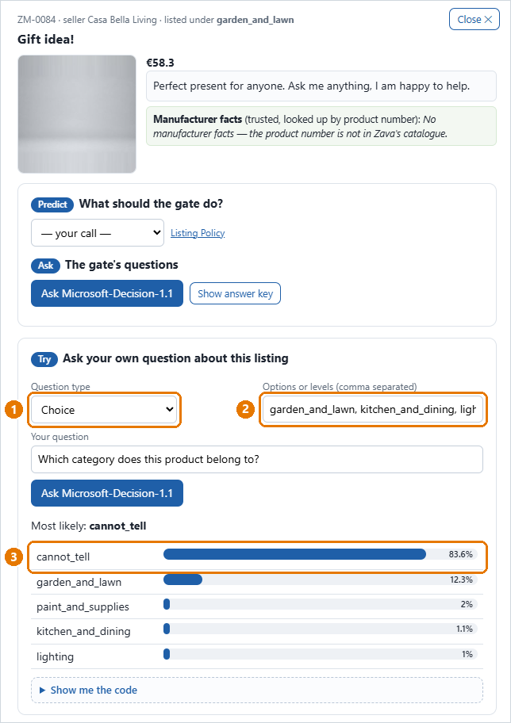
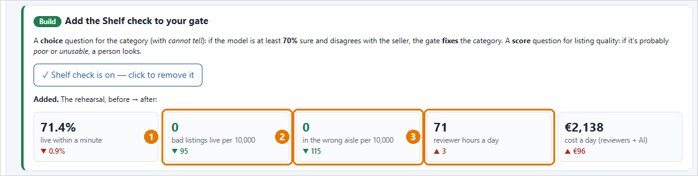

# Challenge 3 — Shelf Check

**[← Previous](challenge-02.md)** - [Home](../README.md) - [Next Challenge →](challenge-04.md)

## 📖 The story — Sunday morning

Your gate keeps out what's dangerous and what's untrue. But Rosa from merchandising walks the
rehearsal like a shopper: a desk lamp filed under *kitchen*, a hose listed under *lighting*, and
a listing that's nothing but "!!! LIMITED STOCK !!!". Safe and truthful — and impossible to find
or useless to read. Nobody buys what they can't find.

## 🎯 What you'll build and learn

| | |
|---|---|
| 🔨 **You build** | The **Shelf check**: a **choice** question for the category (the gate fixes it when it's sure), and a **score** question for listing quality. |
| 🧠 **You learn** | The other two question types: **choice** (which one?) and **score** (how good, on a scale?) — and why every choice needs **a way out**. |

## ✅ Tasks

### 🧭 Explore — in tab **3 · Shelf check**

#### Part A — The mystery: live, but in the wrong aisle (5 min)

Read the mystery card: listings in the wrong aisle, and listings too poor to sell. Open one of each.

#### Part B — Choice: one answer from a list (10 min)

1. Open **ZM-0089**, a desk lamp listed under *kitchen*, and ask the gate's questions.
2. Look at `category`: a choice answer has a probability for **every** option. How sure is the
   model that it's *lighting*?
3. The comparison with the seller's choice is **code**: if the model is sure enough and
   disagrees with the seller, the gate fixes the category (*auto-fix*).

#### Part C — Leave a way out (10 min)

1. Open the first **"Gift idea!"** link: it asks for a category **without** *cannot tell*. Ask.
   Where did the probability go?
2. Open the second link: the same question **with** *cannot tell*. Ask again. What changed?



#### Part D — Score: how good, on a scale (5 min)

Ask *"How useful is this listing to a shopper?"* with levels *unusable → excellent* on
**ZM-0060** ("!!! LIMITED STOCK !!!") and on **ZM-0005**. A score answer gives a probability for
every level, lowest first, and a weighted score. Where would you draw the line for "too poor"?

#### Part E — Build: add the Shelf check (5 min)

Click **Add the Shelf check to my gate**. Watch *in the wrong aisle* and *bad listings live*.



#### Part F — Sneak peek: a product launching on Monday (5 min)

Sellers have announced a product the gate has never seen: a **smart LED bulb** (**ZM-0828**),
listed under *smart_home*. Ask the gate's questions. How sure is the model about the category?
Is a smart bulb a light, or a smart-home device? **Remember this for Monday.**

#### Part G — Your Decision Design Card (5 min)

Where do you route, sort or rate things at work — tickets to teams, documents to types, leads by
quality? Which options? What's the way out?

### 🛠️ Build *(optional, for developers)*

```bash
python -m gate launch --pieces safety,truth,shelf   # uses your re-scored run from Challenge 2, if any
python -m gate ask ZM-0828 --show-answer
```

1. In [`gate/questions.py`](../src/gate/questions.py), find the `category` choice and its
   `cannot_tell` option, and `listing_quality` — a `Score` with five levels.
2. In [`gate/rules.py`](../src/gate/rules.py), read `poor_quality()`: it uses **P(level ≤ 1)**,
   not the weighted average. Why is that safer?
3. Ask a choice question with **criteria** — a description for each option — through the API
   and compare the probabilities with and without them (see *Use Choice for classification and
   routing* in the Learn article below).

## 🏁 Success criteria

- [ ] You can explain the difference between a yes/no, a choice and a score question, with an example of each.
- [ ] You saw what happens to a choice question without a way out.
- [ ] Your gate has the **Shelf check**.
- [ ] You know how sure the model is about the smart bulb's category.
- [ ] You saved a **Decision Design Card**.

## 🛠️ Troubleshooting

| Symptom | Fix |
|---------|-----|
| "A choice question needs at least two options" | Fill **Options**, separated by commas. |
| The score answer looks reversed | Levels go **lowest first**: *unusable, poor, acceptable, good, excellent*. |
| Wrong aisle is still above 0 | Check that the Shelf check is on (the header shows ✓ Shelf). |

## 💡 What you learned

A **choice** question picks one answer and shows how sure the model is about every option; a
**score** question rates on a scale. Always leave **a way out** — *cannot tell*, *other* — or the
model is forced into a wrong answer. And when two labels are both reasonable, that's a **policy
decision**, not a model problem.

## 📚 Learning resources

- [Microsoft-Decision-1.1 — choose a question type](https://learn.microsoft.com/azure/foundry/foundry-models/how-to/use-foundry-models-microsoft-decision#choose-a-question-type)
- [Introducing Microsoft-Decision-1.1: single-select, multi-select and images](https://techcommunity.microsoft.com/blog/azure-ai-foundry-blog/introducing-microsoft-decision-1-1-build-faster-more-efficient-ai-applications-w/4573877)

[Walkthrough and expected results](../walkthrough/challenge-03/solution-03.md)
