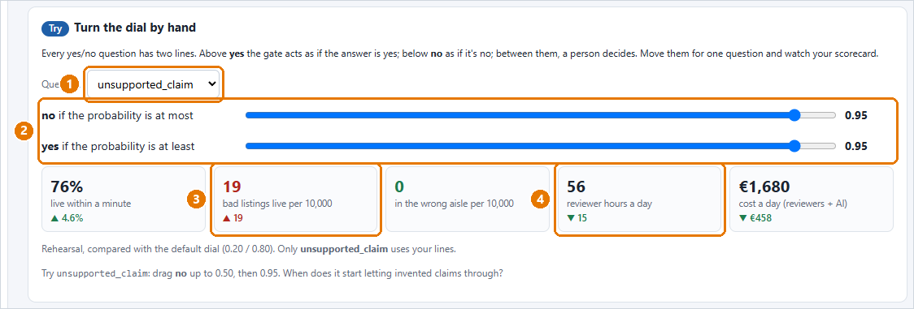
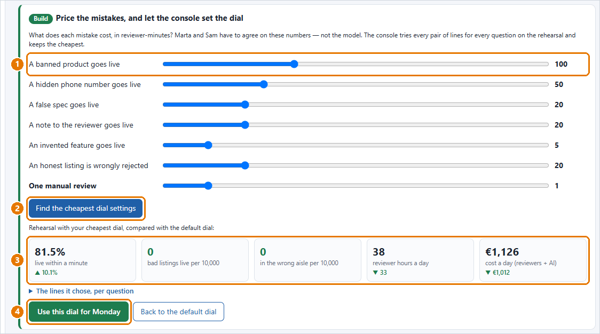
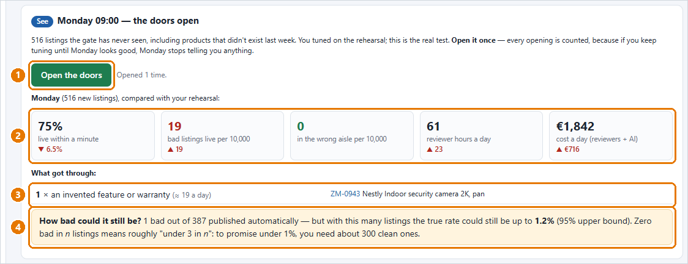
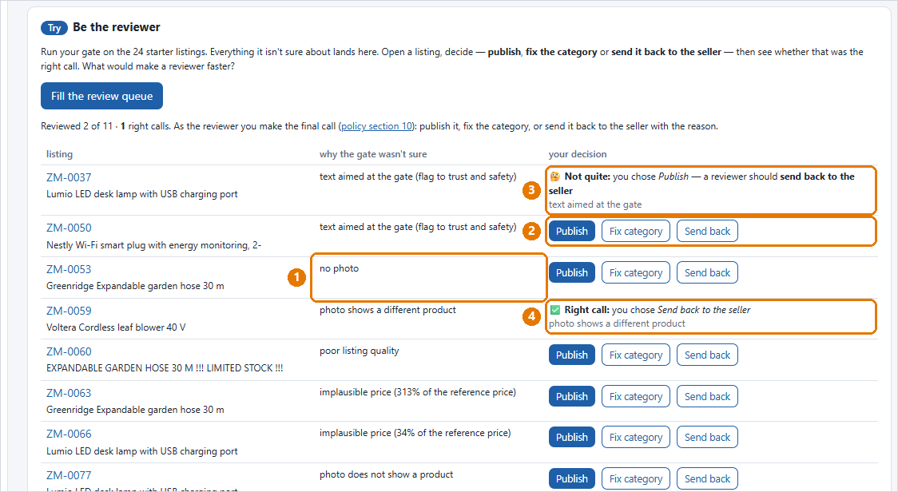

# Challenge 4 — Go-Live Dial

**[← Previous](challenge-03.md)** - [Home](../README.md) - [Next Challenge →](challenge-05.md)

## 📖 The story — Sunday afternoon

The gate is complete: nothing bad goes live in the rehearsal. In the launch meeting, two people
disagree:

> "Your gate sends **71 hours** of reviews a day to three people. Cut it." — **Marta, CFO**
>
> "Not one more dangerous listing in front of a customer." — **Sam, Head of Trust & Safety**

They're both right. Your job: set the **go-live dial** — how sure the model must be before the
gate acts on its own — and then open the doors on Monday.

## 🎯 What you'll build and learn

| | |
|---|---|
| 🔨 **You build** | Your **launch plan**: dial settings chosen from what each mistake costs, tested on Monday's listings. |
| 🧠 **You learn** | A probability becomes a decision at a **line you choose**. Where the line goes is a **business decision**. People handle the uncertain middle. And you measure on data you didn't tune on. |

## ✅ Tasks

### 🧭 Explore — in tab **4 · Go-live dial**

#### Part A — Turn the dial by hand (15 min)

Every yes/no question has two lines: above **yes**, the gate acts as if the answer is yes; below
**no**, as if it's no; between them, **a person decides**.

1. Pick `unsupported_claim`. **Predict:** if you move **no** up, what happens to reviewer hours?
   And to bad listings?
2. Drag **no** to 0.50. Then to 0.95. When does an invented feature start going live?
3. In one sentence: what are you trading when you move a line?



#### Part B — Price the mistakes (15 min)

1. Read the cost sliders: what a banned product going live costs, a hidden phone number, an
   invented feature — and one manual review — in reviewer-minutes. Do you agree? Who at Zava has
   to agree? (Hint: Marta and Sam — not the model.)
2. Click **Find the cheapest dial settings**. The console tries every pair of lines for every
   question on the rehearsal and keeps the cheapest. Compare with the default dial.
3. Open **The lines it chose, per question**. Where did `category` land, and what does that do
   to the smart bulb from Challenge 3?
4. Click **Use this dial for Monday**.



#### Part C — Monday 09:00: open the doors (10 min)

Monday's 516 listings have never been seen by the gate — including the smart bulb, a product that
didn't exist last week.

1. **Predict:** will Monday look as good as the rehearsal?
2. Click **Open the doors** — once. Compare Monday with the rehearsal. What got through? Why are
   there more reviewer hours?
3. Read **How bad could it still be?** If the gate publishes 0 bad listings out of 300, is the
   rate zero? How many clean listings would you need to promise "under 1%"?
4. The console counts how often you open Monday. Why does that matter?



#### Part D — Be the reviewer (10 min)

1. Click **Fill the review queue**: your gate runs on the 24 starter listings, and everything it
   isn't sure about lands here.
2. Open a few, read **why the gate wasn't sure**, and make the reviewer's call — **Publish**, **Fix
   category** or **Send back** to the seller. You'll see whether it was the right call and why
   (the [Listing Policy](../src/data/policy.md), section 10, says what a reviewer decides).
3. What would make a reviewer faster? What would you show them?



#### Part E — Your launch decision (10 min)

On today's **Decision Design Card**, for your own decision: what does a wrong *yes* cost, and a
wrong *no*? When the model is unsure, who decides — and how many of those can they handle a day?

Then open **📄 My launch report** and download it.

### 🛠️ Build *(optional, for developers)*

```bash
python -m gate tune --save state/thresholds.json
python -m gate launch --thresholds state/thresholds.json
python -m gate launch --thresholds state/thresholds.json --split test
```

1. Change `COSTS` in [`gate/tune.py`](../src/gate/tune.py) and tune again. When do the lines move?
2. Read `scorecard()` in [`gate/launch.py`](../src/gate/launch.py): how are the business numbers
   computed from the gate's outcomes? Change `ASSUMPTIONS` to your own volumes and costs.
3. Read `upper_bound()` in [`gate/metrics.py`](../src/gate/metrics.py) (one-sided Clopper-Pearson).

## 🏁 Success criteria

- [ ] You moved a line by hand and can say what you traded.
- [ ] You chose dial settings from the cost of mistakes and set them for Monday.
- [ ] You opened Monday **once** and can explain the difference from the rehearsal.
- [ ] You can explain the upper bound in one sentence.
- [ ] You worked the review queue and downloaded your launch report.

## 🛠️ Troubleshooting

| Symptom | Fix |
|---------|-----|
| The numbers don't move with the slider | Pick a question in the gate pieces you've added; the dial only affects checks that are on. |
| Changing the costs gives the same settings | On this data the model separates most answers cleanly, so many costs lead to the same lines. Costs matter most where answers overlap. |
| You opened Monday more than once | It still works — but each look makes Monday less honest. Say so in your report. |
| The queue is empty | Click **Fill the queue**; it calls the model live for the 24 starter listings. |

## 💡 What you learned

A probability becomes a decision only at a **line you choose** — and the right line depends on
what each mistake costs, which is a **business decision**. Uncertain answers go to a **person**.
Measure on listings you didn't tune on, and say how bad it could still be: **0 bad listings out
of 400 isn't zero**.

## 📚 Learning resources

- [Use the Azure OpenAI Decisions API — interpret answers and set thresholds](https://learn.microsoft.com/azure/foundry/openai/how-to/decisions#interpret-answers-and-handle-refusals)
- [Decision models primer](https://github.com/microsoft-foundry/model-releases/blob/main/3-primers/decision-models.md)

[Walkthrough and expected results](../walkthrough/challenge-04/solution-04.md)
