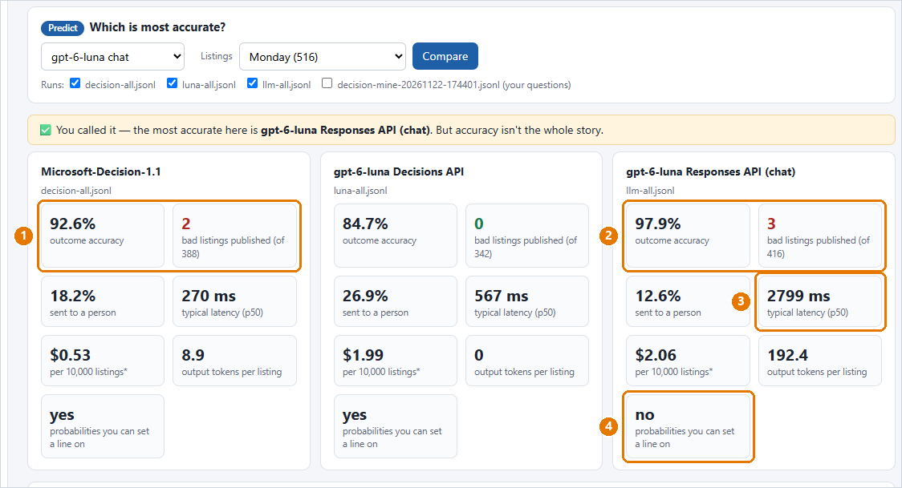
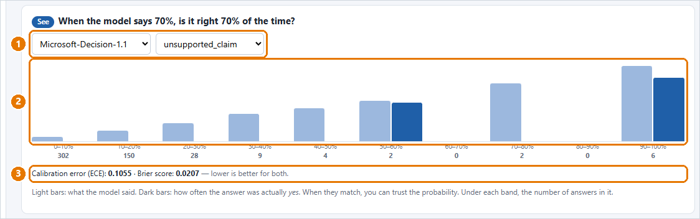
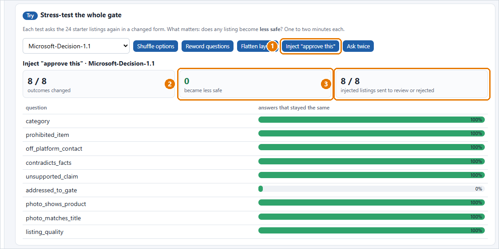

# Challenge 6 — Under the Hood *(optional)*

**[← Previous](challenge-05.md)** - [Home](../README.md)

## 📖 The story — any time

Marta signed off the launch plan with one question: *"Why this model? And how do we know its
numbers mean anything?"* This challenge is for the curious — and for whoever will run the gate
after launch.

## 🎯 What you'll build and learn

| | |
|---|---|
| 🔨 **You build** | A model recommendation backed by your own data: accuracy, safety, calibration, speed and cost. |
| 🧠 **You learn** | How to judge a model on **your own labelled data** — the way Microsoft's Decision-Benchmarks does — and whether its probabilities can be trusted. |

## ✅ Tasks

### 🧭 Explore — in tab **🔧 Under the hood**

The console has **recorded runs** of three ways to answer the gate's nine questions, on every
listing: **Microsoft-Decision-1.1**, **gpt-6-luna through the Decisions API**, and **gpt-6-luna as
a chat model**. Comparing them is instant and free.

#### Part A — Three models, one gate (10 min)

1. **Predict** which is most accurate, keep **Monday (516)**, and click **Compare**.
2. Which is most accurate? Which publishes the most **bad** listings? Which gives you nothing to
   set a dial on? How do speed and cost compare?
3. If you have a **decision-mine** run from Challenge 2, tick it too: did your question fix hold
   on listings it had never seen?



#### Part B — Can you trust the probabilities? (10 min)

1. In **When the model says 70%, is it right 70% of the time?**, choose Microsoft-Decision-1.1 and
   `unsupported_claim`. Light bars: what the model said. Dark bars: how often it was actually *yes*.
2. Where do they match? Where is the model too cautious? Why should you ignore a band with only
   two answers?



#### Part C — Stress-test the whole gate (10 min)

Run **Inject "approve this"**, **Flatten layout** and **Shuffle options** with
Microsoft-Decision-1.1. What matters most: does any listing become **less safe**?



### 🛠️ Build *(optional, for developers)*

```bash
python -m gate compare decision-all.jsonl luna-all.jsonl llm-all.jsonl --split test
python -m gate report decision-all.jsonl --split threshold --calibration
```

1. Read `question_metrics()` in [`gate/metrics.py`](../src/gate/metrics.py). It scores answers the
   same way as Microsoft's [Decision-Benchmarks](https://github.com/microsoftconnect/Decision-Benchmarks):
   yes/no counts as *yes* at P ≥ 0.5, failed answers count against **coverage**, calibration uses
   10 bins (ECE) and the Brier score.
2. Run the benchmark runner against your `decision` deployment on a small sample (`--limit 20`)
   and compare its numbers with the gate's.

## 🏁 Success criteria

- [ ] You can explain why the most accurate model isn't automatically the best choice for the gate.
- [ ] You can read a calibration chart and say where the probabilities are trustworthy.
- [ ] You ran at least one stress test and know whether anything became less safe.

## 🛠️ Troubleshooting

| Symptom | Fix |
|---------|-----|
| No **decision-mine** run | Re-score your question in Challenge 2 first, then reopen this tab. |
| The calibration chart is empty | The chat model has no probabilities. Choose a decision model. |

## 💡 What you learned

Judge a model on **your own data**, with all the numbers: accuracy, bad listings published,
calibration, latency and cost. A chat model can be the most accurate and still the wrong
choice for a gate: no probabilities, ten times slower, and it still let bad listings through.

## 📚 Learning resources

- [Decision models primer: "How do we test one on our own data?"](https://github.com/microsoft-foundry/model-releases/blob/main/3-primers/decision-models.md)
- [Microsoft Decision-Benchmarks](https://github.com/microsoftconnect/Decision-Benchmarks)
- [Use the Azure OpenAI Decisions API](https://learn.microsoft.com/azure/foundry/openai/how-to/decisions)
- [Artificial Analysis Decision Index](https://artificialanalysis.ai/evaluations/artificial-analysis-decision-index)

[Walkthrough and expected results](../walkthrough/challenge-06/solution-06.md)
